# 炎龍騎士團 2 反向工程與重製

## 引言

本專案以合法原版《炎龍騎士團 2：黃金城傳說》作為行為基準，保存它在 DOS
年代的資料格式、介面、音訊與遊戲機制，並以 Go／Ebiten 建立可編輯、可擴充的
潔淨室重製引擎。

我們要做的是重現經典，而不是把玩家困在永無止境的考古工作裡。原版戰役仍是
忠實模式的基準；對話、事件、戰鬥、城鎮、商店、教會、整備、隊伍與存檔則逐步
脫離寫死程式，成為日後能延伸新戰役的資料與規則。

原版程式及美術、文字、音樂等受著作權保護的資產不包含在本倉庫中。玩家必須
自備合法原版；本專案不代表原開發商或權利人。

## 正式第一版下載

[v.1.0.0-20261017](https://github.com/wicanr2/fd2_re/releases/tag/v.1.0.0-20261017) 提供 macOS 通用版 ZIP、Windows x86_64 ZIP 與 Linux x86_64 AppImage，附版本、來源提交、SHA-256 與原生封包自檢紀錄。

公開包只含引擎與可散布資料，遊玩需自備完整合法分離素材。現有單一匯入工具尚不能產生完整可玩包；素材契約與工具範圍見[分離素材規格](docs/knowledge-base/60-editor-separated-assets-spec.md)。30章受控流程與保存例外見[驗收進度](docs/REMAKE-STATUS.md)。HD仍未完成，Windows／macOS未簽署，macOS尚未公證。

開發版可點上方工具列切換忠實原版與現代手繪主題，也保留 F2。工具列支援四語系，位於遊戲畫面外。戰場檢視角色使用 Home，F2 只切換主題。具備合法的完整 HD 素材包時，故事頭像以
480×480 圖源直接繪製，遊戲區域為1920×1200，包含工具列的預設視窗為1920×1272。故事對話、商店文字與數字、旅館／教會、角色／物品狀態、整備與標題讀檔的穩定畫面採用直接高解析繪製的 Noto Sans CJK 黑體；忠實像素模式保留。整備問句的開收動畫也已接入高解析文字。商店金幣的扣款／入款滾動也直接繪字，出售確認會同步清除被覆蓋的歡迎詞。角色／物品面板的開收與命令滑動，也會同步移動及裁切高解析文字。[戰場角色狀態](docs/figures/hd-battlefield-status.png)只覆蓋面板區域，保留框外現代地圖。戰場人物已接入144×144圖源，沿原生312×192窗格與相同視圖繪製，保留F2與正常走行／指令環。經驗／升級下框的開收動畫也保留HD人物，已用明示章前EXP校準槽驗證正常操作、F2與保存冷讀。其餘固定面板、戰鬥過場與完整地形仍待HD化。兩種主題均已驗證首章 JSON 的標題 LOAD 與 F9。
第一章房屋、褐頂物件、尖頂與圓頂綠色物件，以及部分褐色成組物件，已採用真正手繪的144×144圖塊，房屋屋簷也會遮住後方人物。正常移鏡頭、F2及保存冷讀已抽驗；草地與其他地形仍保留原版素材。
蓋亞的故事頭像與四方向戰場小人已依原版壯碩機兵重新設計，採用灰綠厚甲與藍色結構。大型戰鬥的待機與拳擊也已接入HD圖組，驗證範圍見下方戰鬥畫面與現代主題規格。
素材要求及驗證範圍見[現代主題規格](docs/knowledge-base/61-modern-theme-runtime-spec.md)。此功能尚未加入上述正式第一版。

## 忠實像素模式與多語系

| 繁體中文 | 简体中文 |
|---|---|
| 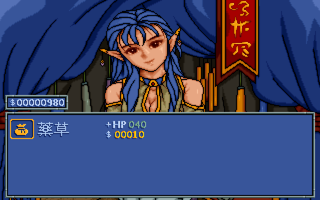 |  |
| English | 日本語 |
| 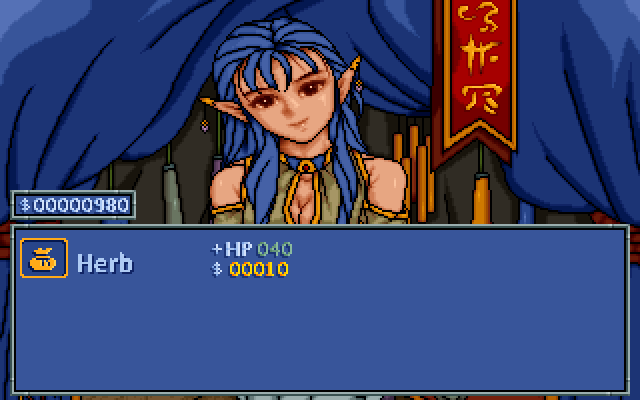 | 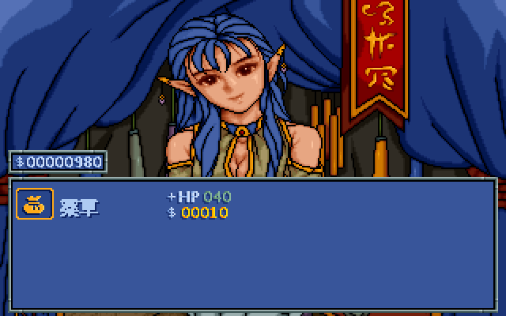 |

以上為重製引擎的實際商店畫面，保留原版像素美術。多語系由重製引擎提供，並非 DOS 原版執行檔新增語言；可按 F4 切換。四張圖使用相同商品與金幣狀態，擷取來源見[截圖紀錄](docs/data/fd2-readme-locales-20261018.json)。

| HD 旅館保存回覆 | HD 教會復活確認 |
| --- | --- |
| 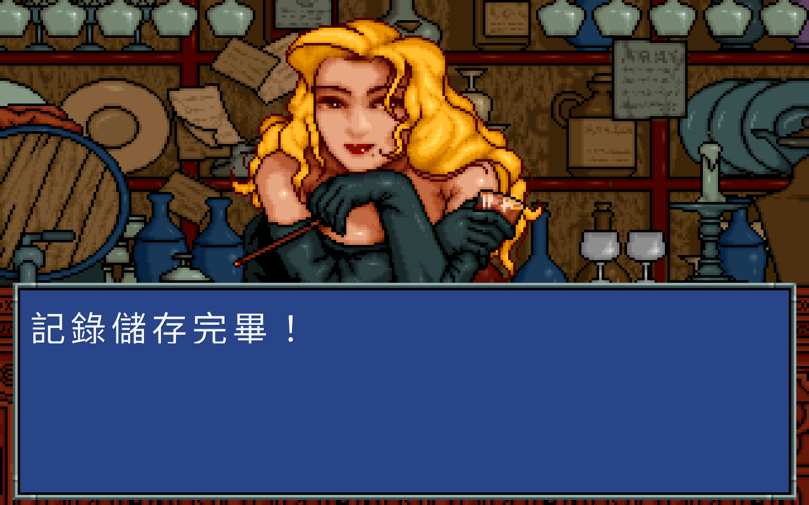 | 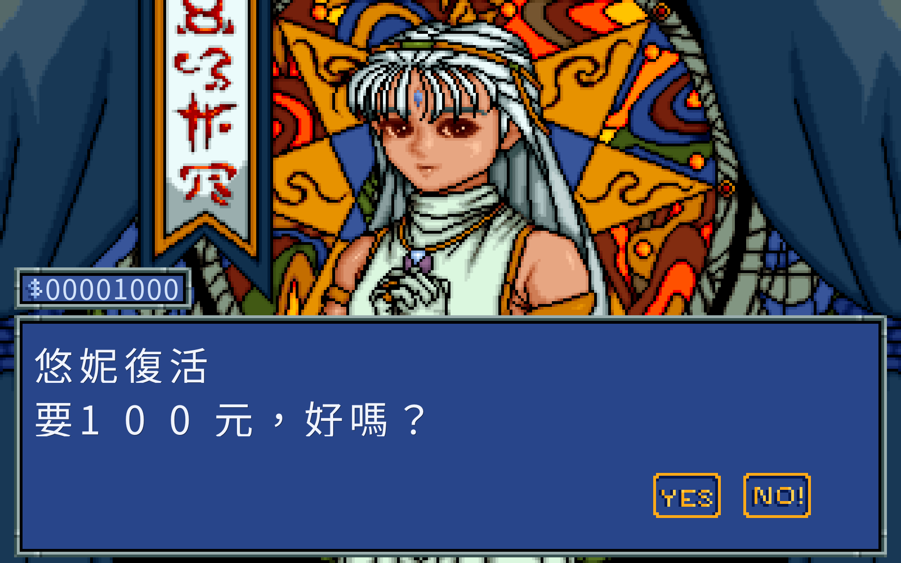 |
| HD 角色狀態 | HD 商店裝備 |
| 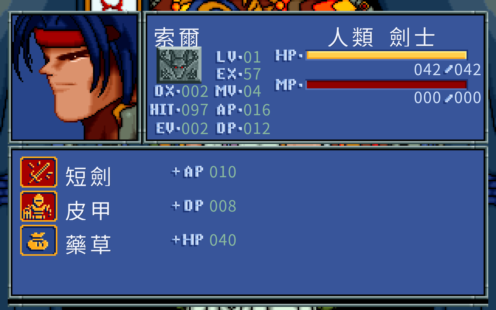 | 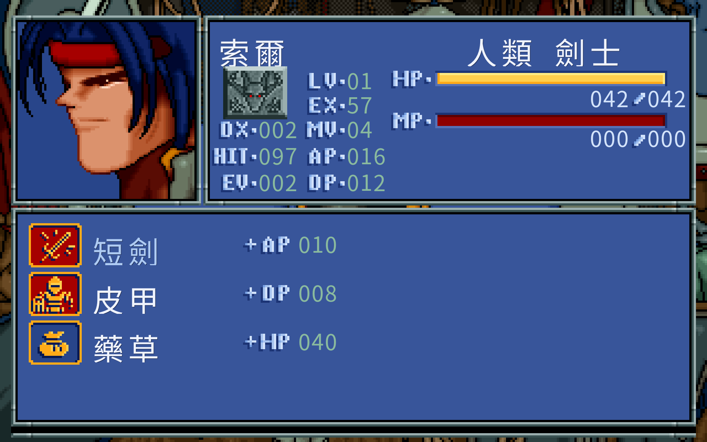 |
| HD 整備選人 | HD 標題讀檔 |
| 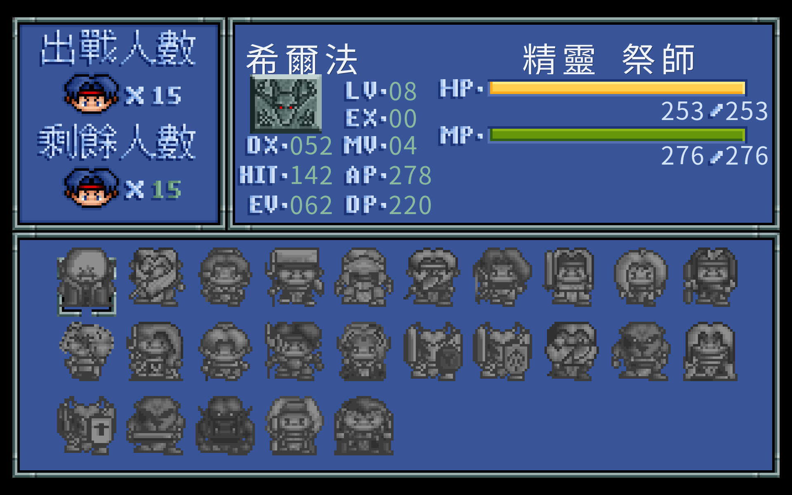 | 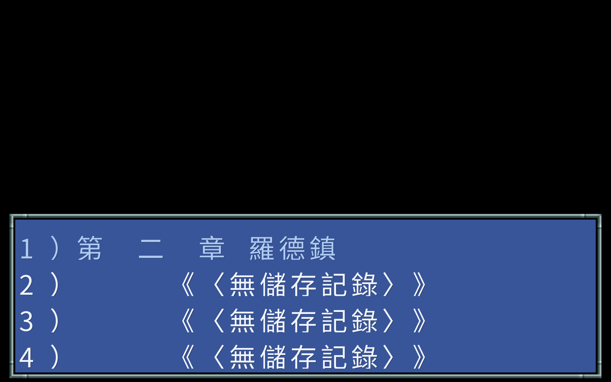 |
| HD 城鎮出發開框 | HD 整備確認收框 |
| 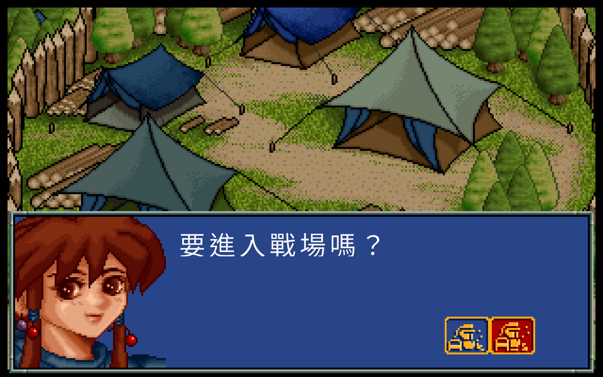 | 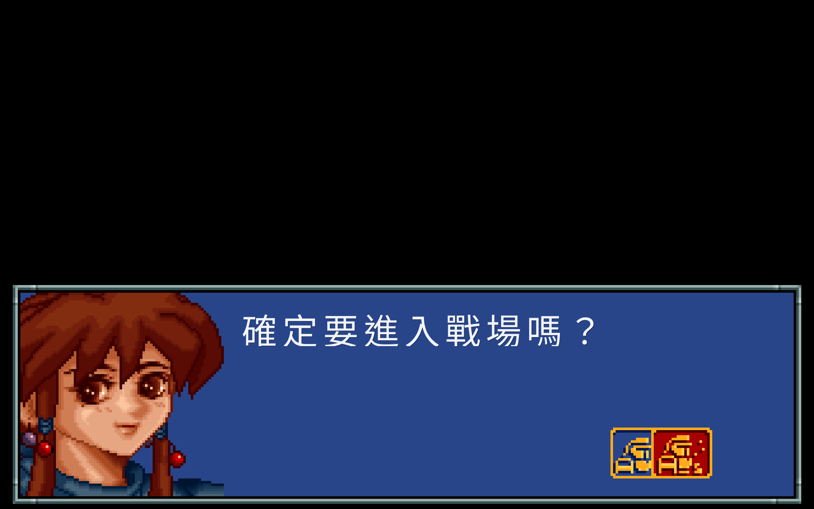 |
| HD 扣款中的數字局部 | HD 商店出售確認 |
|  | 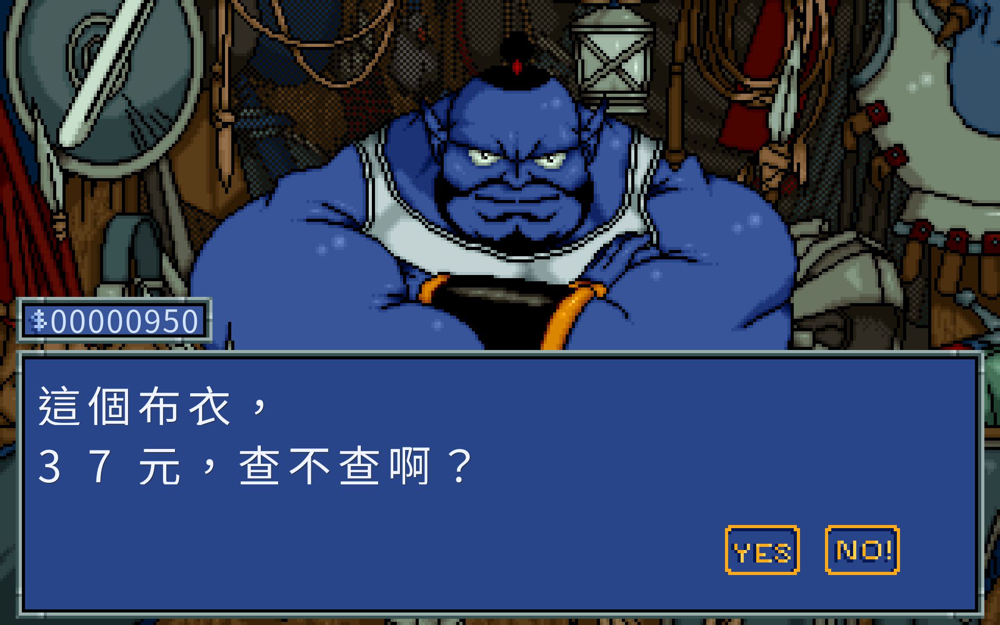 |

以上為開發版的實際遊戲視窗。動態文字與數字直接以高解析繪製，頭像、背景與圖示保留像素素材；操作與保存驗證見[字型收據](docs/data/fd2-modern-hd-fonts-20261018.json)。整備截圖接續具有攻略建構祖先的存檔，不代表自然難度通關。扣款圖是實際視窗的288×54金幣區域，數字仍在滾動。[命令面板轉場局部](docs/figures/hd-status-command-transition-region.png)顯示移動中的HD文字，並非穩定頁。轉場截圖的選項框仍在移動；未列固定畫面、其他轉場與圖示內字樣仍待接入。

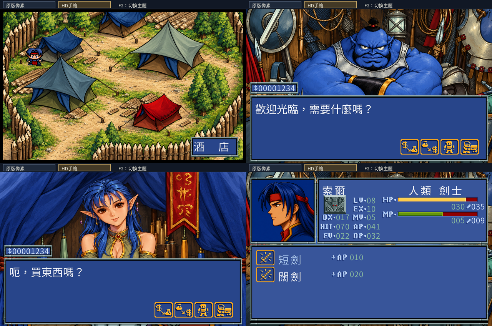

三種城鎮與三種商店已接入手繪HD背景，店員也採HD造型。既有隊伍HD頭像已接到商店裝備面板，隨開窗動畫移動與裁切。上圖是測試場景經正式 Game.Draw 與最終GPU合成的縮圖；選單框、游標及交易效果保留原圖樣。工具列滑鼠／F2／四語切換已驗證，正常玩家與人工造型確認依全部HD完成後集中抽驗。來源與範圍見[現代主題規格](docs/knowledge-base/61-modern-theme-runtime-spec.md)。

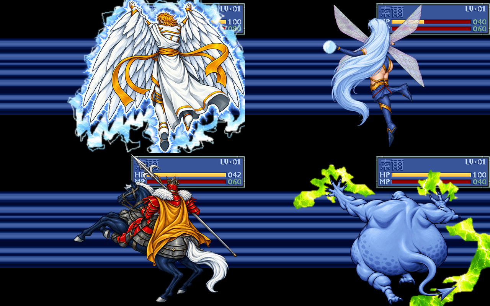

由左上順時針為熾天使、風妖精、暗邪鬼、破壞神，新圖已接入正式繪製層。總覽由修改隊伍與指令資料的建構測試取得，是最終合成器 GPU 回讀的縮圖，尚不代表一般玩家流程驗收。此圖擷取時的施法者、背景與介面仍含像素素材。來源及驗證範圍見[現代主題規格](docs/knowledge-base/61-modern-theme-runtime-spec.md)。

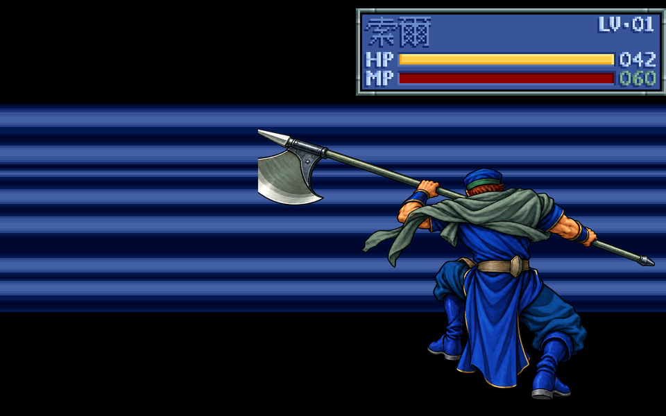

四種召喚的入場、施術動作與退場已接入已登錄的角色HD圖源，保留原有節拍與F2切換。
此圖取自修改class19／BattleFig4測試隊伍的最終GPU，面板仍顯示來源角色名稱；
不代表亞雷斯可在正常流程施放召喚。其他施術者、背景與介面仍待補齊。
驗證範圍見[現代主題規格](docs/knowledge-base/61-modern-theme-runtime-spec.md)。

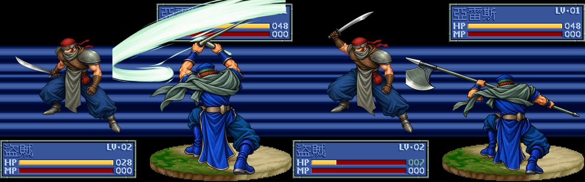

亞雷斯與強盜的待機、攻擊及反擊已使用手繪HD圖源。以上取自首章普通攻防的實際遊戲視窗；
背景與戰鬥面板仍含像素素材。操作、保存冷讀及圖源核對範圍見
[現代主題規格](docs/knowledge-base/61-modern-theme-runtime-spec.md)。

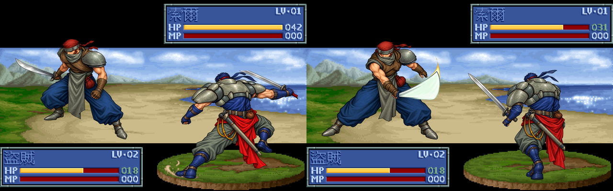

索爾的待機、蓄力、斬擊與收勢也已接入手繪HD圖源。以上是首章正常END接敵後，
索爾收勢與強盜反擊的實際視窗；沒有改寫隊伍、血量或移動力。背景與面板仍含像素素材，
驗證範圍見[現代主題規格](docs/knowledge-base/61-modern-theme-runtime-spec.md)。

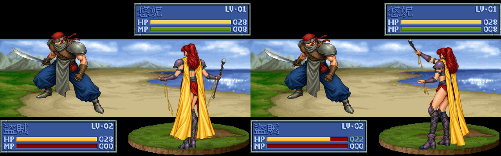

悠妮的待機、抬杖、轉身與收勢已使用手繪HD圖源，保留原版紅髮、紫灰護具與金色披布。
以上取自首章正常選取悠妮攻擊的實際視窗，左為展臂，右為收勢；背景與戰鬥面板仍含像素素材。
操作、圖源與已知裁切範圍見[現代主題規格](docs/knowledge-base/61-modern-theme-runtime-spec.md)。

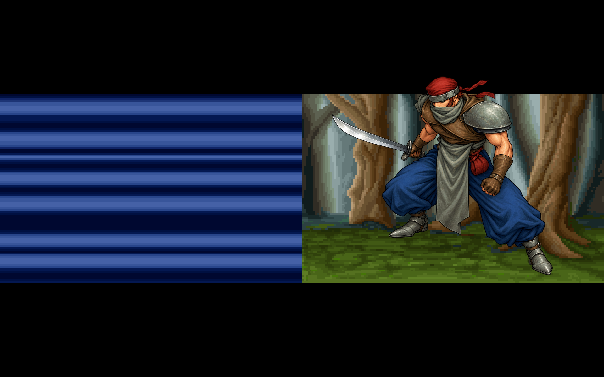

非共背景物理演出已接 HD 人物，包含左右捲動、連射與反擊。以上是修改測試場景的最終 GPU 截圖，
顯示人物捲入途中；背景與介面仍用像素素材。這部分另已抽驗下方希莉亞的正常射擊流程，
範圍見[現代主題規格](docs/knowledge-base/61-modern-theme-runtime-spec.md)。

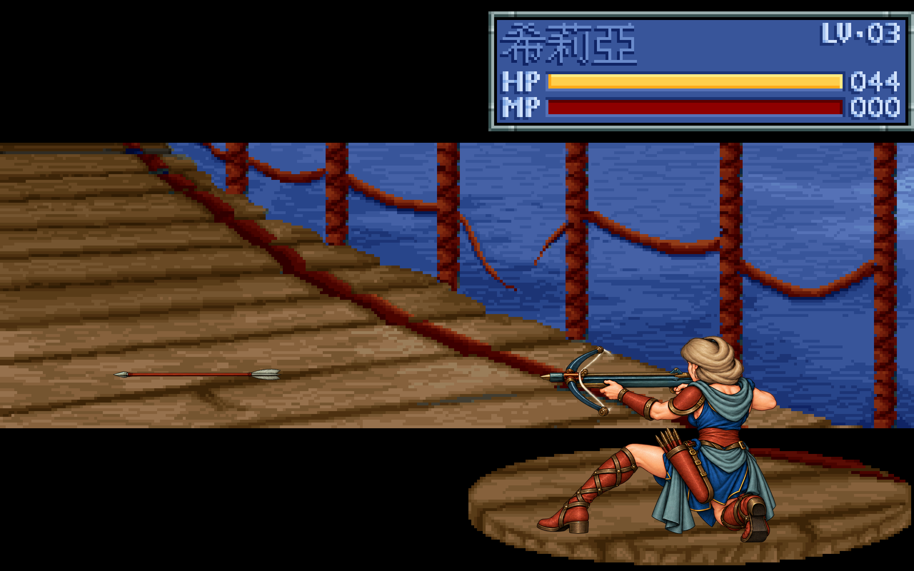

希莉亞的待機、上弦、瞄準、射擊與飛矢，以及敵方劍盾兵，已接入手繪HD圖源。
上圖是第三章普通讀檔、移動待機接敵後的實際射擊畫面。兩次射擊、F2與章節邊界保存冷讀已抽驗；
這份截圖來源的接敵回合使用忠實模式，背景與面板仍為像素素材。來源槽祖先的清敵政策、共享姿勢與驗證範圍見
[現代主題規格](docs/knowledge-base/61-modern-theme-runtime-spec.md)。

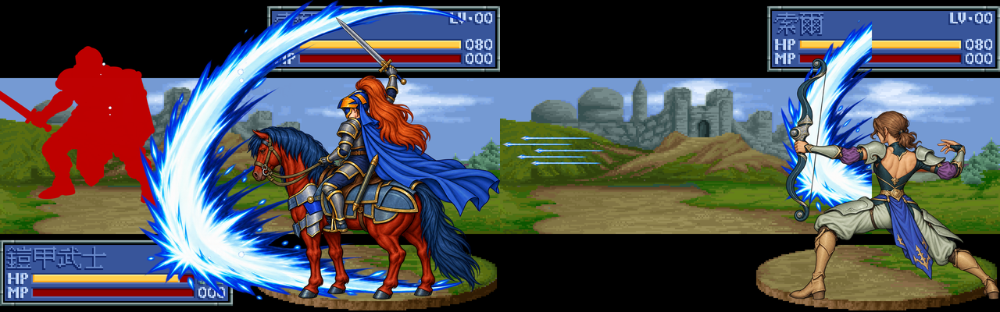

左為騎乘劍士的藍色劍光，右為弓手放箭。圖組也保留原有飛矢與透明停拍。此圖取自明示換用角色圖源的測試場景最終GPU縮圖，面板仍沿用來源角色名稱；背景、面板與受擊閃色保留原圖樣。正常玩家與人工造型確認仍待全部HD接入後集中抽驗，來源與範圍見[現代主題規格](docs/knowledge-base/61-modern-theme-runtime-spec.md)。

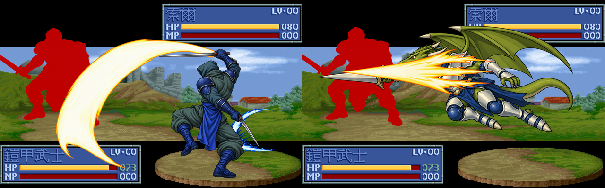

雙刀武者的兩次斬擊與藍色斬光、翼龍槍兵的飛行突刺及透明停拍已接入HD圖源。上圖為測試場景的實際最終GPU縮圖，面板沿用來源角色名稱；背景及受擊閃色仍含像素素材。關鍵姿勢與尾光共用、突刺光寬度等美術近似，保留在全部HD接入後集中人工確認。來源與限定驗證見[現代主題規格](docs/knowledge-base/61-modern-theme-runtime-spec.md)。

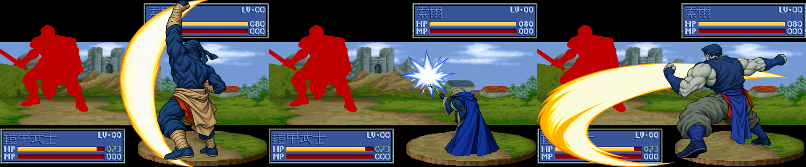

左為深藍拳師上勾拳，中為短杖命中星芒，右為灰綠拳師迴旋打擊。此圖取自明示換用圖源的測試場景最終GPU縮圖，面板仍沿用來源角色名稱；背景及受擊閃色保留原圖樣。共用姿勢、袍身比例、光弧高度與碎光形狀的差異已記錄，待全部HD接入後集中人工確認，範圍見[現代主題規格](docs/knowledge-base/61-modern-theme-runtime-spec.md)。

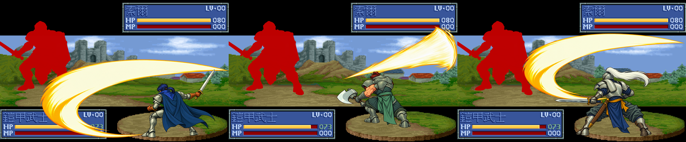

左為藍披風劍士迴旋斬，中為重斧人物劈擊，右為白馬尾劍士橫斬。此圖取自明示換用圖源的測試場景最終GPU縮圖，面板仍沿用來源角色名稱；背景及受擊閃色保留原圖樣。共用姿勢、人物與武器比例、光弧及碎光形狀的差異已記錄，待全部HD接入後集中人工確認，範圍見[現代主題規格](docs/knowledge-base/61-modern-theme-runtime-spec.md)。

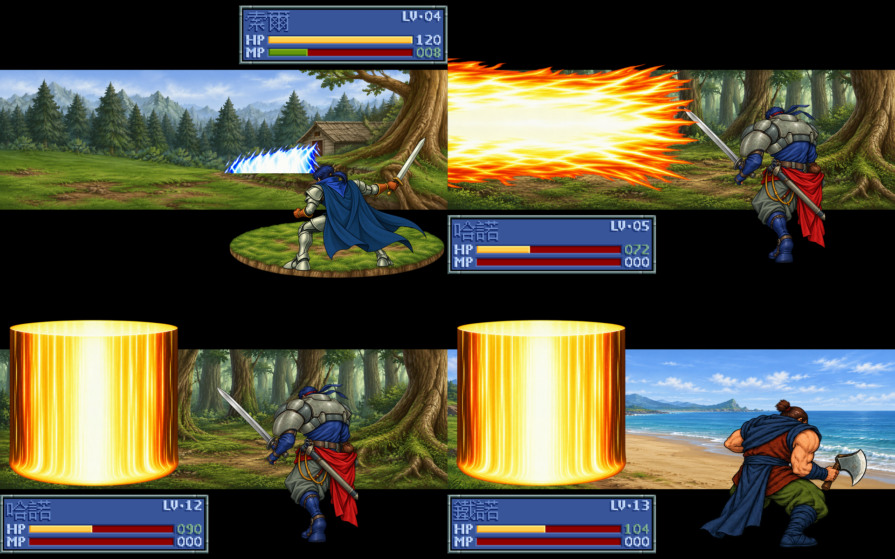

兩種劍士的分段打擊已接入HD，包含藍白蓄光、橫向光束與金色光柱，以及背景轉場和多目標續行。上圖由測試場景的實際最終GPU畫面縮圖，上排為指令24，下排為指令29；面板沿用來源角色名稱，背景與介面仍含像素素材。原有MP／HP標記與透明停拍保持，正常操作與人工造型確認待全部HD接入後集中抽驗。來源與範圍見[現代主題規格](docs/knowledge-base/61-modern-theme-runtime-spec.md)。

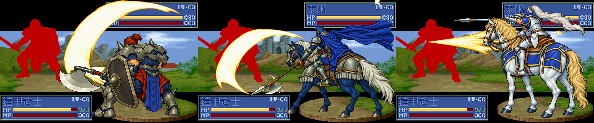

左為斧盾兵劈斬，中為長戟騎兵揚馬後的下劈，右為白馬槍騎兵突刺。圖組包含蓄力、轉槍及收勢，保留原有節拍。上圖是測試場景的實際最終GPU縮圖，面板沿用來源角色名稱；背景及受擊閃色仍含像素素材。馬匹與武器比例、光弧寬度及槍影角度有美術近似，待全部HD接入後集中人工確認。來源與限定驗證見[現代主題規格](docs/knowledge-base/61-modern-theme-runtime-spec.md)。

| 鐵諾HD普通END攻防 | 蓋亞HD普通攻防 |
| --- | --- |
| 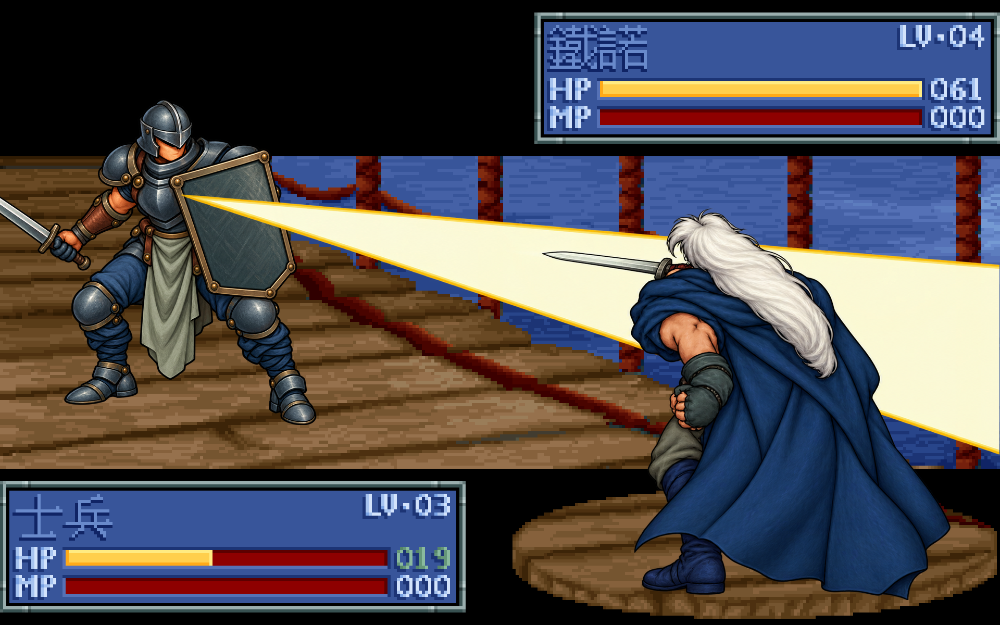 | 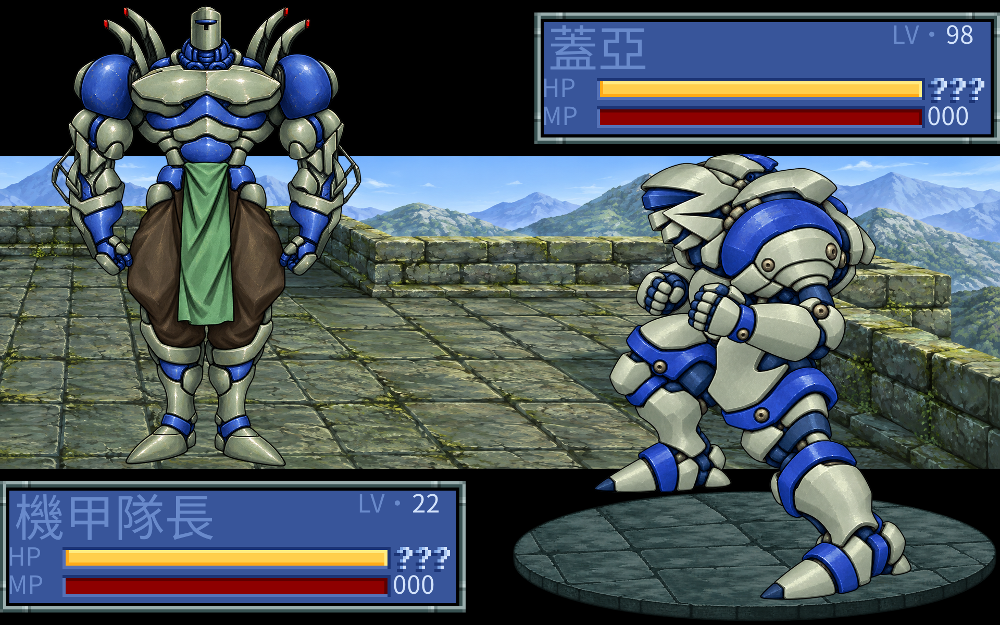 |

兩張皆為第三章普通操作的實際遊戲視窗，背景與面板仍含像素素材。
左圖是鐵諾在END時攻擊；右圖是依原版厚甲機器人造型重畫的蓋亞，沿原框保留待機、蓄力與出拳。
蓋亞的兩次普通攻防、F2與章節邊界保存冷讀已有逐筆追蹤驗證；蓋亞在END參戰另待抽樣。
來源槽祖先、共享稿及驗證範圍見
[現代主題規格](docs/knowledge-base/61-modern-theme-runtime-spec.md)。

| 哈諾HD普通攻防 |
| --- |
| 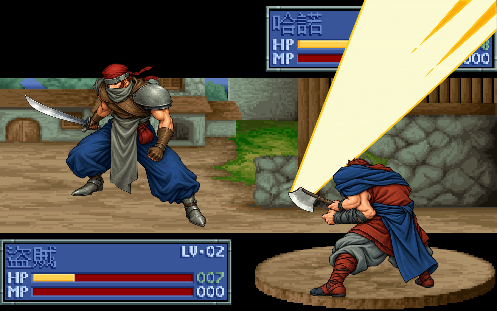 |

此圖為第二章實際遊戲視窗，使用章前加1000HP的建構槽，再以普通按鍵接敵與攻擊。
哈諾的待機、斧擊與光效已接入HD圖組，背景與面板仍含像素素材。
攻防返回、F2與章節邊界保存冷讀已驗證；此測試槽不代表自然難度。
來源、完整提示與共享姿勢見[驗證紀錄](docs/data/fd2-modern-hd-battlefield-20261019.json)的`hano_battle_followup_20261020`。

| 女村民HD受擊待機 | 男村民HD受擊待機 |
| --- | --- |
| 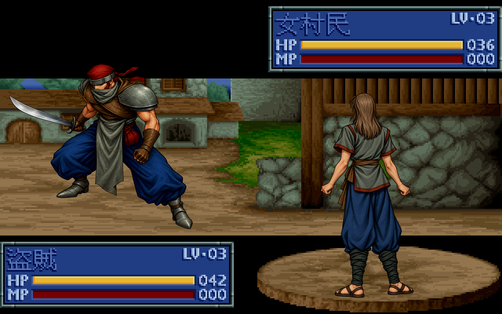 | 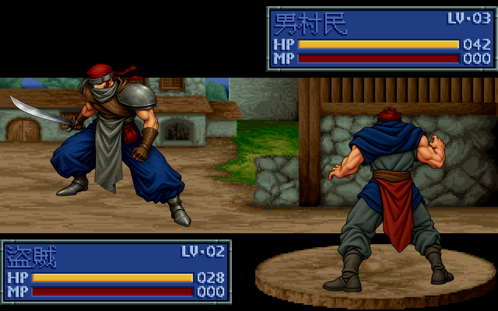 |

兩張取自第二章普通按鍵換手時的實際遊戲視窗，沿用上述章前HP校準槽。
村民各四幀待機已接入HD圖組；原版攻擊與施術圖庫為空，不另造動作。
背景與面板仍含像素素材，呼吸相位共享母稿；來源與驗證範圍見
[驗證紀錄](docs/data/fd2-modern-hd-battlefield-20261019.json)的`villager_idle_battle_followup_20261020`。

| 瑪琳HD普通攻防 | 凱麗HD普通攻防 |
| --- | --- |
| 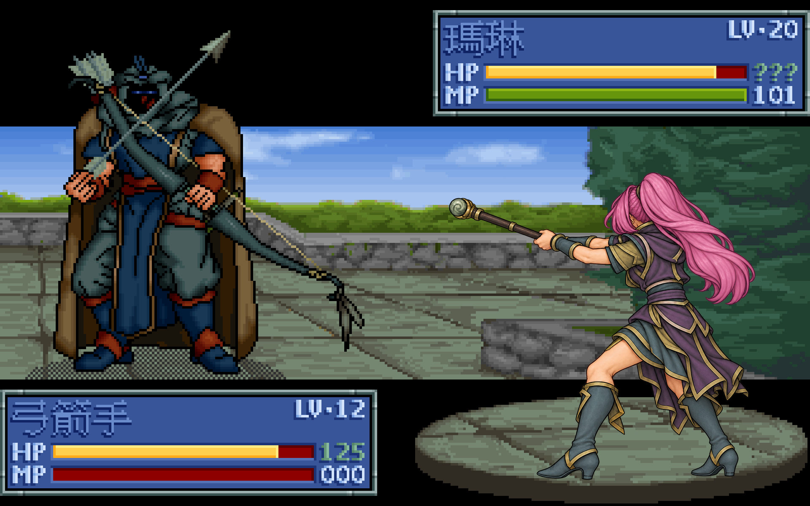 | 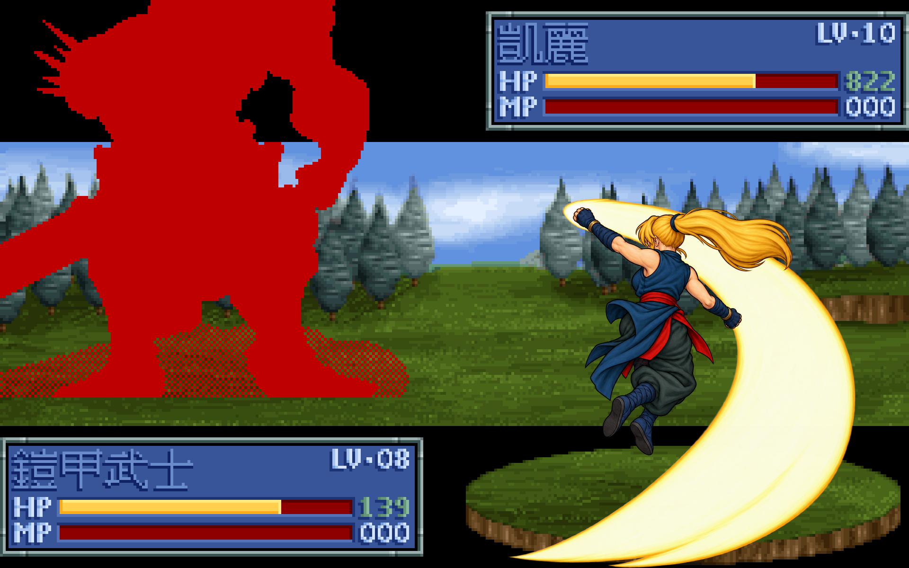 |

兩張皆為第九章普通按鍵攻擊的實際遊戲視窗，使用明示章前HP+1000的建構槽。
瑪琳的揮杖與凱麗的掌擊、旋身已接HD圖組；背景、敵方與面板仍含像素素材。
攻防返回、F2及章節邊界保存冷讀已驗證；共享姿勢、來源政策與驗證範圍見
[驗證紀錄](docs/data/fd2-modern-hd-battlefield-20261019.json)的`early_party_battle_followup_20261020`。
貝克威的端炮與光束也已正式登錄；混合背景反擊的一般能力限制仍由[#265](https://github.com/wicanr2/fd2_re/issues/265)追蹤。

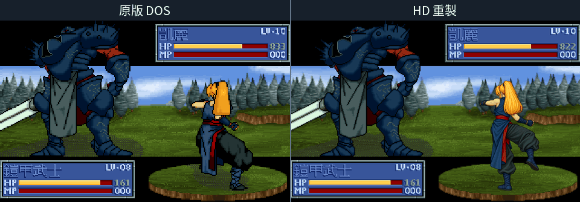

左側是 dosgolem 執行原版遊戲，右側是 HD 重製的實際遊玩畫面，節錄凱麗的掌擊、旋身與收勢。
兩側沿用上述章前加血槽，屬相近戰況；動畫依動作順序剪輯，血量與亂數不同，不代表逐幀一致。
HD 背景、敵方與面板仍含像素素材。來源與可重跑方式見
[動畫驗證紀錄](docs/data/fd2-modern-hd-battlefield-20261019.json)的`kylie_readme_animation_20261020`。

| 貝克威HD端炮 | 貝克威HD光束 |
| --- | --- |
| 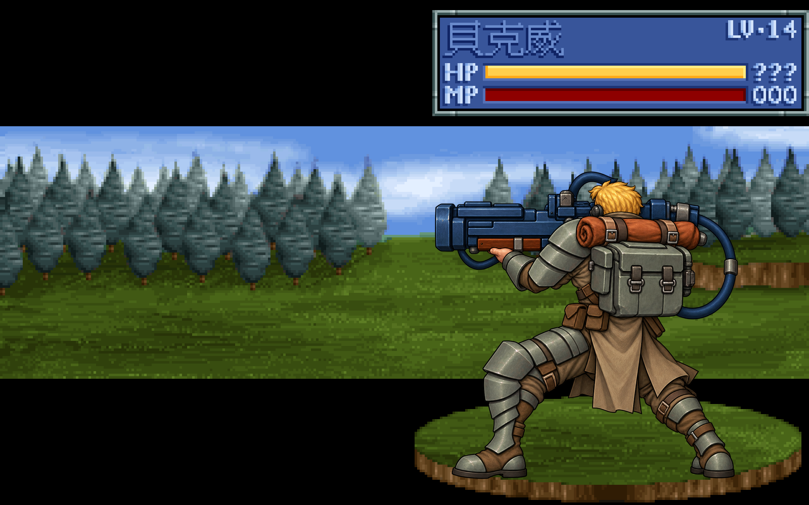 | 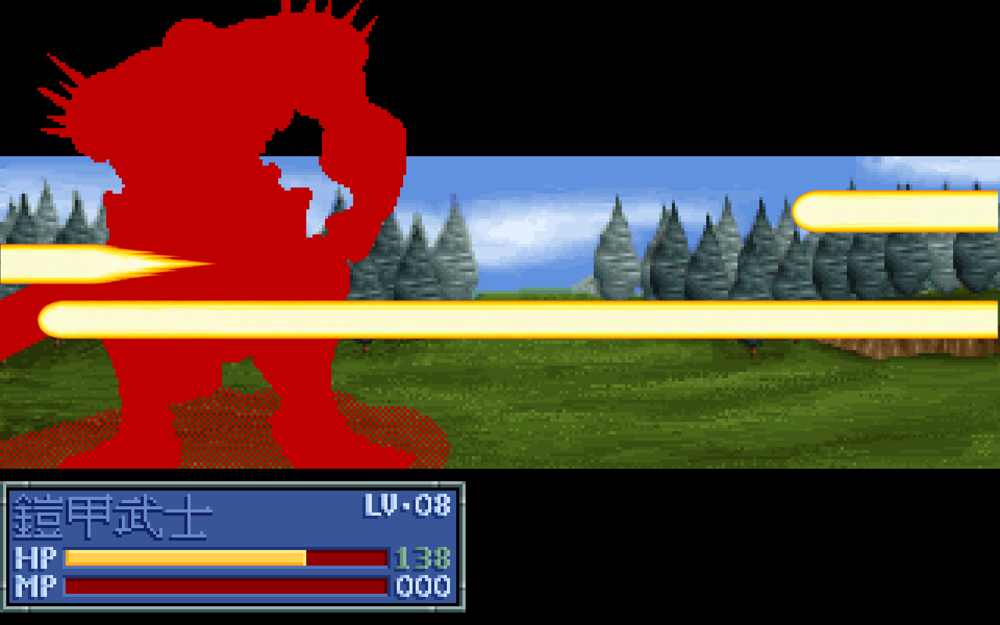 |

兩張取自第九章同一場普通攻擊的實際視窗，使用章前加血槽，再正常購弓、立即裝備與出發。
端炮、離場與光束沿原版演出；背景、敵方及面板仍含像素素材。
普通攻擊返回、F2及保存冷讀已抽驗，來源與驗證範圍見
[驗證紀錄](docs/data/fd2-modern-hd-battlefield-20261019.json)的`bekwei_battle_followup_20261020`。

| 鎧甲武士HD待機 | 鎧甲武士HD下劈 |
| --- | --- |
| 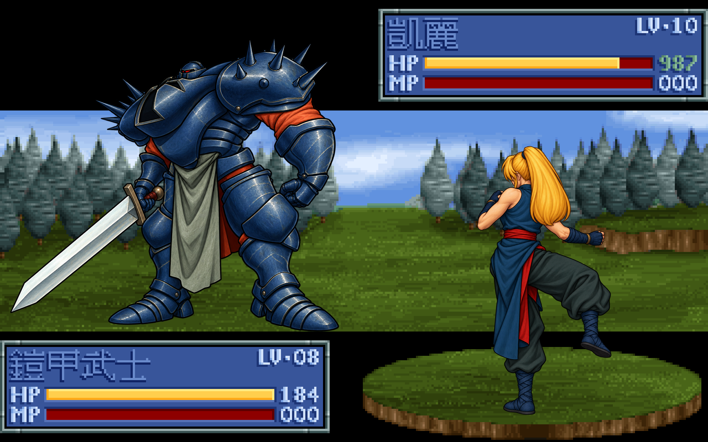 | 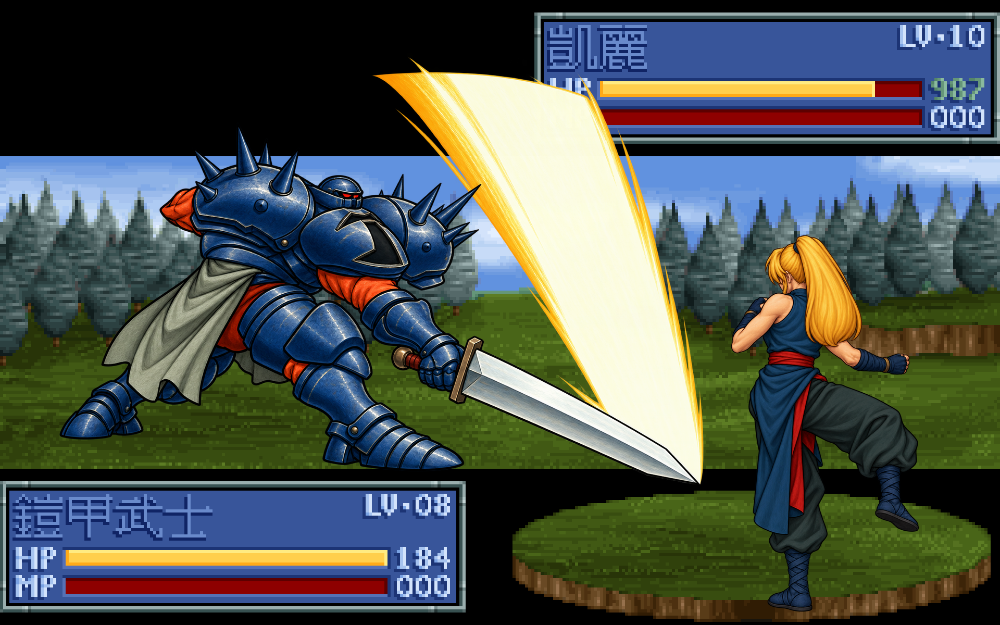 |

兩張取自第九章普通敵方回合的實際遊戲視窗，沿用章前加血槽，沒有編修畫面。
厚重尖肩甲、抬劍與下劈沿原版姿勢重繪；背景與面板仍含像素素材。
普通攻擊、反擊、F2及保存冷讀已抽驗，共享姿勢與抬劍裁切見
[驗證紀錄](docs/data/fd2-modern-hd-battlefield-20261019.json)的`heavyknight_battle_followup_20261020`。

| 弓箭手HD瞄準 | HD飛矢抵達希莉亞 |
| --- | --- |
| 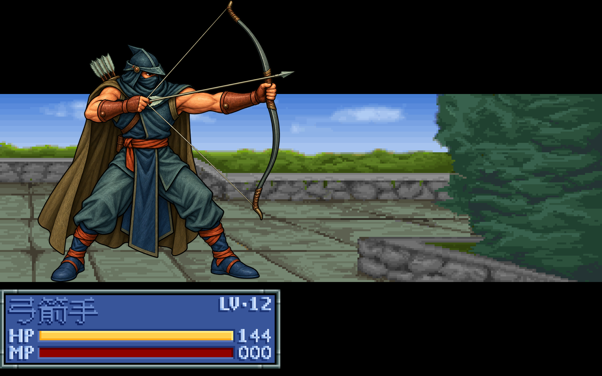 | 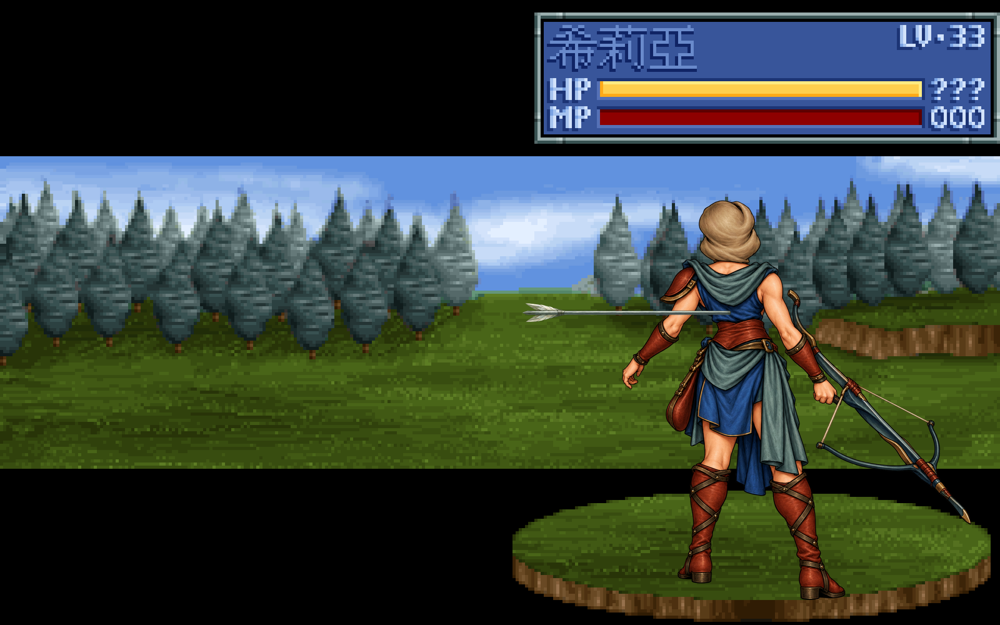 |

兩張取自第九章普通敵方回合的實際遊戲視窗，沿用章前加血槽，沒有編修畫面。
蒙面弓手的搭箭、滿弓、放箭與飛矢沿原版姿勢重繪；背景與面板仍含像素素材。
普通敵方射擊、我方射擊弓手、掉落訊息、F2及章節邊界保存冷讀已抽驗，範圍見
[驗證紀錄](docs/data/fd2-modern-hd-battlefield-20261019.json)的`archer87_battle_followup_20261020`。

| 突擊騎兵HD蓄勢 | 突擊騎兵HD重擊 |
| --- | --- |
| 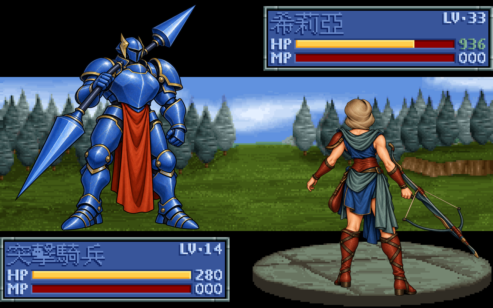 | 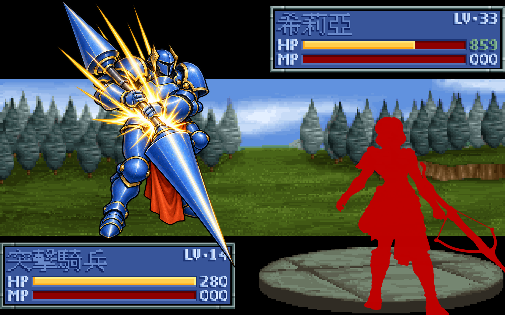 |

兩張取自第九章普通敵方回合的實際遊戲視窗，沿用章前加血槽，沒有編修畫面。
藍甲、雙頭槍、重擊金光與消退收勢依原姿勢重繪；右圖同時顯示希莉亞的紅色受擊輪廓。
背景與面板仍含像素素材。普通接戰、我方射擊、F2及章節邊界保存冷讀已抽驗，範圍見
[驗證紀錄](docs/data/fd2-modern-hd-battlefield-20261019.json)的`knight83_battle_followup_20261020`。

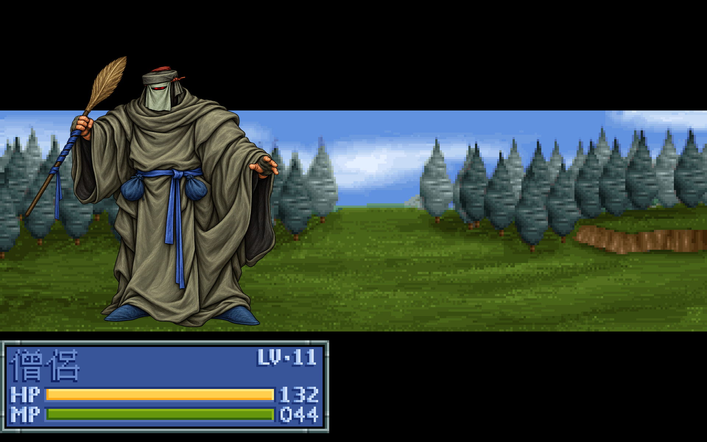

第九章希莉亞射擊僧侶時的實際視窗，未編修。灰袍、面布、藍腰飾與羽形杖依原圖重繪，背景與面板仍含像素素材。
待機與揮杖已保留原版六幀節奏；完整攻擊限測試場景，普通流程抽驗受擊、返回、F2及章節邊界冷讀。
抽樣沿章前加血來源，回復法術的地圖特效仍待HD化，範圍見[現況矩陣](docs/knowledge-base/58-fd2-exe-re-coverage.md)。

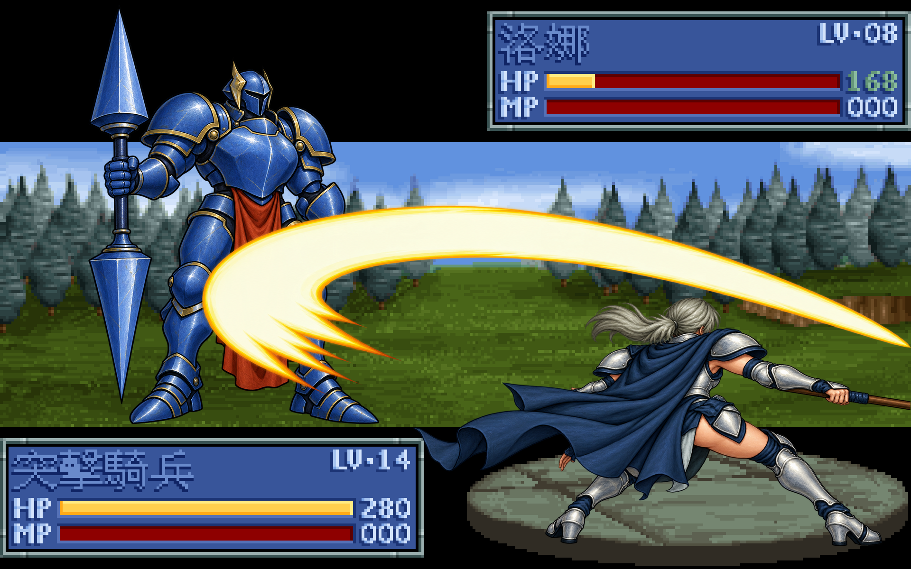

第九章洛娜原地攻擊突擊騎兵的實際遊戲視窗，未編修。藍披風、銀甲、雙頭槍與弧光已接HD，背景與戰鬥面板仍含像素素材。
抽樣沿章前加血來源，章內無注入；完整繪製、攻防返回、F2與章節邊界冷讀見[驗證範圍](docs/knowledge-base/58-fd2-exe-re-coverage.md)。

| 萊汀 HD 斧擊 | 索菲亞 HD 揮杖 |
| --- | --- |
| 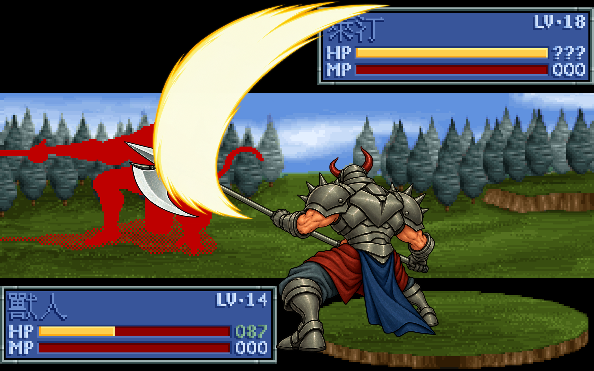 | 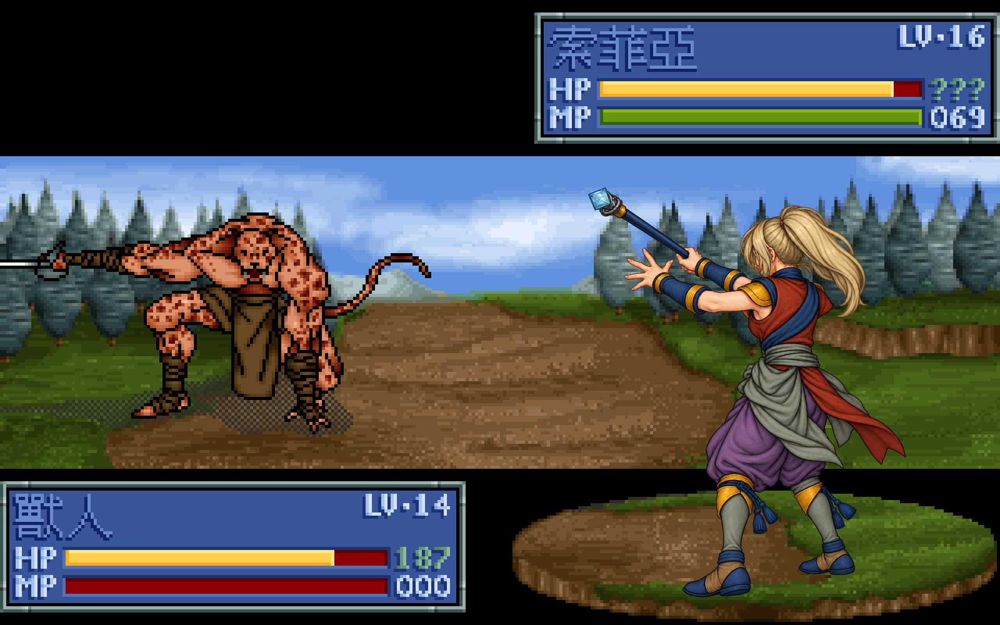 |

兩張取自第十一章正常移動接敵後的遊戲視窗，未編修。厚甲、長柄斧、金色馬尾與寶石杖依原造型重繪，背景、面板與敵方仍含像素素材。
本次使用章前加血的建構槽，章內沒有狀態注入；攻擊返回、F2與章節邊界保存冷讀已抽驗，範圍見[現況矩陣](docs/knowledge-base/58-fd2-exe-re-coverage.md)。

| 獸人 HD 待機 | 獸人隊長 HD 待機 |
| --- | --- |
| 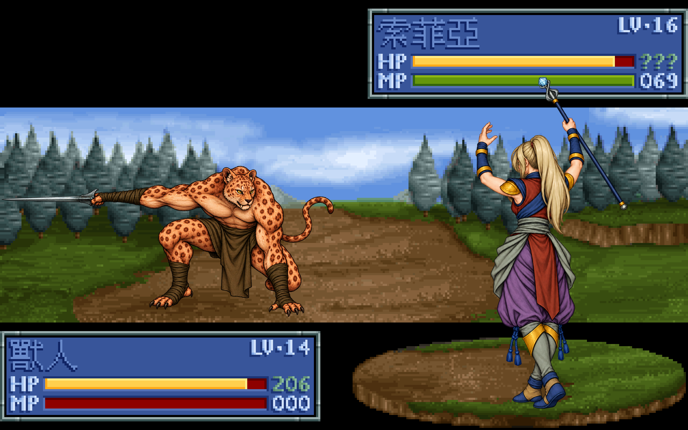 | 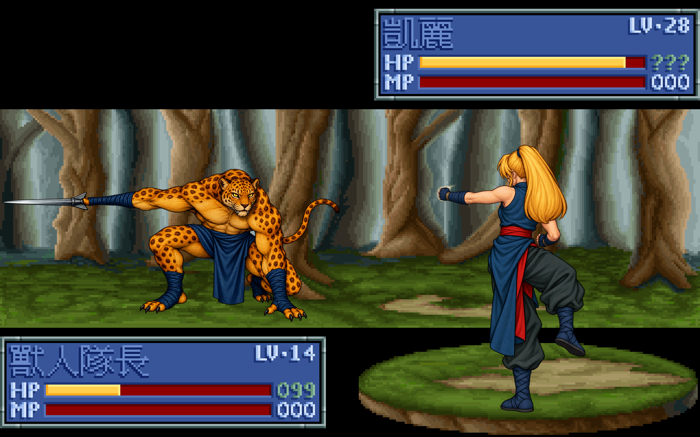 |

取自第十一章索菲亞與凱麗普通近戰的實際視窗，未編修。豹斑、長尾、尖刃與兩種布料配色依原圖重繪，背景與戰鬥面板仍含像素素材。
跳躍、出框、空白等待與俯衝保留原節奏；完整繪製及正常抽樣的不同範圍見[現況矩陣](docs/knowledge-base/58-fd2-exe-re-coverage.md)。抽樣使用明示的章前加血建構槽，章內無注入。

### 普通法術的人物HD呈現

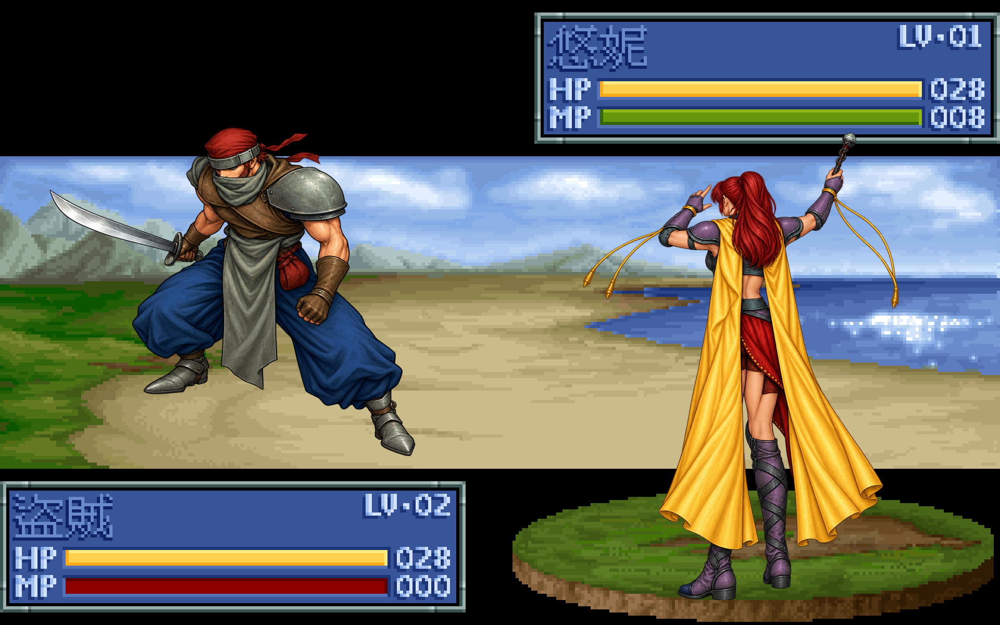

取自首章普通LOAD後的實際施法視窗，未編修畫面。指令0已接入HD人物的滑入、施術、目標及收尾呈現，背景、狀態欄與法術特效仍含像素素材。
正常返回、F2及章節邊界保存冷讀已抽驗；F5／LOAD會重建戰場，未保存本次施法後的魔力與敵方血量。來源與範圍見[驗證紀錄](docs/data/fd2-modern-hd-battlefield-20261019.json)的`ordinary_command0_followup_20261020`。

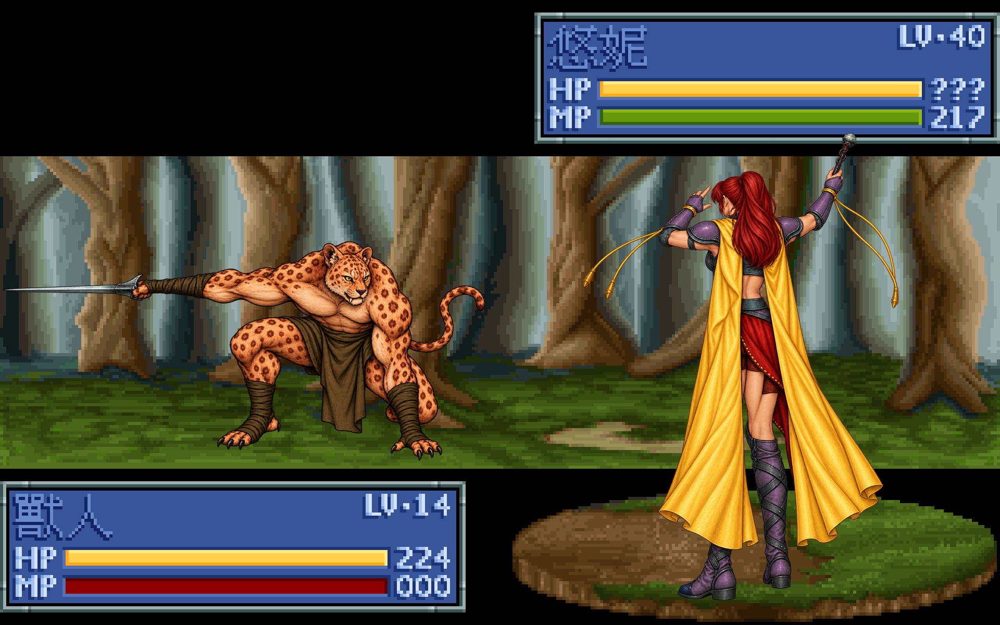

第11章普通鍵盤施法的實際視窗，未編修。指令1已接入既有HD人物，法術特效與戰鬥面板仍含像素素材。
章前建構來源、原地施法、返回及章節邊界保存冷讀的範圍見[驗證紀錄](docs/data/fd2-modern-hd-battlefield-20261019.json)的 command1_hd_followup_20261021。


第九章正常進軍後的魔法師施法視窗，未編修。人物為HD，背景、戰鬥面板與法術特效保留像素素材。
抽樣使用章前加血來源，章內沒有狀態注入；施法、受擊、返回與保存冷讀見[驗證範圍](docs/knowledge-base/58-fd2-exe-re-coverage.md)。

| 約拿 HD 近戰 | 希爾法 HD 近戰 |
|---|---|
|  |  |

上圖是兩位角色正常移動接敵後的實際攻擊視窗，未編修。寬袍、披領與揮杖順序依原圖重繪。
接敵路線、章前強化與驗證範圍見[驗證紀錄](docs/data/fd2-modern-hd-battlefield-20261019.json)的`cleric_party_battle_followup_20261021`。

本組畫面只涵蓋已驗證的近戰圖組；完整 HD 仍在製作。

| 機甲隊長受擊時的 HD 待機 | 機甲隊長戰後 HD 頭像 |
| --- | --- |
|  |  |

兩張皆為正常鍵盤流程的重製視窗，使用明示章前強化槽。戰鬥圖組沿原版十一幀與雙刃節拍重繪，戰後自然接入下一章整備；隊長主動攻擊的正常流程尚未抽驗。詳見[HD 驗證紀錄](docs/data/fd2-modern-hd-battlefield-20261019.json)的 `captain116_battle_followup_20261021`。


上圖是珊正常進軍後揮杖攻擊的實際遊戲視窗，未編修。藍色長髮、抬杖與前揮保留原版造型及動作順序。
普通攻擊、返回、F2與保存冷讀已抽驗，完整人物幀另由繪製測試核對。測試使用章前強化槽，人物外效果與背景／面板仍含像素素材；
來源與共享姿勢範圍見[驗證紀錄](docs/data/fd2-modern-hd-battlefield-20261019.json)的`shan14_battle_followup_20261021`。


上圖是蓋亞普通攻擊機甲兵時的實際遊戲視窗，未編修。機甲兵保留原版灰綠重甲、深藍關節與前臂砲造型。
受擊待機、返回、F2及保存冷讀已抽驗；開砲與光束完整繪製另由測試場景驗證，普通開砲仍待。
測試使用章前強化槽，背景與面板仍含像素素材；來源見[驗證紀錄](docs/data/fd2-modern-hd-battlefield-20261019.json)的`mechanical111_battle_followup_20261021`。

普通擊殺與章節事件的死亡演出已接入 HD 煙霧，保留人物轉向、效果累積與消散。


上圖來自第 23 章正常進軍、普通擊倒隊長時的實際遊戲視窗，未編修。
測試使用章前強化存檔，章內沒有狀態注入。A／B 效果抽樣、下一章整備、F2 與保存冷讀已驗證；
完整 26 拍另由繪製測試核對。狀態扣血致死也已接入相同呈現，正常玩家抽樣仍待；
範圍見[現況矩陣](docs/knowledge-base/58-fd2-exe-re-coverage.md)。

## 遊戲介紹

《炎龍騎士團 2》是 1990 年代華文單機戰略角色扮演遊戲（SRPG）的代表作之一。
玩家在格狀戰場上指揮各具職業、裝備與法術的角色，並在戰鬥之間經歷劇情、城鎮、
商店、教會、轉職、整備及持續成長的隊伍。

它真正難以取代的地方，不只是三十場戰役，而是戰場、人物、音樂與戰間生活共同
形成的節奏。多數戰鬥結束後並非直接跳到下一戰；補給、交易、復活、轉職、存檔與
部署同樣是戰役的一部分。重製因此不能只還原戰鬥公式，也必須保留這條玩家路徑。

## 開發歷史

### 為台灣留一份技術紀念

逆向動畫資料時，我們在原版檔案裡找到一段幾乎被時間掩埋的署名：

> AFM — Animation File Manager Version 1.00<br>
> Copyright (C) 1993 Lo Yuan Tsung

這套由漢堂程式設計師自製的動畫工具，比遊戲發售早兩年。原始碼與說明書如今都
已不可得，但它設計的資料仍在遊戲裡運作。本專案把破解出的技術整理成可重現文件，
不只為了重製，也為了記錄 1995 年台灣團隊如何在 DOS 的限制下完成一款大型戰棋
角色扮演遊戲。

完整總覽：
[`1995 年怎麼做出《炎龍騎士團 2》`](docs/knowledge-base/15-how-fd2-was-made-1995.md)

### DOS 上的中文

DOS 本身不會替遊戲顯示中文。原版自帶點陣字型，文本也不是 Big5 字串：
`FDTXT.DAT` 保存的是 `uint16` 字模索引序列，共 1016 條字串、約 5.8 萬字；
`FDOTHER.DAT` 資源 #4 則包含 1824 個 16×16、1bpp 字模。索引 0–35 是數字與
英文字母，其後才是漢字。

| 字模解碼研究圖 | 對話解碼研究圖 |
|---|---|
|  |  |

以上兩圖是原版資料解碼研究產物，不是重製執行期畫面。格式與控制碼詳見
[`文本與字型格式`](docs/knowledge-base/08-text-and-font-format.md)。

### 開場動畫是一台繪圖位元組虛擬機

原版開場不是把每一幀都存成完整點陣圖。AFM 使用 10 個運算碼描述增量繪圖，
每幀只對上一幀留下的畫面補畫、複製或修改局部區域。96 幀的金鎖動畫因此約為
1 MB，而不是 96 份完整 320×200 畫面。

```text
影格：duration + payload_size + bytecode
指令：opcode + 參數；部分指令引用前一幀或外部圖塊
```

原版派發器位於 `0x36C9E`，跳表位於 `0x5276A`；播放器
`0x020421(index, delayMs, skippable)` 管理播放與略過，`0x3DC9F` 以開機測速忙等
校準舊硬體。重製端保留這套增量語意，但不夾帶任何原版畫格。完整證據見
[`ANI／AFM 格式`](docs/knowledge-base/39-ani-afm-format.md)。

### 同一首音樂，兩種玩家記憶

原版同時支援 Roland MT-32 與 Sound Blaster／AdLib。後者使用遊戲自帶的
`SAMPLE.AD` 音色庫，也是當年多數玩家聽見的預設聲音；MT-32 則有不同的樂器、
包絡與空間感。因此「原版音樂」不是唯一一套固定波形。

曲號不是靠聽感猜測，而是從 `play_bgm`（`0x25977`）的 32 處呼叫逐一追查，過程中
也推翻過舊曲目對應。兩條音源都只由玩家自備原版檔案在本機渲染，音色庫與 ROM
不隨倉庫散布。詳見 [`音樂播放與場景`](docs/knowledge-base/12-music-playback-and-scene.md)
及 [`音訊合成`](docs/knowledge-base/16-audio-synthesis-soundfont-mt32.md)。

## 歷史考證

本專案將格式、工具、呼叫關係與玩家可見結果一併保存，並為每個結論標示
「已證實、強推論、假說或未知」。原始位址、位元組與雜湊始終保留；語意名稱只作
導覽，不取代證據。

主要考證入口：

- [原版工具鏈](docs/knowledge-base/04-original-toolchain.md)、[圖像壓縮](docs/knowledge-base/05-image-compression-format.md)、[動畫格式](docs/knowledge-base/06-animation-format.md)、[XMIDI 音樂](docs/knowledge-base/07-music-xmidi-format.md)
- [文本與字型](docs/knowledge-base/08-text-and-font-format.md)、[劇情與對話](docs/knowledge-base/09-story-and-dialogue.md)、[角色與職業名稱](docs/knowledge-base/45-class-name-mapping.md)、[戰鬥規則](docs/knowledge-base/27-combat-rules-and-validation-checklist.md)、[敵方人工智慧](docs/knowledge-base/11-enemy-ai.md)
- [開機、標題與存檔](docs/knowledge-base/23-boot-title-and-scenario-flow.md)、[可擴展事件系統](docs/knowledge-base/29-remake-extensible-event-system.md)、[劇情腳本系統](docs/knowledge-base/19-scenario-script-system-design.md)
- [反組譯覆蓋矩陣](docs/knowledge-base/58-fd2-exe-re-coverage.md)與[知識庫總索引](docs/knowledge-base/00-index.md)

這些文件同時是「1995 年台灣怎麼做遊戲」的技術保存紀錄，不只是工程工作清單。

### 匹配式反編譯原始碼

重寫的 C 原始碼與可重跑工具保存在本倉庫的 [tools/](tools/)，隨 Git 提交記錄。
[事件布局來源](tools/fd2_matching_game_event_layout.c)已有完整區間匹配；
[大型事件來源](tools/fd2_matching_game_quake.c)也已通過完整函式匹配。
[建置驅動器](tools/fd2_matching_game_restore.py)與
[匹配主收據](docs/data/ida/fd2_matching_full_20261008.json)保存來源雜湊、編譯旗標與比較結果。
全檔還原狀態見[覆蓋矩陣](docs/knowledge-base/58-fd2-exe-re-coverage.md)。

## 重要發現

- 原版使用自製 `.DAT` archive、RLE 圖像、索引色盤、XMIDI、AFM 與 FIGANI 等
  多套專用格式，而不是一組現成引擎資源。
- 對話文字、人物動作與大量戰役流程曾寫死在 `FD2.EXE`；重製將它們轉成可編輯
  腳本與具型別規則。
- 敵方人工智慧不是單一「找最近的人」規則。原版先依模式建立候選、評分與目標
  陣列，再由指令或物品消費端執行；重製保留已證實資料流，未知分支不猜接。
- 原版戰後流程包含城鎮、商店、教會、整備與秘密商店等節點；它們是戰役的一部分，
  不能以直接切到下一戰替代。
- 最終演出不是單一影片，而是文字閘門、角色蒙太奇、20 組尾段、定格與隊伍最終
  狀態共同形成的序列。重製端目前會停在經典終局畫面，並可循環回顧隊伍；這是
  來源約束的 `RUNTIME-E1`，未修改原版同狀態 `PLAYER-E2` 仍待抽驗。

### 指令環與角色的繪圖順序


左側是dosgolem原版擷取，右側是正常載入後的重製正式Game.Draw。原版先貼四張圖示，再重繪游標上的角色；重製也保留這個順序，避免後續再貼圖示蓋住角色。
完整畫面已在明示的有限顯示相位下核對，這張圖只展示局部。驗證範圍與來源見[現況矩陣](docs/knowledge-base/58-fd2-exe-re-coverage.md)及[指令環主契約](docs/data/ida/fd2_parity_ring_open_20261005.json)，不代表整章逐幀一致。

### 原版美術與目前重製畫面總覽


*這張素材總攬圖由已審查的執行期截圖組成；本機完整分離包現有 40,127 個實體檔案、
約 104 MB，並以清冊逐檔驗證。完整原版衍生素材只保存於私人庫，不在公開 README
提供可重組原作的逐檔 atlas。上排用不同場景展示原版 DOS 對話與目前重製執行期的
人物肖像系統，只比較呈現
方式，不是同狀態忠實度證據；下排則是第一戰同一存檔、鏡頭與回合的原版／重製
戰場圖示抽樣。忠實主題仍使用玩家自備原版資料所分離的美術；現代主題則已有
已登錄角色的獨立閉嘴頭像候選，經尺寸、雜湊與原子載入契約驗證後，可由
顯式主題入口載入。這仍是 `RUNTIME-E1-PARTIAL`，不是全角色或全介面完成。*


*現代重繪角色頭像總攬：圖中為先前登錄的 28 位候選。每張皆以原版獨立頭像幀確認
角色身分、方向與主要特徵，再以共同主題規格重繪；完整母稿與執行期 PNG 保存於私人
素材庫 `fd2-assets-private`，公開庫只放這張壓平總攬與可追溯 catalog。
`speaker／identity 7、15、28、29` 仍因原始名稱證據衝突而失敗即關閉，不以猜測補圖。*


*地圖人物總攬：上列由雜湊固定的原版 FDICON 索引與 `FDOTHER.DAT` #0 六位元 VGA
DAC 代表性色盤合成，透明度仍取自原版圖形遮罩，不再以灰階索引圖誤導閱讀；個別場景
仍可能依原版排程調整色盤，因此這不是所有關卡的逐幀實機色彩證明。下列才是現代執行期
候選，避免再把人物編號便利輸出誤當 FDICON selector 證據。本總攬是較早94組子集，其中89組保留四方向×三步態、5組維持三相靜態契約。現行清冊已涵蓋原始圖庫全部125組可見來源，共1455張144×144人物圖；來源與範圍見[HD戰場收據](docs/data/fd2-modern-hd-battlefield-20261019.json)。selector 1–14、16–21
由角色表支持為哈諾／鐵諾／哈瓦特／亞雷斯／洛娜／萊汀／蘭斯洛特／希莉亞／悠妮／瑪琳／索菲亞／凱麗／貝克威／珊／凱拉斯／米亞斯多德／蜜蒂／羅德曼／莎拉／約拿的基礎圖組投影；selector 15 僅標為姓名仍待校訂的角色表投影，不與故事頭像身分合併。selector 000、002、008、009、013、032 已依使用者核准的大頭短身現代手繪母風格重新校稿；所有正式候選均為獨立 `24×24` PNG，具逐幀雜湊與
二值透明度契約；selector 76 是第三章普通追兵的獨立候選，保留原版低圓頂深鋼盔、
額鼻護片、護頰、無徽記木盾與量產制式軍裝，刻意降低俊美英雄與精銳騎士感；selector 77 則是同章更厚重的敵方隊長，保留
全罩盔、板甲、大盾與直劍，但不猜其姓名；selector 82 則依第 7–9 戰共 49 筆敵方
劍士資料保留矩形全罩盔、窄眼縫、灰盾、直劍與紅色下擺；selector 78 依 29 筆敵方
劍士資料保留封閉低盔、紅眼、巨大圓肩與敦實重甲，不擅自補入原版小圖看不出的武器；selector 80 因職業欄混合，
只依 38 筆共同圖像索引保留深藍重甲、紅色盔冠與寬圓肩；selector 83 依 42 筆敵方
劍士資料保留鈷藍角盔、黃綠眼光、藍盾與直劍；selector 85 依 36 筆敵方劍士資料
保留完全遮面的低垂大型桶盔、紅眼、方盾、直劍與制式深藍甲，刻意維持普通士兵辨識；selector 86 依第 24–26 戰及終章共 24 筆敵方
劍士資料保留淡灰綠圓頂全罩盔、水平眼縫、深藍十字盾與直立長兵器輪廓，維持量產要塞守衛感；selector 88 依 48 筆敵方
劍士資料保留深藍護甲、紅褐頭巾、遮面眼部與橫持直劍；selector 90 依第 4–9 戰共 26 筆敵方
劍士資料保留低垂紅褐兜帽、黑色面孔、黃綠眼光、寬大深藍肩衣與敦實輪廓，不添加原圖沒有的武器；selector 91 因職業欄混合且
沒有可見武器，只依輪廓近似保留深藍尖垂兜帽、黑色面孔、紅眼與對稱暗紅外緣，
不把外緣斷言成特定服裝。此圖是公開壓平總攬；母稿與逐幀素材只保存於私人素材庫。完整HD包的普通戰場沿原生定位直繪144×144真彩人物，再疊加前景與透明介面；尚未換成HD的完整演出仍保留索引畫面。較早24×24主題包沿既有路徑，忠實主題維持原生索引呈現。圖組 7
只代表角色表與地圖資料投影；故事 `speaker 7`／頭像身分仍有衝突，維持失敗即關閉。希莉亞的
`speaker 8`／`DATO_008` 身分則已有一致證據。*


*現代戰場第一輪總覽：33 張地圖均由正式 `map.json` 重組，保留原版 tile ID、
通行、事件與人物座標，圖集則依第一關概念稿與高解析手繪參考統一自然綠、土黃、
水岸與柔化材質；現代戰鬥狀態面板也已有獨立無文字底板，由程式疊加即時數值。這是
較早可玩的 `RUNTIME-E1` 現代主題基底，並非現行144人物路徑的HD地形驗收；後者目前沿原生地形放大過渡。完整逐格PNG保存於私人素材庫。後續仍會抽測相鄰圖塊接縫、前景遮擋與各地區辨識度。*


*現代戰場 UI 素材總覽：上方是無文字狀態面板，正式執行時才疊加角色名稱、
LV、HP、MP、AP、DP、MV；下方依序為攻擊、法術、物品、待機。四向選單仍顯示在
目前選取方塊附近，不固定到左上角。這是壓平展示圖；正式 loader 會依 catalog
逐檔驗證 149×42 HUD、四張 28×26 圖示與 SHA-256，再由現代主題消費。*

| 33 張原版戰場低解析索引 |
|---|
|  |

| 96 組戰場角色代表幀 | 96 組對話頭像代表幀 |
|---|---|
|  |  |

*三張總覽由玩家自備原版的本機分離素材產生：戰場圖依 `map.json` 重組完整地圖，
角色動畫與頭像則每組只取一個代表幀。公開版本經降解析並壓平，只供辨識研究覆蓋，
不是可供遊戲回填的素材表；完整解析素材、全部動畫幀及可重組清冊只留在私人素材庫
與標示 `public_distribution: false` 的本機完整版。*


*同一存檔、鏡頭與回合的戰場比較；此圖只證明標示狀態，不外推全戰役。*


*各排依序為原版擷取、重製同輸入合成、完整畫面差異。上排是玩家攻擊，下排是獨立
敵方攻擊；只比較零旗標前導末格。這是合成診斷圖，正式 GPU 前導驗證另記於
[場景契約](docs/data/ida/fd2_physical_background_selection_20261004.json)。完整攻擊、
非零旗標捲動與戰後畫面恢復的現況見[覆蓋矩陣](docs/knowledge-base/58-fd2-exe-re-coverage.md)。*


*各排依序為原版擷取、重製同輸入合成、完整未遮差異。上至下展示非零旗標的前導末格、
捲動中段與目標末格。正式GPU已驗證這段首次轉場；完整攻擊、連擊、反擊與戰後
工作緩衝的現況見[覆蓋矩陣](docs/knowledge-base/58-fd2-exe-re-coverage.md)。*


*各排依序為原版擷取、重製同輸入合成、完整未遮差異，展示單次未命中的尾段。
這個有限案例已核對完整畫面及正式GPU呈現。命中、連擊、反擊、音效與戰後工作
緩衝的驗收範圍見[覆蓋矩陣](docs/knowledge-base/58-fd2-exe-re-coverage.md)。*


*上至下為縮放首步、末步與淡入完成的戰場。每排依序為原版索引畫面加同時點DAC重建、
重製正式GPU、完整未遮差異。原版欄不冒稱三張寫後擷取；來源與限定驗收見
[城鎮過場契約](docs/data/ida/fd2_town_departure_20261005.json)及[覆蓋矩陣](docs/knowledge-base/58-fd2-exe-re-coverage.md)。*


*左為dosgolem原版，右為正式GPU；上為DATO第0幀，下為第3幀。兩側使用同一建構槽與
受控時鐘、原版亂數餘數，經正常LOAD及城鎮出發進入等待。完整章與精確硬體時間不由此圖驗收。
來源與限制見[確認等待契約](docs/data/ida/fd2_confirmation_mouth_runtime_20261005.json)。*


*重製正常啟動路徑的執行期畫面；美術來自玩家自備原版資料。*

## 重製技術創新

- **可編輯戰役資料**：以 `trigger → when → do` 事件模型與具型別 handler，將原本
  寫死的對話、增援、入隊、戰後與終局流程轉成可審查資料。
- **索引色原生呈現**：保留 DOS 時代的色盤、LUT、RLE、逐幀發布與畫面恢復語意，
  再由現代引擎跨平台顯示，避免先轉成一般 RGBA 動畫後遺失原始行為。
- **原子式失敗即關閉**：複雜法術、物品、AI 與存讀檔先在私有狀態預檢；缺少來源
  或資產時不發布半套交易，避免玩家存檔被猜測性實作污染。
- **範圍法術與演出**：指令 6 依游標格建立作用名單，支援我方格與空格作為中心，
  取消後可重新施法。固定素材的負列寫入採已批准的有界畫面相容處理；
  原版完整記憶體行為仍未知。驗收範圍與完整畫面來源見
  [指令 6 契約](docs/data/ida/fd2_ch24_command6_work_bounds_20261004.json)。
- **持續隊伍與原始存檔橋接**：保留加入順序、裝備、指令、HP／MP、增援與部署
  邊界，使戰場、城鎮、整備與終局能共享同一支隊伍。
  非城鎮整備保留記錄提示、四槽保存與返回選人的流程；
  [局部保存驗證](docs/data/ui-traces/preparation-record-save.json)與整章驗收分開記錄。
- **證據驅動的畫面比較**：把輸入序列、狀態、資產雜湊、畫面差分及證據等級綁在
  一起；不以單張看似相近的截圖宣稱整套介面完成。
- **可延續的潔淨室引擎**：原版戰役是第一個正式資料包；長期目標是讓新戰役能沿用
  同一套戰鬥、事件、城鎮與存檔能力，而不必修改原版 executable。
- **可追溯的四語內容層**：繁中、簡中、日文與英文共用 1,564 句 canonical 劇情身分；
  正式 story、handler dialog 與戰場事件61／75／76已改以 `line_id` 查詢候選譯文，缺鍵或
  身分漂移即停止，不用來源行號或內嵌繁中掩蓋錯誤。非繁中原生 indexed 對話已保留
  開收框、閉嘴頭像、鏡頭與逐字顯示並重建安全分頁。三個譯文包的 5,176 筆全部走過人工
  審校：簡中 5,176 筆定稿，日文與英文各 5,006 筆定稿，另 170 筆說話者欄位在來源就只剩
  單一字模（要與相鄰行拼起來才成名字），拆成來源身分阻擋另計、不猜定譯名，逐條登在
  [`review-blockers.json`](docs/data/localization/review-blockers.json)。200 個道具名
  另有以實體 ID 為鍵的目錄，全部通過原版 67×16 安全矩形；同一個角色在對白、戰鬥面板與
  章節標題只會有一種譯名。斷行以「拉丁單字整串搬、中日韓逐字可斷」為單位，英文與日文
  譯文不會被切在單字中間。這是內容層完成度，不等同全部語系介面或正常玩家路徑 E2。

工程架構移至 [`docs/ENGINEERING.md`](docs/ENGINEERING.md)；第一輪重製門檻、目前
進度與剩餘工作移至 [`docs/REMAKE-STATUS.md`](docs/REMAKE-STATUS.md)。

第十二章敗北已依原版播放提示並返回完整標題；同狀態驗證範圍與限制見
[敗北流程收據](docs/data/ui-traces/ch12-defeat-return-title.json)。

## 逐章對拍進度

重製每章以原版執行結果為基準，兩側載入相同存檔槽並重播等價鍵盤輸入。
原版由dosgolem執行，驗收記錄行為、節點、交易與畫面。必驗項目、作弊政策與保存例外
依[111](docs/goal/111-goal-original-parity-campaign-20260915.md)及各章收據；畫面作參考時，不宣稱逐幀或逐像素一致。

30章均已通過各章規定的受控流程驗收，包含增援、戰後及保存邊界。作弊、未抽樣分支與第1、2章的限定保存差異均逐章揭露；HD與現代主題覆蓋仍在進行。

目前分層現況與接續工作見[重製閉合矩陣](docs/knowledge-base/58-fd2-exe-re-coverage.md)。逐章驗收、章前作弊政策及保存限制見[章台帳](docs/data/parity-campaign-progress.json)與[進度頁](docs/REMAKE-STATUS.md)；各章以自己的收據為準，流程通過不代表逐像素一致。

第十六章已通過同槽戰鬥抽樣、戰後交易與酒店存檔驗收，範圍與限制見[完整章收據](docs/data/ui-traces/parity-ch16.json)。
下圖五個起手畫面逐像素相同；[整章總覽索引](docs/data/ui-traces/parity-ch16-samples.json)另保留所有非零差異。


第十七章已通過四回合抽樣、增援、戰後交易與酒店存檔驗收，詳見[完整章收據](docs/data/ui-traces/parity-ch17.json)與[整章總覽索引](docs/data/ui-traces/parity-ch17-samples.json)。依111／114建構槽例外列PLAYER-E2，收據記錄第5回合清敵與受控亂數比較範圍。下圖仍是五個起手畫面的有限比較。


第十八章的章內護援、兩次回合事件、戰後加入隊伍、買賣、酒店存檔與秘密商店入口已依111／114例外驗收。範圍與非零畫面差異見[完整章收據](docs/data/ui-traces/parity-ch18.json)及[本機總覽來源索引](docs/data/ui-traces/parity-ch18-samples.json)。

讀這張表要知道的限制：建構槽是工具依政策值建出來的（每章固定升級數、強化基底
攻防），不是原版實際遊玩累積的數值，所以收據只能談節點、畫面、介面與存檔閉環，
不能拿來談傷害、命中或敵方選目標；抽樣尾端用修改路徑一次清空敵方 HP 進戰後節點，
那一段不屬於一般玩家路徑。詳細規則見
[`111` 全戰役原版一致目標](docs/goal/111-goal-original-parity-campaign-20260915.md)。


## Remake 里程碑

**`v.1.0.3-20260907` 已撤銷穩定版資格。** 實際玩家啟動揭露預設戰役未載入、
標題素材錯誤會落入預載第一關，以及完整版素材來源選錯等阻斷問題；該版只保留為
可追溯的失敗發行，不應下載作為可玩驗收。修正版必須重新通過「開頭動畫 → 標題
選單 → 第 0 章完整對話／演出 → 第一關」正常輸入與音樂驗收，並以新版本發布，
不得覆寫既有標籤。原附件、雜湊、問題與權利邊界見
[`v.1.0.3-20260907 發行說明`](docs/releases/v.1.0.3-20260907.md)。
[GitHub 歷史發行頁](https://github.com/wicanr2/fd2_re/releases/tag/v.1.0.3-20260907)
保留當時六個附件與 SHA-256 清冊，等待下一個通過正常玩家路徑的修正版取代。

玩家可隨時按 `F1` 查看操作說明；安裝現代素材包後，`F2` 可切換忠實原版／現代
手繪主題；`F3` 切換
Sound Blaster／MT-32 音源，`F4` 切換四種官方語言，`F5`／`F9` 快速存讀檔，
`F6` 開關音樂，`F7` 切換字級（80%–125%）。戰場空白格的系統選單另保留音樂、音效、
速度與狀態欄按鈕；
秘密商店的章節指定修飾鍵＋功能鍵不會被無修飾快捷鍵攔截。公開引擎包不含私人
現代逐幀素材，缺少素材時 `F2` 會保持原主題並顯示原因。
現代手繪主題需另行安裝已驗證的私人素材包；序章頭像與正常操作範圍見
[現代主題規格](docs/knowledge-base/61-modern-theme-runtime-spec.md)。
現行非HD完整版的素材範圍依[封包契約](docs/knowledge-base/41-packaging.md)為準。

先前的 [v0.1.1](https://github.com/wicanr2/fd2_re/releases/tag/v0.1.1) 與
[v0.1.0](https://github.com/wicanr2/fd2_re/releases/tag/v0.1.0)保留為歷史快照；
舊版推廣片規格見 [`docs/promo-v0.1.0-spec.md`](docs/promo-v0.1.0-spec.md)。

第一輪重製的 60／60 個分層代表性抽樣已符合正式路徑資格；這是 95% 信心的
第一輪里程碑，不代表 DOS 逐像素、逐音訊或逐週期一比一。詳細分級與限制以進度頁為準。

- **資產保存**：主要容器、圖像、字型、文字、動畫、地圖與音樂格式已有可重生工具。
- **可操作垂直切片**：標題、讀檔、戰場、玩家指令、敵方回合、城鎮、商店、教會、
  整備、存讀檔與多個戰後節點已接入正式 runtime（多數為 `RUNTIME-E1`）。
- **戰役後段**：第29／30戰、最終整備、終局文字、角色蒙太奇、20段尾段、定格與
  隊伍回顧已有連續重製端路徑；一般玩家同狀態 `PLAYER-E2` 尚未全部抽驗。
- **跨平台交付**：Linux AppImage、Windows ZIP、macOS universal ZIP 以同一完整版號
  重建並執行封包自我檢查；Windows／macOS 實體操作仍待驗收。
- **第一輪完成**：戰役／戰間、戰鬥／AI、介面、存檔／持續隊伍、終局／平台五層
  共60格已達最低配額且零完整性錯誤；後續以玩家回報與發行驗收為主。

里程碑的即時證據、分數與抽樣矩陣不在首頁重複維護，請看
[`FD2 第一輪重製進度`](docs/REMAKE-STATUS.md)。


*此圖由正式標題 `LOAD` 的普通鍵盤路徑產生；使用固定雜湊第三方存檔與 dummy
音訊裝置，因此證明重製流程可達，不代表從第一戰完整通關或精確音訊 E2。*


*此圖由正式標題 `LOAD`、普通 Return／Space 與玩家自備原始資產產生；屬
`RUNTIME-E1`，不冒稱未修改 DOS 長程通關或精確硬體音訊。*

## 致謝

感謝漢堂國際資訊與《炎龍騎士團 2》原開發團隊，留下這部至今仍值得研究與遊玩的
作品；也特別記錄 AFM 工具署名者 **Lo Yuan Tsung**，讓三十多年後的人仍能從資料
理解當年的工程設計。

感謝保存實體遊戲、測試存檔、攻略、錄影與硬體聲音的玩家社群。攻略與影片只作
玩家可見行為旁證，不取代原始位元組、合法執行期實驗或同狀態比較。

本專案中的原創程式與文件由各貢獻者完成；原版名稱、程式及資產權利仍屬其權利人。

## 授權與商業使用

本倉庫中由專案貢獻者創作的程式碼與文件，依
[復古重製 source-available 授權條款 1.0（RRSAL-1.0）](LICENSE) 授權：非商業
使用、修改及散布免費；遊戲實況、錄影、評論、教學與平台一般分潤明示允許。
商業使用須事先與 [儲存庫擁有者](https://github.com/wicanr2)另行取得書面授權，
貢獻條件與署名要求以完整條款為準。

此授權不涵蓋、也不重新授權原版《炎龍騎士團 2》的名稱、程式、美術、文字、
音樂、音效或其他資產；這些內容不隨本倉庫散布，權利仍屬其各自權利人。
