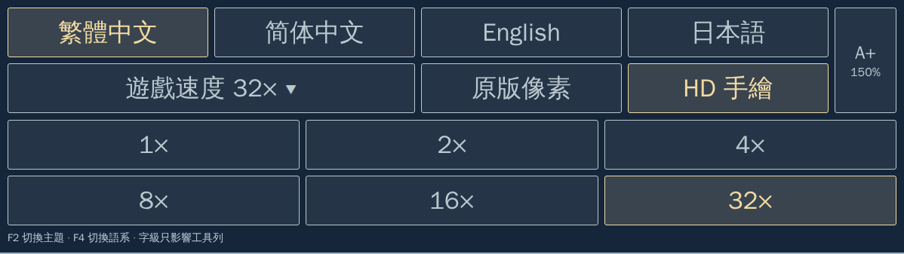

# 61 — 現代美術主題正式執行期規格

狀態：現代主題仍為部分覆蓋；目前分層與缺口依[58](58-fd2-exe-re-coverage.md)。

## 首章寶箱開合與小石塊（CONFORMED-SCOPED／RUNTIME-E1／NORMAL-GUI）

沿已閉合0x12263／取寶與AI mode5規則，補首章原始地圖的248／250兩箱、274／275兩物件，以及正式writer在事件非零且control低位符合0x20時產生的249／251開箱圖。寫入端為`advanceNativeAIMode5EventGrid`，呼叫沿`CompleteTreasureMapUpdate`；消費端為既有NativeTerrainFrameIndex及稀疏HD圖層。原始來源匯出的selected_terrain_frames只涵蓋初始地圖，不證明變動狀態齊全。同一三層內容的map14:180～183亦接入，共六來源、十槽、兩圖，不新增原版語意。

- 兩份內建image_gen透明母稿已目視：一份四格金／銀箱開合，一份兩格小物件。原RGBA完整保存，alpha最高254仍沿既有高覆蓋>=250檢查，不量化母稿。明示裁切保留主體並排除極淡外暈，雙三次／LANCZOS取樣至原生物件bbox六倍，底部與原位置一致。新圖與既有草材合成，原草陰影採明示153／255及半徑2柔化；不混原版RGB，輸出alpha保持原生全opaque。裁切、比例、形狀與陰影為美術近似。
- 來源以原生清冊、固定palette／FDSHAP及目前837清冊SHA綁定；原生bbox由非草／陰影索引獨立核對。正式writer可推進的raw tile+1單獨盤點，不能從相鄰幀外觀推測用途。來源錯誤、缺件、裁切／bbox／控制表改變、錯alpha／remap、引用及不完整GPU收據在正式清冊前拒收。舊837項保持，新增兩母稿與兩稀疏集合，不改正式Go、規則、事件、位置、節拍、RNG或保存。
- 驗兩圖實際bank及原始／事件更新後selector，六種來源GPU世界對獨立CPU、原樣首章閉箱與開箱Game.Draw／F2及原事件一次更新；正常首章普通取景、F2、面板與來源保存／新程序LOAD另錄。受控開箱不冒稱正常取寶。通過後依白名單同步私人庫，原7044檔bytes及mtime保持並核對遠端；完整HD、其他地形／HD2／介面及集中正常／人工／平台仍待。

配方為[props-hd.recipe.json](../../remake/assets/themes/modern/props-hd.recipe.json)，來源及重跑集中[HD主收據](../data/fd2-modern-hd-battlefield-20261019.json)的props_followup_20261025。編製沿[透明物件編製器](../../tools/build_fd2_hd_props.py)，給定`--original-pack /original --maps remake/assets/maps --sources <native-terrain-sources-r2> --base-catalog <837基底或Git c3ff379c清冊> --base-pack /private --recipe remake/assets/themes/modern/props-hd.recipe.json --master-root <保存母稿或私人包> --out <新目錄>`。[來源與登錄反例](../../tools/test_fd2_hd_props.py)綁同候選、GPU及基底；[共用GPU測具](../../remake/cmd/fd2/modern_hd_ground_edges_gpu_test.go)以FD2_HD_PROPS_GPU／OUT及既有素材環境跑TestModernHDPropsRealBanksAndGPU，含兩個完整Game.Draw。登錄沿[共用登錄器](../../tools/register_fd2_hd_ground.py)，私人同步沿[白名單工具](../../tools/sync_modern_theme_private.py)。原版與私人基底唯讀、有界Docker、UID1000及既有work根的新輸出前綴政策保持。

本節實作前為READY。十二來源GPU世界與閉／開兩個完整Game.Draw及F2、正式writer二次更新不變、十來源／七登錄拒收、重編一致、舊起伏地形及十四項實檔清冊回歸通過。正常首章焦點(6,9)、F2、面板、來源保存與新程序LOAD通過；兩PNG各93／96完整塊相符，248／250／274／275每張均可驗，無補取景。GUI357.237秒、峰值5440737280 bytes，無OOM／逾時，不推論平台餘裕。像素驗證器刪除對新props前綴誤套九物件的條件，改按明示terrain_expectation檢查；十五項新舊守衛通過。普通取寶、完整HD與集中人工／平台仍待。

## 首章陰影、土脊與石路（CONFORMED-SCOPED／RUNTIME-E1／NORMAL-GUI）

沿已核對的原生來源匯出及稀疏HD地形，補首章剩餘35槽連續地形，共34種內容。原生彩色接觸表已目視，包含36～39陰影、51及120～143的實際石路、82～95及215～217的實際土脊；精確圖號與跨圖槽位依[配方](../../remake/assets/themes/modern/relief-hd.recipe.json)。來源三層內容相同才共用，共十四圖139槽，全部opaque且無remap。用途不明的其他藍色圖源、寶箱與小石塊不混入本批。

- 沿既有草與土母稿，新增已目視的灰板岩手繪材質。三類索引只作藝術遮罩；原生RGB不參與合成。分類與暗部強度逐索引明示於配方，草地暗部0.6、土脊暗部0.6／0.8、石縫約0.65／0.45。各類遮罩及強度沿24到144雙三次取樣、半徑2柔化，歸一後混合新RGB。最外一HD像素保留原分類與強度；相同分類和強度的端點驗連續，alpha保持原生opaque六倍。此為美術近似，不是新規則或原版逐RGB相同。
- 沿既有編製／反例／登錄工具增加明示relief模式，固定34來源、139槽、十四圖；原822項保持。新增一母稿、35成品及十四集合，完整候選預檢後才發布。舊兩材質、底材、水岸模式保留。錯分類、來源、遮罩、槽位、引用及部分收據拒收，不寫部分正式清冊。
- 驗十四圖各六種來源GPU世界、所有實際bank／selector及34圖源，另驗原樣首章Game.Draw／F2與來源失敗。普通GUI以實際含新增來源的取景、主題往返及來源保存／冷讀抽驗，不能外推十四章、戰後返回或新PLAYER-E2。通過後白名單同步私人庫並核對遠端。規則、正式Go、地圖位置、節拍、RNG及保存格式保持；完整HD與集中人工仍待。

來源及重跑入口為[HD主收據](../data/fd2-modern-hd-battlefield-20261019.json)的relief_followup_20261025；使用[材質編製器](../../tools/build_fd2_hd_ground_edges.py)、[反例](../../tools/test_fd2_hd_ground_edges.py)、[共用GPU測具](../../remake/cmd/fd2/modern_hd_ground_edges_gpu_test.go)與[登錄器](../../tools/register_fd2_hd_ground.py)。既有來源與私人包唯讀，輸出沿既有work根的新前綴；不建立另一套載入器。

普通GUI驗證沿既有[工具](../../tools/verify_fd2_hd_fonts_gui.py)，新增明示360秒啟動等待，預設60及舊60／120／180保持。完整包的冷啟動另有有界時間，不放寬繪圖、狀態、F2或保存條件；普通流程已通過。兩PNG各88／91塊完整相符，51與120每張均可驗，無補取景。GUI422.223秒、峰值4982108160 bytes，無OOM／逾時；源槽、F2保存與新程序LOAD保持。本批未抽攻擊或戰後返回。十四圖來源GPU不擴稱十四章普通驗收。

## 水面、沙地與完整草沙／沙水交界（CONFORMED-SCOPED／RUNTIME-E1／NORMAL-GUI）

本切片補首章實際使用的49水面、50沙地、64～79草沙及96～119中實際被選取的十五種沙水交界。三十三份來源均全opaque且無remap，同源內容共九圖41槽，全部目標綁定於[水岸配方](../../remake/assets/themes/modern/shore-hd.recipe.json)。原生來源匯出、色盤及已閉合selector沿前批；首章這些control第一byte為零，不新增換幀／波浪時鐘，既有selector、色盤及LUT照舊。

- 水與沙母稿用內建圖像工具新繪，完整不透明原稿已目視；草沿已登錄母稿。母稿縮至144並沿既有八像素週期邊帶。草索引68～71、沙索引49～52／97／113／191、水索引224～238只作本來源的製圖分類，不宣稱玩法欄位；沙中的小灰點／褐點併入新沙材質屬明示美術近似。
- 各圖只合成來源實際具有的一或兩種新材質。交界沿既有24到144的雙三次／半徑2柔化，最外一HD像素保留原始分類；相鄰端點屬同一材質才驗RGB一致，alpha仍等於原生opaque六倍。沒有原版RGB混入，不擴張到崖壁、石路或未使用岸形。
- 沿既有稀疏清冊、編製／登錄及來源拒收流程，增加明示水岸模式，固定33來源／41槽／九圖。新增兩母稿、33PNG與九集合，原811項保持；候選發布前完整清冊預檢。既有三種模式保持，錯分類、來源、遮罩、槽位、引用與既有輸出拒收，不發布部分資料。
- 驗九圖各六種GPU世界對獨立CPU，全部41實際bank／selector與33圖源、九錯遮罩及原樣首章Game.Draw／F2。正常首章標題LOAD、方向鍵取景、F2與來源保存／新程序LOAD另驗，不外推九章、自然戰鬥返回或原版RGB。通過後按白名單同步私人庫、核對兩庫遠端，再更新完整實際README畫面。規則、正式Go、位置、RNG及保存格式保持。

主收據入口為[HD主收據](../data/fd2-modern-hd-battlefield-20261019.json)的shore_followup_20261025；編製沿[材質編製器](../../tools/build_fd2_hd_ground_edges.py)的水岸模式，以`--recipe`上述配方、`--base-catalog`固定811項、`--base-pack`完整私人包唯讀、`--sand-master`／`--water-master`新母稿及既有work下新輸出。GPU、來源與登錄沿[共用GPU測具](../../remake/cmd/fd2/modern_hd_ground_edges_gpu_test.go)、[反例](../../tools/test_fd2_hd_ground_edges.py)及[登錄器](../../tools/register_fd2_hd_ground.py)。本切片不縮減其他地形、HD2、完整介面／工具列與集中人工／平台的總範圍。

本節實作前為READY。全部來源及55項GPU流程通過；普通北岸兩PNG各75／78塊完整相符，純水49／沙50均可驗，未使用補取景。GUI290.157秒、峰值4013977600 bytes，無OOM／逾時，不推論平台餘裕。來源及兩主題保存bytes保持；本批未抽攻擊或自然返回。首兩輪測具取景缺必驗來源，已回到實際map0定位，不降低檢查或改正式規則。兩母稿與33成品按白名單同步私人庫，原6974檔保持。其他用途未定的藍色來源分開保留，不從相似色盤猜用途；完整HD與集中人工政策保持。

## 平地底材與三種剩餘草泥交界（CONFORMED-SCOPED／RUNTIME-E1／NORMAL-GUI）

沿既有原生來源匯出，map0:52與244三層內容相同，53為另一份完整來源，160／164／165為三份剩餘交界。已目視原生RGBA，五種來源共十八圖52個實際selector槽，均全opaque且沒有remap。來源及全部目標綁定於[底材配方](../../remake/assets/themes/modern/ground-bases-hd.recipe.json)，只共用三層原生內容SHA相同的槽，不擴張通行語意。

- 沿前批已目視的草地與泥土母稿、144週期材質及相同藝術索引分組。52只呈草，53只呈土，其他三種沿既有半徑2柔化與最外一HD像素的原始分類；每張alpha須等於原生opaque六倍。母稿與既有793清冊項目保持，不生成新母稿。新材質替換與柔化為明示美術近似。
- 編製器與登錄器增加明示底材模式，固定五來源、52槽、十八圖；前批十四交界／十一純草模式保持原驗收。底材新增五PNG與十八個既有稀疏地形集合，不新增母稿清冊。來源、既有實檔與全部新圖在候選中預檢，拒收不得發布部分正式清冊。
- map0:52／244以相同原生三層來源及同一張新PNG共用。既有Go載入器以唯一frame身分、逐幀SHA／尺寸／alpha驗證，已通過本批GPU；清冊驗證器刪除每幀必須不同檔名的舊限制，改驗同檔名的SHA一致。重複frame、危險路徑與錯實檔仍拒收，沒有變更清冊格式或正式Go。
- 驗十八圖各六種穩定／上移端點／LUT／黑白GPU世界對獨立CPU，另驗原樣首章Game.Draw／F2可見52及53。每個實際bank／selector與五圖源都核對，十八錯遮罩及來源／登錄反例拒收；舊交界與純草模式做最小回歸。普通首章標題LOAD、實際移鏡頭、F2及來源槽保存／新程序LOAD另驗，不能外推十八章或自然戰鬥返回。
- 不改正式Go、地圖資料、規則、角色位置、節拍／RNG或保存格式。通過後才登錄與按白名單同步私人庫，核對舊檔保持與兩庫遠端；README可更新完整實際畫面。其餘地形／水岸、HD2、完整介面／工具列與集中人工／平台仍待。

主收據入口為[HD主收據](../data/fd2-modern-hd-battlefield-20261019.json)的ground_bases_followup_20261025。編製沿[既有材質編製器](../../tools/build_fd2_hd_ground_edges.py)，`--recipe`指定上述底材配方、`--base-catalog`固定793項、`--base-pack`與`--earth-master`為私人包唯讀來源，`--out`是既有work父目錄下新目錄。GPU與反例仍沿[既有測具](../../remake/cmd/fd2/modern_hd_ground_edges_gpu_test.go)及[來源／登錄反例](../../tools/test_fd2_hd_ground_edges.py)的底材模式，登錄依[共用工具](../../tools/register_fd2_hd_ground.py)，保留Docker有界與來源唯讀政策。

本節實作前為READY。五來源、52槽與全部GPU／拒收通過，正式清冊及實檔驗證通過。正常首章兩張完整PNG各核對54／54塊相符，52與53均完整可比，未使用補取景。GUI258.182秒、峰值4116852736 bytes，無OOM／逾時，不推論平台餘裕。來源保存及兩主題bytes保持；本批未抽攻擊或自然返回。五新圖已同步私人白名單，原6969檔保持；全部HD後集中人工政策不變。原配方引用錯誤、驗證器限制與修正收據依主收據failed_attempts追溯。

## 十四種草泥交界、十一圖同源槽（CONFORMED-SCOPED／RUNTIME-E1／NORMAL-GUI）

本切片沿既有原生來源匯出及稀疏HD地形，補map0實際使用的145～151、153～159共十四種草泥交界。同一三層內容SHA的其他圖槽列於[製圖配方](../../remake/assets/themes/modern/ground-grass-earth-hd.recipe.json)，共十一圖141槽；未使用152不列入。

- 原生索引68～71、140／141與112～117分成兩組製圖遮罩。此為已目視的草／土藝術分類，不創設玩法欄位或推斷通行語意；其餘索引、非全opaque、有remap或內容不同的槽拒收。每張HD的alpha仍等於原生opaque六倍。
- 草沿已登錄母稿與144週期材質；新泥土母稿已目視，完整保存。每份來源的24×24二元藝術遮罩六倍後雙三次取樣，於HD座標做半徑2的柔化；最外一HD像素按原遮罩最近鄰保留。RGB由兩份新材質合成，不混入原版RGB。材質邊緣沿既有八像素帶校準；相鄰端點屬相同藝術分組時RGB一致，不把原本不同的地表邊界改成同色。柔化與材質屬明示美術近似。
- 沿既有fdshap_native_hd_sparse_v1，每圖一集合、十四張PNG按內容相同共用；不覆寫上一批草地或既有781清冊項目，不改地形規則、位置、角色、色盤／LUT、節拍、RNG或保存。來源與全部新圖私下預檢後才原子登錄。
- 驗141實際bank／selector、全部十四圖源、十一圖各六種steady／上移端點／LUT／黑白GPU世界對獨立CPU及原樣首章Game.Draw／F2，另驗來源／錯遮罩／漏槽及登錄反例。正常首章依實際可見範圍抽游標、F2與來源槽冷讀，不能外推十一章或本批自然戰鬥返回。通過後按白名單同步私人庫，核對原檔保持及兩庫遠端。

重跑及來源主收據為[HD主收據](../data/fd2-modern-hd-battlefield-20261019.json)的grass_earth_edges_followup_20261025；編製沿[草泥交界編製器](../../tools/build_fd2_hd_ground_edges.py)與[來源／登錄及同步反例](../../tools/test_fd2_hd_ground_edges.py)，以`--base-catalog`固定781項、`--base-pack`完整私人包、`--earth-master`新泥土及上述配方，輸出既有work根下的新目錄。實際繪製沿[交界GPU測具](../../remake/cmd/fd2/modern_hd_ground_edges_gpu_test.go)，登錄沿[共用登錄器](../../tools/register_fd2_hd_ground.py)，私人同步沿[白名單工具](../../tools/sync_modern_theme_private.py)的同檔跳過分支。原生來源唯讀與GPU／GUI有界Docker政策保持。其他地形、HD2、介面及集中人工／平台仍待，不縮減完整HD目標。

本節實作前為READY。十四種交界、141個實際同源槽已登錄，既有781清冊項目保持。十一圖共66個完整GPU世界與原樣首章Game.Draw／F2對獨立CPU通過，十一份錯遮罩、十來源及五登錄反例拒收；材質合成290304個RGBA像素保持新圖源與原生遮罩契約。

正常首章標題LOAD、普通游標(6,23)、F2、走行／取消／兩次攻擊取樣及來源槽新程序LOAD通過。兩張主取景各20個完整圖塊相符，新增146／150／153／156各自可驗；148在該視圖被人物遮擋，未算通過。同次指令環的另一組F2前後各27塊相符，各含一塊完整148。補驗沿[地形GPU核對器](../../tools/verify_fd2_hd_terrain_gpu.py)的明示supplemental三圖參數，須同次收據、相同單位／視圖、HD→原圖→HD及來源SHA；[十二項補驗檢查](../../tools/test_fd2_hd_terrain_gpu.py)含舊預設正對照與缺圖／來源／狀態／漏幀拒收。預設仍要求每張圖片完整覆蓋明示範圍，不掩蔽不相符像素。

GUI536.904秒、峰值4687286272 bytes，6GiB／2CPU下無OOM／逾時。來源與F2保存bytes保持；F9來源回載不宣稱自然戰鬥返回或戰後狀態保存，未新增原版對拍或整章E2。十五份新圖源依白名單同步私人庫，舊6954檔bytes與mtime保持。README沿完整原始GUI圖片更新；其他平地、道路／水岸、HD2、完整介面與集中人工／平台仍待。

## 十一圖共用純草地（CONFORMED-SCOPED／RUNTIME-E1／NORMAL-GUI）

首章map0:144的原生24×24索引、opaque及destination-remap三層內容SHA-256為`e4c2b6995211b34519acb83e540eea5ac0ee65e08b3e2560a267e99f3879c0bd`。既有Go來源匯出器及獨立回讀確認，同一內容被map0／2／3／6／10／11／13／14／17／30／31的正式terrain selector使用；各圖幀號列於[配方](../../remake/assets/themes/modern/ground-olive-hd.recipe.json)。只共用這十一槽，不因外觀相近擴及其他草地、邊界或動畫。

- 新不透明草地母稿沿已核准手繪風格，已目視。RGB只取新母稿，LANCZOS縮至144×144後在相對邊緣各八像素帶做對稱混色，使首末列／行一致。此為美術與接縫近似，不宣稱原版草紋逐像素相同。原始母稿保留不改。
- 沿既有`fdshap_native_hd_sparse_v1`載入器，各圖一份清冊集合共用同一PNG；alpha仍須等於原生opaque六倍，原生三層實際內容雜湊相同、全opaque且無remap才收。既有清冊項目、地形幾何／規則、選取層、角色、字型、節拍、RNG及保存格式保持。
- 編製前綁定769項基底清冊與完整原生來源清冊，預檢全來源及白名單圖源，候選原子發布；錯來源／遮罩／未使用槽／缺圖／既有輸出均拒收。舊主題沒有新宣告時沿原行為，正式新包不得漏掉已登錄草地。
- 驗十一圖實際bank及選取、identity／LUT／DAC、GPU世界對獨立CPU、主題往返、上移／前景／選取層與來源失敗原子性。代表性首章正常標題LOAD／移鏡頭／F2／保存冷讀另錄，受控全圖驗證不冒稱十一章正常玩家。候選通過再登錄，依白名單同步私人庫並核對兩庫遠端。

來源與重跑主收據為[HD主收據](../data/fd2-modern-hd-battlefield-20261019.json)的`shared_grass_followup_20261025`。製圖沿[純地形編製器](../../tools/build_fd2_hd_ground.py)，用既有Pillow Docker、原包與來源唯讀、`--base-catalog`固定769項基底、`--base-pack`完整現代包、`--master`新母稿及`--recipe`上述配方，`--out`必須是既有work父目錄下的新目錄。 [來源與登錄反例](../../tools/test_fd2_hd_ground.py)核對實際來源與寫入原子性；[實際GPU測具](../../remake/cmd/fd2/modern_hd_ground_gpu_test.go)沿現行世界繪製及獨立CPU合成。反例可用`--base-catalog <已保存769項基底>`於正式登錄後重跑，無須改回目前清冊。通過後由[正式登錄工具](../../tools/register_fd2_hd_ground.py)核對同清冊／同RGBA的67項GPU與反例收據再發布，不手改清冊。完整／正常玩家、其他地形及集中人工／平台仍依既有總項，不以本切片縮小目標。

本節實作前為READY。正式781項清冊新增十一個稀疏槽，共用一張144草地；原有769項保持。66個實際bank／selector重複草地GPU世界及一個原樣map0 Game.Draw／F2對獨立CPU通過，十一份錯原生遮罩拒收；十來源與五登錄反例通過。首輪測具誤用NativeFrameInput成員及反例暫存檔撞名已各自修正，未改正式程式或調參掩蓋失敗。

獨立完整實檔包經標題LOAD、普通游標(23,10)取景、F2、走行／兩次攻擊取樣及新程序LOAD。兩張PNG各核到兩塊新草地，共82944個RGBA像素；44／46塊總匹配包含既有房屋及物件，不全算本批新增。來源槽與F2保存bytes保持，F9回載及來源冷讀不冒稱自然戰鬥返回／戰後變更保存。GUI447.993秒、峰值5394677760 bytes，6GiB／2CPU下無OOM／逾時，不推論平台餘裕。收據的view_y=8是舊預設欄位，本次實際焦點以輸入及PNG前後audit的(23,10)為準。

兩份新PNG及清冊已同步私人白名單，6954實檔全數核SHA，原6952檔保持；正式清冊的私人實檔檢查通過。母稿、原始提示、編製接縫近似、來源與CLI集中上述主收據；README只保存完整普通GUI截圖。其他地形／HD2、完整介面、工具列及集中人工／平台仍待。

## 傷害公式可調整（DRAFT／後續需求）

使用者2026-10-25確認傷害公式之後須允許調整。忠實模式保留已還原的原版預設公式；擴充方向包含物理、法術及絕招的可編輯計算參數。這是後續工作，本批沒有變更傷害或遊戲平衡。

實作前先盤點正式規則與玩家消費端，再定義設定、相容性及驗收。預設設定須通過既有規則與保存回歸；自訂設定須能追溯使用值，並在相同初始狀態與固定亂數條件下重播。資料格式、調整介面與存檔方式尚未選定，不以本需求預先決定架構。工作入口為[#278](https://github.com/wicanr2/fd2_re/issues/278)及[56](56-fd2-remake-sdd.md)，不是HD串接的新增停止線。

已接HD且有目前原版證據支持流程一致的絕招，沿用已驗範圍；過期停止線直接刪除。其餘HD串接與集中人工抽驗照原計畫推進，不以逐幀一致或未影響玩家流程的原版未知細節阻擋。

## 九階徑向轉場與調色HD（CONFORMED-SCOPED／RUNTIME-E1）

本節實作前為READY。兩包各三個既有caller與一個幾何測具的完整GPU流程、F2、原圖主題控制組與一次返回均通過，圖片及完整收據相同；透明度、baseline DAC及原生work／VGA保持。原生、HD來源與舊故事／轉場回歸通過；唯一數量依[58](58-fd2-exe-re-coverage.md)。本批沒有重跑原版執行器，圖組與保存格式不變。

本切片接上既有 `nativeIndexedTransitionJob` 的0x24618繪製，不改原生輸入、位址解析或事件續行。固定原版雜湊與閉合callee／caller入口依[58](58-fd2-exe-re-coverage.md)、[第22章證據](../data/ida/fd2_ch22_pre_ida.txt)與[第27／28章證據](../data/ida/fd2_ch27_ch28_pre_owner_ida.txt)。來源為既有[原生owner](../../remake/cmd/fd2/native_indexed_transition.go)、`indexedmap.ComposeNativeTransitionFrame`及`fdother.BuildNativeIndexedTransitionSchedule`；只新增HD消費端，不重解參數。來源雜湊與最終收據集中[HD主收據](../data/fd2-modern-hd-battlefield-20261019.json)的indexed_transition_hd_followup_20261024。

- 凍結當次具型別地圖、selector、原始色盤與九份LUT。保留每個原生work／VGA與完整歷史順序，逐byte重建後才發布HD；背景不得把前一階完整work誤換成新的空白種子。九階半徑與原始座標直接沿既有builder，不依欄位名稱補倍率。HD人物／已登錄地形沿共用徑向遮罩，工作基底為完整work的0，與單位轉場的0x8088分開。原生第一remap、單位／前景、第二remap及矩形順序保持；HD查表色彩沿既有四色差近似。
- 既有owner保留九個可見present、500ms停留及32個DAC變更，delta=0..62、步進2。`ApplyVGAPaletteDelta`由baseline加亮、飽和於63，不是累加當前色盤。HD以原九階最後圖面為底，每階RGBA通道加 `delta/63` 後飽和，alpha保持，且只作用在本次遊戲世界。這是現代美術顯示近似；原圖主題仍以原生DAC的bit replication顯示，不宣稱HD逐RGB相同。
- 冷啟動與F2預檢同一凍結來源、九階與全部32階，全部通過才換圖。缺圖、錯尺寸、來源變動或不完整宣告在發布前拒收；主題、owner、角色、RNG、原生圖面與進度保持。Draw只承認已顯示，不推進phase或回呼；停留與一次續行由原owner負責，保存格式不變。新GPU調色欄位預設零，既有owner沿原繪製契約。
- 驗收包含九階native完整重建、work位址與圖層遮罩、全部32個baseline DAC、原子拒收／F2、四個完整Game.Draw與前後續行。三個既有caller及一個明示幾何測具分列；正式與私人包逐圖／收據核對，GPU對獨立RGBA8合成，另驗半透明alpha與既有故事／轉場回歸。原圖控制組使用相同重製程式，不等於原版執行器；本切片只到受控RUNTIME-E1。此批初始不含0x24B4D，現況依本檔「交替列位移地圖演出HD」；其他caller、特殊背景、完整HD與正常／集中人工／平台仍待。

實作入口為[HD徑向消費端](../../remake/cmd/fd2/modern_hd_indexed_transition.go)、[來源與拒收測試](../../remake/cmd/fd2/modern_hd_indexed_transition_test.go)及[完整GPU流程](../../remake/cmd/fd2/modern_hd_indexed_transition_gpu_test.go)，沿既有[單位與轉場驗證器](../../tools/verify_fd2_unit_present_hd.py)擴充`indexed-native`、`indexed-unit`及`indexed-game`。完整GPU用`--kind indexed-game --catalog ABS --pack ABS --out FRESH_PREFIX --timeout 1200`，須獨立程序，私人包加`--require-real-runtime`；掛載與素材環境沿下節。原生owner與共享GPU的新調色欄位預設零，舊故事與轉場各自回歸。README總覽沿`build_fd2_battle_panel_gallery.py --indexed-transition-receipt capture/receipt.json`，先核完整RGBA雜湊再整框半縮，幾何測具不當成新的正常caller。

## 故事走位與插值移鏡HD（CONFORMED-SCOPED／RUNTIME-E1）

本節實作前為READY。正式與私人實檔包的四方向、兩種轉彎、雙軸移鏡及跟隨捲動完整GPU／F2、一次續行與原生控制組均通過，完整收據與圖片相同；前批靜態故事轉場畫面保持。唯一數量依[58](58-fd2-exe-re-coverage.md)，實測收據依下列主收據，不擴稱全部HD或正常玩家。

本批控制組使用同一重製程式的原圖主題與相同初始狀態，核對HD繪製前後的控制器及資料。原版FD2.EXE未在本批重跑，原版語意沿既有閉合證據。

本切片延伸下節的私有故事載體。來源為既有 `stepStoryWalks`、`stepCamPan` 與 `drawUnitSprite`，以及已閉合的原生地圖／選圖契約。工程入口沿[故事HD消費端](../../remake/cmd/fd2/modern_hd_story_map.go)與[單位轉場驗證器](../../tools/verify_fd2_unit_present_hd.py)，收據登錄於[HD主收據](../data/fd2-modern-hd-battlefield-20261019.json)。不新增原版行為推論。

- 直接讀取控制器目前的 X／Y、OffX／OffY 與相機像素，不預先提交終點，也不推進工作。走位角色沿既有方向與三幀節拍，圖源身分仍由具型別 selector 決定。保留靜止原生錨點，避免進出走位時跳動；這是重製端顯示近似，不聲稱原版逐幀相同。
- 相機以整格私有視圖配合殘餘像素位移，地形補足右／下邊緣的一欄／一列並在既有視窗裁切。HD 地形沿原 tile、控制、LUT 與當次色盤；未登錄地形保留原生圖源。視差沿既有每格 X=3／Y=2 的比例插值，不能跟著地形等速平移。HD 座標四捨五入到一個輸出像素，誤差最多 1/12 原生像素。
- 前景只使用私有視覺座標重新規劃，保持既有未知 race／class 近似邊界。Draw 與 F2 都不得回寫原生位置、視圖、時鐘、色盤、RNG 或事件。缺圖或來源錯誤在發布前拒收。暫時圖面的 GPU 資源須有界回收，不能逐幀累積。
- 驗收覆蓋四方向、長短軸轉彎、跟隨捲動、雙軸插值移鏡、邊界裁切、一次續行、主題往返與缺件拒收。實際 Game.Draw 對獨立 CPU 合成，兩包來源核對並回歸原靜態故事／轉場與戰場流程。只到受控 RUNTIME-E1，全部HD及正常玩家／集中人工驗收另列。

實作位於[走位與移鏡消費端](../../remake/cmd/fd2/modern_hd_story_motion.go)，[來源測試](../../remake/cmd/fd2/modern_hd_story_motion_test.go)與[完整GPU流程](../../remake/cmd/fd2/modern_hd_story_motion_gpu_test.go)沿既有驗證器的`--kind motion-unit`及`--kind motion-game`重跑。參數為`--catalog ABS --pack ABS --out FRESH_PREFIX --timeout 900`，私人實檔包加`--require-real-runtime`。移鏡測具將固定FDOTHER16／17視差圖面接到map0載體，只驗繪製，不代表第18章正常可達性。README總覽沿既有工具`build_fd2_battle_panel_gallery.py --story-motion-receipt capture/receipt.json`，先核完整RGBA雜湊再整框半縮。

## 故事入場與返回HD世界（CONFORMED-SCOPED／RUNTIME-E1）

本節實作前為READY。正式與私人實檔包的故事staging、直接單位出現及返回HD世界均已通過，原生故事來源不因Draw改變；舊玩家23與戰場staging完整回歸保持。只限下列具型別載體及受控流程，正常玩家與其他故事／特殊效果仍待。

上一批已接共用0x22253，但一般世界的HD admission只接受battle.State；故事呼叫者使用storyNativeMapState，效果結束後仍回正規化像素世界。本節沿原生故事載體與既有0x11CAC具型別地圖，不新增構造器語意。來源與原版固定雜湊依[58](58-fd2-exe-re-coverage.md)、[故事地圖實作](../../remake/cmd/fd2/native_story_map.go)及[地形模式與故事連續性證據](../data/ida/fd2_terrain_mode3_review_20261001.json)。限已存在完整storyNativeMapState、storyBG及六欄視圖的場景；其他故事場景與天空之鑰／章節徑向／第23章特殊效果另列，不能因此宣稱全部HD。

- 故事世界從同一LOADCH地形、storyActors、selector cache、視圖與時鐘建立私有繪製複本，沿原生故事compositor及既有HD世界層序產生圖框。本節初始收據只涵蓋鏡頭與raw view對齊且沒有storyWalkJob的畫面；故事走位先寫正規化終點與OffX／OffY，完成後才同步原生座標，不可把中間拍當作原生靜止站位。插值走位與未對齊移鏡的現況依上節，不沿用初始限制。原生故事的未知race／class仍只在私有複本依既有明示政策處理，不回寫角色或保存。
- HD繪製只發布HD圖框與圖層快取，不發布私有複本的work／VGA、DAC、原生時鐘或故事cycle值，避免一次Draw多推進故事狀態。清晰對話與人物頭像沿現有疊層；故事HUD保持隱藏，不顯示戰場指令環或橫幅。
- F2在換圖前同次預檢故事穩定世界及共用轉場的活動／待啟動工作。缺圖、錯尺寸或不完整來源須在發布前拒收；原主題、故事資料、鏡頭、RNG、待啟動工作及對話進度保持。繪製不載入檔案、不推進劇本或續行。
- 受控GPU驗證必須實際呼叫故事staging，從focus待啟動、11前導、6收縮、24列橋接與10展開，回到故事HD世界；補直接單位出現呼叫者，保留17號寫入。固定時鐘與seed，原圖控制組逐步比較故事角色／視圖／原生緩衝及一次續行，各階段F2前後最終畫布保持。另驗同來源正常世界與GPU獨立合成、缺件原子拒收及既有戰場傳送回歸。

本切片不新增素材或清冊／保存欄位；正式與私人實檔包分別驗證。正常玩家、故事移動／特殊背景的全部覆蓋與集中人工／平台仍依既定工作清單。唯一來源／收據入口為[HD主收據](../data/fd2-modern-hd-battlefield-20261019.json)的story_map_hd_followup_20261024。

正式接線位於[故事HD消費端](../../remake/cmd/fd2/modern_hd_story_map.go)，來源隔離、缺件與F2拒收由[故事測試](../../remake/cmd/fd2/modern_hd_story_map_test.go)驗證。沿[單位轉場驗證器](../../tools/verify_fd2_unit_present_hd.py)的`--kind story-unit`與`--kind story-game`，其餘Docker掛載、素材環境變數與有界參數同下節；私人包加`--require-real-runtime`。故事GPU專用程序與舊`--kind game`分開，避免同程序重開Ebiten。圖組沿[既有總覽工具](../../tools/build_fd2_battle_panel_gallery.py)的`--story-unit-present-receipt <capture/receipt.json>`，入場及返回畫面均先核對最終RGBA雜湊，再完整半縮。

## 單位消失／出現轉場HD（CONFORMED-SCOPED／RUNTIME-E1）

本節實作前為工程READY、美術DRAFT；第二版編製總覽審閱後提升美術READY。已接入共用轉場及玩家23兩段、故事／戰場staging的待啟動主題預檢。實際GPU流程限玩家23與戰場staging，故事呼叫者沿原生回歸，不外推正常玩家或全部HD完成。唯一收據、數量及來源SHA依下列HD主收據。

上段記錄前批收據範圍；故事GPU及返回世界已由本頁「故事入場與返回HD世界」補驗，原生回歸限制不再代表目前故事接線狀態。兩批收據各自保留，不合併成新的正常玩家聲明。

本節沿58已閉合的0x22253與玩家23兩次呼叫，不重解callee。來源為固定FD2.EXE 357074 bytes、MD5 b97caf2239a27a896069d03549d96e1e、SHA-256 222b7d067ad4450eb9c5f6e6bce1797d54bb050417ba39ced6067f8039f28c4f，以及固定FDOTHER.DAT的6號LMI。原始位址、caller與證據入口依[終段轉場](../data/ida/fd2_ch29_terminal_body_ida.txt)、[戰後呼叫者](../data/ida/fd2_ch28_post_ida.txt)及58；工具為既有IDA9.4 LE線性位址。新實作只提升HD消費端，來源／工具SHA、母稿與收據記在[HD主收據](../data/fd2-modern-hd-battlefield-20261019.json)的unit_present_hd_followup_20261024。

- 原生契約保持11個LMI前導、6個contract、18或24列直接VGA橋接、10個release，共45或51畫面。座標只在17號橋接邊界更新。光形沿VisualX／VisualY，徑向中心沿VisibleCursorX／VisibleCursorY，兩者分開凍結。
- 凍結before／after的具型別地圖、選圖快取、原始色盤、LUT、LMI與terrain snapshot。重組全部work／VGA、等待與metadata後才預備HD；缺來源或矛盾在第一畫面前拒收，不猜補。
- LMI位於地形之上、人物與前景之下。兩段徑向與矩形沿既有回復HD的四色差近似，native fallback精確查表；HD alpha、原生非空與空白規則保持。事件畫布沿0,0的312×192來源，不帶四像素穩定邊距或HUD。原生回復在完整work套用pass，單位轉場則在work+0x8088套用；共享HD遮罩必須明示WorkOffset，不能混用位址空間。
- 條帶按原456→320位元組位址計算。先合成after的局部HD，再以已完成列覆在最後contract畫面。跨VGA列、源／目的窗外及最上排18列依原始位址處理；窗外保留實際native像素，不自行改成整塊淡出或瞬移。
- 活動工作、玩家23調色前導持有的兩段工作、focus待啟動的staging均參與F2同次預檢，全部通過才換圖。新指標只保存預備繪製資料，不更改原交易、取消、roll back與一次續行。繪製不讀檔、不消費RNG、不推進工作。
- 美術沿原版114～124共11張，大小各為原框六倍。未修改透明母稿只提供筆觸，原始非零支撐、孔洞及黃轉紅／暗紅節拍控制輪廓與色彩；母稿alpha完整保存。編製與圖審查通過才升美術READY，逐來源GPU及正式／私人包驗過後才登錄。只缺整組的舊主題可明示回退原圖光形；宣告部分或缺件拒收。
- 驗收包含來源重組、兩種條帶、分離的定位輸入、11來源與獨立GPU合成、玩家23正式確認後的完整兩段與MP／Acted／一次返回、各階段F2、待啟動focus、晚失敗回滾及共用回復／玩家9／HUD回歸。資料、規則與保存格式不變；正常玩家、集中人工及平台另列，不外推全HD完成。

永久編製入口為[單位轉場編製器](../../tools/build_fd2_unit_present_hd.py)，在既有Pillow Docker使用`--original-pack /original --base-catalog <固定764項清冊> --master-root <私人素材包> --out <既有工作根下全新目錄>`。固定基底可由主收據指定的base_commit執行`git show <base_commit>:remake/assets/themes/modern/catalog.json`取得，SHA必須相符。原版輸入唯讀；固定來源報告已內嵌主收據，不依賴工作目錄副本。未修改母稿與成品均依正式catalog白名單保存私人庫，拒收第一版不登錄。

使用[永久驗證器](../../tools/verify_fd2_unit_present_hd.py)的`--kind native／unit／source／game／regression`分別驗原生排程、凍結／條帶／原子拒收、11實際來源、完整Game.Draw與共用回歸。容器沿本頁HUD段落的既有Go映像、原版唯讀掛載與兩個素材環境變數；共同參數為`--catalog <清冊> --pack <圖源目錄> --out <全新前綴> --timeout 900`。完整GPU使用`--memory 6g --cpus 3 --pids-limit 192`，外層逾時至少960秒；驗證器自行擁有Xvfb。私人包加`--require-real-runtime`逐檔拒絕連結、硬連結及SHA差異。`--check-existing`以目前檢查器另存audit，核對全部45／51幀身份、22來源世界、固定時鐘／seed、兩條流程與F2，不覆寫原收據。

README四格由[既有總覽工具](../../tools/build_fd2_battle_panel_gallery.py)的`--unit-present-receipt <capture/receipt.json>`產生；每張先對完整最終RGBA的GPU雜湊，再完整半縮，標籤在畫面外。共用回復只重跑13的單／多目標兩條Game.Draw，其餘指令的既有八條收據保持，不稱本輪重跑全八條。

## 地圖HUD人物圖示的HD圖源

狀態：CONFORMED-SCOPED／RUNTIME-E1。唯一數量、收據及下一閘門依[58現況](58-fd2-exe-re-coverage.md)與[HD主收據](../data/fd2-modern-hd-battlefield-20261019.json)的hud_unit_icon_hd_followup_20261024。下列READY契約已實作並完成受控驗證；不外推正常玩家、HD2或全HD完成。

本切片補目前原版／HD主題的資訊窗人物，沿用既有已閉合的`0x1acf3`與`BlitNativeMapHUD`，不新增角色身份或改版面。來源為固定原版包的`FDOTHER.DAT`資源5圖框130與FDICON選圖快取；已檢查分離圖框遮罩，圖示區相對`[6,30)×[5,29)`全部不透明。現代圖源重用正式清冊的125組144像素人物圖，不新增素材或保存欄位。

- 保留雙顯示閘門、`OptionalUnit`的原始可顯示條件及selector slot；以`KeyForSlot`回查圖組，HUD的raw state3仍轉用第1幀，方向固定0。世界圖與HUD各自遵守既有幀選擇，不猜兩者應使用相同幀；HUD人物不套世界的palette-band旗標。
- 先依原呼叫順序建構「原生圖框＋地形＋AP／DP」底層，再取同次HP覆蓋層，將144像素人物夾在兩者之間。圖示24×24原框與原HP遮蔽保持；原320×200透明UI只在這24×24區域留洞，其他像素保持。
- 高解析HUD區塊在世界的HUD層呈現；普通指令環上方再恢復同一不透明區塊，演出LMI沿既有`OverlaysAboveUI`順序可覆蓋它。事件視窗的四像素偏移同時套到圖示；明示清空UI的取樣畫面不繼承固定HUD。
- 缺圖、錯尺寸、無效原始state／slot及非不透明圖框底層須在發布前拒收，原生work、VGA、時鐘、單位及既有HD畫面保持。合法原生空白圖組保持空白。繪製不讀檔、不重新選角色、不改HP／RNG。
- 驗收包含左右錨點與raw state0～3、HP相等／不同／溢位、兩個顯示閘門與無人物、125個實際圖組與缺件／尺寸／slot原子拒收、原生資料保持、事件偏移及指令環層序；正式`Game.Draw`與F2抽測、既有地圖／回復／玩家9／狀態法術回歸。只到受控RUNTIME-E1，正常玩家、HD2圖源、完整HD介面及平台仍依主工作清單。

本切片的[來源及層序測試](../../remake/cmd/fd2/modern_hd_map_hud_test.go)與[實際Game.Draw測試](../../remake/cmd/fd2/modern_hd_map_hud_gpu_test.go)由[既有HD驗證器](../../tools/verify_fd2_battle_surface_hd.py)的`--kind hud-unit`及`--kind hud-game`執行。用維護中的`fd2-go-test-local:latest`，可寫工作樹掛`/repo`，原版分離包掛`/original:ro`，`org_game`另唯讀覆蓋；設定`FD2_ASSET_PACK=/original`與`FD2_TEST_ORIGINAL_PACK=/original`。容器使用目前UID／GID、`--rm --memory 6g --cpus 3 --pids-limit 192 --network none`，外層逾時大於內層至少60秒。驗證器自行擁有並清理Xvfb。共同參數為`--catalog /repo/remake/assets/themes/modern/catalog.json --pack /repo/remake/generated-assets/modern-theme-prototypes --out <既有輸出目錄下的全新絕對前綴> --timeout 420`，Go快取沿既有工作根。

治療回歸沿[回復HD驗證器](../../tools/verify_fd2_heal_map_hd.py)，`--kind game --case-start 0／2／4／6 --case-limit 2`分別為四次執行，每批使用不同前綴及`--timeout 780`。可用兩個各`--memory 5g --cpus 2 --pids-limit 160`的有界容器分別順序跑0／4與2／6，其餘掛載契約相同。最後以`--kind game --merge-game-parts <四個已通過前綴>`及新的`--out`核對完整八個身份、每條11次F2及一次交易／續行、同清冊、必要測試與無SKIP／OOM。只完成部分批次不能當作八條回歸通過；未給批次參數時仍預設全八條。其他回歸與工具版本、來源／輸出SHA依[HD主收據](../data/fd2-modern-hd-battlefield-20261019.json)的`hud_unit_icon_hd_followup_20261024`。

## 蓋亞v2普通攻擊與自然返回補驗（CONFORMED-SCOPED／NORMAL-GUI）

沿已審查第23章來源槽與現行蓋亞v2，補普通鍵盤選角、進軍、END、攻擊116隊長、共用死亡、自然戰後與第24章整備保存／新程序LOAD。來源為`shared-death-player-ch23-r1/source-gui-r1/user-data/fd2_re/fd2_save.json`，SHA-256 `5d64f3a0bf9aa56f7e77f51e8cfe45fe8c14ab78f2703b966fbc0e142e7bd871`；章前AP+5000／DP+300／DX+60／MaxHP+1000及保留傷亡沿原manifest揭露，不在章內注入。既有`fd2_hd_death_gui.py`與GUI主控制器擁有真實X11按鍵、F2、存檔、程序及背景程序生命週期。

- 只擴充唯讀取樣與核對工具，不改正式遊戲、圖源、節拍、規則或保存格式。可選`--death-actor-art`依實際`battle_source_layers`收集攻擊者FIGANI90／91，最多48張完整1920×1200視窗PNG；保留擷取前後audit及SHA，不以觀測索引宣稱畫格精確。工具列採目前floating，沒有影像裁切或視窗外推。
- 通用人物核對器增加明示`normal-action`分組，先重新驗證同份普通隊長／死亡／F2／保存／新程序LOAD收據，再逐PNG核對來源核心。圖庫、尺寸與位移依已登錄原始描述子；姿勢由實際RGBA核心找相容候選，不把擷取前audit索引當唯一相位。
- 本切片必須辨認v2待機或91:0、91:1..5蓄力，以及91:6..10出拳三類；每類至少一張實際PNG且至少1000個高覆蓋核心點。多個相同圖源相容時保留候選集合。聲音人耳、完整十五幀／每frame、造型自然度、自然難度及原版動態不由本次普通取樣外推。
- 核對來源槽與清冊SHA、冷讀實檔、F2保存bytes；缺圖、錯catalog、錯來源、缺蓄力／出拳與偽造GPU須拒收。既有隊長待機／116頭像、死亡核心及通用人物核對器舊分組回歸保持。無錄影，檢查後清理可重建執行檔與重複中間圖。

重跑沿`tools/verify_fd2_hd_fonts_gui.py --battle-status --world --battle-hd --battle-node battle_ch23 --death-event 53 --death-kind action --death-commander-hd --death-actor-art --startup-timeout 180`。既有`fd2-promo:20261017-r1`若已清理，先從`tools/docker/fd2-promo.Dockerfile`恢復同一工具鏈；GUI在UID1000、網路關閉、有界記憶體／CPU／PID及外層時間下執行。原版與私人素材包唯讀，來源槽唯讀，只有既有work根下明示輸出可寫。技術與普通播放驗證不提前關閉#268的集中人工造型確認。

已以現行主題與floating工具列完成普通流程，來源槽及清冊保持。新版[通用人物核對器](../../tools/verify_fd2_character_battle_gpu.py)以`--figure 30 --core-profile opaque --sample-group normal-action --receipt <普通GUI/receipt.json> --catalog <現行清冊> --source <私人現代包> --report <全新JSON>`重驗同份戰後／保存冷讀，再核對實際PNG的相容姿勢集合。對應[反例檢查器](../../tools/test_fd2_character_battle_gpu.py)採相同來源參數，另給`--other-figure 34 --baseline <正對照JSON> --negative-receipt <同份GUI/receipt.json> --out <新守衛目錄>`；`normal-action`不使用歷史負向收據參數，沿既有CLI保留該欄。

舊fixture模式亦以目前圖包完成完整十五幀Game.Draw／F2與逐圖核心回歸，保留64個戰鬥DAC及65個地圖返回DAC；49.557秒與12.020秒兩份收據均無OOM／逾時。十五幀是fixture來源覆蓋，普通GUI仍只聲明上述五張取樣。

獨立[死亡來源核對器](../../tools/verify_fd2_hd_death_normal.py)及[隊長／頭像反例](../../tools/test_verify_fd2_commander_normal.py)同份收據保持通過。來源、SHA、實際記憶體、相容姿勢與永久重跑資訊記入[HD主收據](../data/fd2-modern-hd-battlefield-20261019.json)的`gaia_v2_normal_followup_20261025`；唯一數量依58。README只把舊版蓋亞圖換成新版完整普通GUI PNG，沒有裁切或補畫。#268仍待集中人工確認；本輪不是自然難度、完整十五幀逐frame、END參戰、平台或原版動態驗收。

## 蜜蒂音速刃指令30：正常學招與戰鬥呈現（CONFORMED-SCOPED／RUNTIME-E1）

原2026-08-25停止線被固定原始位元組直接反證。本節只補蜜蒂selector18學到指令30後的既有玩家流程，不新增28／31或敵方30入口，不改傷害公式、原學招表、職業、保存格式或其他指令。主證據為[取得來源勘誤](../data/ida/fd2_command30_player_acquisition_20261025.json)，舊[取得研究](../data/ida/fd2_command28_31_reachability_ida.txt)已刪除失效停止線並保留原始證據。

- 原版固定檔案大小、MD5與SHA依主證據及`fd2-reference-files.json`。本批為已知file offset的機械核對；既有IDA Pro9.4線性位址`sub_1E292→sub_4E4D1→sub_4E4A2→sub_1D79C`學招鏈不重解。growth18的learn_idx5、learn5的Lv2／ID30及map16資源49的raw camp2／selector18／Lv1名冊均已對原始bytes核對。受控300 EXP／seed7只證明正式writer與UI拒收反例，不冒稱正常章節或原版動態PLAYER-E2。
- 玩家選招以實際已學會的raw mask及原始record30為準。加入target admission，record30是`00 00 00 14 00 18 00`，MPCost24；沿既有候選選擇，進入target modal前保存當時游標，確認後以既有`NativeCommand30Targets`從保存位置朝確認位置走四格、X優先、逐格取第一個有效敵人。不可改用一般EffectMode0的單目標名單。取消仍回原指令框，不扣MP或改HP。
- 專屬actor只接受已證實selector18，讀FIGANI54待機及56效果。原始14幀，targetStart9、actor MP marker4、target damage marker11、分母1；沿已閉合`0x276EC`及`0x2B659`的mode1九張前導與每目標20張背景轉場。重用24／29的typed來源及繪製primitive，不另造一套像素或HD播放器。
- FDOTHER49：actor frame2的raw+5播放sample2，frame4播放sample4並發布一次MP；每目標frame11播放sample3並發布一次傷害。非impact的frame2音效不能遺漏；每次frame第一次Draw確認後才發布，不因重複Draw或F2重播。傷害沿原state-only ID30的multiplier18及現有Go RNG條件，固定測試seed，不要求與原版內部骰序相同。
- 先從相同四格目標名單預檢全部原生與HD銀行、BG／TAI、panel來源及聲音，再建立交易。缺件不能先扣MP、改HP或發布半套HD；晚期取消／來源錯誤沿既有交易回復所有目標與actor acted。保留State及Unit身分，最後只續行一次；不宣稱可回捲任意Go RNG物件或硬體音訊wall-clock。
- HD使用既有已登錄54／56、各目標idle與背景／台座／面板文字，沿原矩形、層序與Draw節拍。所有前導、actor、逐目標轉場／受擊及返回都能F2往返；原版像素模式沿相同交易與排程。固定血條／框線的HD樣式另由下方原型確認，不使本功能依賴新介面樣式。
- 驗收：原始bytes與真實名冊學招反例修復；四方向／X優先／同格／邊界／首個占位及空名單；完整原生及HD Game.Draw、frame2／4／11事件、不同idle delay、四格多目標順序、MP一次與HP時點、下一次RNG與state-only控制相同、F2／重複Draw、缺件／晚期回復與一次返回。保存及新程序冷讀須保留真正學到的30。原版動態、完整正常玩家、人工造型、音訊聽感及平台仍依既定集中驗收，不以本切片外推完整HD。

來源重跑入口為[原始資料稽核器](../../tools/audit_fd2_command30_player_source.py)，在`fd2-assets-local:20260829-sfx`容器以`--original-dir <唯讀原檔目錄> --report <既有工作區的新JSON>`執行，包含FDOTHER49的三個原始PCM子資源雜湊。正式升級來源及保存回歸為[TestNativeCommand30MitiAcquisitionAndPlayerEntry](../../remake/cmd/fd2/native_command30_reachability_test.go)，由真實map16建構器與seed7的一次300 EXP取得技能，再保存完整FD2.SAV，啟動有界新測試程序冷讀；runtime roster發布新技能，persistent roster沿既有baseline保持。這是冷讀adapter驗證，沒有冒稱標題鍵盤或正常整章。

[原生與目標操作回歸](../../remake/cmd/fd2/native_command30_presentation_test.go)涵蓋正式確認／取消、保存游標、state-only數值與下一次Go RNG、原生Draw標記、冷來源拒收及包含死亡暫態的晚期回復。[現有HD檢查器](../../tools/verify_fd2_battle_surface_hd.py)以`--kind split-game --command 30 --triple 4:5:6 --transition`與可選`--enemy`驗雙側；其餘Docker、唯讀原版與主題包、既有工作根下全新絕對`--out`、`--require-real-runtime`及570秒界線沿本文件既有約定。每側完整1920×1200畫面由[獨立CPU比對器](../../tools/verify_fd2_split_strike_gpu.py)驗，參數為`--receipt <capture/receipt.json> --catalog <catalog.json> --source <HD包> --original-pack <原版分離包> --inventory docs/data/fd2-battle-hd-source-inventory-20261019.json --report <全新JSON>`；[反例檢查器](../../tools/test_fd2_split_strike_gpu.py)採相同來源參數、以`--out <全新目錄>`替代`--report`。

已驗範圍為雙側全畫面、所有相位F2、兩個目標HP各一次、MP一次、一次續行及GPU owner釋放；CPU合成最大單色差1。共用24／29原子預檢與29實際HD流程保持。正常鍵盤全鏈、真正戰場返回的集中抽驗、原版動態、音訊聽感及平台仍未提升；圖源登錄數不因本次串接改變。

血條與框線的右側藍框樣式仍為DRAFT，尚待使用者回覆。[可丟棄原型測試](../../remake/cmd/fd2/modern_hd_battle_panel_style_prototype_test.go)以`FD2_PANEL_STYLE_PROTOTYPE_OUT=<全新既有工作根>`顯示三種凍結HP／MP，沒有接入Game.Draw。重跑與狀態記於音速刃主證據的`pending_panel_style`；此樣式不阻擋本次既有HD素材串接。

同一`split-game`入口加`--with-panel-text --panel-locale zh-Hant`可啟用既有HD面板文字驗證，不改框線樣式。實際八相位姓名、等級與HP／MP已由GPU逐字墨跡採樣；最終畫面與面板來源亦由上述獨立CPU／反例檢查器驗證。README採此版本的完整GPU縮圖，保留框線及血條像素的明示範圍。

## 單列浮出工具列：主題與語系（CONFORMED-SCOPED／RUNTIME-E1）

本切片沿使用者選定的 A 頂端浮出、自動隱藏方式，取代正式啟動入口的固定列。既有兩個主題按鈕與 F2 保持，加入語系按鈕沿 F4 的相同條件循環四語。介面獨立切換、HD2、加速、海報及工具列字級另行接入，不顯示尚未可用的控制。

- 輸入來源為 `player_toolbar.go`、`modern_hd_presentation.go` 與既有 `Game.Update` 的 F2／F4 閘門，基準提交 `d086b9db`。這是已核准的重製介面設計，不新增原版二進位語意或原版對拍聲明。
- 正式遊戲邏輯畫布維持 640×400，HD 視窗為 1920×1200。工具列只在最終畫面上疊繪，不平移遊戲、頭像、文字或地圖，也不更改觸控座標原點。指標進入頂端 4 邏輯像素即顯示，留在 24 像素列內保持，離開後 90 次 Update 隱藏。觸控直接點頂端可喚出。
- 顯示中的整列擁有觸控輸入，隱藏時喚出列的觸控也不傳給地圖。滑鼠按鈕與觸控沿同一命中區。主題與語系請求僅存活當次 Update；說明、同步訊息、轉場、結局與修飾鍵等既有閘門不因工具列放寬。
- 無工具列測具不變。歷史固定列測具沿原幾何；`FD2_TOOLBAR_LAYOUT=fixed` 可重跑已登錄的 640×424／1920×1272 擷取，正式預設使用浮出列。舊 `--player-toolbar` 擷取器須明示設定該相容模式。
- 驗收包含顯隱邊界、觸控所有權、四語字寬及幾何、固定模式回歸；真實 XTest 頂邊喚出、離開隱藏、按鈕／F2／F4、禁止請求跨閘門排隊；最終 GPU 隱藏畫面與無列遊戲逐像素相同，顯示時只有列內不同，遊戲狀態及保存資料保持。受控實驗限 RUNTIME-E1，集中正常玩家、人工與平台仍待。

重跑入口為 [verify_fd2_floating_toolbar.py](../../tools/verify_fd2_floating_toolbar.py)。在 `fd2-go-test-local:latest` 容器內以 `--kind unit|floating|fixed --catalog <正式清冊> --pack <唯讀HD包> --out <既有工作區新prefix>` 執行，並提供唯讀 `FD2_ASSET_PACK`。工具重建受版控 XTest 驅動器，保存逐步實際 GPU、來源與記憶體收據。`floating` 驗正式浮出模式，`fixed` 驗歷史固定模式；兩者都不能代替完整正常章節或平台驗收。

## HD2海報漸層與公開設計基準（瀏覽器原型CONFORMED，遊戲執行期DRAFT）

使用者已接受前節兩組海報方向，新增可由工具列設定的海報淡入／戰場銜接，並明確要求完成後將概念圖保存至GitHub，作為後續HD2戰場設計基準。本節先實作可重跑的瀏覽器概念原型，既有Go執行路徑與正式素材清冊保持。

- 輸入為使用者已選的未修改HD2風格原稿及兩張1672×941海報概念。各原圖保存獨立PNG與SHA，漸層由HTML Canvas合成，不重繪中間戰場或角色。人物造型、斜角站姿、地形、同一敵人資訊窗與兩側角色配置沿選定稿。
- 工具列維持單列浮出、自動隱藏。海報選擇提供關閉、HD第一組及原稿重繪第二組；「銜接」彈出設定提供邊緣漸層0～96概念像素及淡入0／300／600／1200毫秒。預覽預設48像素、600毫秒；這是可調原型值，尚非正式遊戲精確尺寸或時序承諾。
- 空間漸層只作用於兩側海報的內側邊緣，底層只以相鄰乾淨地形作鏡射延伸，排除原稿600列以下的HUD，避免淡成黑條；角色以外的內側裝飾框隨遮罩淡出。時間淡入只改海報透明度，工具列、中央戰場與資訊窗不跟著閃動。切海報時重新淡入，調整邊緣寬度不重新播放淡入。
- 概念畫布的中央核心矩形`[296,1376)×[90,835)`保持來源圖逐像素不變。這是概念PNG的驗證範圍，不是FD2邏輯viewport。原稿烘焙的工具列區由網頁繪製層取代，隱藏後顯示延伸地圖；不以原圖裡的按鈕冒稱可操作控制。
- 瀏覽器驗證至少包含兩組原圖載入／SHA、工具列實際滑鼠選擇與頂端顯隱、漸層開／關／不同寬度、早期／完成淡入、中央核心逐像素保持、海報關閉及窄窗單列。存成正式概念PNG並檢查字樣、來源、擁有權及本地連結後，才發布GitHub設計基準。

此批公開範圍限使用者指定的合成概念總覽、可重跑原型與來源／輸出雜湊。三張原版參考圖及可重組的遊戲素材包維持原保存邊界。正式遊戲的HD2圖源、六組合、HUD接線、海報設定持久化、輸入所有權與跨平台仍未通過。

已驗瀏覽器範圍：兩組海報的0／48／96像素邊緣、1200毫秒重播與預設600毫秒、關閉、單列1800／720視窗、頂端顯隱；每個中央核心樣本3218400 bytes逐像素保持，每組22560個邊緣地形像素驗證沒有HUD倒影。首輪以完整地圖邊緣延伸而產生HUD倒影的兩張圖已拒收留本機，公開圖只使用乾淨地形版本。

公開入口為[第一組漸層概念](../figures/fd2-hd2-poster-blend-set1.png)、[第二組漸層概念](../figures/fd2-hd2-poster-blend-set2.png)及[可操作預覽](../figures/hd2-posters-preview.html)。下載儲存庫後可用瀏覽器開啟預覽HTML，圖片使用同目錄相對路徑；GitHub檔案頁只顯示來源。未修改的[原HD2風格基準](../figures/fd2-hd2-style-reference.png)與兩組來源概念均留版控，不因加入漸層覆寫。

提示詞、來源／輸出SHA與選定區域存於[設計清冊](../data/fd2-hd2-concept-design-20261024.json)，實測存於[瀏覽器收據](../data/fd2-hd2-poster-blend-browser-20261024.json)，現況沿[HD主收據](../data/fd2-modern-hd-battlefield-20261019.json)的`hd2_poster_blend_design_20261024`。重跑在既有Playwright1.56.1 Docker內執行`node tools/verify_fd2_poster_blend_prototype.mjs <預覽HTML> <既有work根下全新收據前綴> <既有空圖片輸出目錄>`；[驗證器](../../tools/verify_fd2_poster_blend_prototype.mjs)以容器loopback只提供HTML與兩張來源圖，維持無外網及有界生命週期。正式PNG已存在時不覆寫，重跑指定不同輸出目錄。

## HD2與雙側海報（風格基準已選定，執行期DRAFT）

使用者明確選定`ui-poster-concept-oct24-r1.png`中間戰場的斜角站立人物及手繪地形，新增獨立HD2美術主題，保留既有HD與原版。操作介面仍為原版／HD；人物圖示、頭像、戰鬥動畫及世界圖源依原版／HD／HD2主題，共六種介面／主題組合。邏輯方格、移動／射程、碰撞與存檔沿既有規則；概念圖不作精確投影或座標契約。

工具列採A頂端浮出、自動隱藏，新的版面以單列精簡選單呈現語系、速度、介面、主題、海報、A+與全螢幕。原三列HTML原型只保留為較早的控制測試，不能證明單列正式工具列、HD2或海報已接入。海報選擇與遊戲主題分開，提案包含關閉、第一組HD與第二組原稿重繪。

第一組左為索爾＋悠妮，兩人朝右；右為空魔神與地、水、風、火四魔神，依正式名稱表與DATO122～126造型參考。第二組依使用者提供三張原圖重繪，其中第三張為第一張的局部參考，原始檔完整另存。第二組為生成式重繪概念，不是原始掃描；原稿標題保留，不推定所有來源均為同一代官方海報。本段記錄初版稿件；使用者後續明確授權公開合成概念，現已依上一節保存版控，仍未登錄正式素材包。

已產生兩張1672×941概念圖，來源、提示詞、SHA與使用者選定的未修改HD2基準在[HD主收據](../data/fd2-modern-hd-battlefield-20261019.json)的`ui_poster_hd2_followup_20261024`。最新統一入口為[漸層預覽頁](../figures/hd2-posters-preview.html)；[初版雙組圖頁](../../work/hd2-posters-preview.html)保留本機歷史，可選組別、查看及下載圖片。預覽頁只切圖片，沒有連接正式遊戲或遊戲加速。

游標指到敵人時，地圖角色與資訊窗的人物必須依同一主題一致呈現。設計輪次已確認HD世界另畫高解析人物，但UI當時仍直接消費原生`indexedmap.BlitNativeMapHUD`的`HUDUnits`。這項缺接線已依本頁HUD人物切片補齊；本段保留原先定位脈絡。接線須沿原typed selector、人物可顯示條件與idle，不以固定角色頭像覆蓋所有敵人。概念圖右下放大頭像窗屬新介面提案，仍須實作、同狀態與六組合驗證。

後續先建立HD2可重用地形、人物圖源與載入邊界，再處理介面／主題／海報獨立切換及其餘控制。單列浮出輸入所有權與四語主題／語系列依本頁已驗切片。素材及正式消費端未驗證前，本節維持DRAFT；沒有新增Game.Draw、正常玩家或原版對拍完成聲明。

## 操作介面與人物主題獨立控制（DRAFT，待拆分現行呈現條件）

使用者已明示工具列分成「操作介面：原版／HD」與「主題：原版／HD」。兩者互不改寫，四種組合均須可用。介面中的人物圖示、頭像與戰鬥動畫跟主題選項；不能因操作介面切回原版而回退人物圖源。既有地圖／場景主題範圍不因此縮減。工具列沿先前已選定的頂端浮出、自動隱藏方向。

視覺沿既有原型保留原版藍底及主要配置，以清晰框線、字型與按鈕重繪。依使用者已定案排程，先完成全部HD串接，再集中人工確認。原型使用同一索爾原版DATO_000及已登錄480頭像，原版介面取自保存的重製端索引樣本，HD介面為SVG示意。不是正式遊戲畫面、正常玩家或新原版對拍；沒有播放戰鬥動畫。主題／語系浮出列現況依前節；兩模式拆分、完整HUD與加速仍未完成。

在既有Pillow容器沿[原型建構器](../../tools/build_fd2_toolbar_mm3_prototype.py)，以`--image <既有Game.Draw PNG> --out <既有工作目錄下全新前綴> --display-modes`重生。版面在[HTML來源](../../tools/fd2_toolbar_mm3_prototype.html)，由[瀏覽器檢查器](../../tools/verify_fd2_toolbar_mm3_prototype.mjs)於既有Playwright1.56.1容器核對。F2主題、F4語系與F11介面僅為此原型操作；四語／三字級、四組合、人物圖示獨立性及舊原型回歸已驗，不能提升為正式功能。來源、SHA與概念圖在[HD主收據](../data/fd2-modern-hd-battlefield-20261019.json)的`ui_theme_split_20261024`。

正式實作須先拆分既有HD文字與主題條件，逐項盤點物品／狀態開收框、成功提示、對話及戰鬥面板的人物來源。四組合都須保留原交易、座標、語系、演出進度及存檔；操作介面原版與HD主題同時啟用時，不能因停用HD繪字而跳過人物覆蓋。原版介面沿既有忠實模式與多語呈現，不清除翻譯。本節尚未READY，不接入正式路徑。

## 狀態法術39份尾段光效（CONFORMED-SCOPED／RUNTIME-E1，2026-10-24）

本節實作前為READY。沿下節已閉合的狀態法術地圖來源，補FDOTHER6索引191～229三組各十三幀：圓環、黃綠菱形與淡藍菱形。固定來源仍依`fd2-reference-files.json`及下節127項盤點，不新增技能語意或重開RE。消費端為玩家／敵方20、21及玩家25，包含既有失敗分支；沒有敵方25入口。原規則、保存格式、座標、節拍、聲音、交易及忠實像素模式保持。

- 沿已核准手繪光效風格，圓環重用既有回復環母稿，菱形使用前批已保存的兩份內建imagegen透明母稿；不改原RGBA。原生非零像素的八連通分量只作位置、孔洞及碎裂指引。母稿alpha32界定材質裁切，先在母稿解析度延拓RGB並以3px平滑，再逐分量縮放；依各自覆蓋權重混合RGB，避免矩形範圍互相覆寫。
- 透明度沿原生聯集六倍LANCZOS、1.1HDpx羽化及2HDpx幀邊衰減，亮度沿三組原圖峰值比例；褐色筆畫依原位置平滑調色，包含192右側原有直線。分量各自濾波的量化邊緣以鄰近有效RGB延拓，聯集alpha不變；已量測原型340個此類點的alpha上限1。這些屬明示美術近似，非原版RGB／alpha逐點等價。
- 既有`map_overlay_hd_set`只新增resource6／count39，精確限制191～229；每份仍核對原始pixels SHA、metadata SHA、尺寸、PNG SHA及透明背景。保留763舊項及其全部檔案雜湊，候選只新增39PNG與兩份未修改菱形母稿。新組引用既有圓環，不另存重複來源；正式資料格式不變。
- 候選先在既有work根建立。驗全部39來源中央／負座標裁切的完整GPU畫布、冷載入及metadata／來源／契約／count／descriptor／缺件／SHA／路徑／錯尺寸原子拒收；七條受影響Game.Draw流程須無可見LMI原生回退，含失敗提示、25無數字成功、各階段F2、原單位／RNG及一次續行。另驗正式載入、舊763主題回退與既有召喚／字串回歸。正常玩家與集中人工／平台仍依既定排程。
- 全部通過後才登錄正式清冊，再依catalog白名單同步唯一私人素材庫，逐檔SHA及兩庫遠端HEAD核對。拒收原型不進正式或私人包。主證據為[HD主收據](../data/fd2-modern-hd-battlefield-20261019.json)的`modifier_tail_art_followup_20261024`，不得由本批外推全部HD完成。

永久編製入口為[狀態光效編製器](../../tools/build_fd2_modifier_tail_hd.py)，使用既有Pillow Docker、唯讀`--original-pack`、保存的763項`--base-catalog`與既有父目錄下的全新`--out`。可給`--master-root`從私人素材包讀取同名未修改母稿，避免依賴工作目錄副本；母稿與固定裁切由主收據查驗，不以已擴充清冊代替基底。來源及GPU驗證沿[永久驗證器](../../tools/verify_fd2_battle_surface_hd.py)的`modifier-tail-art-source`；流程沿既有`modifier-map-game`加`--all-modifier-effects`，以`--modifier-command`、`--enemy`及`--modifier-failed`選上述合法分支。獨立實檔包加`--require-real-runtime`，正式開發包的既有連結不冒稱實檔包。

README總覽沿[既有圖組工具](../../tools/build_fd2_battle_panel_gallery.py)的`--modifier-receipts`，依玩家25／20／21給三份`.game.json`，選來源195／210／223；完整畫面半縮，標籤放在遊戲區外。所有來源PNG先核SHA，跨包核對另列主收據。

## 狀態法術的HD地圖呈現（CONFORMED-SCOPED／RUNTIME-E1，2026-10-24）

本節實作前為READY。沿既有玩家`startNativeCommandPalettePresentation`與玩家／敵方`nativeAICommandModifierPresentationJob`，接17～23與25～27既有可達演出。玩家17～19及23保留現行獨立八相位調色owner；玩家20～22／25～27保留八相位後的原生handler尾段；敵方17～22／26～27保留各自單段尾段，沒有玩家調色前導，不新增敵方25入口。原始語意重用58已閉合的`fd2_command_modifier_palette_ida.txt`、`fd2_command20_22_player_ai_presentation_ida.txt`、`fd2_command25_27_player_ai_presentation_ida.txt`與34共用typed排程，固定版本依`fd2-reference-files.json`。不重開原版RE，不改交易、RNG、聲音、delay、mask／數字段publishAt、500ms hold、取消回復或存檔。

- 在既有owner內凍結實際已發布的前置地圖、私有交易後地圖與各自typed來源。含選取圖層的前置來源沿既有玩家9的閉包凍結及整幀逐byte重組，不丟棄選取圖層；後置來源仍沿既有無閉包typed建構器。光效及數字改用既有WithSources producer，只補定位資料，不改原生pixels。mask的偶數拍取原始baseline，奇數拍取同一baseline work的viewport與HD角色輪廓，不提前代入交易後狀態。
- 調色八相位沿既有玩家9的HD契約：原生底圖／介面依當相位palette，HD地形沿既有四色差近似，HD角色RGB保持。只改DAC entry0的原生效果不可解讀為整個HD世界單色閃爍，不新增全圖染色。這是既有現代主題近似，非原版RGB／索引palette等價。
- 所有候選在owner發布或F2切入前逐來源預檢並一次發布；錯尺寸、來源、已登錄LMI或typed VGA即拒收，Draw不得補讀檔案或才準備HD。缺整組未登錄光效沿共用地圖契約明示原圖回退，不能稱全部光效HD。本接線收據當時FDOTHER6 191～229美術未登錄，後續由上一節補齊；126～190與既有數字／MISS沿已登錄圖源，保留34家族failure queue的十進位74／75／76原始索引。
- 驗收包含全部合法owner來源／原生重組、正式Game.Draw、交易前後／無數字成功25／失敗queue、各階段F2、取消／錯來源原子拒收、原結算／RNG／一次續行及共用召喚回歸。獨立八相位入口驗正式呼叫的17～19及23，不擴增呼叫端；23只驗調色前導，不推定後續消失／出現演出完成。原版像素模式與無HD舊主題保持。受控測試只到RUNTIME-E1，正常玩家、集中人工與平台仍待。

主證據入口沿[HD主收據](../data/fd2-modern-hd-battlefield-20261019.json)的`modifier_map_hd_followup_20261024`。實作沿[玩家調色owner](../../remake/cmd/fd2/native_command_modifier_presentation.go)、[共享狀態尾段owner](../../remake/cmd/fd2/native_ai_modifier_presentation.go)、[共享HD地圖](../../remake/cmd/fd2/modern_hd_compound_map.go)與[F2預檢](../../remake/cmd/fd2/player_shortcuts.go)。

來源與主要GPU矩陣固定seed7，兩側地圖時鐘在初始化前固定於Unix1000；另沿既有`TestExecuteNativeAICommand26UsesOriginalIndexedTail`的固定seed0正例補驗套用成功。這是兩份明示初始條件，seed7失敗結果保持，不以重擲替換。每份均對獨立原生重製流程逐步核對單位／RNG，沒有新增原版oracle聲明。[來源及拒收測試](../../remake/cmd/fd2/modern_hd_modifier_map_test.go)與[Game.Draw測試](../../remake/cmd/fd2/modern_hd_modifier_map_gpu_test.go)由[永久驗證器](../../tools/verify_fd2_battle_surface_hd.py)的`modifier-map-fixture`、`modifier-map-source`、`modifier-map-game`、`modifier-map-batch`與`modifier-map-zero-seed`驅動。game以`--modifier-command`選指令、`--enemy`選敵方、`--modifier-failed`選明示狀態失敗槽；固定0補測限定敵方26。沿既有Go Docker、唯讀原包／org_game，給正式`--catalog --pack --out`與有界`--timeout`；每次ebiten.RunGame使用獨立程序，batch以--modifier-start／--modifier-limit選最多六個fixture。全部LMI來源盤點用[固定圖源工具](../../tools/audit_fd2_player9_map_source.py)的`--modifier-tails`，不與`--compound-tails`混用。

## 四召喚77份尾段光效美術（CONFORMED-SCOPED／RUNTIME-E1，2026-10-24）

本節實作前為READY。沿已閉合四召喚typed來源及下節地圖接線，補FDOTHER6索引64～75、126～190，固定來源／raw／Pmode／manifest雜湊沿compound_map_tail_followup_20261024的pinned_lmi_sources；不重開RE、不改原生層序、MP／HP／RNG、節拍、保存與像素模式。九格母稿用內建imagegen依原版形狀參考及已核准光環風格生成，原稿及alpha原樣保存。光柱、地面碎光、074圖樣、冰晶、紅印記、六芒光、赤色彎刃／斬痕及藍光球分組，不把未知圖樣提升成技能語意。

- 以固定九格裁切及實際alpha核心界定母稿；原始LMI非零像素只作位置／空洞／碎裂及色彩區域指引。六倍LANCZOS與小半徑羽化構成平滑支撐，RGB材質來自手繪母稿，透明部位依最近有墨跡位置延拓材質色，避免平色替代。冰晶與彎刃依固定八方向對原生支撐的重合選方向；交叉斬痕組合兩道反向母稿。幀邊兩個HD像素羽化至透明，含原生全填滿光柱；這是明示美術近似，不稱原生alpha或RGB逐點一致。微小棕色筆畫保持原位置並依原色區域調色。
- 既有map_overlay_hd_set只新增resource6／count12對64～75及count65對126～190兩組，逐index、尺寸、raw pixels SHA、metadata SHA與PNG SHA拒收。舊五組索引／761項及私人檔逐SHA保持；舊主題維持原生回退。工具為[編製器](../../tools/build_fd2_compound_tail_hd.py)，不新增外部保存格式。
- 候選先在既有work根編製，不直接覆蓋正式圖。驗全部77來源的CPU／GPU完整畫布與透明邊、冷載入及錯根／錯metadata／錯尺寸／缺檔拒收、八個雙側四語Game.Draw／逐階段F2／結算返回及既有來源／字串回歸。正常玩家、人工造型與平台依既有排程另驗。
- 通過後原子登錄正式catalog／pack，以catalog allow-list同步唯一私人庫並分別核對兩庫遠端HEAD。母稿、編製配方、工具／輸入／輸出雜湊存主收據compound_tail_art_followup_20261024；README只放已授權實際Game.Draw總覽，不放完整可重組圖包。

[冷載入拒收測試](../../remake/cmd/fd2/modern_hd_compound_tail_art_test.go)與[全部來源GPU測試](../../remake/cmd/fd2/modern_hd_compound_tail_art_gpu_test.go)由[永久驗證器](../../tools/verify_fd2_battle_surface_hd.py)的`compound-tail-art-source`驅動，給`--catalog --pack --out`與有界`--timeout`。77來源各驗中央及負座標裁切，完整1920×1200逐RGBA核對容差2。`compound-map-game --panel-owner 32..35 --panel-locale <語系> --all-compound-effects`要求尾段沒有可見LMI原生回退，`--enemy`驗另一側。獨立實檔包另加`--require-real-runtime`；正式開發包沿既有連結，不冒稱獨立實檔。編製器給唯讀`--original-pack`、未修改`--master`、保存的761項`--base-catalog`及全新`--out`，沿既有Pillow Docker重生；不以已擴充的763項清冊當舊輸入。

## 四召喚返回地圖的HD世界與既有尾段圖源（CONFORMED-SCOPED／RUNTIME-E1，2026-10-24）

本節實作前為READY。範圍為32～35共用大型段之後的41張地圖色盤漸變、各自原生effect／toggle或mask／數字與hold；沿已核准1920畫布、原生位置及既有HD圖源。原始來源固定版本依`fd2-reference-files.json`；重用58的`fd2_command32_tail_presentation_ida.txt`、`fd2_command33_tail_presentation_ida.txt`、`fd2_command34_tail_presentation_ida.txt`、`fd2_command35_tail_presentation_ida.txt`及已閉合typed producer。原生32的0x2111A／0x1CAC7、33的0x211A4、34的17→18→19及35的26→22→27順序保持，不重開RE。

- 凍結同次typed地圖input、work／VGA、palette及原生WithSources成功寫入的LMI來源。事件幀保留原viewport複製的(-4,-4)偏移；ramp則沿完整steady畫布。原生幀保留為fallback與驗證，不由現時已結算單位重算較早畫面。
- 所有HD候選在正式owner發布或F2切入前完成；原始來源、尺寸、metadata及已登錄圖片不符即拒收，不發布半套主題或交易。Draw只讀準備好的圖，禁補讀及補算。32～35全部地圖幀共用此入口，不只挑有既有素材的33。
- 33的七環與綠數字、32／35紅數字及MISS沿既有清冊，mask沿同次raw selector／idle cycle的HD輪廓及原palette單色。其餘未登錄LMI暫留明示原生圖層；這是缺美術待辦，不能因世界HD或catalog驗證通過就稱全部尾段HD完成。34第三階段失敗queue的十進位74／75／76保留原始索引，不能誤寫成0x74／0x75／0x76。
- 地圖ramp沿原生delta0～40及既有RGB端點，使用與大型段相同的全圖線性插色近似；不宣稱索引palette與HD逐RGB一致。交易／MP／HP／RNG、階段publishAt、500ms hold及一次續行保持，保存格式不變。
- 驗收包含四caller全部地圖幀的typed來源及原生重組、來源／尺寸拒收、各階段實際Game.Draw／F2／HD人物與圖層回讀、一次返回與既有大型段／回復／字串回歸。受控fixture僅RUNTIME-E1，集中正常／人工／平台仍待。主收據沿`compound_map_tail_followup_20261024`；實作入口為`modern_hd_compound_map.go`，永久驗證器沿`tools/verify_fd2_battle_surface_hd.py`新增compound-map-unit／source／game。

本批只完成四召喚尾段的HD世界與既有圖源接線。34／35的偶數mask拍沿初始完整baseline，奇數拍沿該階段work並複製viewport；不可一律套事件偏移，也不可把後段狀態提前代入。GPU沿凍結scene控制快取，普通地圖owner為nil，回到普通地圖時釋放本次尾段紋理。

實作見[地圖尾段](../../remake/cmd/fd2/modern_hd_compound_map.go)及[來源與實際GPU檢查](../../remake/cmd/fd2/modern_hd_compound_map_test.go)。`compound-map-unit`驗原子綁定及無owner的主題相容；`compound-map-source`／`compound-map-game`以`--panel-owner 32|33|34|35`、`--surface 4`、`--panel-locale`選四語，反側加`--enemy`。沿既有Go Docker、正式catalog／pack、唯讀org_game及有界out／timeout。前者驗全部native重組及失敗候選；後者實際Game.Draw／F2、CPU全畫布格點容差2與HD數字／光環核心，另核對原生像素確有差異。初輪格點收據保持，32～34主側另R2補驗核心。唯一數量依58與主收據，不由HD世界推定全部效果HD。

[固定LMI盤點](../../tools/audit_fd2_player9_map_source.py)新增`--compound-tails`，在既有Pillow Docker、唯讀合法`--original-pack`與既有父目錄的全新`--out`前綴核對全部尾段索引。本接線批次當時只有57～63已登錄；64～75與126～190共77份的HD美術後續由本檔首節補齊，舊收據保留原生回退狀態。動態列數參考圖涵蓋110項，預設玩家9入口保持。README圖以`build_fd2_battle_panel_gallery.py --command-panels --phase map-result`沿四capture目錄重生，遊戲區不裁切；R1展示圖與最終R2加強收據分列。

## 一般指令背景、台座與查表變色（CONFORMED-SCOPED／RUNTIME-E1，2026-10-24）

本節實作前為READY。範圍為0～8及敵方9的共用戰鬥場景，4／5共用presenter；沿已核准BG／TAI圖源及1920畫布，不新增美術、清冊或保存欄位。原生資料重用`fd2-reference-files.json`固定版本、已閉合`fdother.Frame.BlitLUTAt`的0x4E583契約、`NativeCommand0ActorInput`與各正式presenter的11～15查表輸入。HD四色差加權沿`modern_hd_terrain.go`的既有近似，不稱原版RGB恢復；原生模式、交易、RNG、音效與節拍保持。

- caller明示BG及TAI索引與原始frame。綁定器只接受當幀base與原始或11～15查表後的來源在全部可見mask逐byte相符；多個查表若在該來源已用索引上相同，視為等價映射，不推論實際呼叫哪一張表。無匹配即拒收，不用相近色或場景名稱猜補。
- 前導保留台座原本在base或移動layer的位置。移動台座只在完整描述子／pixels／mask相符後標記來源；其餘場景先拆出BG／TAI，再以精確查表重組原生base。完整候選先驗證，再一次發布所有來源。
- 可選內部查表描述子凍結256-byte查表及同次原生戰鬥palette，原始frame不覆寫。原生fallback精確映射索引；HD依原來源實際使用的色盤索引計算四個最近色、反距離權重與RGB差值，夾於0～255並保留alpha。全黑／白映射依既有契約直接達端點。前導扣色及既有全圖插色仍由原GPU公式處理，不重複套入CPU映射；單一色盤索引的閃色不宣稱等同新RGB圖的完整重映射。
- 查表圖與權重只由本次owner持有，跨幀共用；正式發布或F2切入前預備，Draw不得補讀檔案或才生成變色圖。原始圖、查表、palette或已登錄素材不一致即拒收，缺整項登錄沿原生fallback。跨主題先核原始圖SHA與凍結來源／查表／palette，只有相同內容可重用。每個查表最多保留兩個圖源內容項，保留最後已繪製者供失敗F2回復；owner釋放後可回收。
- 驗收包括0～8雙側及敵方9的既有合法raw side0來源，9的side2須在原guard原子拒收，不另造反向owner；再驗精確base重組、LUT／alpha／端點及冷拒收、實際Game.Draw的查表變色與可見台座、各階段F2、原交易／RNG與一次返回。既有物理、分段與召喚保持。受控fixture不提升正常玩家或原版對拍；全部HD後再集中正常／人工／平台抽驗。

來源與結果沿[HD主收據](../data/fd2-modern-hd-battlefield-20261019.json)的`ordinary_scenery_followup_20261024`；新[查表圖源](../../remake/cmd/fd2/modern_hd_battle_surface_lut.go)與[一般指令場景綁定](../../remake/cmd/fd2/modern_hd_ordinary_scenery.go)接既有正式presenter。[查表／alpha／原子綁定測試](../../remake/cmd/fd2/modern_hd_ordinary_scenery_test.go)由[永久驗證器](../../tools/verify_fd2_battle_surface_hd.py)的`ordinary-scenery-unit`驅動，沿既有Go Docker、合法分離包與唯讀org_game，傳正式`--catalog --pack --out`及有界`--timeout`。其餘來源及完整Game.Draw收據接續記錄於主收據。

全部合法來源與完整Game.Draw、查表變色、F2及原交易／返回通過，數量唯一見[58](58-fd2-exe-re-coverage.md)。`ordinary-scenery-source`與`ordinary-scenery-game`以`--panel-owner`選0～9、`--surface`選測試控制圖塊，省略`--enemy`為raw side0，加上則為side2；敵方9僅允許side0，非法side2由unit驗原子拒收。actual BG／TAI索引依原scene gate，不能把`--surface`回顯當作兩者實際索引。`--panel-locale`選四語，其餘Docker及合法素材掛載沿上節入口。

TAI4僅有少量alpha255核心，驗證依實際alpha選點後再排除後層遮擋，仍用容差1；全透明TAI3分列原生空白收據，可見但缺HD的來源仍拒收。`ordinary-scenery-fallback`以獨立程序檢查BG／TAI五種查表的完整原生GPU畫布；既有physical／scroll／分段原子回復及共用GPU回歸保持。[展示圖工具](../../tools/build_fd2_battle_panel_gallery.py)以`--command-panels --phase target`與四語`--captures`重生完整半縮圖；target包含指令1的command1-target，收據仍記實際phase。地圖尾段、其他效果／HUD與集中正常／人工／平台仍待。

## 四種召喚的戰鬥背景與台座（CONFORMED-SCOPED／RUNTIME-E1，2026-10-24）

本節實作前為READY。沿用已核准的BG／TAI圖源與原位置，接入32～35既有caller；不新增美術、清冊格式、規則或保存欄位。原生來源重用本檔共用召喚的已閉合`BuildNativeCommandPreludeFrames`、`BuildNativeCompoundCommonFrames`與各正式presenter；固定檔案沿`fd2-reference-files.json`。前導全palette扣色、效果尾段插色沿既有HD近似，不開新硬體RE。普通0～9的背景LUT另列，這個切片不猜補其色彩轉換。

- 依同次caller的`background`、`actorSelector`與可選`platform`建立明示來源，逐metadata與原始pixels／mask預檢已登錄圖源。沒有登錄的整項維持原圖回退。
- 前導只將背景附加到base；原生負resource台座層須與同次TAI逐byte相符，才標記其來源，保留原stage位移與層序。其餘戰鬥階段沿同一base拆出BG／TAI，再以原生source重組，必須與原base逐byte相同。地圖尾段沒有戰鬥來源，保持原路徑。
- 完整候選先在私有副本完成預檢及原生重組，再一次發布所有frame的來源；失敗不發布owner、圖庫或半套來源。文字仍以同次base匹配附加，免於人物扣色／插色；背景及台座沿既有GPU公式。
- 驗收包含四caller／兩side、原生重組、錯來源及缺圖拒收、正式Game.Draw的實際圖源像素、各階段F2、交易／RNG及一次返回。受控fixture只到RUNTIME-E1，普通／集中人工／平台仍待。

來源與結果沿[HD主收據](../data/fd2-modern-hd-battlefield-20261019.json)的`compound_scenery_followup_20261024`；實作沿[召喚來源](../../remake/cmd/fd2/modern_hd_compound.go)，[來源／GPU測試](../../remake/cmd/fd2/modern_hd_compound_scenery_test.go)由既有[永久驗證器](../../tools/verify_fd2_battle_surface_hd.py)的`compound-scenery-unit`、`compound-scenery-source`與`compound-scenery-game`驅動。source／game以`--panel-owner`選32、33、34或35，`--surface`明示測試槽的背景／台座索引，預設4。fixture只替施術者格選取原生控制表中已有的圖塊，不改`NativeTerrainControl`；實際資源索引另寫入收據核對。原測試槽的0台座合法空白，不能用來宣稱可見台座HD。`--enemy`只切換明示fixture的raw side 2，保留Camp與規則；省略時為side 0。`compound-scenery-regression`另驗四個既有原生呈現入口。沿既有Go Docker、原包與唯讀org_game掛載，傳正式`--catalog --pack --out`及有界`--timeout`，不得覆寫收據。

四caller的雙側來源與完整Game.Draw、實際背景／台座RGB、各階段F2、原交易與一次返回通過，數量唯一見[58](58-fd2-exe-re-coverage.md)。取樣限未被後層遮擋的不透明核心；前導及尾段用既有HD扣色／插色公式核對，不宣稱原版RGB。四個原生呈現入口及錯來源原子拒收回歸通過，清冊與私人素材保持。[完整畫面圖組工具](../../tools/build_fd2_battle_panel_gallery.py)可用`--command-panels --phase effect-main`與四語`--captures`重生展示圖；不能裁切遊戲畫面或把測試隊伍當成普通玩家收據。完整HUD、普通指令LUT／其他效果及集中正常／人工／平台仍待。

## 其餘戰鬥指令面板直接繪字（CONFORMED-SCOPED／RUNTIME-E1，2026-10-24）

本節實作前為READY。沿用物理戰鬥切片的原生面板契約、1920畫布及Noto字形安全範圍。原版語意重用`NativeBattlePanelRecordForUnit`、`NativeBattlePanelOrigin`與各已閉合指令producer，不新增RE、交易或保存欄位。唯一來源沿[HD主收據](../data/fd2-modern-hd-battlefield-20261019.json)的`command_panel_text_followup_20261024`。

- 範圍為共用面板的0／1／2／3／4／5／6／7／8／敵方9、分離背景24／29與召喚32至35。玩家9地圖、地圖回復／結果尾段沒有此戰鬥面板，不以相似外觀取代另一個HUD。
- collector只屬本次準備流程，明示交給兩個共用base建構器。每次原生panel寫入成功後，依同次record、chapter、index與locale凍結typed文字。相同原生圖與語意先去重，再量字與繪字；失敗不發布owner或半套collector，不從交易後單位補值。
- 一般指令沿既有`sourceFrames`介面附加到同次`hdSources`；FIGANI／效果保持其後的層序。24／29在prelude、actor／target工廠、尾端來源與轉場base建立時附加，先附加再沿既有scroll位移及clip。不得以當前場景的面板覆蓋另一名目標或另一個MP／HP階段。
- 面板base逐byte相符才附加。缺optional姓名的既有原生回退保持，沒有字型的既有診斷路徑保持。HD文字可獨立於人物美術啟用，不把缺少人物圖的舊主題說成完整HD。
- 面板及文字沿當次palette取色，包含全色盤的召喚演出；人物專用subtract／mix不作用於panel。禁止以固定白色蓋過palette變色，背景原LUT、條與overflow符號保持。原生模式、節拍、Draw承認、音效、RNG與MP／HP交易保持。
- 驗收沿所有15個presenter、四語代表、逐階段HP／MP、原生重組與source identity、palette變化、F2及正式Game.Draw；以受控fixture取得的證據只到RUNTIME-E1。既有物理及一般GPU回歸保持；所有HD後再集中正常玩家／造型／平台。框線美術、其他背景caller／效果與完整HD仍待。

實作入口為[共用面板快照](../../remake/cmd/fd2/modern_hd_battle_panel.go)、[base建構器](../../remake/cmd/fd2/native_battle_panel_locale.go)與[24／29捲動來源](../../remake/cmd/fd2/modern_hd_split_strike.go)。[全部caller及GPU文字核對](../../remake/cmd/fd2/modern_hd_command_panel_test.go)由[永久驗證器](../../tools/verify_fd2_battle_surface_hd.py)的`command-panel-unit`、`command-panel-owner`與`command-panel-game`驅動；owner／game各以`--panel-owner`指定本節指令，game另以`--panel-locale`選四語。沿既有Go Docker，給正式`--catalog --pack --out`及原分離包；這批fixture另將合法`org_game/`唯讀掛到`/repo/org_game`。指令9只涵蓋敵方戰鬥owner，4／5共用一個presenter。

全部來源逐byte重組、typed快照、交易及RNG對照與完整Game.Draw通過；數量唯一見[58](58-fd2-exe-re-coverage.md)。[獨立Pillow核對](../../tools/verify_fd2_split_strike_gpu.py)另重組24／29全部最終畫布；[拒收工具](../../tools/test_fd2_split_strike_gpu.py)各驗來源、矩形、色盤、凍結數值、SHA、內容鍵、F2、空拍與錯GPU。兩工具沿既有素材Docker，傳`--receipt --catalog --source --original-pack --inventory`，前者用`--report`，後者用新的`--out`；不能用字串欄位或自報布林取代實檔核對。[展示圖工具](../../tools/build_fd2_battle_panel_gallery.py)新增`--command-panels`，沿四個`--captures`與既有輸出父目錄，依上游SHA或明示首份SHA重生完整半縮圖。清冊與私人素材未改；完整框線美術、其餘背景caller／效果及集中正常／人工／平台仍待。

## 戰鬥面板HD框線與HP／MP條（CONFORMED-SCOPED／RUNTIME-E1／NORMAL-GUI，2026-10-26）

沿使用者「全部HD先串接，再集中人工確認」及既有藍色介面原型，本切片把物理、普通法術、分段打擊與召喚共用的149×42面板直接繪成894×252。保持原生原點、圖層、捲動裁切、字區、資料及排程；介面與人物主題獨立控制仍依既有切片，不在此批改保存格式或增設選項。

- 原版來源重用已閉合的`NativeBattlePanelRecordForUnit`→`NativeBattlePanelOrigin`→`RenderNativeBattlePanel`及`blitNativeItemPanelBar`。固定包依`fd2-reference-files.json`。同次raw姓名、typed數值、完整原生面板與色盤仍是凍結來源，原生逐byte重組及像素模式保持；不重開絕招RE。
- 既有[面板樣式原型](../../remake/cmd/fd2/modern_hd_battle_panel_style_prototype_test.go)只作清晰框線構圖參考。正式HD以同次原版藍底、母版亮框及raw bar色盤索引直接填色，三HD像素外框、兩像素分隔線、一像素bar框；不改用原型固定RGB，保留當次DAC。這是可集中人工調整的呈現近似，不稱原版RGB或框線逐像素一致。
- HP／MP槽原點沿(21,22)／(21,31)，長103個原像素，HD槽高6個原像素。最大值或當前值為0時留空槽；其他值沿既有整數量化`101*current/maximum+1`及左右端帽的佔位，顯示裁切在槽內。負值及超上限仍按原生計算佔位，不改正式數值。須以實際indexed輸出核對空、滿、部分、極小、負值、超上限與max=0，不能只測複製公式。
- 原生兩位／三位溢位marker仍從同次凍結面板保留，不把未知符號改成一般數字。姓名、標籤及正常數字沿既有regional Noto字區與溢位政策。先畫整個HD底板、框與bar，再繪字，不重留原像素陰影或擦掉新分隔線。
- 接線與重跑入口為[面板呈現](../../remake/cmd/fd2/modern_hd_battle_panel.go)、[HD框線](../../remake/cmd/fd2/modern_hd_battle_panel_chrome.go)、[面板測具](../../remake/cmd/fd2/modern_hd_battle_panel_test.go)及[既有驗證驅動器](../../tools/verify_fd2_battle_surface_hd.py)。須驗來源凍結、四語字形、色盤變化、原子拒收、來源GPU、實際Game.Draw／F2／返回及至少物理／法術／分段／召喚主要owner；原生控制組、HP／MP／RNG與保存不變。獨立CPU核對須包含框、槽、填條與文字，不能只驗文字。
- 正常玩家與集中人工／平台仍依全部HD後排程；本批自動與受控GUI只聲明實際範圍，不以此宣稱全部HUD、六組合、完整HD或PLAYER-E2。來源、命令、圖像與記憶體收據集中既有[HD主收據](../data/fd2-modern-hd-battlefield-20261019.json)的`battle_panel_chrome_followup_20261026`。

實作與驗證已通過上述範圍。獨立[面板核對器](../../tools/verify_fd2_battle_panel_chrome.py)以「--receipt ABS/receipt.json --original-pack ABS --out FRESH.json」核對凍結框／條，「--normal-gui」另驗普通攻擊收據的兩面板72個未遮擋幾何點；[十五項反例](../../tools/test_fd2_battle_panel_chrome.py)可加「--gui-receipt ABS/receipt.json」重跑。完整223個1920畫布沿既有[分段GPU核對器](../../tools/verify_fd2_split_strike_gpu.py)，沒有遮蔽像素。當次色盤直接繪製、框與槽高屬HD呈現近似；正常F5仍沿既有章節邊界保存，不宣稱跨章通關。正式清冊、私人圖包、規則、音效、亂數與保存格式未改；集中人工仍待全部HD後。

## 戰鬥面板六倍直接繪字（CONFORMED-SCOPED／RUNTIME-E1，2026-10-24）

本節記錄早期文字切片；現行框線與HP／MP條依上節。本切片沿已定案1920×1200與Noto清晰黑體，只替換物理攻擊面板文字。原框、HP／MP條、位置、人物遮擋、節拍、交易及保存保持。完整HUD美術仍待，指令caller後續見上節；不外推PLAYER-E2。唯一收據沿[HD主收據](../data/fd2-modern-hd-battlefield-20261019.json)的`battle_panel_text_followup_20261024`。

- 原版契約重用已閉合`NativeBattlePanelRecordForUnit`→`NativeBattlePanelOrigin`→`RenderNativeBattlePanel`及已登錄物理caller，固定執行檔依`fd2-reference-files.json`。不新增原版語意或RE聲明。
- 每次成功繪製保存該次typed數值、raw +8語系名稱、原點與149×42原生圖，掛在本次scene；不得讀取交易後單位取代較早幀的HP。候選圖須與source base同一原點逐byte相同，才可附加文字層。
- 空白底色取同次原版panel母版的無字背景。六倍原圖保留框與bar；姓名ink矩形(5,4)-(114,20)，LV(115,4)-(147,13)，HP標籤(3,21)-(20,30)與數字(126,21)-(147,30)，MP同列下移9。姓名／LV標籤先清除(4,4)-(132,21)，涵蓋既有`fdtxt.Font.BlitNativeGlyph`的左下陰影與localized姓名框；LV數字及原生overflow區域不在其中，其餘欄位各自清除。字只畫在ink矩形內。
- regional Noto以實際ink bounds同時量寬高，姓名上限96px、其餘48px，逐px縮小至24px；不截字、不省略、不增加行數，無法容納即拒收。數字沿原生負值歸零與補零；超過99／999的原版marker保留，不臆造新文字。
- HD圖層位於背景之上、人物及效果之下；捲動沿同一source clip與shift，F2原子保持。來源綁定錯誤返回不附加面板資料，只在完整來源成功後綁定。面板依原palette著色，不能套人物專用subtract／tint。像素主題及缺字型的既有診斷路徑保持原生。
- 驗收包括四語實際字形bounds、不同HP快照、來源不符拒收、同次原生重組、完整Game.Draw、雙側／F2及回歸；使用修改fixture的結果只到RUNTIME-E1。測試與原稿沿既有工具／工作根，不新增交付目錄。

2026-10-15 接續現況：使用者已要求加速HD化；本檔既有手繪風格、靜態嘴型、幾何與原子預檢契約保持。
清冊與私人檔檢查通過，不代表完整玩家路徑或高解析呈現完成；唯一數量與缺口見[58目前狀態](58-fd2-exe-re-coverage.md)。
[#4](https://github.com/wicanr2/fd2_re/issues/4)為總項，
[#201](https://github.com/wicanr2/fd2_re/issues/201)盤點正式consumer素材覆蓋，
[#202](https://github.com/wicanr2/fd2_re/issues/202)驗證正常路徑，
[#204](https://github.com/wicanr2/fd2_re/issues/204)追蹤高解析範圍與原型。
正式路徑已接480×480故事頭像、高解析黑體及144×144戰場人物；下方各切片分別記錄驗證範圍。
真正HD地形、其他完整演出與平台仍待完成。新增範圍先經確認與READY審查。

素材缺口先用[靜態宣告盤點工具](../../tools/audit_modern_theme_coverage.py)產生候選來源與JSON pointer，
再查正式consumer或正常玩家路徑。工具用法見檔首；它包含可能不可達的故事資料，零缺件也不代表完整玩家覆蓋。
負speaker宣告另列，不直接視為缺頭像。此次靜態候選、來源雜湊及18項私人素材回歸結果見
[工具與素材主收據](../data/fd2-remake-toolchain-recovery-20261015.json)；尚未改變catalog的候選狀態。

實作入口為[面板文字](../../remake/cmd/fd2/modern_hd_battle_panel.go)與[來源／字形測試](../../remake/cmd/fd2/modern_hd_battle_panel_test.go)。[永久驗證器](../../tools/verify_fd2_battle_surface_hd.py)新增panel-unit、panel-source、panel-game、panel-scroll；沿既有Go Docker、正式catalog／pack與有界out前綴，panel-game以--panel-locale選四語，panel-scroll沿--pair及--enemy。11份HD閘門／24必要測試通過，另七項原生面板與八項字串回歸；228姓名ink與24 GPU畫布、六完整流程／24次F2及72實際PNG通過。原版字模左下陰影已依writer足跡清除，LV／HP／MP原生overflow符號保持。所有閘門無SKIP／逾時／OOM，數值僅見58及同批主收據。[README圖組工具](../../tools/build_fd2_battle_panel_gallery.py)接受四個capture目錄與既有輸出父目錄，可逐SHA重生完整半縮圖。清冊與私人美術未變，沒有新資產同步需求；完整HUD與其他caller、普通／集中人工／平台仍待。

## 範圍

### 蓋亞原框戰鬥圖修訂（2026-10-20，CONFORMED-SCOPED）

本節在實作前為READY。15幀已正式登錄，兩次普通攻防及保存依下述獨立追蹤驗證通過；
原控制器因指定蓋亞的END樣本為零而失敗，失敗不改成PASS，該項END圖源不在本節通過範圍。
92張PNG符合蓋亞核心，98張符合士兵核心，87張同圖符合雙方；完整15幀fixture及12項追蹤拒收通過。
四次END仍全程HD，觀測群組為鐵諾／士兵；不推定蓋亞在END參戰，亦不推定唯一相位或原版逐幀一致。
正式數量與私人同步依[58](58-fd2-exe-re-coverage.md)及主收據`gaia_native_battle_followup_20261020`。

沿用核准的第二版厚甲機器人造型與既有原矩形契約，重畫朝左側身的緊湊待機及蓄力。
先前較寬母稿與擴框比較保留為歷史候選，不將擴框方案接入正式幾何。
來源沿用固定FIGANI90／91的4／11幀、逐幀座標、尺寸、delay、hit及cue；
新稿以原框可容納的姿勢恢復身高，禁止非等比壓窄、額外鏡像或修改生成alpha。

- 由既有[人物編製器](../../tools/build_fd2_character_battle_hd.py)的明示配方生成隔離清冊。
  四待機共享idle；攻擊0用idle、1～5共享charge、6用impact、7～8共享flare、9～10共享follow。
  後三母稿沿既有候選；五份母稿均保留原檔與SHA，逐幀錨點及群組比例寫入配方。
  共享稿不宣稱十五份獨立重繪或原版逐幀畫面一致，原光效邊界與美化差異另行揭露。
- 編製後檢查朝向、裝甲身分、姿勢間身高、腳底及高覆蓋裁切；不通過則回到候選美術修正。
  正式loader、完整Game.Draw十五幀、三階段F2、64／65段DAC及一次續行沿既有fixture抽測。
- 正式登錄前，以同一第三章來源及seed1普通選取蓋亞、移動／待機／END接敵，抽驗攻防與返回、
  F2、章節邊界F5及新程序LOAD。來源祖先建構與清敵照舊揭露，章內不注入HP、位置或狀態。
  保存依既有章節邊界重建，不宣稱戰中HP或位置原地持續。GPU核對實際像素及caller位移，
  不把X11觀測job索引當作呈現相位；完整fixture仍逐幀嚴格核對。
- 通過才登錄及同步私人allow-list，像素模式與正式規則保持。主收據沿用
  [HD戰場證據](../data/fd2-modern-hd-battlefield-20261019.json)，本切片不等於完整戰鬥HD。

原控制器若只缺額外指定的END圖源樣本，原始失敗與OBSERVATION-ONLY保持。
可另以獨立追蹤驗證器核對已落地的普通攻防及保存範圍，不補造原控制器PASS。
這條驗證契約為READY：核對控制器／程式／來源／清冊SHA、完整按下及放鍵ACK、兩場指定角色HD呈現與返回、
四段普通END的存活及HD觀測、128張實檔來源雜湊、戰後F2狀態保持、F5／F9兩主題邊界重建，
以及新程序標題LOAD與最後audit單位投影。任何缺項都不發布追蹤通過。
獨立結果只涵蓋攻防與章節邊界保存；不接受為指定END人物圖源或原控制器完整通過，
圖源核對器須重驗追蹤來源，不能只相信新收據的布林值。
入口為[攻防追蹤驗證器](../../tools/verify_fd2_battle_attack_trace.py)，
使用`--run --binary --catalog --source-save --figure 30 --report`產生同原始樣本目錄的獨立收據；
圖源工具另以`--sample-group trace`核對實際PNG。初次須有程式實檔，既有收據可在清理已驗程式後
沿其SHA與原觀測指紋重驗；其他原始證據仍須實檔完整。這不是原控制器的PASS。
[實檔拒收回歸](../../tools/test_fd2_battle_attack_trace.py)以相同來源加`--baseline --out`核對
缺少程序／ACK／F5／PNG、錯冷讀與偽造布林值；黑圖即使控制追蹤有效仍須被GPU核對拒收。

### 共用召喚演出HD（2026-10-19，CONFORMED-SCOPED／RUNTIME-E1，普通玩家另驗）

範圍是既有`0x27FC9`的FDOTHER 65～68，分別由command32～35消費。
原始bytes、caller與尾段沿`docs/data/ida/fd2_command32_35_presentation_ida.txt`及
既有`figani.BuildNativeCompoundPresentationSchedule`、`battlepresent.BuildNativeCompoundCommonFrames`。
不重開已閉合的交易、MP／HP、目標、RNG、聲音或tick語意。
來源固定為`fd2-reference-files.json`的FDOTHER.DAT；參照板必須核對分離清冊及raw重組，
原始解析器與分離metadata／pixels／mask另行比較。

- 新增可選`battle_effect_hd_set`，使用`native_fdother_compound_rgba_hd6_v1`，
  `source_archive=FDOTHER.DAT`且resource限65～68。保留完整native header、逐幀描述子、
  metadata與PNG SHA。每幀尺寸為原始矩形乘六，原始座標乘六，不加轉場或鏡像。
  `cycle_policy=native_compound_frames`、`layout_policy=native_descriptor_hd6`，
  `alpha_contract=coverage`。此role與FIGANI人物圖源分開，禁止相同數字的資源互相冒用。
  HD全不透明幀只在原始mask全不透明時接受，其餘須有透明背景與不透明核心。
- 清冊預檢逐幀驗來源、形狀、hash及alpha，不常駐全部解碼圖。caller發布前與F2切入前
  原子預載當場FDOTHER集合；失敗保留舊圖、不發布主題或交易。各來源家族只保留最近一場資源，
  Draw不補讀。未登錄整項可沿原生呈現，已登錄但缺幀或未預載則拒絕。
- 第一接線涵蓋共用effect slide、main及tail。actor prelude、actor animation、actor slide及
  指令專屬地圖尾段保持原有呈現，不能把這份證據外推完整施法者HD。
  effect slide照既有九步`j=8..0`及`DX=30*j`；main照原順序，33／34先疊frame0；
  32／35的十一個tail輪流用最後兩幀。base、層序、delay、cue、Draw ACK與交易發布邊界保持。
- 原生fallback使用真正當幀palette，完整GPU回讀必須等於原有CPU合成。
  新RGB圖的色盤插值明示為現代近似：`raw + delta*(base-raw)/40`對應
  `mix(baseRGB, expand6bit(raw), 1-delta/40)`；原生索引255保持原契約。
  不宣稱HD RGB與原版DAC逐像素相同。其他地圖淡入、mask及數字尾段不接此近似。
- GPU貼圖依實際呈現owner及theme釋放。F2不改演出游標、已發布stage、HP、MP或RNG。
  驗證包含四caller共用計畫的完整原生回讀、HD插值／alpha、預載拒收、F2及一次續行，
  再以正式caller或正常鍵盤補驗。fixture、建構槽、近似及未驗部分逐項揭露。
- 熾天使先採固定身體、電光材質及近身電光三母稿，加原版逐幀FX遮罩的明示編製。先驗原始五幀的身體重用條件，
  HD身體只縮放一次，前四幀固定世界位置，最後一幀沿原始身體bytes下移一個原生像素；
  新電光材質按原始差異遮罩編製，不因閃光外框變大而縮小人物。
  近身電光對齊新羽翼輪廓，身體最後疊回保持，原版差異遮罩保留逐幀外擴節拍。
  新材質使用自身RGB，原生遮罩以0.65像素半徑抗鋸齒後乘六，避免保留舊色盤的深色像素外框。
  這是明示美化近似；不影響原版像素模式。編製器`--fx-edge-softness 0 --native-fx-colors`
  可重生初期未柔化、原色調製的草稿。
  這是三份新母稿的動畫重定向，不是五張獨立繪畫。先用隔離清冊及完整執行期驗證，
  通過才登錄、同步私人素材；其他三個召喚圖庫不能由此算作已HD化。

來源入口為[`audit_fd2_compound_hd.py`](../../tools/audit_fd2_compound_hd.py)，
在既有素材Docker執行`--pack <合法分離包> --out <盤點.json>`。
[`原始解析比較`](../../remake/internal/figani/separated_original_pack_test.go)
使用`FD2_TEST_ORIGINAL_PACK=<分離包> go test ./internal/figani -run TestSeparatedOriginalCompoundFDOTHERFrames -count=1 -v`。
[`build_fd2_seraph_battle_hd.py`](../../tools/build_fd2_seraph_battle_hd.py)
在素材Docker執行`--pack <分離包> --inventory <盤點> --body <身體母稿> --energy <電光材質> --charge <近身電光> --out <新候選目錄>`；
`--base-catalog`可明示既有清冊，重生只替換同一FDOTHER65條目，其餘來源保持。
正式接線入口為[`modern_hd_compound.go`](../../remake/cmd/fd2/modern_hd_compound.go)。
[`共用GPU及拒收測試`](../../remake/cmd/fd2/modern_hd_compound_test.go)併入前節GPU回讀程序，
另以[`交易生命週期`](../../remake/cmd/fd2/modern_hd_compound_lifecycle_test.go)執行
`FD2_HD_COMPOUND_GPU=1 FD2_TEST_MODERN_EFFECT_CATALOG=<候選catalog> FD2_TEST_MODERN_EFFECT_PACK=<候選pack>
FD2_TEST_MODERN_EFFECT_OUT=<新輸出目錄> with-xvfb go test ./cmd/fd2 -run '^TestModernHDCompoundRuntimeGPU$' -count=1 -v`。
此測試沿既有class19／BattleFig4 fixture並修改隊伍與command32輸入，維持原frame delay與hold；
只能證明正式caller的RUNTIME-E1，不是普通玩家、自然存檔或整章E2。

#### 四召喚施術者階段（CONFORMED-SCOPED／RUNTIME-E1，原生排程及既有圖源延伸）

依`fd2_command32_35_presentation_ida.txt`已證實的0x28024..0x28189、0x27FC9及
0x29164，延伸command32～35的prelude、actor animation與actor slide。
原版來源仍綁`fd2-reference-files.json`，不重新解傷害、MP、RNG、音效或原始tick。
使用既有FIGANI角色HD集合，不增加資產role、存檔欄位、矩形或手繪範圍。

- 原生actor builder另輸出ActorIndex／TargetIndex，保留原CPU像素與每個delay tick的
  目標idle進位。既有[][]byte介面沿同一producer輸出，不改呈現張數。
- prelude沿原九階、rawSide及TAI定位，原生底圖用當幀DAC；HD RGB沿既有
  stage*6/63扣色近似。actor層序沿rawSide，slide沿frame0與20*i共八張。
  原生fallback、缺整項圖源及Draw ACK／hold／交易發布位置保持。
- 角色待機／演出／首目標待機與FDOTHER效果採跨家族原子預載。
  先驗證圖源，原生演出建構全部成功才發布兩個集合；
  原生建構失敗或任一缺件保持舊圖、owner、主題及HP／MP／兩種RNG。
  F2切入預載整場來源，Draw不補讀，其他家族不互用相同數字資源。
- 四個正式caller共用綁定器，不從烘焙CPU圖片反查人物或清除人物像素。
  Game.Draw對本階段只有已登錄角色圖源時才使用HD，沒有任何登錄來源則沿原畫面。
- 驗證兩側原生prelude／actor／slide的整幅GPU回讀與獨立CPU合成，
  再驗四caller完整RunGame／最終GPU、F2、各階段與一次續行。
  角色缺件、效果缺件、已開演後F2缺件均須拒收且不部分發布。
  既有273個GPU案例及物理戰鬥預載回歸保持。
- 首章四人沒有可用召喚，不改悠妮或隊伍來冒稱普通玩家驗收。
  本批以既有class19／BattleFig4修改fixture驗正式caller，明示RUNTIME-E1。
  普通玩家法術、保存冷讀、其他施法者及完整戰鬥HD Goal仍待完成。

來源、輸入與重跑驗證沿[主收據](../data/fd2-modern-hd-battlefield-20261019.json)的
`compound_caster_followup_20261019`。實際圖源核對由
[`verify_fd2_compound_caster_gpu.py`](../../tools/verify_fd2_compound_caster_gpu.py)接受
`--receipt <各caller收據，可重複> --figure 4 --catalog <同份清冊> --source <圖源包>
--original-pack <固定原版包> --inventory <全來源盤點> --report <新報告>`，
限具有足夠高覆蓋藍衣核心的施術者；其他配色須另驗。執行期入口仍為
[`modern_hd_compound.go`](../../remake/cmd/fd2/modern_hd_compound.go)。

本批四caller完整158／156／241／255次呈現、395組GPU／CPU回歸及角色／效果／F2拒收通過。
148張最終GPU符合圖源核心，前景原生mask或HD alpha均先核SHA，再排除確實遮住的像素，
剩餘須至少1000個核心。三種負向實驗拒收，不只核對收據旗標。
完整擷取共用回讀畫布與像素緩衝，測試結束Dispose；缺件圖源檢查提前，兩個集合延後共同發布。
最終四流程的2GB容器均無oom_kill；峰值仍觸及上限，不宣稱平台效能通過。
該次施術者接線沒有新增圖源；當時清冊375項，私人3392／runtime-only3146檔沿前批已驗結果。

#### 風妖精分層圖源（CONFORMED-SCOPED／RUNTIME-E1，普通玩家另驗）

FDOTHER66的原始14幀採frame0固定身體及frame1～13差分，正式command33先疊frame0。
frame1～3的PNG與mask完全相同；後段原始風球採索引200。編製前逐筆核對固定來源，
驗證frame6～13所有未被風球蓋住的像素沿frame5手勢，不能把差分當完整人物。
沿已核准手繪風格，以固定身體、抬手、伸手及風材質四母稿編製14幀。
身體只縮放一次；手勢的主要手臂及遠端小手分別對齊原生可見區域，避免透明間距影響縮放。
手勢母稿沿既有`master_components`的核心128及三像素柔邊輪廓分離，排除淡像素橋接，
選中輪廓的原始覆蓋alpha保持，不以二值核心當輸出。
frame4與5共用伸手母稿，按各自原生外框定位，明示為姿勢重定向，非逐幀獨立繪畫。
風球以原始逐幀索引200遮罩搭配新風材質，半徑0.65原生像素抗鋸齒；身體、手勢、風球層序保持。
不改原始時鐘、delay、hold、音效、HP／MP、RNG、存檔或像素模式。
先輸出隔離清冊，通過正式command33完整Draw、F2及原子拒收後才登錄與私人同步。
重跑入口為[`風妖精編製器`](../../tools/build_fd2_fairy_battle_hd.py)，介面為
`--pack <分離原版包> --inventory <已驗盤點> --body <身體> --raised <抬手>
--open <伸手> --wind <風材質> --out <新候選目錄>`，可加`--base-catalog <清冊>`重生。

#### 破壞神與暗邪鬼（CONFORMED-SCOPED／RUNTIME-E1，普通玩家另驗）

兩者各有九幀。FDOTHER67由固定騎士身體frame0與索引32的八張擴張球體差分組成，
command34先疊frame0；新的紅色風暴材質依原生逐幀球體遮罩繪製，最後全畫面不透明幀保留。
FDOTHER68的前八幀共用15649個身體像素，最後幀下移一原生像素，15647個可見像素相同，
另兩個裁出底界。固定身體只縮放一次，原版綠色FX依差異遮罩編製，身體最後疊回。
每種兩份母稿，均為明示姿勢／材質重定向，原始位置、分層、delay、hold與交易保持。
暗邪鬼沿0.65像素FX柔邊政策；破壞神球體直接以Lanczos重取樣原始遮罩，
保留11×11首幀的透明角落，避免額外模糊把裁切區全變成非零alpha。
新RGB材質沿同一世界座標，不把原生單色球體最近鄰放大當作新HD美術。
隔離編製入口為[`剩餘兩召喚編製器`](../../tools/build_fd2_staged_summon_hd.py)，
介面為`--resource 67|68 --pack <原版包> --inventory <盤點> --body <身體>
--energy <材質> --out <新候選目錄>`，可用`--base-catalog`組合已驗候選。
各自通過正式command34／35的完整Draw、三段發布、F2與缺件原子拒收後才登錄與私人同步。

分階段owner結束中間hold而轉到`stageEnd`時，必須清除上一幀的`drawn`，
下一張影格取得自己的Draw確認前不能推進。兩個caller沿同一規則，等待值、交易邊界與RNG保持。
完整測試須容許多次Update才一次Draw，不能靠每次Update前強制Draw掩蓋旗標重用。

本批正式登錄三種圖源，完整來源、生成提示、失敗勘誤、逐檔驗證與剩餘範圍沿
[主收據](../data/fd2-modern-hd-battlefield-20261019.json)的`battle_summon_bank_followup_20261019`。
[`風妖精完整Draw`](../../remake/cmd/fd2/modern_hd_fairy_lifecycle_test.go)使用
`FD2_HD_FAIRY_GPU=1`及`TestModernHDFairyRuntimeGPU`；
[`兩種分階段完整Draw`](../../remake/cmd/fd2/modern_hd_staged_summon_lifecycle_test.go)分別使用
`FD2_HD_STAGED_COMMAND=34`或`35`及`TestModernHDStagedSummonRuntimeGPU`，素材參數沿前節。
每個Ebiten測試獨立程序；同檔`TestNativeCompoundStageHoldRequiresNewDraw`驗多Update的交界拒絕前進。
這些仍是修改class19／BattleFig4的RUNTIME-E1；施術者延伸依上節，普通玩家召喚、保存冷讀與其他FIGANI施術者另驗。

### 大型戰鬥動畫 HD 起始切片（2026-10-19，READY-CANDIDATE）

#### 希莉亞與原始空白幀（CONFORMED-SCOPED）

FIGANI24一張待機與25十九張攻擊保留原矩形、header與節拍；26空header。
固定盤點與原始Mask確認25/14為320×200且全部透明，15..18為50×3飛行箭。
由原始Mask完整長度及全0導出空白資格，只接受alpha全部0的對應HD圖；
其他FIGANI的透明背景／不透明核心及FDOTHER既有全幅契約保持。
不新增catalog、recipe或保存欄位，不跳過空白幀，也不以固定索引或缺Mask放行。
編製器沿原配方但原生空白時直接建立六倍空白PNG，逐筆揭露未使用母稿；
來源稽核沿固定Mask SHA判定，不由新圖自承資格。完整預載仍共同發布，空白圖仍是non-nil圖源。
原圖姿勢、服裝、箭與空白分開編製，沿已核准手繪與原矩形，先隔離候選再驗正式Draw及正常操作。
主契約、正負向驗收與限制見[戰鬥HD現況](../data/fd2-modern-hd-battlefield-20261019.json)的
`silia_battle_followup_20261019`，編製入口仍為
[`build_fd2_character_battle_hd.py`](../../tools/build_fd2_character_battle_hd.py)，
載入入口為[`modern_hd_battle_assets.go`](../../remake/cmd/fd2/modern_hd_battle_assets.go)，
來源稽核為[`audit_fd2_battle_hd_coverage.py`](../../tools/audit_fd2_battle_hd_coverage.py)。
空白來源、七種正負向、GPU透明合成與完整20幀已通過並正式登錄。
一般玩家抽驗沿[`GUI工具`](../../tools/verify_fd2_hd_fonts_gui.py)的`--capture-native-battle-save`、
`--native-save`及`--battle-node battle_ch03`，先由可追溯原生槽普通LOAD／出發／F5建立JSON來源。
再以`--battle-only --battle-hd --battle-art --world --battle-status`抽驗弓兵，
`--battle-approach-rounds`明示0..3次正常END，`--startup-timeout`明示60／120／180秒視窗等待。
射程讀取正式unit.AtkMin／AtkMax，零值沿既有InAttackRange取1；不猜相鄰或改規則。
F5沿save.go的章節邊界語意，新程序LOAD重建戰場，不把戰中位置／Acted／敵方HP當持續契約。
原生覆蓋層可被正常F5同步保存，唯讀來源SHA保持；槽祖先清敵政策完整揭露。
人物、空白、飛行箭與普通玩家證據分層；85張正常射擊PNG符合明示本體核心，
兩次射擊、返回、F2及章節邊界保存／冷讀通過。共享微幅姿勢保持揭露，完整戰鬥HD仍未完成。

#### 第三章劍盾兵與希莉亞（CONFORMED-SCOPED）

第三章實際原生LOAD的敵人使用BattleFig76，不能以已登錄的強盜96取代。
FIGANI228四幀待機、229九幀攻擊沿原矩形、header、層序與節拍，230為零header空來源。
原始來源與消費端、六母稿及三份比例修訂見同主收據的
`assassin76_battle_followup_20261020`。四張待機與部分預備拍明示共享母稿，
不宣稱逐幀視覺相同。與希莉亞合併後正式清冊為381項；候選到正式僅修改素材根路徑，
asset清單及逐檔PNG保持相同，沒有改寫普通GUI收據的清冊指紋。
正常GUI的`--battle-advance`依正式可達集合移動、下方待機再END；
`--faithful-approach`明示在END期間以普通F2選忠實主題，返回玩家回合再切HD。
當時NPC鐵諾圖組尚未重繪，該段忠實模式不能計入HD；最新鐵諾及普通HD END見下節。

希莉亞雙側完整Draw與四張飛矢PNG核對通過。新增敵方76號完整146次呈現，
九張攻擊幀與四飛矢的實際PNG核心相符，六階段F2、64／65 DAC與一次續行保持。
敵方主動揮劍限強制反擊計畫fixture的RUNTIME-E1；正常第三章為距離3的弓箭射擊，
不能拿它宣稱已驗正常敵方揮劍或NPC鐵諾HD。
飛矢核對入口為[`verify_fd2_scroll_battle_gpu.py`](../../tools/verify_fd2_scroll_battle_gpu.py)
的`--projectiles`，沿原描述子位置及alpha混合容差逐張比對來源核心。
`--target-figure 76 --target-frames`另核對敵方九張攻擊幀的服裝核心，未比較全部武器／光效像素。
反例入口為[`test_fd2_scroll_battle_gpu.py`](../../tools/test_fd2_scroll_battle_gpu.py)，
要求當前正向報告，再以缺幀、錯幀、錯位置、原生PNG替身、錯人物與缺敵方攻擊幀驗證拒收。
正常操作、章節邊界保存冷讀、33幀乾淨重建、正式來源稽核及私人同步均通過。
私人完整3464檔與runtime-only3194檔逐筆核對，原3415檔保持；16新母稿不進執行包。
runtime-only正式Go載入及玩家／AI結算前拒收通過，不新增原版oracle、整章E2或跨平台效能聲明。

重建輸入使用受版控的[固定來源盤點](../data/fd2-battle-hd-source-inventory-20261019.json)，
SHA為`d019e2cb233d8bbe8d6b6d688221fdc2fecadc78bf39142e5e3c2f6b57375f51`。
其中focus、catalog與登錄清單屬盤點當批快照，不能用來判定目前HD進度。
主收據兩個人物區塊的`reproduction_recipe`保存完整配方，母稿路徑改指正式allow-list檔名。
先以`sync_modern_theme_private.py --catalog remake/assets/themes/modern/catalog.json
--source <私人現代包> --destination remake/generated-assets/modern-theme-prototypes`在素材容器恢復檔案；
再將配方另存工作區JSON，交給`build_fd2_character_battle_hd.py`。
登錄後的`--base-catalog`須用正式清冊複本，僅移除待重建人物的idle／attack兩個asset，
其餘內容及private_root保持。原始包唯讀掛為`/original`；完整argv與33幀重建結果見主收據，
不依賴Codex生成目錄或未追蹤的原始母稿。

完整演出使用`modern_hd_battle_scroll_lifecycle_test.go`的`TestModernHDScrollRuntimeGPU`，
在維護中的Go測試容器明示`FD2_HD_SCROLL_SIDE=2`、`FD2_HD_SCROLL_REAL=1`、
`FD2_HD_SCROLL_TARGET=76`、`FD2_HD_SCROLL_TARGET_FRAMES=1`及`FD2_HD_SCROLL_PROJECTILES=1`。
`FD2_TEST_MODERN_BATTLE_CATALOG`與`FD2_TEST_MODERN_BATTLE_PACK`指定清冊／素材根，
`FD2_TEST_HD_SCROLL_OUT`指定新輸出目錄；此入口只產生fixture的RUNTIME-E1證據。

#### 鐵諾與正常END觀測（CONFORMED-SCOPED）

FIGANI6四幀待機、7十幀攻擊與8零header沿固定來源盤點；第三章NPC實際BattleFig2，
身份依角色表及map2型別資料定位，不把NPC的NativeIdentity=0佔位值當作索爾。
重畫保留銀白長髮、深藍披風、灰綠護腕與直劍，三拍光帶各有對應稿。
沿既有character配方、原矩形及節拍，無規則、幾何或保存格式變更。
來源、共享姿勢及驗收見主收據的`tino_battle_followup_20261020`。

[`input_audit_trace.go`](../../remake/cmd/fd2/input_audit_trace.go)可只讀當前physical body job
的圖層索引與原位移。這是預期資料，不能當成GPU已呈現的證據。
[`GUI工具`](../../tools/verify_fd2_hd_fonts_gui.py)的`--battle-end-art`沿正常END觀測明示figure2，
每回合每resource／frame最多一張，再以實際PNG核對圖源核心。
[`完整繪製測試`](../../remake/cmd/fd2/modern_hd_battle_lifecycle_test.go)沿既有共背景fixture，
以`FD2_HD_BATTLE_LIFECYCLE_GPU=1`、`FD2_HD_BATTLE_REAL=1`及`FD2_TEST_MODERN_BATTLE_FIGURE=2`
選真實人物銀行；清冊／素材根沿既有`FD2_TEST_MODERN_BATTLE_CATALOG`與`FD2_TEST_MODERN_BATTLE_PACK`，
`FD2_TEST_HD_BATTLE_OUT`指定新輸出目錄。這是強制一次攻擊／反擊計畫的RUNTIME-E1。
[`圖源核對器`](../../tools/verify_fd2_character_battle_gpu.py)的`--sample-group fixture`
要求完整14幀實際PNG、三階段F2、64／65 DAC與一次續行；`--sample-group end`另核普通END。
兩者都核來源SHA及高覆蓋核心；[`反例`](../../tools/test_fd2_character_battle_gpu.py)另拒絕保留觀測欄位的黑圖。
實際X11取樣已證實可比當前job慢一幀，甚至跨待機／收勢邊界。
END因此只從同圖庫的預期job取caller位移與裁切，依各原描述子逐一核對實際PNG；
不把觀測索引當作已呈現相位。錯caller位移須拒收，色域／像素容差保持。
同次Draw回讀的fixture仍要求精確索引，不降低14幀驗收。
戰後最後一次Enter可能跨過自動關框而開出狀態面板；GUI沿`player_status_phase`
以正常Escape逐頁關閉，再Z選人。nativeMovePlan可在g.sel=nil後保留，不能把move_preview當成活動面板；遊戲程式保持。
失敗時`battle-observation.json`保存樣本及工具／清冊指紋，只標`OBSERVATION-ONLY`；
完整保存冷讀未完成時不產生PASS收據。
正式已新增14幀與五母稿，清冊383項，FIGANI14資源108幀。14幀完整Draw與原子拒收通過，
三階段F2、64／65 DAC及一次續行保持；五項fixture反例與舊希莉亞85圖回歸通過。
正常第三章四次HD END與兩次希莉亞射擊、返回、F2及章節邊界保存冷讀通過；
51張END符合鐵諾核心、73張射擊符合希莉亞核心，六種錯收據／人物／來源／位移／舊圖／保存反例拒收。
r1及r2在保存前的失敗分別是額外狀態頁與plan假門檻，不是產品缺陷；r3無額外清理輸入而完整通過。
五母稿allow-list另乾淨重建，14幀及清冊項目逐位元組相同，重建暫存已刪。
來源槽、清敵祖先、共享姿勢、取樣界線、1437秒軟體擷取耗時與私人同步見主收據。
私人allow-list3483檔與runtime-only3208檔已建立，原3464檔SHA保持；遠端提交及正式Go收尾由主收據記錄。
不新增原版oracle、整章E2、傷害或平台效能聲明。

#### 哈諾物理戰鬥HD（CONFORMED-SCOPED，章前HP校準槽）

FIGANI3四待機、4七攻擊與5零header沿同一固定盤點；角色表identity1為哈諾。
六母稿編製11幀，保留短柄斧、紅褐背心、深藍披布、灰綠長褲與纏腿；
大斬光、星芒與餘光分開，末兩格收勢共享，極小餘光差異明示。
仍沿原矩形與既有character配方，無新正式繪製路徑。
來源、完整提示、配方、零高覆蓋裁切與16項拒收見主收據的`hano_battle_followup_20261020`。
初次385項是以鐵諾隔離候選為基底的歷史候選清冊；本批依最新正式385項重編，原11張PNG保持。
完整11幀候選已通過同次最終1920回讀、三階段F2、64／65 DAC及一次續行，五項圖源反例拒收。
限只換BattleFig1／76的修改fixture，不能當作正常哈諾玩家流程或傷害對拍。
正常來源、普通按鍵攻防返回與保存冷讀已依下述章前HP校準契約通過，正式登錄與私人同步見本節驗收。
舊385項候選只屬該次基底，正式登錄前須依最新清冊重編及核對原11張PNG，不得覆蓋後續新資產。

哈諾正常來源補驗契約（READY）：沿既有第二／三章原生槽普通標題LOAD，先在城鎮F5取得實際名冊。
候選依`party_join_order`及既有`HasNativeRecordByte5 && NativeRecordByte5&1`規則選取，不能只用HP猜排序。
普通左移四次進教會、右移兩次選復活，以實際候選序號選哈諾，確認付費與復活演出；
費用沿`assets/data/revive_fee_rates.json`的raw class費率乘等級，回城後F5核對金幣、HP／死亡位元及其他名冊不變。
再沿教會返回的城鎮選項右移兩次出發、正常章首及F5建立戰場來源。所有鍵都有按下／放鍵ACK，
原始SAV唯讀，僅既有複本覆蓋層可寫，章內不鎖血或注入座標；來源祖先照原manifest揭露。
這是來源建構與正常操作驗證，不新增原版對拍或整章E2。缺名冊、費率、金幣或復活結果就停止，不直接改HP補洞。
第二章來源沿`docs/data/parity-slots/ch02-manifest.json`的實際前章酒店SAV，第三章沿既有ch03來源；
兩章authored town選項0／2／4均為酒店／出發／教會，native selector左增右減，教會離開保留caller選項。
之後以新基底候選核對至少一條正常哈諾攻防、自然返回、F2與章節邊界冷讀；完整驗證前不登錄。
GUI新增可選一場模式及32／64張取樣上限，預設仍兩場／64。單場須完整自然返回與保存冷讀，
不能把舊兩場收據只改場數冒用。圖源工具依明示場數核對，每場仍須取得實際攻擊核心；完整11幀由既有Draw fixture涵蓋。

第二章來源補圖契約（READY）：正常章首實測在`speaker 134`停止，原版參考為
`remake/assets/portraits/DATO_134_m0.png`。沿已核准手繪風格補此靜態閉嘴表情，
保留向左、閉眼、紅褐髮、深藍束帶與原構圖；既有哈諾頭像只供畫風參考，不替代此表情。
母稿不小於480正方形，以既有Lanczos規則衍生80及480兩角色，透明度保持全不透明。
先在隔離清冊登錄`speaker_id:134`，不得拿FDICON134地圖圖組代用，也不改缺件拒收規則。
由同一教會復活後原生槽重新普通LOAD，通過此段對話與戰場F5後再接哈諾攻防。
正式登錄與私人同步仍依上述正常路徑閘門；靜態表情不宣稱四個原版嘴形動畫。
編製入口為[`register_modern_intro_portraits.py`](../../tools/register_modern_intro_portraits.py)：
`--sources`提供`dato-134-expression.png`，`--target 134:dato-134-expression --hd`
同批編製兩角色，`--catalog`指定隔離清冊，`--receipt`指定新收據；省略`--target`保持原序章三人。
同一第二章普通接敵首跑又在第三回合劇情缺少`speaker 133`而停止，原失敗保留。
沿相同契約補`DATO_133_m0.png`：正面少女、灰褐直髮及齊瀏海、紅褐眼睛、淺綠衣領，
保留原構圖與閉嘴微笑，採相同不透明藍底；不推定姓名或改事件。
`--target 133:dato-133-expression --hd`先進隔離清冊，正常回合事件及哈諾攻防／冷讀通過才登錄。

補圖後的同來源r2已越過第三回合對話，但哈諾在敵軍換手中HP歸零；此失敗保留，不繼續刷原難度。
依使用者已允許作弊驗流程的範圍，改沿既有[`fd2-chapter-slot`](../../remake/cmd/fd2-chapter-slot/main.go)
的`-boost-only -boost-max-hp 1000`，在教會正常復活後原生槽一次提高名冊MaxHP與存活者HP。
死亡者維持HP0；章節、金幣、升級、事件、裝備、AP／DP／DX及其他欄位保持，由工具重算自檢與逐筆差異核對。
原生chapter byte為1，`-target 1`保持同章，不能混用推章政策；輸入唯讀，輸出另存並保留manifest。
再正常標題LOAD、章首、F5建來源與同一普通鍵盤攻防／返回／F2／保存冷讀。
這是明示章前作弊槽的流程與美術抽樣，不宣稱自然能力、存活、傷害、敵方選目標、新原版oracle或整章PLAYER-E2。
章內不改HP、座標或任何狀態，也不更改正式遊戲規則；原36HP來源與失敗收據保持可查。

本節驗收：完整11幀同次Draw與五項反例保持；正常教會付150金復活至36HP，
再沿既有工具章前加1000HP，18個解碼存檔byte差異僅HP／MaxHP與檢查碼，其他bytes相同。
新原生槽正常LOAD、章首及F5通過，第二章三次普通END、回合事件與一場哈諾攻防自然返回，
F2、保存與新程序LOAD完整GUI通過。21張主要GPU、29張戰鬥取樣、4張走行及197筆輸入保留，
10張PNG符合哈諾核心；相近姿勢保留相容集合，不判唯一相位。607.5秒是軟體擷取耗時，非平台效能。
戰中HP降至966、等級升至2；F5依章節邊界重建為來源1036HP／等級1，不能宣稱戰中HP與升級原地持續。
九項反例含缺自然返回、缺保存、單場混入第二場及場數錯誤，舊兩場希莉亞85圖回歸通過。
兩張新增表情均為80／480靜態閉嘴圖，不宣稱四嘴形；133的髮帶與上緣構圖差異見完整提示紀錄。
正式391項、18個FIGANI資源134幀及四召喚37幀；私人3526檔與runtime-only3238檔已核，原3503檔SHA保持。
正式Go真實載入、玩家／AI結算前拒收及完整HD頭像載入三項加兩子項通過，零SKIP；清冊11測試保持。
私人提交與遠端核對、完整來源／共享稿及拒收見主收據`hano_battle_followup_20261020`。
其他人物、施術者、法術／死亡／共同效果、普通召喚與平台仍待，完整Goal及#263保持開啟。

#### 貝克威普通購弓與炮擊（CONFORMED-SCOPED）

本節及下方保存修正補充在實作前為READY。39／40共21幀已正式登錄；完整戰鬥HD仍待其他圖組。
第九章既有章前HP+1000槽的貝克威為class4，卻帶裝備中item0短劍，射程1；
此輸入沿`nativeEquippedWeapon`及`NativeCounterattackEligible`觸發相鄰反擊與#265的混合背景拒收。
原始caller證據仍沿`fd2_physical_background_selection_20261004.json`，不刪守衛或改反擊規則。
正式`item.json`的item46黑暗弓為type5、1800金、射程2～4；`class_equip_types.json`允許class4裝type5。
以上是既有資料與正式consumer核對，不新增原版ABI或自然玩家可達性聲明。

[測試控制器](../../tools/verify_fd2_hd_fonts_gui.py)可明示`--buy-bekwei-bow`，限定原生第九章正常標題LOAD與出發前使用。
先F5保留名冊，從城鎮進武器店，正常購買item46，按正式職業篩選名冊選identity13並確認立即裝備。
不得注入物品、金幣、章內HP或位置；金幣扣1800、舊短劍解除、新弓裝上，HP及其他名冊保持。
回城F5保留購物收據，再正常出發、章首與F5建立戰場來源，須實際顯示射程2～4。
沿既有399項隔離候選驗普通END、貝克威攻擊及自然返回、F2、章節邊界保存與新程序冷讀，
實際PNG另核圖源核心；原21幀完整Draw保持，全部通過才正式登錄39／40並同步私人allow-list。
來源槽含作弊與先前預設裝備，不能用來談自然難度、傷害、AI選目標或整章E2。
一般混合背景caller未知仍拒收，其他裝備／caller不由本批推定；主收據沿`bekwei_battle_followup_20261020`。

購弓r2另證實立即裝備把ignored原始格6／7的0x80旗標清零，舊item byte0因此被啟用。
既有`campaign.EquipNativeCompactSlot`已依0x1c142保留ignored cells，獨立裝備路徑與
`shop-standalone-equip-ch02-e2.json`可回查。本次補充READY限定原生購買確認分支改呼叫該既有helper，
沿原pending unit預檢及原子成功／拒收，不改正規化`EquipItem`、資料格式、裝備數值或反擊規則。
回歸須走正式recipient／equip-confirm／成功生命週期，保留兩個非FF殘留格與其旗標，
並以同份原生槽乾淨重跑購弓、F5、出發及射程驗證。原失敗保存與逐欄差異留在同主收據。

修正前正式生命週期回歸命中相同旗標毀損；修正後29項商店回歸零SKIP，普通購弓／F5／章首通過。
2000→200金，HP與其他名冊保持，射程1→2～4，ignored格6／7保持0x80。
同來源seed1，普通一次END及移動後射程4炮擊、自然返回、F2與章節邊界保存／新程序LOAD通過。
64張有界取樣中，本體14張與光束4張符合來源核心，九項錯配反例拒收；相近姿勢不判唯一幀。
既有完整21張同次Draw、F2與DAC／一次續行證據保持；正式399項的397項前綴與所有既有圖源不變。
本次更正來源使貝克威普通路徑可達，不推定全部混合header caller已支援，#265保留一般能力限制。

#### 凱麗 README 原版／HD 攻擊動畫（CONFORMED-SCOPED）

本節在製作前為READY。已依使用者要求，把凱麗攻擊做成README內嵌並排GIF，僅改文件展示。
左側由固定提交dosgolem的正式oracle執行原版EXE擷取，右側沿已通過第九章普通攻防的實際HD視窗PNG。
兩側使用同份章前HP+1000建構槽祖先；原版重新正常LOAD、出發、凱麗移動／待機／END與攻擊。
控制序列為[`kylie-ch09-readme-20261020.jsonl`](../data/parity-plans/kylie-ch09-readme-20261020.jsonl)。
原版只讀逐格擷取與單位資料，原始資料唯讀、存檔另用覆蓋層；不鎖章內HP、強置位置或補造動作。
若敵方或HP因亂數與操作不同，圖說明示相近戰況，只比較攻擊流程及美術，不宣稱同狀態、逐幀或傷害對拍。

成品使用原色等比例縮小、左右清楚標示來源、無音訊循環GIF；只取一次攻擊及短待機停留，
不以AI插幀、截圖平移或補畫假裝遊戲動作。兩側依實際演出順序，剪輯時間與原始擷取時間分列。
尺寸與檔案量以README易讀為準，先採每側480×300及窄標題列；生成後實測幀數、時長、loop、
有效動作變化、雙側非黑、無裁切及GIF完整解碼，抽取蓄力／掌擊／旋身／收勢作目視審查。
[`README.md`](../../README.md)圖說連回主收據的新段落，保存工具／輸入／輸出SHA及可重跑合成命令。
正式GIF及必要截圖保留，已驗證的暫存影片清除，不把GIF當作完整新玩家驗收。
合成工具為[`build_fd2_readme_attack_gif.py`](../../tools/build_fd2_readme_attack_gif.py)，
依主收據逐張核對SHA、原版執行器來源及HD正式收據，再檢查GIF完整解碼、循環與兩側動作變化。
成品960×334、21幀、2.17秒、2130350bytes，25組實際來源配對中的重複幀由GIF合併，總時長保持。
原版正常按鍵攻擊及返回通過，兩側各21種實際畫面、Pillow與FFmpeg完整解碼及四動作目視審查通過。
HD右側沿第九章已驗GUI，原版固定190d944的IRQ7鏈，章內無鎖血、清敵或移位。
血量、亂數與到達格不同，只列相近戰況；主收據`kylie_readme_animation_20261020`保存重跑命令與失敗來源。

#### 前批瑪琳、凱麗與貝克威圖組紀錄（貝克威舊候選已由前節取代）

以下保留前批契約與驗收歷程，候選／拒收敘述均屬當時狀態。貝克威目前正式登錄與正常購弓炮擊見前節。
本節在實作前為READY。瑪琳15幀與凱麗20幀已正式登錄，完整修改fixture各15／20張，
正常第九章普通攻防、返回、F2與邊界保存冷讀通過，實際圖源核心各21／33張符合、各九項反例拒收。
同一正常GUI使用399項候選清冊，正式只登錄上述四資源，entries及全部35成品／9母稿逐筆相同。
貝克威仍為候選，完整21張同次Draw及離場／捲動各階段F2通過，15張本體與5張光束核心符合，末幀透明。
普通第九章接敵時，主動header零而反擊非零的既有caller BG守衛拒收，見[#265](https://github.com/wicanr2/fd2_re/issues/265)。
槽含加入時預設裝備，不推定該組合的未修改原版可達性；不刪守衛、改無反擊或拿fixture替代普通收據。
第八章NPC死亡失敗與第九章貝克威失敗均保留，後續沿下列來源及驗收停止線。

固定盤點與原版分離包已核對：瑪琳FIGANI30／31為4／11幀、凱麗36／37為4／16幀、
貝克威39／40為1／20幀，32／38／41各為零header。原始frame、矩形、delay、cue與遮罩保留。
姓名與BattleFig綁定沿原生名冊及既有typed角色資料，不由DATO／FDICON同號推定。
本批沿原版姿勢與既有核准手繪風格，不新增造型方向、正式規則、renderer或保存格式。
瑪琳保留粉紫長髮、紫色長衣與青灰靴及長杖；凱麗保留金色高馬尾、深藍短衣、紅腰帶與寬褲、護腕及靴；
貝克威保留金髮、厚重灰綠防護裝、背包與連管、深藍長炮。朝向及武器不得鏡像或猜換。
各呼吸與相近姿勢可明示共享母稿，特殊揮擊、掌光及光束使用對應原圖的獨立圖源；
原版空白幀保持全透明，不增加不存在的施術圖庫。生成alpha保持，不描摹成放大像素。

沿既有[人物編製器](../../tools/build_fd2_character_battle_hd.py)依次建立三份隔離雙資源清冊，
完整56幀逐筆核原描述子、腳底、姿勢比例、source／output SHA與高覆蓋裁切。
每組再以`TestModernHDBattleRuntimeGPU`及明示figure／catalog／pack跑完整Game.Draw／最終1920回讀，
三階段F2、64／65 DAC、一次續行與HP／兩種RNG保持；圖源核心以fixture分組核對，不冒充普通玩家。
來源先沿既有第八章建構槽與111／114政策，不改章內HP或位置；正常標題LOAD、出發及F5建立JSON來源。
出發工具新增明示第八章，事先核對`town_ch08`的原生variant0、0／2／4選項依序為酒店／整備／教會，
以及整備到章首cutscene再到`battle_ch08`的typed路由；不把任意章節套入相同按鍵。
逐人以普通選取、移動／待機／有界END取得主動攻防、自然返回、F2與章節邊界保存冷讀；
若既有deploy或route不能滿足，先查typed來源與觀測，不以測試旗標強置在場。
第八章首輪在接敵前的第二次END，前方BattleFig5 NPC由138HP降至0，三份GUI均保留失敗。
第九章既有typed部署沒有該前方NPC，改由相同原生第八章來源套既有戰後建構到第九章，
只加明示章前HP+1000，保留既有能力、裝備與工具所記錄的戰後操作；不增加升級或金幣政策。
正常出發工具明示增加第九章，先核town variant0與相同0／2／4選項及整備→章首→battle_ch09。
此為驗證來源替換，不是通過第八章、整章E2或自然難度；第八章失敗不改寫成通過。
每位通過實際圖源與必要拒收後才正式登錄、同步私人allow-list並抽驗runtime-only及舊圖組。
圖源核對新增明示紫色核心，供瑪琳原本紫衣／粉紫髮使用；既有藍色、金色門檻保持。
紫色只選alpha至少250、紅藍各至少40、紅藍各至少為綠色1.2倍，且紅藍互不低於0.65倍的點，
仍須每個明示本體幀至少1000點，沿原座標與同一像素混合容差逐點核對；不為核對而改服裝顏色。
貝克威的光束及全透明幀與本體分開，明示本體39:0及40:0..13，光束14..18另核；
光束以明示暖色核心核對，選alpha至少250、紅至少160、綠至少100、紅不低於綠0.9倍且綠不低於藍0.95倍，
涵蓋原有乳白／暖黃中心及橙邊，仍保留每幀1000點與既有逐點混合容差，不改金色本體門檻。
40:19沿完整原始遮罩證據保持透明，不宣稱透明圖有服裝核心。
貝克威40的原始非零header將0..13幀送入既有`departure`工作，14..19才進`body`。
首輪完整繪製已通過，但測試只收`body`／`counter`，因此缺0..13而拒收；保留該失敗。
測試增加`departure`的同次Game.Draw最終回讀，直接使用當前job的既有typed來源及位置，
並要求實際departure階段F2；完整21張要求保持，不重播、推定索引或更動正式繪製路徑。
第一個無效來源或腳本假設保持失敗，修正後乾淨重跑；不放寬圖源、保存或正常輸入門檻。
完整提示、配方、固定原檔證據及各人物範圍保存於
[主收據](../data/fd2-modern-hd-battlefield-20261019.json)的`early_party_battle_followup_20261020`。
三人的正常抽樣不新增自然難度、整章E2、逐幀原版parity或平台效能聲明；完整戰鬥HD仍須其他圖組及演出。

#### 第二章村民受擊待機（CONFORMED-SCOPED）

本節在實作前為READY。399／402各四幀已正式登錄；同次最終1920回讀各四張完整核對。
普通第二章三次END、事件與哈諾攻防、自然返回、F2及章節邊界保存冷讀完整GUI通過。
兩位村民的實際END截圖分別三張／兩張符合高覆蓋服裝核心，不判定唯一相位。
修改fixture各十二項、普通END各十四項及編製器各二十項反例拒收；
既有哈諾完整十一幀、三階段F2與雙資源編製十六項拒收保持。
普通圖源與完整fixture分開記錄；此切片不新增原版oracle、整章E2或平台效能聲明。
目前數量與私人保存依[58](58-fd2-exe-re-coverage.md)，完整提示、配方、來源與實檔SHA沿
[主收據](../data/fd2-modern-hd-battlefield-20261019.json)的`villager_idle_battle_followup_20261020`。

固定盤點的FIGANI399／402各4幀，原矩形、位置、delay與遮罩SHA均已解碼。
400／401／403／404的`resource.json`同原始盤點狀態SHA，明示`empty_header_zero`、
`zero_header_word`及`header_word_le:0`，不補造攻擊或施術圖。
本節只以BattleFig133／134定位圖源；不從與DATO／FDICON同號推定人物姓名或合併身分。
沿核准手繪風格，399保留背向灰褐長髮、灰綠短袖上衣與褐色滾邊、藍色寬褲及纏腿涼鞋；
402保留背向短紅褐髮、深藍披布、灰綠衣褲、褐帶／紅褐長後擺、外露粗壯前臂與深靴，雙手無武器。
不畫原始地面網點影，生成alpha保持；呼吸相位按原圖審查，允許明示共享相近姿勢，不把靜態重用當逐幀原版一致。

編製沿[`build_fd2_character_battle_hd.py`](../../tools/build_fd2_character_battle_hd.py)既有schema1與逐資源清冊格式。
新增合法集合僅`resources:{idle:四幀配方}`，且同一figure的attack／cast兩項皆須核對固定盤點及實檔零header；
decoded、未知、缺件、錯SHA或非零header都拒收。既有完整idle／attack配方與拒收保持，沒有新的正式資料格式或Go呈現路徑。
空圖庫證據只寫編製收據，不登錄假空白PNG或改規則；正式角色仍是既有`battle_animation_hd_set`。

完整Game.Draw測試新增明示`idle-target`範圍：既有劍盾兵76圖源攻擊無武器的村民目標，
沿既有`NativePhysicalCounterattackEligible`確認不反擊，只建立一次主動呈現計畫。
本場景是修改fixture的RUNTIME-E1，不把只換BattleFig的目標視為原版村民規則對拍。
核對4張同次最終1920回讀、prelude／body兩階段F2、64／65 DAC、一次返回、HP及兩種RNG保持，
並斷言沒有counter或空圖庫的HD圖層。舊attack fixture的三階段與完整圖源要求保持。
首跑誤用同在右側的索爾圖源，167..270與村民200..268重疊，完整繪製通過但服裝核心被遮住而拒收。
依原描述子改用左側劍盾兵，全部228／229圖源的右界不超過132；不改正式renderer或放寬像素容差。
入口仍是`TestModernHDBattleRuntimeGPU`，新增`FD2_HD_BATTLE_IDLE_TARGET=1`且必須搭配既有REAL及明示figure／catalog／pack。
[`verify_fd2_character_battle_gpu.py`](../../tools/verify_fd2_character_battle_gpu.py)的`--sample-group idle-fixture`
核對獨立狀態`PASS-IDLE-TARGET-FIXTURE-RUNTIME-E1`及固定盤點兩項零header；不得拿它取代三階段攻擊驗收。

普通玩家抽樣沿已驗第二章章前HP+1000來源與seed1，正常LOAD、移動／END、事件、哈諾攻防、F2及章節邊界保存冷讀。
GUI可明示複數`--battle-end-figures 133,134`，只增加只讀PNG擷取；舊單數參數與預設行為保持。
既有同來源實錄中，第一／二回合各572／486筆觀測皆無物理場景，第三回合才接戰。
換手可只有走行；不要求每回合生出戰鬥，所有實際物理場景仍須有HD呈現，整份GUI及圖源收據仍須實際END樣本。
新`idle-end`核對器必須有完整GUI／保存、所選figure的END來源圖層及實際idle服裝核心，
不要求或宣稱原版不存在的攻擊幀；完整4幀仍另由fixture驗證。新範圍不能套用既有attack／end的通過名稱。
錯圖源、錯人物、錯範圍、空header證據、缺F2／保存及黑圖反例須拒收；舊哈諾、希莉亞與三階段fixture回歸保持。
兩圖組通過後才登錄並以allow-list同步私人庫，原391項與3526檔SHA保持；其他戰鬥HD與平台仍待。
原始來源、完整提示、配方、差異與重跑入口集中主收據`villager_idle_battle_followup_20261020`。

#### 非共背景物理演出（CONFORMED-SCOPED／RUNTIME-E1）

沿[已閉合主證據](../data/ida/fd2_physical_background_selection_20261004.json)的IDA LE
`sub_28A6C`、`sub_29164`、`sub_29C90`及`sub_29DED`，延伸既有非零header呈現。
FIGANI25為真實非零header例，現已隨希莉亞正式登錄，普通抽驗見人物段落。
下列雙側修改fixture只證明捲動consumer，不能冒稱自然出場。
原生兩段左右捲動保持20／19張與BG循環。producer附加phase、ContentX、BGX、ViewportX與BG history，
原[][]byte介面沿同一pixels。由乾淨base、actor／idle來源與透明BG覆蓋構成HD，
Source先限原320畫布再放入640半面，TargetIdle沿原640 work；不得從烘焙CPU圖清掉人物。
HD source增加可選目的裁切，沿viewport平移再與1920世界取交集。nil為全畫布，空交集不畫，
無效幾何在清除舊GPU前拒收。legacy FDOTHER RLE沿原blitter在0／255兩背景取正確mask，
不把原生index0當透明；分離PNG仍直接用indexed／mask。
mode1只呈現該側人物／台座；departure、重複射擊與反擊的每次scroll皆保留typed來源。
所有原delay、cue、HP、兩種RNG、Draw確認、64／65 DAC、F2交易及續行保持，不改主題清冊或保存格式。
驗左右完整GPU／CPU畫布、遮擋與跨半面裁切、HD alpha／shade及既有395案例；
再驗正式Game.Draw／最終GPU全演出、每階段F2／拒收與一次續行。原生未知counter BG不猜補。
來源及驗收由[戰鬥HD主收據](../data/fd2-modern-hd-battlefield-20261019.json)的
`physical_scroll_followup_20261019`承載。實作入口為
[`modern_hd_battle_scroll.go`](../../remake/cmd/fd2/modern_hd_battle_scroll.go)，
驗證入口為[`捲動圖層測試`](../../remake/cmd/fd2/modern_hd_battle_scroll_test.go)、
[`雙側生命週期`](../../remake/cmd/fd2/modern_hd_battle_scroll_lifecycle_test.go)及
[`最終GPU圖源核對`](../../tools/verify_fd2_scroll_battle_gpu.py)。
生命週期以`FD2_HD_SCROLL_SIDE=0`或`2`分程序執行`TestModernHDScrollRuntimeGPU`，
`FD2_HD_SCROLL_REAL=1`時沿`FD2_TEST_MODERN_BATTLE_CATALOG`與`FD2_TEST_MODERN_BATTLE_PACK`
載入正式戰鬥圖組，`FD2_TEST_HD_SCROLL_OUT`指定尚不存在的截圖目錄。
核對器接受`--receipt --catalog --source --report`，只驗明示fixture的敵方服裝核心。
合成邊界另含原生640工作面的線性base跨列測試，僅證明現有CPU／GPU等價，不新增EXE對拍聲明。
783組GPU比對通過，包含既有395組與新增388組；原生完整畫布一致，HD透明度容差1。
四項producer、17頂層加20子項回歸及正式圖源2頂層加2子項通過。
雙側正式圖源139／140次呈現、六階段F2、兩次射擊與反擊、64／65 DAC及一次續行通過；
共背景完整流程保持。七張最終GPU符合敵方服裝核心，三種錯範圍／原生PNG替身／錯幀拒收。
所有本批2GB執行容器無OOM，不把擷取時間或Draw次數當平台效能。
單元首跑兩項條件SKIP：HD缺參數已在正式圖源補驗，six-BIOS-wait另需原版收據未重跑。
範圍仍限修改fixture；沒有新的普通玩家、保存冷讀或原版oracle。正式圖源只交換battle圖組，
地圖返回沿native fixture。較早「只支援共背景」的現況限制由本節有限範圍取代。

#### 物理戰鬥GPU合成器（CONFORMED-SCOPED／RUNTIME-E1，人物占寬另驗）

沿既有`ComposeNativePhysicalBodyPresent`及`BuildNativeCommandPreludeFrames`建立
可選GPU呈現。來源仍綁原始資源與frame；通用圖層接受明示目的矩形，原生橋接先按
既有描述子乘六，不因此採用待決的較寬人物方案。首批亞雷斯FIGANI12／13見下節，共用效果見前節。

- 第一接線驗證原生共背景物理演出；非共背景延伸與限制見前節。
  主動與反擊都使用同一圖層合成順序，原生未知counter BG仍拒收。
- 入場九個stage保留原生base、平台、人物平移及DAC；主動／受擊保留rawSide、
  RawByte7層序、DX／DY及fill33；結束restore保留雙方當前HP面板和原定idle幀。
  不改job、delay、音效、HP、RNG或Draw acknowledgment。
- 物理owner最後以同一份restore圖源通過既有64階DAC淡出，才交回原地圖composer。
  重建地圖再沿原有65階DAC淡入，之後才呼叫續行一次。地圖淡入不保留戰鬥圖層。
  順序沿既有`fd2_physical_background_selection_20261004.json`的
  `physical_owner_return_dac_spec`。HD RGB是明示的逐通道減色近似。
- 原生圖使用當幀palette和獨立mask；index0仍可不透明。HD圖保留coverage alpha，
  fill33只換RGB不換alpha。入場HD色彩以RGB逐通道減去`stage*6/63`作現代近似，
  不宣稱新圖逐像素等於原版palette。原生fallback仍使用真正的當幀DAC色盤。
- GPU快取只屬於目前scene與theme；更換scene或theme釋放舊人物貼圖。背景為
  320×200即時上傳，1920×1200世界在最終畫布層呈現，原有白／黑DAC與說明畫面維持覆蓋順序。
- F2切入含動畫的主題前先預載當場所需資源；失敗不發布主題、不補讀Draw或重播結算。
  缺少整項HD圖可原生呈現，已登錄但未預載或錯幀則拒絕。
- 驗證先以未修改的原生圖，對照CPU原生合成的完整GPU輸出，涵蓋入場兩側九階段、
  層序、位移、裁切、fill33、透明索引0與HD細節／alpha。這是引擎橋接驗證，
  不取代正常玩家路徑、新美術驗收或原版oracle。較寬人物仍等待使用者選擇。

呈現入口為[`modern_hd_battle_runtime.go`](../../remake/cmd/fd2/modern_hd_battle_runtime.go)，
GPU合成器見[`modern_hd_battle_gpu.go`](../../remake/cmd/fd2/modern_hd_battle_gpu.go)。
[`GPU回讀`](../../remake/cmd/fd2/modern_hd_battle_gpu_test.go)以
`FD2_HD_BATTLE_GPU=1 with-xvfb go test ./cmd/fd2 -run '^TestModernHDBattleGPUBridge$' -count=1 -v`
單獨執行；[`實際Draw生命週期`](../../remake/cmd/fd2/modern_hd_battle_lifecycle_test.go)
改用`FD2_HD_BATTLE_LIFECYCLE_GPU=1`與`TestModernHDBattleRuntimeGPU`。
兩者各啟一個Ebiten程序，在既有Go Docker映像檔中執行並明示合法`FD2_ASSET_PACK`。

正常鍵盤抽驗可用[`build_fd2_battle_diagnostic_hd.py`](../../tools/build_fd2_battle_diagnostic_hd.py)
在素材Docker內執行`--pack <原版分離包> --inventory <已驗盤點> --resources 12,13 --out <新診斷目錄>`，
再以[`verify_fd2_hd_fonts_gui.py`](../../tools/verify_fd2_hd_fonts_gui.py)的
`--battle-status --world --battle-hd`驗兩次攻擊確實使用可選GPU圖層。
`--assets`指向診斷包`runtime`、`--modern-pack`指向其`pack`；其他必要參數沿工具`--help`。
此包只把原版像素最近鄰放大六倍，不是新增HD美術；清冊與產物僅限本機。

#### 索爾待機與物理攻擊（CONFORMED-SCOPED，限普通首章接敵）

沿已核准手繪風格及通用配方，補BattleFig0的FIGANI0待機4幀與1攻擊11幀。
原版固定來源、409槽盤點與原始metadata／PNG雜湊仍為輸入閘門；2為空header。
保留灰綠厚肩甲、藍色內衣與護腿、紅色腰布、背向三分之四視角及單手劍。
原位置、大小、delay、raw byte與正式規則／保存格式不變，不採待決蓋亞加寬。

- 配方完整列15幀。相近蓄力或收勢可共享母稿，須逐幀明示及記錄美化重定向，
  不宣稱原版身體完全相同或逐幀視覺對拍。全姿勢與武器／光效須目視審查。
- 使用前節通用編製與拒收工具，先隔離候選、乾淨重建及Go完整／原子拒收。
  索爾正式普通抽驗須由一般標題LOAD、Z選人、正常移動與攻擊進入，不修改存檔隊伍。
- GUI工具新增明示在場我方序號，只改鍵盤選取。收據記下選人序號與來源名冊的NativeIdentity／BattleFig，圖源身分另由GPU核對，
  維持預設亞雷斯路徑；兩次攻防後返回、F2、保存及新程序LOAD。
  首輪索爾的正式可達集合沒有相鄰敵人，先以普通空格系統環Down→END→確認，
  最多一次換手後再選索爾。等待AI、回合事件與對話結束，記錄前後狀態；未存活或
  仍無可達目標就保留失敗，不改槽、不重擲、不新增移動力。重播在F9後同樣執行。
  GPU核對索爾藍衣核心及既有強盜，相近圖源保留相容集合；錯角色／來源拒收。
  拒收入口[`test_fd2_character_battle_gpu.py`](../../tools/test_fd2_character_battle_gpu.py)
  接受`--figure --other-figure --receipt --catalog --source --baseline --negative-receipt --out`，
  由已通過的正向報告驗錯清冊、錯人物、錯圖源及舊實際PNG；負向報告不得發布。
- 通過後才登錄兩資源與同步私人allow-list，原373項保持。其他人物、施法者、
  法術／死亡、非共背景、普通召喚與代表性效能仍屬完整Goal，不能由本批替代。

本批正式375項清冊已登錄索爾15幀。七母稿、乾淨重建、11項編製拒收及四項實檔圖源拒收通過。
兩次普通END均由回合1至2，回合後我方HP42／28／31／50，再由索爾正常接戰。
38張主要GPU、100張戰鬥PNG、4張走行；兩場33／16張同圖符合雙方HD核心。
正式Go為11頂層加8子項、蓋亞預覽一項條件SKIP，清冊11項及教訓守衛通過。
私人完整3392檔與runtime-only3146檔逐筆核對，原3370檔保持；七母稿不進執行包。
原描述子、正式Go與保存格式保持。最後先F9回來源再F5，保存bytes相同不代表受傷後HP持續。
完整來源、重跑命令與限制見[主收據](../data/fd2-modern-hd-battlefield-20261019.json)的`thor_battle_followup_20261019`。

#### 悠妮大型戰鬥圖源（CONFORMED-SCOPED，限首章正常普通攻防）

固定FIGANI27為4張待機，28為11張普通攻擊，29是零header，不新增第三套動作。
正式色盤顯示紅長髮、紫灰護具／高靴、金色長披布與短杖；大型戰鬥造型依原圖，
不把地圖人物服裝或職業名稱投射過來。沿既有手繪風格及原矩形乘六，
母稿姿勢共享及逐幀錨點寫入配方，原位置、層序、delay、hit／cue標記與規則保持。
使用既有通用編製器先建隔離候選，原生資料與清冊預檢失敗即拒收。
先驗正式Game.Draw及正常首章悠妮兩次攻防／返回、F2、保存與冷讀，
再核實際GPU身體核心及錯來源／人物／舊圖拒收。全部通過才登錄與私人同步。
主收據為[戰鬥HD現況](../data/fd2-modern-hd-battlefield-20261019.json)的`yuni_battle_followup_20261019`。
完整戰鬥HD、其他角色、正常法術與平台仍待；不變更蓋亞待決占寬。
圖源核對器新增`--core-profile gold`，限alpha≥250、R≥100、G≥70、R≥G、G≥1.5B、R≥1.8B的
金色披布核心，仍須至少1000個，逐點沿原描述子世界座標比較。預設blue條件保持，
以舊索爾實際PNG重跑57張相符；色域只選取來源樣本，不放寬實際RGB／alpha混合界限。
守衛工具可明示`--other-core-profile blue`，以非出場人物反證核對器。
正常GUI兩場攻防、返回、F2、保存冷讀通過，81張悠妮／74張強盜PNG符合核心，
同圖雙方分別39／32張；四種實際圖源負向拒收。清冊377項及私人3415／執行3161檔已核，
舊3392檔保持。八份母稿、共享相位、錨點與裁切逐幀揭露，兩縮放群組均1.0；
右側披布／繩飾與少數底邊像素沿原矩形裁切，不因通過核心核對就宣稱整張美術逐像素通過。
最後先F9回來源再F5，保存bytes相同不證明受傷後HP持續。649秒是軟體擷取耗時，非平台效能。
本批Go未改，正常召喚、其他人物與非共背景另驗，正式Release保持。

#### 首章敵方人物與明示錨點配方（CONFORMED-SCOPED，限首章普通攻防）

沿既有共背景物理consumer、手繪主題與原描述子乘六，補BattleFig96的
FIGANI288待機4幀及289攻擊8幀。290的原始header為零，不新增動作。
資料來源沿固定FIGANI.DAT及已通過盤點的分離metadata／PNG，原始資源、
每幀原點、大小、delay及raw byte保持。角色造型以原版戰鬥圖為主，保留
紅頭巾、灰綠單肩甲、褐衣、灰綠前垂布、藍色寬褲及彎刀；既有現代地圖圖組
只供身分與色彩參照，不把其頭身比例套入大型戰鬥。

編製入口為[`build_fd2_character_battle_hd.py`](../../tools/build_fd2_character_battle_hd.py)，
在既有素材Docker執行`--pack <原版包> --inventory <已驗盤點> --recipe <配方.json>
--out <新候選>`；登錄後重生另用`--base-catalog <保存的基底清冊>`。
這是離線美術配方，正式catalog及存檔格式不變。

- 配方綁定inventory SHA、figure、每份母稿的路徑／SHA／錨點矩形，以及
  兩個資源全部影格的母稿選擇、原生錨點矩形與共同縮放群組。
  錨點是明示的美術定位範圍，從參照圖與新稿逐項審查，不命名成原版結構欄位。
  來源及原生矩形均須在各自畫布內，禁止缺項、未知母稿或錯資源。
- 先核manifest、metadata、全部原始PNG與描述子，再按錨點高度等比例LANCZOS取樣，
  對齊水平中心與下緣。若同群組任一錨點超出舊畫布，採全群組均可容納的
  共同內縮倍率，逐幀保存倍率、原點與裁切量。不採蓋亞待決的較寬幾何。
  不改原圖alpha以遷就守衛；有來源像素的成品仍須通過透明背景與不透明核心契約。
  已證實原生全空白的FIGANI例外只沿本檔希莉亞契約處理。
- 本批八母稿供十二幀：四相待機及攻擊首幀沿同一待機稿，其餘七幀各有獨立攻擊稿。
  原版三個收勢尾幀仍有少量非金色像素差異，沒有把它們稱為完全相同的身體。
  明示美化重定向不升格為逐幀原版視覺相同，全部姿勢、比例與武器／光效須目視審查。
- 完整新資源只加入隔離清冊。先驗圖源完整性、錯metadata及玩家／AI缺件時不結算，
  再沿普通首章存檔驗兩次攻擊、敵方反擊、返回、F2與保存／新程序LOAD。
  GPU須核對新敵方圖源，不能只驗`hd_battle`布林或沿用亞雷斯的通過收據。
  通過後才登錄與同步私人allow-list，既有371項逐筆保持。

圖源核對入口為[`verify_fd2_character_battle_gpu.py`](../../tools/verify_fd2_character_battle_gpu.py)，
接受`--figure 96 --receipt <普通GUI收據> --catalog <同份清冊> --source <圖源包>
--report <新報告>`。沿原矩形及高覆蓋藍衣／褲像素的混合界限，兩場均需有
289非零攻擊幀的相容圖源。相近身體保留候選集合，不判定唯一相位；武器與光效另作目視審查。
其他人物、其他演出、全戰役及平台效能仍由#263追蹤。

整體圖源覆蓋由[`audit_fd2_battle_hd_coverage.py`](../../tools/audit_fd2_battle_hd_coverage.py)
接受`--inventory --original-pack --catalog --source --report`重跑，逐個核對409個來源位置、
已登錄描述子／header及實際PNG。輸出分開列資料登錄、未登錄來源與來源阻擋；
不以資料數量推定caller、普通玩家、所有共同效果或完整戰鬥HD已完成。
配方拒收由[`test_fd2_character_battle_hd.py`](../../tools/test_fd2_character_battle_hd.py)接受
`--pack --inventory --recipe --baseline <已通過的compiled.json> --out <新目錄>`驗證，
覆蓋錯版本／SHA、越界錨點、缺幀、錯資源、未知欄位、覆寫已登錄資源及原版metadata變動；
每項須在建立輸出前拒收，不能以一般環境失敗冒充通過。

本批正式373項已登錄FIGANI288／289完整十二幀，八母稿均有生成提示與SHA。
乾淨重建與十一項編製拒收、五項圖源核對拒收通過。普通首章兩次攻防、返回、F2、
保存／新程序LOAD通過；兩場20／44張同圖同時核對亞雷斯與強盜核心。
F2限戰場操作，相容圖源不升格為唯一動畫相位；武器／光效另作目視審查。
全來源稽核為409位置、264已解碼資源、2118原幀，目前正式FIGANI四資源31幀；
FDOTHER四效果37幀完整，但不推定其他效果的總量或caller覆蓋。408來源仍阻擋。
稽核透明度契約沿正式loader：只有FDOTHER原生mask全非零的全幅寫入允許無透明點，
該批FIGANI皆非空，要求透明背景及255核心；後續希莉亞的原生空白例外見本檔上節。
完整來源、命令及限制見
[主收據](../data/fd2-modern-hd-battlefield-20261019.json)的`bandit_battle_followup_20261019`。

#### 亞雷斯物理戰鬥編製（CONFORMED-SCOPED，限首章普通攻擊）

沿已核准手繪主題及1920×1200目標，先補首章普通攻擊實際使用的
FIGANI12待機4幀與13攻擊15幀。身分4、原始metadata與PNG來源沿既有固定
盤點；14為空資源，不新增動作。原版藍帽、灰綠披巾、藍衣及長柄斧是造型參照。
一張待機母稿供四相及攻擊首幀，其餘14幀分別按原姿勢補繪；這是美化重定向，
不宣稱逐幀視覺對拍。蓋亞超出舊外框的寬度選項仍待決定，本切片不採用。

- 編製入口為[`build_fd2_ares_battle_hd.py`](../../tools/build_fd2_ares_battle_hd.py)，
  在既有素材Docker執行`--pack <分離原版包> --inventory <盤點.json>
  --sources <母稿路徑表.json> --out <新候選目錄>`。
  登錄後重生另以`--base-catalog <候選保存的base-catalog.json>`指定原基底，
  不回滾目前正式清冊；原母稿與既有allow-list圖源仍須備妥。
- 先核對manifest、metadata、原始PNG及全部描述子，再以原索引72..79的有覆蓋
  衣帽／護腕範圍作幾何參照。新母稿以明示藍色像素條件取得美術錨點，
  條件為alpha≥192、B≥70、B/R≥1.75、B/G≥1.45，僅取至少1000來源像素的
  四鄰接核心，排除冷色金屬反光及孤立邊點。按參照高度等比例縮放、
  水平中心及下緣對齊。收勢11..14若衣袖超出舊矩形，以四幀皆可容納的
  最小共同倍率內縮，中心與下緣保持，避免各幀單獨縮放跳動；倍率與原高度差
  寫入收據並經接觸表審查。此政策只在舊外框內編製，不採蓋亞待決的加寬幾何。
  這只是本批美術配方，
  不把色索引範圍命名成原版結構欄位，也不以光效外框決定人物比例。
- 保存每張原稿、錨點、實際縮放與原點。輸出限原描述子矩形乘六；
  原X／Y、時序、raw byte、傷害、亂數、音效及保存保持。保留原覆蓋alpha，
  僅用一般等比例LANCZOS取樣，不修改透明度以遷就載入守衛。
- 完整19幀先作原版參照與候選接觸表，檢查姿勢、比例、武器裁切及腳底；
  衣帽錨點超出畫布、缺幀、錯來源或清冊錯誤拒收。候選仍走下節完整預檢。
  正常首章LOAD、兩次普通攻擊／返回、F2及保存冷讀通過後，才登錄與同步私人包。
  GUI的HD布林標記只證明繪製路徑，須另核對實際GPU圖中的本批美術。

普通操作沿[`verify_fd2_hd_fonts_gui.py`](../../tools/verify_fd2_hd_fonts_gui.py)的
`--battle-status --world --battle-hd --battle-art`，其餘必要路徑參數沿原介面。
新增旗標只在兩次攻擊各擷取最多64張實際視窗PNG，不改狀態或播放時鐘，也不錄影。
再由[`verify_fd2_ares_battle_gpu.py`](../../tools/verify_fd2_ares_battle_gpu.py)接受
`--receipt <GUI收據> --catalog <同份清冊> --source <候選包> --report <新收據>`，
核對圖片／圖源SHA及原矩形位置，兩場均須驗到13號資源非零攻擊幀。
每幀至少1000個可驗藍衣高覆蓋像素，來源較大時採均勻抽樣；
alpha255依一量化值，250..254依本檔「蓋亞造型修訂」的未知背景混合界限驗證。
只聲明實際辨識到的畫面，不把其餘未擷取幀或低覆蓋邊緣算作GPU逐幀通過。
多個候選的衣服像素相符時保留完整相容集合，不宣稱唯一相位；武器與光效另作目視審查。
實檔預檢沿`modern_hd_battle_assets_test.go`，明示
`FD2_TEST_MODERN_BATTLE_FIGURE=4`及既有清冊、候選包、原版包環境變數；
預設30的蓋亞隔離測試入口保留，不提升其候選狀態。

完整19幀與15母稿已登錄，舊369項保持。普通LOAD、兩次攻擊／返回、F2、保存及
新程序LOAD通過；完整保存bytes與來源相同。GPU只驗藍衣高覆蓋核心及相容圖源集合，
不把相近身體升格成唯一相位或光效逐像素通過。錯收據、錯圖源及舊像素擷圖三種負向
fixture均拒收且不發布報告。收勢共同倍率為0.9217171717171717，保留中心與腳底；
四幀採同倍率，部分武器及光效仍依原描述子裁切。其他人物、非共背景與效能未完成。
來源、完整提示、拒收稿、私人同步及重跑輸入見
[主收據](../data/fd2-modern-hd-battlefield-20261019.json)的`ares_battle_followup_20261019`。

#### 可選物理戰鬥圖源與載入（READY，正式美術登錄另驗）

沿已核准手繪主題，新增可選 `battle_animation_hd_set`，使用
`native_figani_rgba_hd6_v1`。每項固定一個 `FIGANI.DAT` 資源，完整保存
`source_resource`、原始 metadata SHA-256、三個 native header 值與每幀
X／Y／寬／高／delay／raw byte4、5、7。`files`、`frame_sha256` 與
`native_frames` 必須涵蓋該資源全部影格。PNG 尺寸為對應原始寬高乘六，
保留 coverage alpha，不以重複序列冒稱額外原版證據。

載入時先核對原版分離 metadata 雜湊，再逐欄核對實際 `figani.Animation`，
最後核對完整新圖 SHA、尺寸及透明背景／不透明核心，整項通過才發布。
重複資源、缺幀、錯來源、錯欄位或錯 PNG 全部拒收。沒有此 role 的舊清冊
行為保持；缺少整項圖源可沿原版呈現，不能把不完整項目當成正常 fallback。
不改存檔、原始 animation、傷害、RNG 或音效標記。

完整2118幀依原始矩形乘六的RGBA大小為6,878,745,936 bytes，因此主題預檢逐檔驗證後
只保存路徑、指紋與描述子，不常駐所有解碼圖。物理戰鬥在結算前按攻守方資源預載；
全部所需資源通過才一次發布，成功後釋放其他戰鬥資源。預載失敗保持舊集合與既有圖，
不在Draw才補讀、吞錯或靜默改用不完整HD。原始清冊沒有此role時不新增讀檔。
目前可選繪製層已接共背景物理演出與前述有限非共背景捲動；首批亞雷斯FIGANI12／13已按上節登錄，其餘人物另驗。

蓋亞候選以待機、蓄力、大閃光、小閃光及收勢母稿，按明示逐幀配方編製
完整4／11幀；屬美化姿勢重定向，沒有聲稱15張獨立重畫或逐幀原版視覺一致。
蓋亞美術尚須檢查姿勢間人物比例及正常呈現；共背景consumer的接線見前節。
此載入契約不等於蓋亞候選已登錄；本節人物圖源仍為隔離候選。

編製入口為 [`build_fd2_gaia_battle_hd.py`](../../tools/build_fd2_gaia_battle_hd.py)，
使用 `--inventory <已通過盤點.json> --sources <五母稿路徑表.json> --out <新候選目錄>`。
產物保留每幀母稿選擇、原始描述子、尺寸、配方與雜湊，既有清冊素材只依allow-list
連結進隔離包，不包含未登錄草稿。候選使用儲存庫內的標準路徑讀取，避免 `/out`
別名改變相對符號連結的根。清冊驗證及
[`modern_hd_battle_assets.go`](../../remake/cmd/fd2/modern_hd_battle_assets.go)
接受完整候選；來源錯誤與原子拒收見
[`modern_hd_battle_assets_test.go`](../../remake/cmd/fd2/modern_hd_battle_assets_test.go)。

以下是較寬舊稿的未採用排版比較。縮進舊外框會使較寬的待機母稿縮矮；對齊原版身高及腳底
可保留厚甲比例，但會超出舊外框。兩者用同一未修改母稿的可重跑比較入口為
[`preview_fd2_hd_battle_bounds.py`](../../tools/preview_fd2_hd_battle_bounds.py)，
使用 `--pack <合法分離包> --master <待機母稿.png> --out <比較.png>`，
僅比較排版，不是GUI或原版對拍。確認前不將較寬方案寫入正式幾何或清冊。
後續已重畫符合原框的側身待機／蓄力，沿既有幾何正式登錄，見本檔「蓋亞原框戰鬥圖修訂」。
這份舊稿的擴框選擇不再阻塞原框素材，也不視為使用者已同意擴框。

使用者目前目標為完成戰鬥動畫 HD。本節先規範可撤回的物理戰鬥呈現候選，
共背景consumer已接入 `Game.Draw`，不代表FIGANI人物動畫或全戰役 HD 完成。沿用已核准的
1920×1200、手繪主題與蓋亞第二版厚甲造型。原始圖庫範圍、工具與來源指紋見
[主收據的戰鬥動畫切片](../data/fd2-modern-hd-battlefield-20261019.json#battle_animation_followup_20261019)。
盤點入口為 [`audit_fd2_battle_animation_hd.py`](../../tools/audit_fd2_battle_animation_hd.py)，
在既有素材 Docker 映像檔執行 `--pack <分離原版包> --out <報告.json>`；
另加 `--reference-sheet <PNG>` 可重生身分30的原始動作參照板。

- 證據使用既有 `figani.Frame` 與
  `battlepresent.ComposeNativePhysicalBodyPresent`，主證據保持
  `docs/data/ida/fd2_physical_background_selection_20261004.json`。
  不重新推導傷害、音效、反擊、原始描述子或播放時鐘。
- 320×200 原生座標統一乘六。每張 HD 圖的畫布必須是該原始幀的
  `Width*6 × Height*6`，仍從原始 `X,Y` 放置，不用圖像的非透明邊界重算位置。
  缺少候選圖時依原始索引色與獨立 mask 建立最近鄰參照，palette index0
  仍可為不透明色。已提供的候選圖若尺寸錯誤則拒絕，不靜默退回原圖。
- 攻守方順序直接沿用 `rawSide` 與攻擊幀 `RawByte7&1` 的既有條件。
  `DX,DY` 僅移動待機中的受擊方，裁切範圍固定為1920×1200。
  `OpaqueFill=33` 將受擊方當幀的 alpha 輪廓填成該索引色；`-1` 保留圖像。
  候選不額外鏡像、不加過渡幀、不更動 delay、RNG、HP 或存檔。
- 首批驗證為離線繪圖：以原生圖源放大後的候選逐格對照現有索引合成器，
  涵蓋兩側、前後景、位移、邊界裁切、填色及透明索引0；再用蓋亞單幀新圖
  核對位置。這些結果只屬候選幾何，不能提升為正常 GUI 或原版執行收據。
- 人物整套圖源正式登錄前仍須補齊待機與攻擊圖，核對入場、攻擊、受擊／反擊與返回，
  通過清冊及正常玩家路徑後再同步私人包。三姿勢草稿有朝向與裁切問題，
  維持拒收；單張出拳後姿勢仍是待審候選，不能當作15幀動畫已完成。

單姿勢編製入口為
[`compile_fd2_battle_pose_candidate.py`](../../tools/compile_fd2_battle_pose_candidate.py)，
使用 `--inventory <盤點.json> --resource 91 --frame 7 --master <母稿.png>
--out <候選.png> --receipt <收據.json>`。只裁掉全透明外圍，以等比例縮放、
水平置中及底部對齊放進原描述子畫布，不改世界座標、不去除低覆蓋邊緣。
這項編製政策尚未成為正式素材契約。

離線合成器與測試為
[`modern_hd_battle_candidate.go`](../../remake/cmd/fd2/modern_hd_battle_candidate.go)及
[`modern_hd_battle_candidate_test.go`](../../remake/cmd/fd2/modern_hd_battle_candidate_test.go)。
真實素材預覽測試需明示 `FD2_TEST_ORIGINAL_PACK`、`FD2_TEST_BATTLE_POSE`、
`FD2_TEST_BATTLE_OUT`。圖源完整回讀另走
[`separated_original_pack_test.go`](../../remake/internal/figani/separated_original_pack_test.go)，
來源拒收測試走
[`test_audit_fd2_battle_animation_hd.py`](../../tools/test_audit_fd2_battle_animation_hd.py)。
全部測試與編製均在既有 Docker 工具鏈執行；沒有連接正式播放時鐘或更動存檔。

### 蓋亞造型修訂（2026-10-19，CONFORMED-SCOPED）

使用者確認原版導向的第二版造型，要求繼續製作頭像與四方向動作。
核准原稿 SHA-256 為 `f5b53ec12ecd73f104a79044985dc383a6bdc0a4c0df0df7daf1c38ef9900463`。
來源、完整提示與核准紀錄沿用 [HD 戰場主收據](../data/fd2-modern-hd-battlefield-20261019.json)。
原版參照為角色表身分30、`DATO_030_m0`、`FDICON`第30組，以及正常保存名冊的
`BattleFig=30`所選`FIGANI_090/091`。參照板是解碼素材整理，不是原版執行期截圖。
原版灰綠厚甲、藍色結構與壯碩輪廓屬視覺來源；核准稿細節屬使用者選定的美化設計。
本節在接入前為READY。資料與分段正常流程已通過；相位對應與序章尾端失敗依下述限制保留，
不提升為逐幀對拍或整次長流程全通。正式數量、私人同步與工具指紋見主收據。

- 僅替換蓋亞身分30的80／480靜態頭像，以及第30組24／144的四方向十二幀。
  頭像直接取核准原稿右側正方形`[890,168,1518,796]`，不重畫已核准的頭部。
  動作母稿沿核准造型生成，逐幀審查方向、輪廓與三個相異步態。
- 沿既有完整輪廓提取、22像素等比例方格、腳底23、HD覆蓋alpha與24二值alpha契約。
  以第二版檔名保存新圖，不覆寫舊圖檔。其他角色、地形、規則、座標、輸入與保存格式保持。
- 核准原稿以既有`portrait_concept`角色與獨立asset ID加入私人清冊，保留原有索爾概念圖。
  此角色可容納多份具不同ID的角色設計；重複ID仍拒收。清冊版本及正式consumer不變。
- 接入前核對清冊與來源雜湊、十二幀與alpha、其餘清冊逐筆不變；接入後以正常START抽驗
  蓋亞GPU頭像、首章普通走行、F2及保存冷讀。通過後同步私人庫，原稿不公開散布。
  大型戰鬥動畫仍使用原版素材；本切片不宣稱完整HD或原版逐像素對拍。

可重跑入口為[蓋亞素材修訂工具](../../tools/revise_fd2_gaia_assets.py)：
在Docker執行`prepare --design <核准原稿> --walk-master <十二幀母稿> --out <新候選目錄>`，
核對產生的清冊與收據後，依工具的`register`介面登錄。未通過GUI驗證不登錄正式清冊。
已登錄後可用`prepare --base-catalog <該次base-catalog.json>`重生，須備妥其中指向的舊私人圖源；
本次基底為`71a8e473`的清冊及私人`b0ddae47`，不必回滾目前正式清冊。
正常選角補抽由[共用GUI工具](../../tools/verify_fd2_hd_fonts_gui.py)的`--battle-status --gaia`
呼叫[蓋亞普通操作模組](../../tools/verify_fd2_gaia_focus.py)，使用同一按下／放鍵收據及新程序LOAD。
[世界圖源驗證器](../../tools/verify_fd2_hd_world_images.py)的`--group 30 --gaia-focus`
核對固定三張補抽PNG的實際不透明核心，至少兩張穩定樣本通過。原有索爾與地形驗證模式保持。
本切片採使用者已確認的流程一致範圍；`--gaia-focus`只辨識同方向三個已登錄步態中的唯一圖源，
逐筆保留`reported_frame`及`source_frame`。兩者不同不升格為同狀態／相同幀證據，也不改遊戲時序。
一般模式仍嚴格核對收據指定的相位。擷取相位與發布計畫的差異原因仍未知，不宣稱已修復。
新母稿保留覆蓋alpha。若內部未達255，不能假設RGB應直接相等：alpha255仍精確核對；
alpha250..254依[Ebitengine預設混合](https://ebitengine.org/en/examples/blur.html)的
`src*a + dst*(1-a)`，令未知背景通道為0..255，再容許一個量化值核對上下界。
每張至少3000個高覆蓋像素，全部不透明與近不透明檢查均須通過；低覆蓋邊緣不作聲明。
這是混合界限驗證，不宣稱那些半透明像素與原始RGB精確相同，也不修改母稿alpha。
[實檔拒收回歸](../../tools/test_fd2_gaia_gpu.py)使用相同`--receipt --catalog --source --report`
介面，必須拒收錯收據範圍、錯角色與索爾圖源冒充蓋亞，且不發布通過報告、不修改原收據。
若正常START已到首章而尾端讀取失敗，[分段產物驗證器](../../tools/recover_fd2_hd_intro_receipt.py)
以`--run --binary --catalog --source --report`核對97拍、最終章節與七名頭像原始PNG，
只產生`START-PASS-TAIL-INCOMPLETE`。尾端失敗保持，保存冷讀須另有完整收據，不補造整次通過。

### 2026-10-19 原始圖庫範圍勘誤（已證實，#259）

第一章既有JSON存檔的具型別名冊需要selector96，HD世界候選拒收`missing group 96 frame 0`。
回查固定`FDICON.B24`及既有`fdicon.SeparatedSpriteCount`：實際header為1680幀／140組，
不是96組。先前94組／1083張只涵蓋selector0..95的可繪子集；其資料驗證仍有效，
不能當成全部原版圖庫覆蓋。這項勘誤沒有重開原版函式或matching。

[圖庫盤點工具](../../tools/audit_modern_fdicon_bank.py)在Docker執行，接受`--original <FDICON.B24>`、
`--bank <分離bank.json>`、`--catalog <catalog.json>`、`--reference <固定版本清單>`及`--report <新檔>`。
它核對原始size／MD5／SHA、header與全部分離mask，輸出未登錄可見selector及逐層雜湊；
`--palette <FDOTHER#0 JSON> --render-selector 96`另產生明示的原版彩色參照，不能標成執行期擷圖。
完整數量、輸入指紋及來源見[58目前狀態](58-fd2-exe-re-coverage.md)與
[HD戰場主收據](../data/fd2-modern-hd-battlefield-20261019.json)的`proportional_world_followup_20261019`。

[#259](https://github.com/wicanr2/fd2_re/issues/259)追蹤漏列圖組、既有24與新增HD載入範圍。
先補第一章實際需求，再核對其他名冊；不猜代96、不略過敵人、不以像素替代讓候選通過。
上述拒收時只有94組loader；其後由下節補齊125組，正式世界另見本檔「正式HD戰場接線」。

#### 完整原生圖庫的清冊、父項與HD載入（CONFORMED，限資料與既有呈現）

沿上節已證實的固定B24指紋、1680幀header、全部分離Mask與正式selector consumer，
修正資料容量假設，不改玩法、名冊、selector cache、方向、座標或保存格式。
可見圖組名單只取原始Mask盤點；無來源寫入的15組不造人物，raw單位pass保持既有無寫入行為。

- Go以既有`fdicon.SeparatedSpriteCount/12`定義原生圖組上界；可見資格另由固定圖庫盤點定義，
  並逐組對照真實分離Mask回歸。Python清冊工具使用同一已證實名單，另以完整盤點驗證。
- 沒有HD人物的舊清冊仍可載入既有子集；新24人物可登錄實際可見的96..139圖組。
  只要有`map_sprite_hd_set`，必須完整覆蓋125組及同份125組24父項，排除全部零來源寫入組。
  任一缺組、重複、孤兒、越界、錯誤週期／hash／腳底，均原子拒收。不能以95組局部清冊放行首章。
- 新父項只從已審手繪母稿完整輪廓產生。沿已核准alpha核心提取、22像素等比例方格、水平置中與
  腳底23；24輸出使用最近鄰與alpha128二值門檻，HD輸出保留原覆蓋alpha。不得固定格線裁切。
  既有94組24成品bytes保持；新31組的12幀皆有原始來源，不重用未證實的別組或新增身分語意。
- 清冊schema維持1；HD角色使用既有已核准role／consumer_contract／layout_policy，另以
  `master_file`／`frame_overrides`保留已驗的來源選擇，`source_files`與`source_sha256`逐項保留
  實際採用的母稿及單幀來源。來源檔名安全、互異且hash相符；
  來源只供完整私人包重生，runtime-only包只需正式逐幀PNG。拒收草稿與原版參照不列allow-list。
- 先產生可丟棄完整父項清冊與候選包，再編製／驗證125組HD資料與全姿態；完整資料預檢及
  第一章同份存檔候選成功後才登錄正式清冊。已登錄來源與逐幀檔沿現有allow-list工具同步私人庫。
  這項資料接入只驗載入；後續Game.Draw驗收見「正式HD戰場接線」，完整HD地形仍另列。
- 回歸覆蓋真實140組Mask分類、125組完整預檢、96與最後可見135的有效載入、15組空來源及140越界、
  缺組／孤兒／重複／父項錯誤／來源hash拒收、舊清冊相容、原始保存不變與第一章候選。
  正式現代主題另抽正常F2／Home／保存冷讀；其餘章節與完整HD世界仍保持未驗分級。

[完整清冊候選工具](../../tools/prepare_modern_hd_map_catalog.py)只在Docker執行。
`prepare`接受`--catalog`、`--prior-manifest`、`--native-audit`、`--new-masters`、`--source`及新`--output`，
建立完整24父項候選包、選定母稿／單幀映射及輸入指紋；`--workers 1..4`限制編製程序。
再用既有HD編製器及獨立驗證器產生完整HD候選。`register`另要求`--parent-catalog`、`--manifest`、
`--world-receipt`、`--art-review`、`--source`與`--destination`，預檢正式清冊未被其他工作修改、既有成品bytes保持，
且同份完整第一章候選與原始保存檢查通過，最後才原子登錄。工具不啟用Game.Draw或發布Release。

125組／1455張HD及31組／372張父項已登錄，新增372幀逐姿態檢閱通過。
舊94組的1083張父項與HD輸出bytes相同；完整原生Mask分類、清冊與九項編製守衛通過。
首章實檔CPU候選通過；正式清冊與私人包另取得16張普通GUI、F2／Home、保存及新程序LOAD，
兩主題與來源保存bytes相同。CONFORMED只限本段資料、載入與既有24呈現；當時144世界尚未接線，
後續正式接線由本檔獨立切片及主收據的`world_runtime_followup_20261019`驗收。
來源、重跑命令與限制見[HD戰場主收據](../data/fd2-modern-hd-battlefield-20261019.json)的`native_coverage_followup_20261019`。

### 2026-10-19 F2戰場重複消費修正（CONFORMED，限首章抽驗）

F2已是核准的全域主題切換，Home為正常角色檢視。正式首章LOAD、Z聚焦後F2的
實際PNG與兩個KeyF2讀取端確認：同一鍵也開啟角色狀態，前測圖片因此不能證明取景比較。
修正只從中立戰場角色檢視移除F2舊alias，保留Home；全域F2、修飾鍵、序章／設施、
動畫推進、選取、角色／view與保存不變。正常F2往返須維持player_status_phase空且GPU仍是
戰場，之後Home才開啟狀態；並驗兩角色、縮放／說明、F5／F9與新程序標題LOAD。
來源沿現行Go及字型GUI工具；不新增原版RE或parity聲明。

正常首章16張GPU圖、兩次F2不開狀態、Home檢視索爾／悠妮、縮放／說明、保存及新程序LOAD通過。
完整保存與來源SHA相同；相關cmd16.550秒及清冊bytes保持。來源見
[HD戰場主收據](../data/fd2-modern-hd-battlefield-20261019.json)。#257已依來源提交結案。
真正雙主題戰場比較也確認取景倍率不同，#258另列，不能用F2修正宣稱已完成HD世界。

### 2026-10-19 母稿透明度核心分離（CONFORMED，僅候選編製）

三份新RGBA母稿以alpha>0連通時拒收；實檔分級64／128／192在三組均得到12人物，
證實低覆蓋像素橋接了各人物，不能以此宣稱實際身體重疊。來源、完整histogram與輸入SHA
見HD戰場主收據的redraw_batch_3_10_12，原始PNG保持不可變。

- alpha≥128只作四鄰接實例拓樸判定，排序及拒收條件保持，不把此二值mask當輸出alpha。
- 對每個核心保留原RGB／alpha；只在核心外3來源像素內取回原覆蓋邊緣，排除非該實例的淡橋接。
  無partial alpha的舊來源沿原編製法，應逐檔保持既有PNG bytes。原24墨跡矩形及腳底不變。
- 驗新3／10／12各12幀與原0／4／9／52等48張binary來源，前者alpha保留並各自完整，後者bytes相同。
  靜態與重複政策另維持。方向仍須人工審，group10 frame5不得因分離成功而放行。
- 本契約僅適用候選編製，不授權正式HD世界或不完整catalog，其他主線規則與存檔不變。

r6全94組1083幀已通過獨立資料驗證，48張舊binary-alpha樣本的PNG bytes保持；
單幀替換、canonical重複相位的來源傳遞及六項拒收守衛通過。CONFORMED只限本段候選工具，
不包含美術或正常玩家路徑；版本、命令輸入與雜湊沿主收據的alpha_core_followup_20261019。

#### 單幀來源替換（READY，僅候選編製）

group10 frame5的實際候選面向右，與該列左向契約矛盾。單獨補繪左向步態後，
候選工具可接收明示的group／frame／安全來源檔名映射，不覆寫整張母稿。
只接受清冊內圖組及有效幀，單幀來源須能辨認唯一完整人物；來源SHA、裁切範圍與
替換索引寫入manifest。其他幀須逐檔保持，重複相位不得另設衝突替換。
驗收先核對方向、角色與步態，再驗144尺寸、覆蓋alpha、原墨跡矩形及未替換幀的bytes。
未通過人工審查仍不能登錄正式清冊，也不改變遊戲規則或保存。

[候選驗證器](../../tools/verify_modern_hd_map_sprites.py)在Docker執行，接受
`--manifest <hd-map-sprites.json> --catalog <catalog.json> --source <母稿目錄>`，
檢查目前編製器／清冊與逐幀來源SHA、尺寸、原墨跡定位及重複政策；預設要求全94組，
有界樣本須明示`--allow-subset`。只產生資料驗證收據，不替代人工姿態審查或正常GUI。

### 2026-10-19 144×144 戰場角色與世界層（較早DRAFT與候選證據）

本節保留候選形成與94組子集的歷史限制；現行125組及Game.Draw分別依本檔完整圖庫與正式HD戰場接線。

沿使用者已核准的1920×1200、手繪風格、原方格與人物位置，從既有母稿編製144×144圖。
[候選編製器](../../tools/build_modern_hd_map_sprites.py)保留24×24已審墨跡矩形及腳底，
色彩與細節直接取自母稿；12幀行走、3相靜態及明示重複幀保持。這是技術編製，
不重新決定畫風，不把尺寸變大當作細節完成。group68的母稿尚未登錄，候選明示override。

目前已證實現代正規化世界以24邏輯像素直繪，忠實原生世界則由320×200放大兩倍；
同一NativeMapViewState的取景與人物大小因此不同。原生世界來源為
`buildNativeMapFrameInput`、`fdicon.NativePlacementOffset`、`NativeFrameIndex`及
`indexedmap.ComposeFrame`，原版雜湊、位址基準與證據沿既有固定清單及原生地圖契約。
新增HD層不得重猜方向、可見名冊、移動偏移、selector與前景遮擋。

擬採獨立1920×1200世界層及透明640×400介面層，在最終螢幕先貼世界、再貼介面與HD文字。
世界使用原生(4,4)、312×192窗格及同份具型別狀態；忠實路徑保持，早返演出清除本幀世界。
新增`map_sprite_hd_set`只附加144圖源，完整94組原子預檢，24圖與存檔格式保持。
首輪94組1083張雖通過檔案與alpha檢查，固定格線會裁切，已拒絕登錄；總覽不是全部姿態驗收。
編製器改以整張母稿的連通輪廓排序，保留來源alpha並拒收不明額外輪廓；五組51張完整樣本已審。
靜態48另由內建image_gen沿核准風格重繪，三相與原銀白機械身份保持，原檔不覆寫。
新圖與其餘像素化母稿仍為候選，不能用144尺寸宣稱細節齊備。來源及下一閘門見同一HD戰場主收據。
r3歷史audit為84組963張通過、10組拒收。新透明度核心及明示來源替換後，r6全94組1083幀
通過來源、幾何、覆蓋alpha與相位驗證。22份新母稿供28組明示重用，另有3份單幀；
全組候選已掃描，29組339張替換幀已重審，但完整美術驗收尚未通過，仍不進catalog。
第19組單幀只解決朝向，仍像素化；部分舊母稿頭身比例待校正。第37組花形盾徽已拒收並
另製十字修正版；第19組持盾側錯誤的整張新稿也拒收，沒有因解析度高就採用。
r6不等比填滿舊墨跡框曾拉伸人物，第76組中立左向頭盔尤其明顯。
後續等比例r9已通過既有94組資料驗證及姿態掃描；新母稿與來源沿主收據。
真正第一章候選另因selector96拒收，見本檔範圍勘誤；資料PASS仍不推定完整美術或HD世界READY。

#### 保留來源比例的HD編製（READY，僅候選工具）

六個可丟棄樣本比較舊填框、框內等比例及22像素方格內等比例；第76組左向中立頭盔
在舊填框被拉寬。追查既有`process_modern_map_sprite_sheet.py`確認原24成品本來就以
`min(22/width,22/height)`保持比例，並置中、將腳底對齊23；它不是原版FDICON墨跡。
r6的`native_ink`因此只是已登錄現代24成品的輪廓，不能解讀為原版位元組的權威邊界。
樣本與來源見主收據的後續比例紀錄；r6收據保留，不重寫歷史。

- 新候選沿同一22像素方格契約，最大132×132，整張144×144；只等比例縮放完整母稿人物。
- 水平置中於144方格，腳底沿已登錄24成品的alpha下界乘6；可用高度不得超過該腳底座標，
  不越出畫布。整數尺寸採最近整數，半數進位，最小1像素；不量化原覆蓋alpha。
- manifest明示`contain_22px_cell_feet_v1`、`registered_ink`及實際`fit_rect`。
  原24 PNG、selector／frame／cycle、圖格、世界位置與保存不變。重複幀連同fit來源傳遞。
- 獨立驗證來源比例的整數誤差、最大尺寸、置中、腳底、實際alpha範圍及重複相位。
  全94組重編後重審完整方向，尤其第76組中立幀、靜態48與特殊馬形73。
- 本項修正候選編製拉伸，不將既有二值來源bytes保持要求套到新的縮放政策。
  透明度核心提取仍沿上一節；造型與正式HD世界的驗收保持分開。

#### HD人物清冊載入（READY，世界繪製與美術驗收另列）

本節記錄最初selector0..95清冊子集；完整人物圖庫已依#259擴充，現況與主收據依[58](58-fd2-exe-re-coverage.md)。
新增`map_sprite_hd_set`附加圖源，既有24人物與正式保存格式不改。
12幀契約為`fdicon_hd_map_sprite_12x144_v1`，3相契約為
`fdicon_hd_static_sprite_3x144_v1`；尺寸144×144、`alpha_contract: coverage`，
`layout_policy: contain_22px_cell_feet_v1`，逐幀PNG檔名及SHA安全檢查。
每幀須具有透明背景及不透明核心，柔邊保留；空白、全幅不透明背景或僅半透明圖拒收。
只要清冊有HD人物，就必須完整94組，排除已證實無來源寫入的39／57；同份清冊也須有
完整對應24組。逐組frame_count、cycle_policy及全部重複幀等價關係須與24父項相同。
重複圖組、缺件、錯誤幾何、來源雜湊或週期均原子拒收整個主題，不部分發布。
沒有HD人物的既有清冊仍沿原路徑。世界繪製依已接入的原生HD稀疏地形與人物契約。
驗證完整清冊、缺組／重複、父項不符、錯誤來源、透明度與相位，並跑既有現代主題回歸。

#### HD單位的原生座標計畫

輸入只沿`indexedmap.FrameInput`的UnitBank、SelectorCache、raw Units、相機、週期與pixelShift，
及該caller的viewport來源位移。定位與可見閘門沿`fdicon.BlitNativeUnitLayerWithBaseShift`、
`NativeFrameIndex`和`NativePlacementOffset`既有已證實契約；原版雜湊與位址基準沿固定清單，
不重新推定u.Dir、人物ID或已行動狀態。正式世界已接入，驗證範圍依[58](58-fd2-exe-re-coverage.md)。

- 使用原版cache slot取得group，按pose×3加原週期選幀，forceBase、cycle3→1及bit7原樣保留。
- 原始work位移先通過同一非負及工作緩衝邊界；以絕對位移和viewport base各自除／餘456，
  兩者差值才是座標。不能對兩者差值直接取餘數，否則負向邊界會錯行。
- HD目的矩形為原生viewport的(4,4)加相對座標，乘6；尺寸144，裁於312×192 viewport乘6。
  caller可提供已證實的上移viewport base，不改世界或單位座標。
- 先檢原版選中Sprite.Mask；沒有來源寫入的39／57與靜態未用方向不生成HD人物。
  不把RemapMask當人物輪廓。有效來源卻缺HD group／frame時原子拒收計畫。
- 對比既有原生單位pass的實際work寫入，涵蓋四方向、步長0..6、相機四邊、forceBase、
  週期、cache順序、純重映射／靜態保留幀與拒收；這是重製端座標轉接驗證，不新增oracle或E2。
#### HD前景遮擋計畫

沿`fdicon.BlitNativeForegroundLayer`的資格、排程、相機／地圖邊界、control及frame selector，
把同份原版Sprite的來源寫入轉成透明RGBA前景。只以Mask決定覆蓋，包含palette index 0；
不用前後畫面差分判定遮擋，因為相同顏色的寫入仍會遮住HD人物。
`BlitMode==0xff`沿原色，其餘沿同份LUT轉換來源；`BlitLUTTransparentAtOffset`已證實
保留mode-3目的地，故RemapMask不產生前景覆蓋。座標沿上一節絕對work位移與viewport差值，
只在最終畫布裁切。任何缺bank、control、LUT、幾何或palette均原子拒收。
以既有native foreground blitter的實際寫入驗證順序、移動鄰格、負邊界、資格、flip、
LUT、零色來源及透明洞。

#### HD世界候選合成器（READY，限較早CPU候選）

此有界切片只驗正常穩定世界的地形／範圍、HD單位與前景排序。使用同份FrameInput與
明示原生work初始快照；複製cells後讓既有ComposeFrame合成地形／範圍，單位、前景、
SelectionOverlay與HUD由本切片分開。沿原生312×192取景乘6，外圍四像素邊界保持黑色。
HD單位依上一節計畫與名冊順序合成，再貼來源Mask形成的前景。兩個計畫及全部144圖源
先預檢，錯誤不發布部分畫面。原始cells、work、銀行與HD圖源保持不變。
raw bit7沿既有現代主題的變暗係數`0.55／0.55／0.6`呈現，不宣稱原版palette-band逐色一致。
39／57在本raw單位pass只有mode-3透明跨度，沿已證實的`BlitForNativeFlagsAtOffset`
保持無來源寫入；不把它誤套成地形BlitLUT的目的地重映射。
此段為早期CPU候選的合成契約。已接入的HD地形、前景、人物與正式Game.Draw，依[58](58-fd2-exe-re-coverage.md)及本檔各CONFORMED切片驗證；候選圖本身只列重製端證據。

[HD圖源載入](../../remake/cmd/fd2/modern_hd_map_sprite_assets.go)、
[單位計畫](../../remake/cmd/fd2/modern_hd_map_unit_plan.go)、
[前景計畫](../../remake/cmd/fd2/modern_hd_map_foreground_plan.go)與
[候選世界合成器](../../remake/cmd/fd2/modern_hd_map_world.go)已依上述READY契約實作。
重製端回歸涵蓋1568組單位定位與96組前景寫入比較、透明洞／零色來源及原子拒收，
既有現代主題回歸通過；不宣稱完整cmd或正常GPU驗收。

[候選工具守衛](../../tools/test_modern_hd_map_sprites.py)使用`--catalog`、`--source`、`--report`在Docker執行，
驗序列／平行bytes、canonical重複來源與比例等九項守衛。
[實檔候選測試](../../remake/cmd/fd2/modern_hd_map_candidate_test.go)由
`FD2_HD_CANDIDATE_DIR`、`FD2_HD_CANDIDATE_SOURCE`、`FD2_HD_WORLD_SAVE`與`FD2_HD_WORLD_REPORT`
明示本機輸入／輸出，再於既有Go測試容器執行`go test ./cmd/fd2 -count=1 -run TestModernHDMapActualCandidateWorld`。
尚未登錄的完整父項清冊另以`FD2_HD_PARENT_CATALOG`明示，不覆寫正式清冊來測候選。
此次94組實檔預檢後，第一章世界因96拒收，失敗與來源快照保留；標準回歸略過此外部候選測試。

### 2026-10-19 戰鬥後JSON LOAD暫態（CONFORMED-SCOPED，#260）

正常標題LOAD及普通攻擊後，`hd-world-gui-r5`觀測到F9已載入新的非原生章首對話，
但`nativeLevelUpDialogue`與`nativeMovePlan`仍在。`Update`先呼叫經驗對話owner，
`nativeStoryDialogueAtInputWait`拒絕非原生章首對話，輸入無法到達普通對話。
這是已證實的重製端生命週期缺陷，不推論原版ABI。

成功JSON LOAD在存檔欄位驗證後、發布新節點前丟棄舊經驗對話、待播佇列與移動計畫／面板，
不得執行舊owner的續行。拒收存檔保留目前owner。驗收包含修正前失敗的成功LOAD案例、
拒收案例，以及普通物理戰鬥後F9、章首對話、保存與新程序LOAD。
存檔格式、原生槽與正式經驗／死亡規則保持；這個窄修正不宣稱完整暫態覆蓋。

### 2026-10-19 計時戰場對話透明圖層（CONFORMED-SCOPED，限RUNTIME-E1及明示槽普通輸入）

沿已核准HD世界、原方格／對話位置、黑體與F2。既有`beginNativeTimedMessageDialogue`
以FDTXT_000具型別頁面提供經驗、升級及中毒訊息；穩定文字已沿`modernHDStoryTextFrame`繪製。
已證實的缺口是`drawNativeStoryDialogue`各階段透過完整indexed frame覆蓋已畫好的HD世界。
本切片不改訊息、翻頁、成長亂數、計時、保存或玩家路徑，不新增翻譯或美術。

- 範圍只含`nativeLevelUpDialogue`持有的FFEC下框、MotionTargetY=0，沒有走行或回合橫幅。
  其他故事對話與滑向游標的收框仍沿原路徑，另列後續驗收。
- 格網覆蓋直接來自`nativeStoryOpeningGridSizes`／`nativeStoryClosingGridSizes`、
  `PlanNativeDialogueFrameGrid`及實際RawCell寬高；opaque複製包含零色，不從畫面色差猜遮罩。
  開框5階段、穩定19×5格網、收框4階段及純背景一階段均做來源／邊界驗證。
- 第一次HD對話Draw保存同次原生幀交易的獨立HD世界與透明HUD；後續原生時鐘仍照常消費，
  對話只呈現這份背景快照，避免快取indexed人物重新出現。首次背景相位取實際HD呈現，
  不宣稱與Update建立原版indexed快取逐幀相同。坐標、HP與對話規則不變。
- F2保留同一對話處理器、頁面與快照。忠實路徑仍呈現原完整索引幀；回到HD後重用快照。
  F9或對話結束丟棄處理器時，快照同步失效，不能滲入新節點。
- 對話圖層只複製來源明示的覆蓋區域，穩定頭像與高解析文字沿既有consumer。
  像素資料或幾何無效時拒收，不發布部分介面。唯讀觀測記錄實際Draw階段與呈現的單位來源。
- CPU回歸比較全部階段與原合成器，包含同色／零色；GUI以普通攻擊取得開框、穩定頁、
  收框、F2、返回及保存／冷讀。若用章前EXP校準槽，只改明示欄位並保存原始／衍生SHA與差異，
  不把它當自然難度或原版oracle證據。

覆蓋入口為[對話來源覆蓋計畫](../../remake/internal/campaign/native_story_dialogue_coverage.go)，
正式呈現入口為[計時對話HD圖層](../../remake/cmd/fd2/modern_hd_timed_dialogue.go)。
普通GUI沿既有字型工具加`--battle-status --world --timed-dialogue`，
[實際GPU探針](../../tools/verify_fd2_hd_timed_dialogue.py)只觀測圖層與按鍵收據。
[章前EXP槽工具](../../tools/prepare_fd2_hd_timed_slot.py)在Docker以`--source`、新`--output`、
新`--report`及明示`--unit 4 --exp 99`保存原始／衍生SHA與唯一JSON pointer差異。
[實際像素驗證](../../tools/verify_fd2_hd_timed_pixels.py)另以正式FDOTHER#5兩個邊角的18個原始像素，
辨認實際開收框格網；再核對框外背景與144人物圖源。允許擷取索引跨相鄰幀，不把Draw觀測當GPU完成證明。
CPU全控制碼格網開收框與FFEC穩定覆蓋通過；FFEE文字窗口超出格網，本切片不猜補。
37張主要GPU、6張計時對話、4張走行與兩主題／來源保存相同及新程序LOAD通過。
正式兩邊角實際像素確認2張開框與2張收框，另1張跨呈現階段不可比；144圖源8296核心像素零差異。
章前只改亞雷斯EXP0→99，正常攻擊確實升至Lv2／EXP30，不宣稱自然難度或原版oracle。
來源與重跑入口見[主收據](../data/fd2-modern-hd-battlefield-20261019.json)的`timed_dialogue_followup_20261019`。
其他caller、HD地形及平台仍未完成。

### 2026-10-19 正式HD戰場接線（CONFORMED-SCOPED）

沿已確認1920×1200、144人物、原方格與位置、F2及透明介面方案。完整125組來源已通過上一節，
不新增畫風、玩法、保存或發行決策。原版指紋沿固定清單；本節是現有重製消費端的已證實接線。
來源為`composeNativeMapFrameAtWithPaletteCycle`、`buildNativeMapFrameInput`、
`indexedmap.ComposeNativeFrame`／`ComposeNativeStepFrame`／`ComposeNativeUpStepFrame`、
`nativeMapSelectionOverlay`、`BlitNativeMapHUD`與`MosaicNativeMapViewport`。
原版位址、遮罩與caller證據沿上述現有契約及本檔HD單位／前景計畫，不重開matching。

- 正式HD戰場共用一次原生幀交易的candidate state、時鐘、DAC與FrameInput。
  HD預檢失敗不得發布新原生work／VGA、時鐘、狀態或部分HD幀。忠實及無HD舊包沿原路徑。
- HD獨立保存只含地形的work種子；不得把上一幀原版人物、range、HUD或選取像素當地形來源。
  地形、parallax、chapter auxiliary與第23章staging沿原生blitter及相同caller；原生work另保持原本語意。
  普通幀保留range，走行／橫幅不進range或HUD；第12章上移沿既有9列地形及viewport位移。
- 地形原生320×200來源乘6；144人物依原生計畫直繪，前景依Mask含零色來源，順序保持。
  原地形放大只是過渡呈現，真正HD地形仍未完成。raw bit7沿已核准現代變暗係數。
- Selection／HUD均已證實為來源覆寫或透明跳過。用兩個不同的完整初始填值執行同一純寫入callback：
  兩結果相同者為覆寫，兩者各保留原填值者透明，其餘拒收destination-dependent操作。
  這是覆寫契約的覆蓋證明，不能用原畫面前後色差、零色或黑色推定遮罩。
  UI以320原生位置乘2貼透明640介面；全畫面面板、說明、對話、淡幕及HD字型沿既有繪製順序。
- 現代指令圖示沿原`ActionOverlayOrigin`與各階段offset乘6貼世界，之後重繪游標上的HD人物，
  HUD及後續不透明UI保持在上層。輸入、blink、Draw承認與availability保持。
- 回合橫幅凍結進場HD世界。馬賽克原生block乘6、從viewport左上取樣；字樣沿原glyph／位置在UI。
  真彩人物無原版palette index，橫幅真彩減亮僅列現代呈現近似，不稱原版逐色parity。
- 每次Draw清除可見世界引用；早返、標題、設施、戰鬥演出、完整DAC黑白及LOAD不能露出舊世界。
  最終螢幕先世界、再透明介面、HD頭像與文字；邏輯截圖亦須包含同一世界。
- 驗收比較原生幀／時鐘／保存不變、普通及兩種走行、遮罩同色／零色、缺件原子拒收、
  F2、選取、指令環、走行／取消、HUD、角色／戰鬥返回及普通GPU。完整HD地形、其他演出及平台另列。

正式實作入口：[HD世界幀與UI](../../remake/cmd/fd2/modern_hd_map_runtime.go)、
[HD世界GPU](../../remake/cmd/fd2/modern_hd_map_gpu.go)；正常首章34張GPU與4張走行通過；兩次普通攻擊分驗經驗對話中F9及正常返回，保存與新程序LOAD bytes保持。
兩份穩定144來源各10678個核心像素零差異，一份跨相位明示不可比；同view的960地形樣本零差異。
範圍限本節與[主收據](../data/fd2-modern-hd-battlefield-20261019.json)的`world_runtime_followup_20261019`，不宣稱完整HD或原版對拍。
本輪GPU限首章普通走行與物理攻擊。第12章上移caller限CPU回歸，回合橫幅限shader編譯；
正常END橫幅、AI、其他章節及故事世界仍沿#202／#204後續抽驗，不能由這34張圖提升分級。
[GPU圖源驗證](../../tools/verify_fd2_hd_world_images.py)在Docker以`--receipt`、`--catalog`、`--source`及
新`--report`核對預先指定樣本的144不透明核心、前後相位、原生位移與雙主題同view；不挑選碰巧相同的動畫幀。

### 角色／物品面板轉場字型（CONFORMED，限已列GUI與fixture範圍）

延伸已核准的狀態、命令與物品字型。原版定位沿用`0x17AED`／`0x18409`，
位址基準及FD2.EXE雜湊沿[固定清單](../data/fd2-reference-files.json)。
既有具型別來源為[面板區域計畫](../../remake/internal/battle/native_item_selector.go)、
[角色合成器](../../remake/cmd/fd2/native_church_status_ui.go)與
[物品繪製](../../remake/cmd/fd2/native_item_panel_ui.go)，不重開RE或新增原版逐幀聲明。

- 教會／戰場狀態開收框與狀態到命令的下框移動，在建立動畫時保存獨立來源與角色資料快照。
  原12／14張索引快取與Draw承認保持，正式規則及保存格式不變。
- 物品及商店裝備沿已發布的raw slot快照，Draw各階段合成同份HD文字來源；不在Update包裝字型。
- 像素及文字使用同一份NativeItemPanelRegion。文字先裁來源矩形，再按來源到目的的差值移動，
  最後裁目的矩形。遮蔽只影響實際目的區域，保留面板外文字，不能把原位置文字留在移動畫面上。
- 原生模式仍使用索引快取；無效快照或區域退回原畫格。中途切換主題不推進動畫、改寫選取或重做交易。
- 回歸涵蓋全12／14階段、上下／左右裁切、原索引相關結果、快照獨立性、原生回退及一次性延續點。
  普通START後F9接續既有旅館槽，經教會狀態／命令與商店裝備取得GPU移動文字樣本，
  返回旅館保存並冷讀；CPU只定位候選，不能代替實際圖或宣稱精確同幀。不錄影。

實作見[面板移動文字](../../remake/cmd/fd2/modern_hd_panel_transition.go)。
正常驗證沿[字型GUI工具](../../tools/verify_fd2_hd_fonts_gui.py)加`--status --panel-transitions`
或`--items --panel-transitions`；[區域探針](../../tools/verify_fd2_hd_panel_transitions.py)
比對實際GPU與移動後穩定HD參照，不以CPU階段替代。

最終50張實際畫面含11張移動區域，兩路徑均通過兩主題／來源完整保存相同與新程序標題LOAD。
相關介面48.994秒及五資料／清冊套件通過。戰場caller限E1，未新增正常戰場GPU。
來源與分級見[字型主收據](../data/fd2-modern-hd-fonts-20261018.json)的`panel_transition_followup`。
其他設施對話／清單轉場、圖示內文字、成功演出、完整戰場美術與平台效能仍另列。

### 商店金幣滾動字型（CONFORMED，限已列GUI與fixture範圍）

延伸已核准的黑體與商店數字，僅改變扣款／入款滾動的繪字來源。
原版定位沿用 `0x2d516`／`0x2d3ff`，位址基準為 IDA flat-loader linear address，
輸入雜湊沿[固定清單](../data/fd2-reference-files.json)的 FD2.EXE。
既有證據與消費端見[系統設計](56-fd2-remake-sdd.md)、
[金額合成器](../../remake/internal/campaign/native_gold_debit.go)及其原有測試。
本輪不重開逆向，不新增原版逐幀或硬體時鐘一致聲明。

- 將既有八位十進位獨立滾動順序抽成具型別窗口計畫，原索引合成與 HD 使用同一計畫。
  扣款向下、入款向上，每位每輪九個窗口，6×99來源與6×9目的窗口保持。
- 時間軸建立時保存獨立的數字背景、來源窗口與色盤索引。不由畫面辨識或目前金額猜階段。
  HD Draw 只替換 `(16,98,48,9)` 的數字區，採現有20邏輯像素黑體及每位獨立裁切。
  一個來源窗口跨兩個數字時，兩個字形隨相同偏移滾動；原模式仍直接顯示索引快取。
  分離素材 `ui/fdother_005_item_panel/resource.json` 的31..40為6×8，只有32數字1為5×8；
  字距仍為6。滾動條每格9列，穩定數字在99列，滾動窗口自98列開始。
- 不把字型包裝帶入 Update，不改金額／物品提交時點、10毫秒步長、輸入鎖定或延續點。
  無效來源保留原畫格，主題中途切換不重建交易或推進動畫。
- 驗收包括扣款／入款、借位／進位、零交易、範圍拒收、索引結果保持、裁切與一次性延續點。
  普通 START 後 F9 接續已知旅館槽，正常購買及出售，觀測 GPU 滾動數字、F2往返、
  普通保存及冷讀；實際畫面與 CPU 候選分列，不宣稱精確同幀。不錄影。

其他設施／角色／物品轉場、成功演出中的金額、圖示內文字、戰場及平台效能仍另列。

實作入口為[金額文字快照](../../remake/cmd/fd2/modern_hd_gold_roll.go)，
驗證沿[字型GUI工具](../../tools/verify_fd2_hd_fonts_gui.py)加`--gold-roll`；
忠實交易對照另加`--gold-roll-theme faithful`。完整素材與輸出參數沿本檔既有入口。

同輪 GUI 發現出售確認穩定頁殘留 HD 歡迎詞，見[#255](https://github.com/wicanr2/fd2_re/issues/255)。修正契約：
`ComposeNativeShopSellQuestionBase` 已重建對話區，Draw 在提交原生問句前同步清除該區 HD 文字，
再用現有字模反查包裝擷取同份原生問句。忠實模式保持原畫格，未辨識字形保留原字形；
不新增翻譯，不改交易。歡迎詞殘留負例及實際出售確認畫面已驗。

最終HD與忠實普通買賣、F2、F5／F9及新程序標題LOAD通過，完整保存bytes相同。
22張實際畫面含4張有效HD金幣區域，所有圖已逐張審查；來源及分級見
[字型主收據](../data/fd2-modern-hd-fonts-20261018.json)的`gold_roll_followup`。
保存與來源的差異只有金額及既有raw移格造成的一個未使用格殘值，不新增原版保存放行。

### 整備預建問句轉場（CONFORMED，限已列GUI與fixture範圍）

延伸已核准的整備 HD 字型，保留原開收框與輸入時序。已證實的重製端來源為
`native_preparation_ui.go` 的六個建立端，以及 `native_class_ui_lifecycle.go` 的
逐次 Draw 承認排程。`NativePreparationConfirmationOpeningFrames` 先呈現六張空框，
再呈現四張含問句的選項動畫；收框依序為四張問句與五張空框，再由 caller 還原。
必選角色訊息另在六張空框後呈現一張文字。原版定位與資料雜湊沿既有整備契約及
[固定版本清單](../data/fd2-reference-files.json)，不新增原版語意。

- 建立轉場時保存獨立的底圖、原始字模／文本／選項素材及問句種類與必選身份。
  原始索引畫格仍為權威快取；不在 Update 包裝 HD 字模，也不由像素或 hash 猜來源。
- 只有已登記的文字階段在 Draw 從同份來源合成 HD 底圖與文字，再使用原選項動畫。
  空框、還原及未登記的 job 沿原畫格。未知字形保留像素，合成失敗回到原畫格。
- 中途 F2 可切換呈現；不得改畫格索引、Draw 承認、輸入鎖定、延續點或保存格式。
  原始素材與來源快照保持，不能讓後續游標、名冊或問句狀態改寫已建立的轉場。
- 驗收逐張比較來源配方與原索引快取，檢查開收階段、未知回退、中途主題切換與
  延續點只執行一次。正常城鎮與來源明示晚期槽另以普通鍵盤抽樣 GPU 問句轉場，
  收據區分擷取前後狀態，避免把穩定頁冒稱轉場；兩主題保存須相同。
  CPU 狀態僅定位候選；最終 PNG 的問句區須與 HD 穩定參照相同，選項框位置須位於
  開收途中。擷取可能跨過 CPU 階段邊界，前後狀態照實保留，不宣稱精確同幀。
  其他設施、角色／物品開收框、金幣滾動與圖示內文字仍另列，不錄影。

正式實作見[轉場來源快照](../../remake/cmd/fd2/modern_hd_preparation_transition.go)。
七種開收配方逐張與原索引畫格相同，來源變更不改已建立的轉場；中途主題切換、
失敗回退與延續點一次性測試通過，必選訊息仍限 RUNTIME-E1。
正常 JSON 城鎮出發問句的開收框、第24章原生槽記錄問句開收框與確認問句收框，
共5張實際 GPU 轉場通過問句 RGB 及內移選項位置驗證；另28張正常路徑、
F2／縮放／說明與保存畫面已審查。JSON 與來源 bytes 相同；原生槽兩主題保存相同，
建構祖先明示，不提升自然難度或整章 E2。
首輪 CPU 階段判定曾把空框／穩定頁算作通過，又誤拒 GPU 已呈現的跨階段樣本，
保留原失敗並以同一建置乾淨重跑兩條路徑。完整來源與勘誤見
[字型主收據](../data/fd2-modern-hd-fonts-20261018.json)的 `preparation_transition_followup`。
重跑[GUI工具](../../tools/verify_fd2_hd_fonts_gui.py)加 `--preparation --transition-frames`，
晚期樣本另加 `--native-save <既有SAV>`。本切片不新增原版對拍或發行驗收。

### 整備與標題讀檔穩定畫面（CONFORMED，限已列GUI與fixture範圍）

沿用已核准的 A 黑體、1920×1200 與既有座標。資料鏈為
`nativePreparationUIAssets.status` 的字模／數字素材與正式名冊，經既有整備合成器
進入 `drawNativePreparation`；標題四槽由已驗證的存檔 metadata 經
`ComposeNativeLoadSlotsFrame` 進入 `drawNativeLoadSlots`。不新增原版語意。

- 整備只在穩定 Draw 暫時複製資產、包裝字模與已驗證的數字 bank；繪製後還原。
  包含選人狀態、確認／必選角色訊息、城鎮出發／非城鎮保存問句及四槽。
- 標題讀檔使用自己的 palette 與字模擷取文字；完整索引畫面替換時清除先前 HD 文字。
  未知、歧義或字型缺字沿用像素。原生四槽與 JSON 後備路徑保持既有邊界。
- 原像素快取保持；整備問句轉場另依上節來源重建 HD 文字。不得將 Draw 包裝帶入 Update、變更部署規則、
  存檔 bytes、checksum 或交易驗證。圖示、烘焙標籤與頭像不在本輪字型範圍。
- 驗收包含穩定畫面文字、資產還原、原像素 bytes 不變、空槽／選取色與拒絕路徑，
  相關整備／讀檔回歸及實際視窗普通鍵盤操作。GUI 收據明示存檔來源與續玩邊界；
  非城鎮建構 fixture 不提升為正常玩家路徑。F2 往返及保存／讀取逐筆核對。
  不錄影，不修改正式發行包或私人美術。

正常標題 LOAD 既有 JSON 槽後，城鎮出發選 NO、返回旅館 F5／F9 通過，
完整保存與來源相同，限 PLAYER-E2-LIMITED。既有第24章原生槽另驗普通標題 LOAD、
保存第二槽、選人15筆、確認取消、F2、說明與縮放。它有攻略建構與清敵祖先，來源明示，
不提升自然難度或整章 PLAYER-E2；必選訊息等其他分支限 RUNTIME-E1。
最終28張實際視窗已審查，兩種主題保存各自相同，未錄影。
初輪縮放擷取仍為舊 viewport，不能列通過；沿同一建置等待後續 Update，
並確認 X11 幾何後重跑，完整畫面通過。Xvfb 就緒競態另保留環境失敗日誌。
來源與勘誤見[字型主收據](../data/fd2-modern-hd-fonts-20261018.json)的 `preparation_followup`。
沿[GUI工具](../../tools/verify_fd2_hd_fonts_gui.py)加 `--preparation` 重跑；
原生晚期樣本另加 `--native-save <既有SAV>`，工具只寫複本。

### 物品操作與商店裝備穩定面板（CONFORMED，限商店PLAYER-E2／其他caller相關回歸）

沿用A黑體、1920×1200及原版版面。已證實的重製端資料鏈為
`prepareNativeItemPanelMode`、`refreshNativeItemPanelMode`及`rebuildNativeItemPanelContents`，
從80-byte角色紀錄、分離素材與物品效果列產生像素快取；`drawNativeItemPanel`由戰場物品、
商店裝備與滿袋交換共同消費。原始輸入沿[固定版本清單](../data/fd2-reference-files.json)，
不新增原版二進位語意或物品規則。

- 開啟／裝備重建時保存無動態文字底圖與同份紀錄、資產、效果列快照；原像素快取保持。
  只有成功發布選取畫面才發布對應raw slot。裝備重建失敗須還原原快照與既有所有cache，
  不改持續名冊；關閉時清除快照。
- 各Draw階段沿原字模及31／42／119數字合成HD文字與選取色；開收轉場依上節移動與裁切。
  預建12幀開收框仍用像素快取；不在Update包裝字模，不猜快取的來源。
- 每個實際拷貝區域只遮蔽該區域的既有HD文字，保留外部文字；新文字同樣裁在拷貝區域。
  不讓商店歡迎詞／金幣或戰場文字穿過不透明物品面板。頭像、圖示及烘焙標籤仍是像素。
- 驗收包括與原合成器完整索引bytes相同、有洞raw slot選取、空名冊、快照及素材不可變、
  選取／裝備刷新、失敗還原、區域遮蔽及原12幀排程。戰場與交換caller另跑相關回歸列E1。
  正常START後F9接續既有旅館槽，經城鎮商店普通裝備選人、移動物品、重新裝備既有短劍，
  驗F2、縮放／說明遮罩、返回與F5／F9；保存兩主題須一致，來源差異逐筆檢查。
  不錄影，不改正式發行包、私人美術、存檔格式或翻譯。

正常START後F9接續既有旅館，經城鎮進武器店裝備服務，13張實際視窗已審查。
三筆選取、拒絕藥草及重新裝備短劍、F2、縮放／說明遮罩與返回保存通過；角色資料及金幣保持，
F2往返PNG SHA相同，兩主題與來源完整保存bytes相同。相關回歸涵蓋戰場物品與死亡交換caller，
不新增其正常GUI或原版對拍。來源、負例與驗證分級見[字型主收據](../data/fd2-modern-hd-fonts-20261018.json)
的`item_followup`；重跑既有[GUI工具](../../tools/verify_fd2_hd_fonts_gui.py)加`--items`。

### 角色狀態與命令穩定面板（CONFORMED，限教會PLAYER-E2／戰場RUNTIME-E1）

沿用已核准A黑體、1920×1200及原版座標。已證實的重製端資料鏈為
`prepareNativeUnitStatus`的80-byte紀錄、分離素材與物品效果列，經
`RenderNativeItemPanelBaseResources`、`RenderNativeItemPanelData`及物品／命令列合成器，
由教會`drawNativeChurchStatus`及戰場`drawNativePlayerStatus`消費。
原始資產沿[固定版本清單](../data/fd2-reference-files.json)，不新增二進位語意。

- 開啟時保存具型別的面板輸入快照：紀錄、無字底圖、字模／數字素材、物品效果列與命令資料。
  同份輸入產生原有像素快取，忠實模式及12／14幀開收框沿原排程。
- Draw從同份快照合成HD底圖與文字，沿既有字模唯一反查與未知回退；轉場依上節來源／目的區域。
  共用文字及31／42／119數字包裝只在Draw生效，不進Update，不以指標或雜湊猜快取來源。
  原始素材與快照不變，切換F2不重新取得或修改角色資料。
- 覆蓋全畫面前清除前一層HD文字；教會狀態面板同時覆蓋歡迎詞與金幣區，不保留被遮蔽描述。
  角色頭像及圖示字樣仍是像素素材，原轉場快取保留，HD文字依上節接續；不新增翻譯或改版面。
- 驗收包括與原合成器完整索引bytes相同、快照不可變、未知字形回退、兩主題往返及
  教會／戰場兩個消費端。正常START後F9接續既有旅館槽，經城鎮進教會，
  普通選人進狀態／命令、F2、縮放及說明遮罩，再返回並保存；兩主題與來源bytes須一致。
  戰場消費端另以fixture穩定畫面及正式推進介面測試列RUNTIME-E1，不提升連續戰役或原版像素對拍。

正常START後F9接續既有旅館，經城鎮普通選人開啟索爾狀態與悠妮命令頁，
F2往返、縮放／說明遮罩及24張實際視窗審查通過。兩頁切回HD的PNG SHA各自相同，
返回旅館F5／F9的兩主題保存與來源完整bytes相同。戰場消費端與14幀推進另以fixture驗證，
不宣稱新取得正常戰場GUI。範圍、來源與回歸見[字型主收據](../data/fd2-modern-hd-fonts-20261018.json)
的`status_followup`；重跑既有[GUI工具](../../tools/verify_fd2_hd_fonts_gui.py)加`--status`。

### 教會即時文字面板（CONFORMED，限已驗玩家路徑／其餘RUNTIME-E1）

沿用A黑體、1920×1200、原版座標與語系路由，只換呈現。已證實的重製端消費端為
`native_church_ui.go`、`native_church_roster_ui.go`、`native_class_ui.go`、
`native_church_revive_ui.go`與`native_church_transfer_ui.go`；它們從既有FDTXT、具型別隊伍
及費用／物品資料即時合成。原始輸入依[固定版本清單](../data/fd2-reference-files.json)，
字模及十進位字庫契約沿下節與既有商店規格，不新增原版二進位語意。

- 當次Draw使用獨立的共享資產包裝，原字模、數字素材與名冊不變。保留字模驗證及
  未知字形回退，文字提交最終層；普通金幣及已驗31／42／119字庫以原目的座標提交。
- 教會穩定選單、名冊、轉職列表／問句、復活列表／問句／空名冊與餘額不足回覆、
  交付物品列表及滿袋回覆使用此路徑。原有在地化名冊沿原字串及安全矩形提交，
  其他原生文字維持既有語言，不新增翻譯。
- 下方框從原生y112覆蓋文字區；列表或對話重建前清除下方文字描述，保留y99金幣。
  `NativeChurchMenuBase`只清除(201,169)至(305,189)服務圖示，不自行當成已清除提示。
- 其他預建開收框與復活動畫保留像素文字；角色狀態開收框與命令轉場已由上節接入HD。字型包裝不進Update，
  不以byte slice指標或雜湊推測快取幀歸屬；F2下一次Draw立即依主題重新選擇呈現。
- 驗收包括所有即時分支的覆蓋文字去重、金幣保留、共享資產不可變、忠實模式
  索引結果保持，以及既有轉職／復活／交付正式輸入測試。正常START後F9接續已驗旅館槽，
  由城鎮進教會，抽驗四語名冊、既有倒下隊員的復活列表／問句與取消、交付物品列表與取消、F2、離開及保存一致性；其餘fixture分支
  僅列RUNTIME-E1。使用既有Docker工具鏈與實際視窗擷取，不錄影，不變更正式發行包。

正常START後F9接續既有旅館槽，經城鎮進教會；四語名冊、復活列表／問句及取消、
交付物品列表及取消、F2、縮放／說明遮罩與15張實際視窗審查通過。
名冊F2往返PNG SHA相同；回旅館普通F5／F9，兩主題與來源槽完整bytes相同，金幣保持1000。
沒有新增狀態注入；轉職、空名冊、餘額不足、交付目的名冊與滿袋等fixture分支仍限RUNTIME-E1。
相關cmd介面及campaign／fdtxt／fdother／localization回歸通過，不宣稱完整cmd測試。
來源、輸入與分級見[字型主收據](../data/fd2-modern-hd-fonts-20261018.json)的`church_followup`。
重跑既有[GUI工具](../../tools/verify_fd2_hd_fonts_gui.py)加`--church`，其餘參數沿字型主路徑；不錄影。

### 原生旅館固定文字（CONFORMED，限旅館JSON玩家路徑）

沿用已確認的A黑體與1920×1200，不改版面或服務。已證實的重製端來源為
`native_hotel_ui.go`、`campaign/native_church_scene.go`與`campaign/native_load_slots.go`：
提示從FDTXT索引選取，FFFE換行；槽列表展開FFFA數字、章名與標題，再呼叫
`fdtxt.Font.BlitNativeGlyph`。既有原版來源與位址見[酒店LOAD證據](../data/ida/fd2_hotel_load_20261004.json)；
本次只替換呈現，不新增二進位語意，輸入仍依[固定版本清單](../data/fd2-reference-files.json)。

- 只於旅館當次Draw使用獨立字模包裝，原字模資料不變。完成原有範圍驗證及背景填色後，
  可唯一對回單一Unicode且Noto有字的字模，改提交最終層文字；其餘保留原始點陣。
- 字模目的地沿原合成器，16原生像素一格，字級28邏輯像素；選取色沿色盤。
  槽框與服務回覆重建面板時先清除提示描述，不依[]byte指標或內容雜湊猜測圖層歸屬。
- 只涵蓋即時合成的旅館提示、保存／讀取回覆及四槽固定字樣。原有文字與各語系路由保持，
  不新增翻譯。預建動畫、圖示內文字及其他面板仍待辦。
- 驗收包括未知字模回退、原字模不可變、無效目的地拒收、槽框遮蔽提示，以及正常F9接續
  既有旅館存檔後選槽、保存、服務LOAD與F2往返。保存狀態須兩主題一致；不宣稱原版像素對拍。
  使用既有Docker工具鏈與實際視窗擷取，不錄影，不改公開發行包或私人美術。
  GUI可用唯讀`FD2_INPUT_AUDIT_INTERVAL=2`加密收據；未設定仍每120次Update取樣，
  按下與放開事件均記錄，測試須確認實際放鍵，不以幀數替代。此觀測不影響Update頻率、動畫時鐘或輸入處理。

正常START後F9接續既有旅館存檔，四語上下文、四槽選取、保存、服務LOAD及F2往返通過。
13張實際視窗完成審查，兩主題保存完整bytes一致，來源槽未變；拒收回覆與特殊字模回退另驗E1。
GUI的r4雖通過保存檢查，服務回覆卻殘留歡迎詞，已拒收並登錄[#254](https://github.com/wicanr2/fd2_re/issues/254)。
先以重複目的座標回歸重現，再清除重建面板前的提示描述；最終r5截圖不再重疊。
來源、負例與驗收見[字型主收據](../data/fd2-modern-hd-fonts-20261018.json)的`hotel_followup`。
重跑既有[GUI工具](../../tools/verify_fd2_hd_fonts_gui.py)加`--hotel`，其他參數沿下節；不錄影。

### HD 清晰黑體主路徑（CONFORMED，限已驗切片）

使用者選定 A 清晰黑體，沿用 Noto Sans CJK。正式目標為1920×1200直接繪字，
涵蓋對話、商店與一般介面；忠實模式保留。此項不改規則或保存格式。

- 邏輯排版仍為640×400；字級、斷行與逐字時鐘沿既有消費端。新文字層在最終
  畫布以3倍字級柵格化，依最終幾何縮放與黑邊定位，不把低解析字形放大。
- 一般介面的文字依繪製順序收集；完整原生畫面覆蓋時清除先前文字。說明頁
  先清除文字層再提交自己的文字；全畫面黑白與淡出同時作用於文字。
- 原生對話從具型別頁面及既有逐字進度重建可見字形，清除原文字窗口後才疊新字。
  多頁、捲動與特殊字模須有明示處理；未知字模保留原字形，不猜Unicode。
- 商店沿既有資料、商品與語系字串產生文字，使用既有無字底圖。每個覆蓋文字
  窗口的面板先清除被覆蓋的文字描述，不殘留歡迎詞或上一個商品名稱。
  金幣與商品數字沿既有31／42／119字庫的0～9契約及實際Blit目的座標替換，
  保留既有補零、價格、顏色與未知值標誌。原圖先完整驗證，再建立只於本次繪製
  使用的透明文字占位圖；不修改分離素材與正式規則。數字以字形墨跡頂端對齊。
  HD主文字採已展示的淺色黑體與一個輸出像素的陰影，選取色仍沿既有色盤。
- 舊80×80現代包與忠實模式不啟用新文字層。原版圖中烘焙的標誌與裝飾仍屬美術。
- 驗收須包括直接高解析字形、縮放與裁切、F2往返、四語對話／商店及普通保存冷讀。
  分層記錄已接入與未接入的消費端，未驗證分支不宣稱整款字型完成。

已確認的[A／B字型原型](../figures/hd-font-style-comparison.png)為純字型樣式比較，不是遊戲執行期證據。實際呈現、來源雜湊與範圍見[字型主收據](../data/fd2-modern-hd-fonts-20261018.json)。

未接入部分：原生整備／原生標題LOAD等其餘固定索引面板、預建原生轉場job中的文字，以及FDOTHER圖示內的HP／貨幣等字樣。這些維持原有點陣；特殊字模或已綁定的不同原始字形若不能無損轉成Unicode，也明示保留原字形。本切片不關閉#204的完整字型／介面與戰場閘門。

正常START序章首句四語、F2同狀態往返、明示F9接續旅店存檔後的城鎮與商店、單筆購買1000→990、1280／1920與1600縮放說明頁及最大字級均通過實際GPU驗證。首章JSON正常標題LOAD、F5／F9與重新保存bytes保持。cmd/fd2、campaign、fdother及localization回歸通過；四語各5107筆譯文、狀態與變數保持。本節只將上述路徑列PLAYER-E2，其他消費端及完整字型覆蓋仍沿#204。

重跑時先在fd2-go-test-local:latest容器內建置go build ./cmd/fd2，再使用[字型GUI工具](../../tools/verify_fd2_hd_fonts_gui.py)的--binary、--assets、--original-pack、--modern-pack、--town-save與新的--out。GUI使用fd2-promo:20261017-r1，原始資料唯讀、輸出獨立可寫；本輪未錄影，暫時建置與字型副本已刪除，雜湊保留於主收據。

逐字驗證發現既有`ComposeNativeStoryDialogueProgressiveFrames`把`next`直接加入捲動
快照，再將它用於下一行寫字；最後一張捲動畫格因此被後續字形污染。這是已證實的
重製端記憶體別名缺陷，非新原版語意。READY修正為發布獨立快照，保留既有十幀捲動
與逐字時鐘；以同一具型別頁面逐步比較索引字形位置，另保留忠實模式的靜態終點。

### 2026-10-18 非原生對話高解析切片（CONFORMED，限首章下框PLAYER-E2／上下框RUNTIME-E1）

本切片沿用已確認的手繪風格、480×480來源與最終呈現器，補齊正常JSON節點LOAD後的
非原生對話。既有玩家證據見[F2收據](../data/fd2-modern-hd-f2-20261018.json)的
首章LOAD截圖；正式消費端為`Game.Draw`中`!nativeStoryDialogueDrawn`的穩定對話分支。
以上為已證實的重製端行為，不新增原版二進位語意，也不重開匹配式反編譯。

- 已解析的`DialogLine.Speaker`選取同一清冊頭像；完整HD包直接提交480×480原圖，
  舊80×80包與忠實模式維持既有繪圖。缺speaker仍拒收，不猜角色對應。
- 保留既有`ps=2.1`及168×168邏輯區域：下框左上角(16,213)，上框(456,19)。
  下框水平鏡像，上框不鏡像；`Upper`覆蓋仍由既有消費端解析。
  因保留版面，1920×1200視窗中的此分支區域為504×504，來源細節為480×480；
  原生故事對話仍為既有480×480顯示區域。
- 只在`dlgPhase==0`且目前對話真的繪出頭像時提交HD描述；開／收框期間及下一幀
  沒有對話時不殘留。說明、狀態面板、黑白DAC與淡出沿既有最終呈現遮罩契約。
- 不改對話頁數、文字進度、框位置、規則、隊伍或存檔。原圖、清冊與私人庫均不變。
- 驗收包括上下框及鏡像的繪圖變換、舊包與忠實模式、遮罩與開收框回歸；
  使用上一輪正常START實際F5存檔的原樣複本，從新程序的正常START後以F9冷讀，
  驗證實際GPU頭像、F2往返、縮放與F9重讀。存檔SHA與兩種主題LOAD結果須保持。
  普通LOAD只驗實際可達的首章下框；其餘上下框幾何測試另標RUNTIME-E1。
  不建立錄影，不提升全戰役、全介面、跨平台或原版視覺對拍狀態。

本節當輪驗證入口勘誤：首章實際JSON沒有正`chapter`值，`nativeLoadSlotMetadata`拒收，
故標題LOAD仍停在選槽；同份F9可讀。這是既有JSON槽顯示與保存編號契約的缺口，
當輪獨立列為[#252](https://github.com/wicanr2/fd2_re/issues/252)，未猜填章號或放寬原版SAV驗證。
其後標題JSON確認已改用實際還原結果，忠實／HD及重新F5後的標題冷讀通過，見[獨立主收據](../data/fd2-json-title-load-20261018.json)。
本節較早收據仍只驗START後F9，不回溯提升其範圍。

兩個新程序正常START後F9、F2往返、說明遮罩及縮放通過；六個504區域GPU比較最大正規化MAE為0.00162285，
參照為480原圖經Triangle插值至504並鏡像，與GPU線性取樣存在明示插值差異，不宣稱零像素。
原樣存檔SHA保持，上框與鏡像幾何回歸通過。來源及限制見[非原生對話主收據](../data/fd2-modern-hd-dialogue-20261018.json)。
重跑[冷讀GUI工具](../../tools/verify_fd2_hd_dialogue_gui.py)時提供正式建置的--binary、公開--assets、
合法--original-pack、完整--modern-pack、既有F2主收據的--source-receipt及新的--out；
使用既有fd2-promo:20261017-r1容器，來源唯讀、輸出獨立可寫，不建立錄影。

### 2026-10-18 F2 動態高解析切片（CONFORMED，限原生故事對話與節點存讀檔）

本切片接續已核准的1920×1200／480×480呈現。現有F2只替換素材，啟動後無法新增
`FinalScreenDrawer`，且正在顯示的原生對話仍保留舊頭像指標。來源為
`player_shortcuts.go`、`main.go`及`native_story_dialogue.go`的正式消費端。

- 所有啟動主題共用最終呈現器。忠實模式的整數放大、縮小、非整數放大及關閉濾鏡，
  均沿鎖定Ebiten v2.6.6的預設契約。來源為容器內該版本`gameforui.go`的
  `DrawFinalScreen`與`screenShaderSrc`；附加HD層不改640×400座標及黑邊。
  改寫檔`ebiten_screen_filter.go`保留Apache署名與修改說明，完整授權見
  [Ebiten授權](../../remake/packaging/ebiten-LICENSE)；既有封包工具另保留模組原始授權。
- F2先預檢整包與目前對話的已解析speaker，再發布主題。失敗只顯示訊息；成功只換
  繪圖資源及目前頭像指標，不重建對話、不重設文字進度、頁數、戰況、隊伍或存檔。
  切回忠實模式立即清除現代頭像與上一幀HD描述。
- 完整預檢成功的素材在同一程序內快取；往返切換重用已驗證圖片，不重複解碼整包。
  重新啟動仍完整預檢。這不是檔案熱更新；失敗的候選不進快取。
- 視窗模式切入完整HD包採1920×1200，切出時恢復切入前大小；HD期間可自由縮放。
  全螢幕切換不改視窗大小。舊80×80現代包不觸發HD視窗轉換。
- 驗收包括壞包與缺speaker的原子拒收、對話進度保持、忠實濾鏡實際GPU對照、
  正常START途中雙向F2、縮放／黑邊／遮罩，以及第一章普通F5／F9保存回歸。
  F5 JSON沿既有`save.go`節點邊界契約，F9重建章起始狀態；比較同份存檔在兩種主題
  LOAD的結果與保存SHA，不要求還原章內暫態戰況，也不修改存檔格式。
  不建立錄影，不宣稱整款HD、跨平台效能或原版視覺一致。

正常忠實START途中雙向F2、視窗恢復、非整數縮放、黑邊及實際說明遮罩通過。
正常97拍至首章，七位原生故事頭像480區域MAE=0；同份首章JSON在兩種主題LOAD的單位結果相同，
保存SHA不變。五種GPU濾鏡對照全畫面零像素差異。來源與限制見
[F2主收據](../data/fd2-modern-hd-f2-20261018.json)。

本節當輪F9重建章起始時的非原生對話由`Game.Draw`取`modern.image`的80×80圖，未接480最終層，
已由上節非原生切片補齊首章下框，其他玩家路徑沿[#202](https://github.com/wicanr2/fd2_re/issues/202)驗證。
F1標題與首列間距另列[#251](https://github.com/wicanr2/fd2_re/issues/251)；其後已由本檔HD黑體切片修正並通過忠實／HD說明頁驗證。
重跑[正常HD驗證工具](../../tools/verify_fd2_hd_gui.py)加`--switch-theme`；
`--switch-only`只補抽正常START至父王對話的切換／遮罩，不算完整97拍或首章保存。
[濾鏡GPU工具](../../tools/verify_fd2_screen_filter_gpu.py)以`--binary`指定
`go test -c ./cmd/fd2`的測試程式，`--out`指定新目錄；均在既有`fd2-promo:20261017-r1`容器執行。

### 2026-10-18 高解析序章切片（CONFORMED，限啟動時高解析）

使用者撤回160×160方案，檢視1280×800／320×320與1920×1200／480×480同場景原型後，
明確選擇1920×1200、480×480頭像，維持版面比例與對話位置。此決定取代較早的倍率選擇。

- 第一階段只提升故事頭像的實際細節。遊戲狀態與640×400座標維持，現代主題在最終呈現層
  直接繪製480×480圖，不先縮成80×80或160×160再放大。背景、原版字模及戰場仍待後續切片。
- 依既有母稿產生31位已登錄頭像的480×480完全不透明PNG；保留80×80清冊與檔案，
  以可選 `story_portrait_hd_frame`、`native_story_dialogue_rgba_overlay_hd6_v1` 登錄。
  母稿須至少480×480；缺母稿、身分、尺寸、SHA、透明度任一不符即拒收，不以放大80圖補洞。
- 有高解析宣告時，speaker集合須與既有80×80集合完全一致，frame0、靜態閉嘴；
  重複、孤兒、部分集合或壞檔拒絕整個主題。沒有高解析宣告的舊包仍沿原有路徑。
- 採用專案鎖定的Ebiten v2.6.6 `FinalScreenDrawer`，沿其 `geoM` 保留比例及黑邊。
  480圖以原生上框(232,5)、下框(8,115)的80×80區域換算；1920×1200實際輸出為480×480。
  此API契約來源為容器 `/go/pkg/mod/github.com/hajimehoshi/ebiten/v2@v2.6.6/run.go`。
- 只對完整高解析現代包啟用新呈現器與1920×1200預設視窗；忠實模式與舊包沿原有呈現器。
  遊戲視野、鍵盤／指標座標、文字安全區、規則與存檔格式不變。縮放視窗時依相同比例縮放。
- 每張高解析頭像只建立一次GPU圖片。開／收框、非對話畫面、幫助與全畫面黑／白效果不得殘留頭像，
  淡出須覆蓋頭像；每次Draw重設當幀呈現描述，不能直接沿用上一句狀態。
- 驗收包括完整私有包原子預檢、缺件／壞檔反例、上下錨點及一像素細節GPU測試、
  黑邊／縮放／淡出測試、正常START的序章至首章流程及1920×1200實際視窗擷取。
  這是核准的美化呈現，不宣稱原版視覺對拍；三平台效能與整款HD尚未完成。
- 素材完成驗證後依catalog allow-list同步私人庫並核對遠端HEAD，公開庫不加入完整美術。

正常START已以1920×1200視窗走完97個序章對話拍點並進入第一章。七位抽樣頭像的480區域與清冊圖MAE=0，
含父王、王后及強盜；相關Go回歸、完整私人包與Python清冊檢查通過。
正式來源、原型、GPU、普通輸入、時序觀測與限制見[高解析收據](../data/fd2-modern-hd-20261018.json)。
本節原驗證限啟動時高解析，現況已由上節F2切片接續。非原生首章下框已由上節冷讀切片接續；其餘玩家路徑、介面／字型／戰場及跨平台效能仍由#204／#202追蹤。

重跑入口為[正常HD驗證工具](../../tools/verify_fd2_hd_gui.py)，在既有
`fd2-promo:20261017-r1`容器執行。`--binary`指定由`fd2-go-test-local:latest`建置的程式，
`--assets /repo/remake`指定公開資料根目錄，`--original-pack`指定含manifest的合法分離素材根目錄，
`--modern-pack`指定清冊登錄的私人圖檔目錄，`--out`指定不存在的新驗證目錄。
原版pack與公開assets是兩個命名空間，不得把pack作為assets根目錄。
工具保留普通按鍵、實際視窗PNG及JSON收據，不建立錄影；此入口不驗全戰役或跨平台。

### 2026-10-18 序章頭像切片（CONFORMED，限序章頭像）

使用者已確認父王原型的手繪風格，先補齊序章頭像，再接高解析呈現；忠實原版主題保留。
正式 `campaign_full` 起點、`ch00_pre` handler、原生對話映射及 LOADCH roster
需要 DATO 48（父王）、66（王后）及96（強盜）。
[需求收據](../data/fd2-modern-intro-coverage-20261018.json)保留97筆來源與解析方法。
現代主題正常 START 先前在父王對話拒收 speaker48，證實這是實際玩家阻擋。
補圖後同一正式第一版引擎以普通按鍵走過97個對話拍點、父王／王后／強盜及首章接縫，
沒有缺圖錯誤；[製作與正常路徑收據](../data/fd2-modern-portraits-20261018.json)保留來源、GPU與私人同步雜湊。

- 三個新增頭像沿既有 `native_story_dialogue_rgba_overlay_v1` 登錄；80×80、完全不透明、
  frame0、靜態閉嘴、各自SHA-256與原生DATO身分都須通過原子預檢。
- 保存使用者確認的父王原圖與後續同風格母稿，衍生80×80執行期圖。
  母稿與PNG留私人素材保存庫；公開庫只記清冊、來源、決策及雜湊。
- 不改原生對話錨點、文字安全區、隊伍、規則或存檔。
  正常START須越過父王、王后與強盜對話並進入第一章，才列本切片玩家路徑通過。
- 本節只授權既有尺寸的缺件補齊。高解析檔及最終視窗繪製仍須獨立READY契約與GPU驗證，
  母稿存在不代表高解析呈現完成。

本規格分別定義現代故事頭像、已登錄的九十四組可繪 FDICON 候選，以及依概念稿建立、
但保持原版圖塊索引的戰場圖集。九十四組中有八十九組四方向十二幀行走人物，另有
五組依原版證據保留三相靜態契約；selector 39／57 是純目的地重映射，不虛構人物圖。
selector 是圖像索引，不等於故事說話者或頭像身分；兩者不得混用。
它不授權從合成概念稿反切地圖圖塊或 HUD，也不改變忠實原版主題。

## 全戰役現代戰場圖集契約（READY）

### 原生HD圖源限制（來源審查勘誤）

本節READY只描述既有正規化24圖集的清冊與消費端，不證明它與目前原生FDSHAP分離圖層完全一致，
也不授權直接升採樣成原生HD圖集。[地形核對工具](../../tools/prototype_fd2_hd_terrain.py)逐幀比對實際alpha，
並檢查同一原生調色盤索引是否對應多個正規化RGB；已觀測差異與範圍依[58](58-fd2-exe-re-coverage.md)。
這推翻「圖集尺寸及格數相同即可沿用原生幾何」的推定，尚未判定解碼或來源歷史根因。
原有資料與工具保留，以便回查。[#261](https://github.com/wicanr2/fd2_re/issues/261)追蹤逐幀來源閉合。

原生HD現已採正式`tilesets/fdshap/map_XX/bank.json`及其frame、mask、remap_mask，
沿既有`fdicon.NativeTerrainFrameIndex`與`NativeForegroundFrameIndex`選取，並消費`native_terrain_hd_set`。
LUT／DAC的四色差映射、遮罩及正式renderer已在下文房屋／物件與十一圖共用純草地切片驗證；
範圍依58及各切片收據。未製作的地形列為美術缺口，不再沿用最初DRAFT或新增RE／matching前置。
動畫、前景及目的地remap仍沿既有原生契約，不能以正規化圖集替代。

製圖用原生來源匯出（CONFORMED，限離線工具及DATA-READY）：

- 輸入為正式分離pack、目前map0..32的map.json；重用
  `fdicon.LoadSeparatedFDSHAPBank`及`fdother.LoadSeparatedFDOTHERPalette(...,0)`的固定版本檢查。
  不再解碼原始DAT，也不把舊RGBA圖集當作輸入。
- 每幀保持24×24原生索引，分別輸出索引、opaque mask、destination remap mask及FDOTHER#0基準RGBA。
  mask以二元值保存，兩種mask不得重疊；RGBA不代表完成LUT／DAC／動態畫面的驗收。
- 逐幀清冊保留map、frame、三個輸入檔SHA與原生解碼內容SHA。每張圖集的幀數由實際bank決定，
  不刪未使用槽，不以去重改變frame ID。去重只供安排製圖工作。
- 正規化map只提供raw tile word與控制表；控制表須與正式bank相同。
  對實際格子逐一呼叫現有terrain／foreground selector，抽遍flip0..1與idle cycle0..3，
  檢查全部選取結果在實際bank內。這只證明資料／selector可用，不證明正常玩家路徑。
- 所有來源先通過預檢，產物在輸出父目錄的暫存子目錄建立後發布；來源失敗或輸出已存在即拒收，
  不留下半套正式輸出。輸出屬受限本機製圖中間資料，不加入公開庫或Release。
- 房屋可用相連的原生格子建立製圖參照，再完整重繪及切回格子；製圖參照不得冒稱原版執行期畫面。
  高清候選仍須另驗接縫、輪廓、前景與正式consumer，才可進入原生HD的READY契約。

可重跑入口為[Go來源匯出器](../../remake/cmd/fd2-terrain-sources/main.go)與
[獨立PIL回讀](../../tools/verify_fd2_terrain_sources.py)。在維護中的Go Docker執行
`go run ./cmd/fd2-terrain-sources -pack /pack -maps /src/remake/assets/maps -out /out/native-terrain-sources-rN`，
完整pack與來源只讀掛載，`/out`為既有使用者所有的本機中間目錄。
匯出器重用目前遊戲的原生載入器，沒有新DAT解碼器或原版執行器。
實際PNG、來源三圖層、每幀hash及初始map selector回讀均通過；
末張圖庫錯誤也不發布半套資料。完整範圍、工具版本及SHA沿主收據，不宣稱原版archive重新解碼或GPU結果。

第一章房屋製圖候選（歷史DRAFT，後續接線見下節）：

- [可編輯製圖配方](../../remake/assets/themes/modern/terrain-house-map0.recipe.json)保留整棟手繪母稿的分段UV錨點。
  錨點是人工製圖校準，不是二進位語意；RGB全取自新母稿，不把舊像素RGB放大後加噪聲。
  物件格子及terrain／foreground frame由Go來源清冊提供，不由製圖工具再猜selector。
- [製圖工具](../../tools/build_fd2_hd_terrain_object.py)先驗完整原生來源，再切回格子。
  本切片只接受無動畫旗標、完全opaque且無destination-remap的base；前景保持原生opaque mask六倍。
  source mode3對前景維持透明，不能用它填滿alpha。
- 只有來源opaque索引與base相同的前景可共用新RGB；原生279不同，使用配方明示的獨立母稿及取樣區域。
  不因遮罩相近就假定RGB相同，也不替這個差異推測玩法意義。
- 已序列化PNG的alpha逐像素核對，切片重組與新整棟畫布相同。
  這只證明內部切片與覆蓋，未證明外緣地形接縫、清冊、動態DAC、正常Game.Draw或玩家路徑。
- [拒收工具](../../tools/test_fd2_hd_terrain_sources.py)使用實際分離素材，驗末張圖庫錯誤、缺獨立前景及既有輸出保護。
  候選與原始母稿留本機；通過清冊及執行期驗證前，不同步私人正式主題包。

第一章房屋正式接線（底圖與前景279切片CONFORMED；其餘前景／上移GPU待驗，限已製成的30槽）：

- 清冊使用可選`native_terrain_hd_set`，既有`files`、`frame_sha256`、`frame_count`及`semantics`配合
  `frame_ids`整數陣列，明示map及terrain／foreground角色。每圖144×144，`native_mask_nearest_6`。
  舊清冊無此集合時維持既有呈現；集合存在則全部檔案原子預檢，不因缺圖而悄悄略過。
- 載入對應原生bank後，整組核對每個alpha與原生opaque mask六倍一致。
  本階段terrain槽必須全opaque且無destination-remap；foreground的mode3維持透明。
  未登錄的地形仍沿現有原生底圖，本節不宣稱完整HD美術。
- 地形沿原生13×8排程；上移沿`indexedmap.NativeUpStepLayout`的13×9來源、terrainBase及viewportBase。
  每格用原有terrain selector；前景沿原有角色資格、座標排程與foreground selector，不從房屋合成圖反切遮罩。
- 圖層固定為原生底圖、HD地形、原生range、HD人物、原生／HD前景、選取與HUD。
  range以兩個初值證明overwrite／skip，再保留為獨立透明層；發現目的地相依操作即拒收，不覆蓋選目標提示。
- 原生`BlitLUT`與`BlitLUTTransparent`會映射opaque來源索引。
  新RGB以該槽實際opaque索引為控制點，取RGB距離最近四點的反距離加權色差，
  將`currentPalette[LUT[index]] - baselinePalette[index]`加到手繪RGB並裁至0..255。
  raw分支使用identity LUT；alpha不變。此為明示的現代RGB插值，並非原版RGB逐像素parity；
  控制點完全相同時直接使用原手繪圖，全部塌縮為黑／白時保持該端點。相同距離依原索引順序取前四點。
  identity且palette不變時必須保持手繪RGB完全不變，不把舊24像素明暗格放大進新材質。
- 同一原生時鐘交易發布地形、人物、前景與透明介面；HD不再推進計時或修改戰鬥／存檔。
  素材及轉色可快取，計時對話的既有世界快照須同時保留地形。
- 回歸核對缺檔／錯hash／重複frame、原生mask、RGB identity／映射與steady／上移定位、range層序。
  正常首章標題LOAD抽F2、走行／移鏡頭、選取、保存及冷讀，實際GPU核對房屋圖源與框外接縫。
  前景的正常可達樣本與局部部件證據分開，不以建構狀態冒稱一般玩家。

正式入口為[稀疏集合載入與RGB映射](../../remake/cmd/fd2/modern_hd_terrain.go)、
[原生定位計畫](../../remake/cmd/fd2/modern_hd_terrain_plan.go)、
[清冊登錄](../../tools/register_fd2_hd_terrain.py)及[實際GPU核對](../../tools/verify_fd2_hd_terrain_gpu.py)。
清冊另登錄兩份`terrain_hd_master`概念來源，具有file、width／height及SHA，正式runtime不載入母稿。
正常首章房屋移鏡頭／F2及完整保存／新程序LOAD通過，兩張GPU完整可比格直接核對發布RGB。
普通走行／攻擊在首章其他區域抽驗；不外推房屋在視野內的走行、六張前景遮擋與第12章上移GPU。
外緣與切片接縫已目視審查，原版草地與HD房屋混合美術仍可辨識。
收據、來源與重跑命令見[主收據](../data/fd2-modern-hd-battlefield-20261019.json)的`house_runtime_followup_20261019`。

屋後遮擋抽樣（CONFORMED-SCOPED）：沿既有普通首章JSON標題LOAD，不改槽或章內狀態。
以正式移動可達集合決定目的地，最多六個玩家回合，普通待機與空格系統面板Down→END推進；
seed在啟動前固定，失敗保留，不重擲。`turn`與`native_round`均為遞增計數，橫幅播放以`banner_t`判定，
不把保留的`banner`標籤當成仍在播放。目標是原生房屋第8列可走格，既有`NativeForegroundRedrawCells`
會排程該格及上格。觀測器只附加實際已發布前景的frame／rect／RGBA雜湊及人物palette-band。
實際GPU核對來源opaque覆蓋與透明跳過，F2維持同一隊伍／view；最後F9回來源再驗保存冷讀。
未抵達、跨相位或未顯示前景均不能宣稱遮擋通過。此抽樣不更改既有遊戲規則，也不新增原版oracle。

相鄰褐頂物件（CONFORMED：八底圖正式GPU；兩前景限E1）：map0的(11,4)起2×4格，基準幀28／30、272／273、32／33、34／35。
沿同一Go來源匯出器及正式selector保存整體參照，不推定物件用途。兩個前景29／31的opaque索引與各自base相同，
可共用對應新RGB；仍逐像素核對遮罩。八個base均須全opaque且無remap，才適用既有144稀疏集合。
新母稿沿既有手繪風格完整重畫，再以明示UV錨點切片；接縫、清冊、正常GPU及私人同步通過後才列正式切片。
[褐頂物件配方](../../remake/assets/themes/modern/terrain-roof-object-map0.recipe.json)保留人工錨點與來源限制。
屋後普通路徑使用[正常移動／END工具](../../tools/verify_fd2_hd_terrain_walk.py)，
實際opaque覆寫與透明處人物核心使用[GPU遮擋核對](../../tools/verify_fd2_hd_terrain_occlusion.py)。
兩張前景279圖片各核對16632個opaque像素；人物核心只取相位可比的第一張，第二張保留不可比。
[拒收回歸](../../tools/test_fd2_hd_terrain_occlusion.py)另驗錯hash、錯一個opaque像素、錯透明處人物核心及缺前景。
長流程後續F9等待腳本失敗保留，同一binary的獨立正常操作／保存冷讀通過；範圍不合併成單次長流程PASS。
完整新圖源、提示、SHA、普通路徑及限制沿主收據的`house_occlusion_and_roof_followup_20261019`。

尖頂綠色物件與褐色成組物件（CONFORMED-SCOPED-RUNTIME-E1，先READY後實作）：沿相同原生來源／144稀疏集合，不改碰撞、格子、時鐘或存檔。
前者取map0(7,8)的1×3格，frame40／43／42；後者取(7,6)的3×2格，frame203..208。
全部static、全opaque且無remap，沒有額外前景。名稱只描述可見外形，不推定樹種或褐色物件用途。
RGB來自獨立新手繪母稿，沿明示UV錨點切片。原生地圖會連續重用frame43，故可在製圖配方使用
可選`repeat_edges`，只對全opaque的terrain幀，以新繪圖自身上下邊平均作3列線性漸變校準；
同一畫布緊鄰上／下幀的交界3列也對齊相同平均邊界，只限這三張全opaque幀。
不混入原版RGB，不改alpha，不改其他幀。校準在切片前回填製圖畫布，重組零差異須明示為校準後畫布。
驗收包括原生來源、既有40槽保持、新9槽預檢、長短綠色物件的重複中段接縫、正常GPU與F2、保存冷讀及私人同步。
配方入口為[尖頂綠色物件](../../remake/assets/themes/modern/terrain-tall-green-map0.recipe.json)與
[褐色成組物件](../../remake/assets/themes/modern/terrain-brown-group-map0.recipe.json)。
來源／遮罩／校準後重組、短長物件、正常GPU／F2及保存冷讀均通過；詳細數量與未驗範圍依[58](58-fd2-exe-re-coverage.md)。
`tools/verify_fd2_hd_fonts_gui.py --battle-status --terrain --terrain-props-view --world`以普通游標取景，
`tools/verify_fd2_hd_terrain_gpu.py`要求兩份實際PNG均包含全部新槽的相符完整圖塊。
接縫測試由`tools/test_fd2_hd_terrain_sources.py`的`verify_repeat_calibration`驗不改核心與六項不安全政策拒收。
該批當時未補的相鄰圓頂變體見下段，草地仍用原版。圖源、提示、SHA及私人同步見主收據的`green_and_brown_followup_20261019`。

圓頂綠色及褐色雙塊物件（CONFORMED-SCOPED-RUNTIME-E1，先READY後實作）：沿相同144稀疏原生集合，只追加map0的44／47／46及48。
前者取map0(13,3)的1×3格，後者取(9,12)單格；只描述可見外形，不推定樹種或用途。
原生static、全opaque且無remap／額外前景，仍以正式匯出器及獨立回讀核對。
兩份新母稿沿既有手繪風格與原生幾何，明示UV錨點；frame47可沿既有3列`repeat_edges`政策，
驗短版及加長版，重組相對校準後畫布。既有九槽及更早素材保持，遊戲runtime／規則／保存不改。
GUI觀測工具可用明示的預期frame清單與取景標籤，保存於收據；GPU驗證要求每份相同取景PNG
均實際包含所有預期frame的完整相符圖塊。舊旗標及舊收據仍保留驗證方法，不削弱原有九槽門檻。
正式驗收仍須正常首章LOAD、方向鍵取景、F2、走行／攻擊／戰場返回、F5／新程序LOAD及私人同步。
以上閘門均已通過。配方入口為[圓頂綠色物件](../../remake/assets/themes/modern/terrain-rounded-green-map0.recipe.json)及
[褐色雙塊物件](../../remake/assets/themes/modern/terrain-brown-pair-map0.recipe.json)。
重跑GUI使用`--battle-status --terrain --terrain-frames 44,46,47,48 --terrain-label variants --world`；
範圍寫入`terrain_expectation`，GPU驗證器逐張要求完整相符圖塊。
`tools/test_fd2_hd_terrain_sources.py`的`verify_gpu_expectations`以真實舊PNG及合成損壞metadata，
驗缺frame、重複frame及錯標籤均拒收、不發布報告，也不改原始收據；`--gpu-receipt`可加入既有CLI回歸。
明示frame參數拒收空值、重複、負數、越界與非整數；既有props九槽門檻及舊收據驗證保持。
來源、完整提示、拒收初稿與私人同步沿主收據的`rounded_green_and_pair_followup_20261019`。

草地母稿以內建image_gen產生，完整提示與SHA保存在
[主收據](../data/fd2-modern-hd-battlefield-20261019.json)的`terrain_source_followup_20261019`。
工具產生的比較圖僅以固定首章資料排版，不含人物、遊戲狀態、動畫或GPU擷取。
直接替換造成材質接縫；按來源顏色遮罩加入細節仍保留明顯區塊感，兩者均未採用。
母稿與比較圖留本機，沒有登錄catalog、同步私人正式包或公開素材。

下列為原有正規化圖集契約，保留其消費端範圍。

- `map0/map.json` 已固定邏輯圖塊為 `24×24`、每列 16 格；原版分離圖集為
  `384×432`，共 288 格。地圖資料中的 tile ID、通行規則、事件座標與人物座標
  均不因主題改變。
- `ch01-battlefield-style-a.png` 只提供地貌色彩、材質與光影方向。它包含烘焙人物，
  因此不得直接作背景，也不得由合成畫面反切碰撞或前景遮罩。
- 正式候選 `modern.map0.tileset.style_a` 至 `modern.map32.tileset.style_a` 各為
  單一 RGBA PNG，依 `map_tileset_indexed_geometry_v1` 登錄 `map_id`、
  `tile_width=24`、`tile_height=24`、`columns=16`、實際 `tile_count` 與 SHA-256。
  寬度均為 384；高度依原圖集為 144／288／432／576，格數相應為
  96／192／288／384，不可硬套第一關尺寸。
- 產生器逐格處理原版分離圖集，只從概念稿取得色彩與平滑繪法；不得重排格子、
  增刪圖塊或混入人物。這是經使用者核准的現代呈現，不是原版視覺 parity 證據。
- `modern.battlefield.tileset.style_a.reference` 是依原 atlas 與第一關概念稿生成的
  高解析手繪風格參考。直接縮放該稿後，以正式 `map0` 重組會出現格線漂移、斷岸與
  錯接屋頂，已拒絕作 runtime atlas；正式 33 張圖集只擷取它的色彩／材質分布，
  每一格的結構仍由原版分離圖集控制。純黑洞窟與畫布外區域必須保留純黑，避免
  中性色轉換產生假地板。
- 載入時須先驗證清冊身分、雜湊、PNG 尺寸與圖塊幾何，再依地圖目錄原子替換
  `map0` 至 `map32` 圖集。
  任一條件不符即拒絕整個現代主題，不得混搭半套現代圖塊。
- 現代主題使用正規化地圖 renderer 疊加現代人物；原版完整 indexed frame 不得再
  覆蓋它。忠實原版主題的 indexed compositor 行為維持不變。

### 2026-10-18 戰場角色狀態覆蓋區域修正（CONFORMED，限首章抽驗）

正常標題 LOAD 普通首章 JSON 後，以 Z 聚焦、Home 檢視索爾的實際 GPU 圖片，
確認面板外現代底圖被原版 indexed 全幀覆蓋。前測來源為 ecb006ad 的正式遊戲，
`battle-status-gui-before-r1` 保留實際圖片及輸入；索爾無命令頁，工具等待命令的
逾時另列驗證腳本錯誤。這是重製端已證實缺陷，不新增原版 RE 或保存例外。

- 現代主題的戰場角色狀態只繪製 `NativeItemPanelRegion` 的目的區域。
  原開收與命令換頁的來源矩形、移動、遮蔽及文字裁切沿既有配方；框外保留已繪現代地圖。
- Draw 可從獨立快照合成 HD 文字；失敗時使用已驗像素面板，仍不得用原版完整底圖覆蓋。
  教會的完整設施來源與忠實戰場快取路徑保持；不改 12／14 張排程、Draw 承認或規則。
- 正常標題 LOAD 既有首章槽，以普通 Z／Home 抽有／無命令兩種角色，F2、返回與縮放。
  實際 PNG 在面板外的地圖區域須等於開啟前參照。單位、游標與完整保存須保持，
  另以同份檔案正常 F9／新程序標題 LOAD 驗證，不把節點保存當戰中快照。
- 單元驗證逐階段快取不變、文字在目的區域內、框外 HD 文字保留與框內遮蔽，
  並跑角色／面板／保存相關回歸。仍不宣稱早中晚全部交界或原版視覺 parity。

正式實作與正常首章抽驗通過：索爾無命令、悠妮有命令，14張實際畫面已審查。
六組面板外54000像素區域與各自開啟前參照完全相同，修正前50832像素不同。
完整保存與來源SHA相同，F2／F5／F9與新程序標題LOAD通過；沒有原版對拍或戰鬥驗收。
相關介面35.408秒及文字清冊／localization通過，四語清冊bytes完全保持。
最終工具與回歸Go相同；冷讀空框的過早擷取已分類工具問題，同份binary完整重跑。
來源見[字型主收據](../data/fd2-modern-hd-fonts-20261018.json)的`battle_status_followup`，
重跑[正常GUI工具](../../tools/verify_fd2_hd_fonts_gui.py)加`--battle-status`。
戰場轉場外區GPU、早中晚其他交界與真正高解析美術仍待完成。

## 現代戰場狀態面板契約（READY）

- `modern.battle.hud.style_a` 只作整體構圖參考；正式 runtime 不得把概念稿中的
  地圖、人物、選單或文字裁入 HUD。
- `modern.battle.hud.panel.style_a` 是獨立 `149×42` RGBA 背景，依
  `battle_status_panel_149x42_v1` 登錄。母稿只含深藍底板、金色雙框與角飾，
  不含頭像、文字、數值、圖示或填滿的 HP／MP 條。
- 現代主題沿用既有 `×2` 邏輯尺寸與左下方錨點；角色名、LV、HP、MP、AP、DP、MV
  仍由 runtime 依目前單位狀態繪製，不可烘焙進圖片。
- 面板檔名、SHA-256、尺寸與完全不透明契約任一不符，即拒絕整個現代主題。
  忠實原版主題仍使用已證實的 FDOTHER／indexed HUD，不受此素材影響。

## 現代四向行動選單契約（READY）

- 原版已證實的結果順序維持 `attack／spell／item／wait`，畫面位置維持
  上／左／右／下，錨點仍由目前選取單位或游標方塊換算；不得固定到左上角。
- `modern.battle.action-icons.style_a` 依 `battle_action_icons_4x28x26_v1`
  登錄四張 `28×26` RGBA PNG，語意順序固定為攻擊、法術、物品、待機。
  圖像分別使用銀劍、魔法杖與星芒、藥水與布袋、沙漏；不再以未證實的
  `status` fallback 圖示冒充法術。
- 四個檔名、逐檔 SHA-256、尺寸、完全不透明、語意順序任一不符，即拒絕整個
  現代主題。選單開合四幀、可用性、鍵盤輸入及命令結果仍由既有 runtime 控制。
- 忠實原版主題繼續使用 FDOTHER action cells；完整通過 catalog 驗證的現代主題
  則由四枚重繪圖示擁有 action overlay 呈現，不得再被原版 FDOTHER 圖層蓋回去。
  圖示集合不完整時整組失敗即關閉，不得混搭原版與現代按鈕；此切換不改變原版
  命令語意或位置證據。

## 原始證據與既有消費端

- 原版分離資產：`assets/portraits/DATO_000_m0.png`；`DATO` resource 0、frame 0。
- `dato.Frame` 已證實為 `80×80`，故事說話者必須具備四幀；正式載入端位於
  `remake/cmd/fd2/native_story_dialogue.go` 的 `loadNativeSeparatedPortrait`。
- 原生上框頭像的一般左上角是線性位址 `0x728`，即 `(232,5)`，覆蓋
  `x=232..311, y=5..84`。下框的 `0x9017` 是 `0x4E8E1` 右向左 blit 的每列
  **右緣**，不是左上角；`80×80` 頭像實際覆蓋 `x=8..87, y=115..194`。
- `ComposeNativeStoryDialogueBaseFrame` 目前會把 DATO 頭像直接寫進
  `320×200` 索引畫面；`presentNativeClassFrame` 再套用原版調色盤並放大兩倍。
- 證據等級：上述形狀、座標、載入者與消費端皆為**已證實**；來源是受版控
  原始碼、分離資產測試及既有原版位址證據。現代畫風本身是使用者核准方向，
  不是原版行為證據。

### 2026-08-31 勘誤

本規格初稿曾把 `0x9017 % 320 = 87` 誤寫成下框左上角。直接 consumer
`blitNativeDialoguePortraitAt` 對此位址呼叫 `BlitRightToLeftAtOffset`，而該函式
逐列由 right edge 遞減目的位址；因此新證據直接否定舊座標，修正為左上角
`(8,115)`。原始位址 `0x9017` 保留不變。

## 型別與呈現契約

1. 現代故事頭像是獨立 `80×80` 真彩色 PNG，以穩定 `asset_id`、SHA-256、
   原始 frame 身分及嘴型狀態登錄於 `assets/themes/modern/catalog.json`。
2. 現代頭像不得先量化進原版 16 色索引畫面；正式 renderer 應先呈現原生框與
   文字，再在相同邏輯座標以真彩色層覆蓋完整 `80×80` 頭像區。
3. 上／下框錨點與 `NativeStoryDialogueTextGeometry` 不得改動。
4. 第一個候選只提供索爾閉嘴 frame 0。依使用者既有裁決「嘴型不考慮」，
   現代主題採靜態閉嘴策略；正式 consumer 在原版嘴型 phase 仍覆蓋同一張現代
   frame 0，不可露出或混用原版 frame 3。
5. 主題必須整組預檢並原子切換。檔案缺漏、尺寸不符、雜湊不符或 speaker
   沒有對應資產時，現代主題失敗即關閉，不得在同一畫面混搭原版與現代頭像。

## 目前候選

- `modern.sol.portrait.style_a.frame0`
- 執行期檔：`sol-portrait-style-a-v2-80.png`，`80×80`，SHA-256
  `6ecc692c30973c62900dc9983ea878df29394d30bfe28d7bf6931dd223131e82`
- 母稿：`sol-portrait-style-a-v2-master.png`，`1254×1254`。
- `modern.hano.portrait.style_a.frame0`
- 執行期檔：`hano-portrait-style-a-v1-80.png`，`80×80`，SHA-256
  `89d108d4ccea833ab0f2167aa5c220b9cea2694976347fff241cf016ec48203d`
- 母稿：`hano-portrait-style-a-v1-master.png`，`1254×1254`。2026-08-31
  勘誤：`DATO_001_m0`、多章 `speaker=1` 與繁中實體清冊三方皆指向哈諾，
  不是亞雷斯；原先 `modern.ares...` 名稱及私有檔名已更正，像素內容與雜湊
  未改。保留棕紅長髮、深色頭帶與右向側面，索爾現代母稿只作畫風參考。
- `modern.ares.portrait.style_a.frame0`
- 執行期檔：`ares-portrait-style-a-v2-80.png`，`80×80`，SHA-256
  `23e12ae24d8f67bde815c32c82544d99cd2f8af1b844bc691422a3d7ed7cfa39`
- 母稿：`ares-portrait-style-a-v2-master.png`，`1254×1254`；角色身分由
  `DATO_004_m0`、多章 `speaker=4 / speaker_name=亞雷斯` 與繁中實體清冊
  三方一致確認。保留原版左向、深藍包頭帽、綠額帶、紅棕短髮及肩後長柄武器；
  哈諾現代母稿只作畫風參考。
- `modern.lorna.portrait.style_a.frame0`
- 執行期檔：`lorna-portrait-style-a-v1-80.png`，`80×80`，SHA-256
  `46d339af0f1aa08c95f5fb1e47a5b434590f961b119640b045fda70c8dfa6ffc`
- 母稿：`lorna-portrait-style-a-v1-master.png`，`1254×1254`；角色身分由
  `DATO_005_m0`、第 8／11／16／24／31 章的 `speaker=5 / speaker_name=洛娜`
  與繁中實體清冊三方一致確認。保留正面構圖、灰綠長髮、銳利眉眼、紅唇與
  深色高領；亞雷斯現代母稿只作畫風參考。
- `modern.leidin.portrait.style_a.frame0`
- 執行期檔：`leidin-portrait-style-a-v1-80.png`，`80×80`，SHA-256
  `f26171b353719930c905b534c6bd8b69db82a3d15c958c1530538a5ddca58bb1`
- 母稿：`leidin-portrait-style-a-v1-master.png`，`1254×1254`；角色身分由
  `DATO_006_m0`、多章 `speaker=6 / speaker_name=萊汀` 與繁中實體清冊三方
  一致確認。保留左向側面、深棕束髮、窄深色頭帶、狹長眼及左下淺色尖角；
  亞雷斯現代母稿只作畫風參考，不能把藍帽／綠額帶帶入萊汀。
- `modern.celia.portrait.style_a.frame0`
- 執行期檔：`celia-portrait-style-a-v1-80.png`，`80×80`，SHA-256
  `e0f8b3644662c10044bb0d6082ed8553c54aa26b50df7084120c9100c96102f1`
- 母稿：`celia-portrait-style-a-v1-master.png`，`1254×1254`；角色身分由
  `DATO_008_m0`、86 筆 `speaker=8 / speaker_name=希莉亞` 與繁中實體清冊
  三方一致確認。人工影像檢視保留正面構圖、棕色波浪長髮、藍色額飾與中央
  紅寶石、紅唇及灰藍高領；洛娜現代母稿只作畫風參考。
- `modern.yuni.portrait.style_a.frame0`
- 執行期檔：`yuni-portrait-style-a-v1-80.png`，`80×80`，SHA-256
  `f8d28f8ed44f6a4063dd4375aafe965c7b688a92fd33a18963adc7f0efd535b0`
- 母稿：`yuni-portrait-style-a-v1-master.png`，`1254×1254`；角色身分由
  `DATO_009_m0`、107 筆 `speaker=9 / speaker_name=悠妮` 與繁中實體清冊
  三方一致確認。人工影像檢視保留正面構圖、深紅長髮與頭帶、中央藍寶石、
  狹長眼及暗紅高領。初遇倒地昏迷屬場景演出，不混入正常對話頭像。
- `modern.marin.portrait.style_a.frame0`
- 執行期檔：`marin-portrait-style-a-v1-80.png`，`80×80`，SHA-256
  `75701dc5fa307e09aa393d46f863465b3a06bbb64e1c97d34073d39c7d96d4e1`
- 母稿：`marin-portrait-style-a-v1-master.png`，`1254×1254`；角色身分由
  `DATO_010_m0`、18 筆 `speaker=10 / speaker_name=瑪琳` 與繁中實體清冊
  三方一致確認。人工影像檢視保留正面構圖、紫紅齊肩短髮、中央金色髮飾、
  狹長眼、紅唇與金紅華麗高領；悠妮現代母稿只作畫風參考。
- `modern.sophia.portrait.style_a.frame0`
- 執行期檔：`sophia-portrait-style-a-v1-80.png`，`80×80`，SHA-256
  `39da886f78193f0ff6082f10aa7d65c1f201771ad5ea4193ceed664cd640c2ff`
- 母稿：`sophia-portrait-style-a-v1-master.png`，`1254×1254`；角色身分由
  `DATO_011_m0`、19 筆 `speaker=11 / speaker_name=索菲亞` 與繁中實體清冊
  三方一致確認。人工影像檢視保留灰綠短髮、兩側長鬢髮、紅唇、黑色細頸圈
  與藍灰肩甲；瑪琳現代母稿只作畫風參考。
- `modern.kelly.portrait.style_a.frame0`
- 執行期檔：`kelly-portrait-style-a-v1-80.png`，`80×80`，SHA-256
  `b92b5118a7b17b455854e8eca92f19fd8a78af614e876af902d7880d5333a393`
- 母稿：`kelly-portrait-style-a-v1-master.png`，`1254×1254`；角色身分由
  `DATO_012_m0`、16 筆 `speaker=12 / speaker_name=凱麗` 與繁中實體清冊
  三方一致確認，識別字採英文實體目錄的 `Kelly`。人工影像檢視保留微向右側、
  金色短捲髮、垂眼、紅唇、金色耳飾與深藍高領。
- `modern.beckway.portrait.style_a.frame0`
- 執行期檔：`beckway-portrait-style-a-v1-80.png`，`80×80`，SHA-256
  `cd6ccdfb8b8df27b01aa5a0461203f8394d5a83eb737a707ad479af334682049`
- 母稿：`beckway-portrait-style-a-v1-master.png`，`1254×1254`；角色身分由
  `DATO_013_m0`、60 筆 `speaker=13 / speaker_name=貝克威` 與繁中實體清冊
  三方一致確認，識別字採重製英文實體目錄的 `Beckway`。人工影像檢視保留
  正面金色長直髮、寬深藍頭帶、微瞇眼、淡笑及深藍頸圈。
- `modern.shan.portrait.style_a.frame0`
- 執行期檔：`shan-portrait-style-a-v1-80.png`，`80×80`，SHA-256
  `9123e7894502efab46b062c4c10138ee9d7849ac06a06cc13c7ddb9e0946f970`
- 母稿：`shan-portrait-style-a-v1-master.png`，`1254×1254`；角色身分由
  `DATO_014_m0`、23 筆 `speaker=14 / speaker_name=珊` 與繁中實體清冊
  三方一致確認，識別字採重製英文實體目錄的 `Shan`。人工影像檢視保留
  微向左側、深藍長髮、橙金細額飾與紅寶石、狹長眼、紅唇及藍色高領。
- `modern.kylas.portrait.style_a.frame0`
- 執行期檔：`kylas-portrait-style-a-v1-80.png`，`80×80`，SHA-256
  `8334058bcee062d77b6cc93641c057b12c2ef1002aa34bae2b0807b9dde2e8f1`
- 母稿：`kylas-portrait-style-a-v1-master.png`，`1254×1254`；角色身分由
  `DATO_016_m0`、30 筆 `speaker=16 / speaker_name=凱拉斯` 與繁中實體清冊
  三方一致確認，識別字採重製英文實體目錄的 `Kylas`。原版影像確認它是向左
  的棕黑龍首，具長吻、尖牙、綠眼、後掠角與深色頸部，不得套用人類頭像模板。
- `modern.miasdord.portrait.style_a.frame0`
- 執行期檔：`miasdord-portrait-style-a-v1-80.png`，`80×80`，SHA-256
  `9487e75795103c8a5c98bfd79a3e264dc6780fec8fccfb2b6634989aa250404c`
- 母稿：`miasdord-portrait-style-a-v1-master.png`，`1254×1254`；角色身分由
  `DATO_017_m0`、22 筆 `speaker=17 / speaker_name=米亞斯多德` 與繁中實體
  清冊三方一致確認，識別字採 `Miasdord`。原版影像確認它是正面暗紅龍／魔獸首，
  具亮紅眼、多根尖角、尖長側耳、黑色鬚棘與灰藍肩部，不得套用人類頭像模板。
- `modern.mitty.portrait.style_a.frame0`
- 執行期檔：`mitty-portrait-style-a-v1-80.png`，`80×80`，SHA-256
  `4230f203f3fefb576edcfa46dc5e768898d9784073e584187e687eea09fb64a1`
- 母稿：`mitty-portrait-style-a-v1-master.png`，`1254×1254`；角色身分由
  `DATO_018_m0`、29 筆 `speaker=18 / speaker_name=蜜蒂` 與繁中實體清冊
  三方一致確認，識別字採重製英文實體目錄的 `Mitty`。人工影像檢視保留
  正面構圖、蓬鬆金色長捲髮、深色眉毛、紅唇與沉著表情；蘇菲亞現代母稿
  只作畫風與完成度參考。
- `modern.rodman.portrait.style_a.frame0`
- 執行期檔：`rodman-portrait-style-a-v1-80.png`，`80×80`，SHA-256
  `4abe00cc62692a6a122bf26334cfc54d9e66056153021a6c0ae4634817db105e`
- 母稿：`rodman-portrait-style-a-v1-master.png`，`1254×1254`；角色身分由
  `DATO_019_m0`、12 筆 `speaker=19 / speaker_name=羅德曼` 與繁中實體清冊
  三方一致確認，識別字採重製英文實體目錄的 `Rodman`。人工影像檢視保留
  向左三分之二側面、棕色後梳長髮、濃密八字鬍與下巴鬍鬚、銳利眼神及
  灰藍肩甲；蜜蒂現代母稿只作平滑手繪完成度與背景參考。
- `modern.sarah.portrait.style_a.frame0`
- 執行期檔：`sarah-portrait-style-a-v1-80.png`，`80×80`，SHA-256
  `4e738256880aa93af830e45354f80cf2b199463fb43d03bc320a306823ed57e7`
- 母稿：`sarah-portrait-style-a-v1-master.png`，`1254×1254`；角色身分由
  `DATO_020_m0`、6 筆 `speaker=20 / speaker_name=莎拉` 與繁中實體清冊
  三方一致確認，識別字採重製英文實體目錄的 `Sarah`。人工影像檢視保留
  正面精靈尖耳、灰綠長直髮、細紅色頭帶、纖細眉眼、紅唇與深色高領；
  蜜蒂現代母稿只作平滑手繪完成度與背景參考。
- `modern.jonah.portrait.style_a.frame0`
- 執行期檔：`jonah-portrait-style-a-v1-80.png`，`80×80`，SHA-256
  `d739a4e499b02529da54062761de9bd61eac7e6d00cab4b67a8714f56bb498c9`
- 母稿：`jonah-portrait-style-a-v1-master.png`，`1254×1254`；角色身分由
  `DATO_021_m0`、84 筆 `speaker=21 / speaker_name=約拿` 與繁中實體清冊
  三方一致確認，識別字採重製英文實體目錄的 `Jonah`。人工影像檢視保留
  老年人類聖者、貼合頭部的白色頭巾／白髮、巨大白色鬍鬚與鬍髭、飽經風霜
  的面孔、堅毅眼神及素色棕灰聖者衣袍；不得畫成戴深藍尖帽的巫師。
  2026-09-01 經角色資料、使用者勘誤與人工圖像再次核對後，
  約拿只保留 `DATO_021_m0` 為身分來源；不得再以其他老年男性角色作角色來源，
  避免把風格參考誤讀成身分證據。
- `modern.carlos.portrait.style_a.frame0`
- 執行期檔：`carlos-portrait-style-a-v1-80.png`，`80×80`，SHA-256
  `8ebbb556ed3462f0efe824344702fc59fd5219359d5fc29c42d9185861d71ebe`
- 母稿：`carlos-portrait-style-a-v1-master.png`，`1254×1254`；角色身分由
  `DATO_022_m0`、16 筆 `speaker=22 / speaker_name=卡里斯` 與繁中實體清冊
  三方一致確認，識別字採重製英文實體目錄的 `Carlos`。人工影像檢視保留
  正面略向左、深藍黑高馬尾、兩側長鬢髮、冷峻微瞇眼、黑色高領與暗紅肩部；
  莎拉現代母稿只作平滑手繪完成度與背景參考。
- `modern.roland.portrait.style_a.frame0`
- 執行期檔：`roland-portrait-style-a-v1-80.png`，`80×80`，SHA-256
  `eecbc0dc0688e7bc46233f0a6e40c50a1d54d12e4bbb292f9ec19cc0888554c9`
- 母稿：`roland-portrait-style-a-v1-master.png`，`1254×1254`；角色身分由
  `DATO_023_m0`、3 筆 `speaker=23 / speaker_name=羅蘭` 與繁中實體清冊
  三方一致確認，識別字採重製英文實體目錄的 `Roland`。人工影像檢視保留
  正面略向左、灰棕長捲髮、寬深藍頭帶、狹長眼、淡紅唇色與小型金色耳飾；
  希莉亞現代母稿只作平滑手繪完成度與背景參考。
- `modern.sylpha.portrait.style_a.frame0`
- 執行期檔：`sylpha-portrait-style-a-v1-80.png`，`80×80`，SHA-256
  `ecd5b1f299bb9f0e1b1dc233a31b9fe5652d9bcac20eacad2935839fba424ccb`
- 母稿：`sylpha-portrait-style-a-v1-master.png`，`1254×1254`；角色身分由
  `DATO_024_m0`、10 份故事檔共 41 筆 `speaker=24 / speaker_name=希爾法` 與繁中實體清冊
  三方一致確認，識別字採重製英文實體目錄的 `Sylpha`。人工影像檢視保留
  完全禿頭、高額頭、兩側長尖耳、瘦削嚴肅面孔、細黑八字鬍、中央尖山羊鬍
  與金橙高聖職衣領；約拿現代母稿只作完成度與背景參考，希爾法不得帶入約拿的
  巨大白鬍鬚或貼頭白色頭巾。
- `modern.seymour.portrait.style_a.frame0`
- 執行期檔：`seymour-portrait-style-a-v1-80.png`，`80×80`，SHA-256
  `cda1be8693662eb478b9462d9b3a9e8239fb1c5b1164c9828c6ffd29fc868ff7`
- 母稿：`seymour-portrait-style-a-v1-master.png`，`1254×1254`；角色身分由
  `DATO_025_m0`、2 份故事檔共 5 筆 `speaker=25 / speaker_name=謝多` 與繁中
  實體清冊三方一致確認，識別字採重製英文實體目錄的 `Seymour`。2026-09-01
  依使用者角色設定勘誤確認謝多是豹人，不是鼠人；原版 `40×40` 頭像單靠像素
  輪廓不足以判定種族，先前把圓角耳、口鼻與亮色嘴部解讀為鼠耳、鼠吻及門牙
  是過度斷言，現已撤銷。修正版保留原版可見的深藍灰毛、向右三分之二側面、
  警覺淺色眼與深色忍者高領，改用小型貓耳、短寬貓科口鼻、強壯顴骨及低調豹斑；
  不再帶入大型圓鼠耳、細長鼠吻或門牙。
- `modern.saint-colas.portrait.style_a.frame0`
- 執行期檔：`saint-colas-portrait-style-a-v1-80.png`，`80×80`，SHA-256
  `4c1de0e53513751b81bf6ccf3dd632be04ac01ab5d86ebbf1e89dc6d073266ad`
- 母稿：`saint-colas-portrait-style-a-v1-master.png`，`1254×1254`；角色身分由
  `DATO_026_m0`、角色資料表的龍人／龍劍士欄位，以及四語隊伍姓名清冊共同確認
  為聖寇拉斯（`Saint Colas`）。人工影像檢視保留原版向左的深鋼藍龍首、狹長
  金色眼、後掠長角、頰部與頸部棘刺、外露尖牙及藍色護甲。故事資料中的
  `speaker=26` 尚存在跨場景身分混用，不能把其總筆數當成聖寇拉斯對話證據；
  正式載入仍依 catalog 的明確 `speaker_id` 契約失敗即關閉。
- `modern.banalosia.portrait.style_a.frame0`
- 執行期檔：`banalosia-portrait-style-a-v1-80.png`，`80×80`，SHA-256
  `ed12d32c99a2e1058f9cf2c20865a8bd4d0fc079d62b9ee7c2b8a13100b18167`
- 母稿：`banalosia-portrait-style-a-v1-master.png`，`1254×1254`；角色身分由
  `DATO_027_m0`、角色資料表的龍人／龍劍士欄位，以及四語隊伍姓名清冊共同確認
  為巴拿羅西亞（`Banalosia`）。人工影像檢視保留原版向左的橄欖綠龍首、狹長
  黃眼、頭頂與頸後淡色尖角、分層鱗片及外露尖牙；不從職業名稱臆造盔甲或飾品。
  身分標籤統計與展開後故事台詞筆數屬不同量尺，不得混稱。
- `modern.gaia.portrait.style_a.frame0`
- 執行期檔：`gaia-portrait-style-a-v1-80.png`，`80×80`，SHA-256
  `bc5a12b1e6e0d61dcdf0b48fee2061ad7ca7fba3f81f7bfaaa144257ae390398`
- 母稿：`gaia-portrait-style-a-v1-master.png`，`1254×1254`；角色身分由
  `DATO_030_m0`、角色資料表的機兵職業、四語隊伍姓名清冊及故事中的機能／導航
  敘述共同確認為蓋亞（`Gaia`）。人工影像檢視保留原版向右的非人機械頭、白灰
  分段裝甲、深色水平視窗及藍色關節／線路；種族欄位仍未解碼，不另加種族斷言。
- `modern.wood.portrait.style_a.frame0`
- 執行期檔：`wood-portrait-style-a-v1-80.png`，`80×80`，SHA-256
  `225455dd1e6f3678b1376889f546c110d41a46c48415476cf58425e07cf50805`
- 母稿：`wood-portrait-style-a-v1-master.png`，`1254×1254`；角色身分由
  `DATO_031_m0`、機兵職業、四語姓名及故事的系統／記憶庫／機甲戰鬥團敘述共同
  確認為渥德（`Wood`）。人工影像檢視保留原版向左的仿人機械臉、古銅色人造
  表皮、黑色硬質頭冠、藍黑側板、紅橙眼與強壯下顎；不把它改畫成蓋亞式全罩頭。
- `modern.tino.portrait.style_a.frame0`
- 執行期檔：`tino-portrait-style-a-v1-80.png`，`80×80`，SHA-256
  `f0d350e52c9d67250b1f63e8775e7eb9a99e030eb815bca4b37ae6f2f887b64d`
- 母稿：`tino-portrait-style-a-v1-master.png`，`1254×1254`；角色身分由
  `DATO_002_m0`、`ch03.json` 的 `speaker=2 / speaker_name=鐵諾` 與繁中實體
  清冊三方一致確認。保留淺灰綠兜帽、深色長髮、額帶、右向側面及深藍灰護甲；
  哈諾現代母稿只作畫風參考。
- `modern.harvat.portrait.style_a.frame0`
- 執行期檔：`harvat-portrait-style-a-v1-80.png`，`80×80`，SHA-256
  `709f889fa71c36644c279af2aefd889fd46098545c345dd0223d7a748ffd8109`
- 母稿：`harvat-portrait-style-a-v1-master.png`，`1254×1254`；角色身分由
  `DATO_003_m0`、多章劇本的 `speaker=3 / speaker_name=哈瓦特` 與繁中實體
  清冊三方一致確認。保留原版左向、巨大圓鼻、紅棕濃鬍與緊湊臉部特寫；鐵諾
  現代母稿只作像素密度、光影及背景參考。
- 上述母稿與執行期檔先在忽略版控的本機工作目錄產生；通過 catalog 驗證後同步至
  私人庫 `wicanr2/fd2-assets-private` 的 `packs/fd2-modern-handpainted-a/`。
  公開儲存庫保存契約、雜湊與經使用者允許的總攬圖，不保存完整原版分離包。

## FDICON 地圖人物 12 格契約

### 原始證據

- 原始來源是 `FDICON.B24` 第 68 組，不是 `FIGANI_068`；後者已由清冊證實為
  `empty_header_zero`，不可混作戰鬥動畫來源。
- 角色建構資料把索爾基礎 selector 設為 0；轉職等 writer 可另行改寫 selector，
  且既有晚期悠妮資料曾使用 `0x44`。因此第 68 組只能稱為原始 selector 圖組，
  不能永久命名為索爾或悠妮。這項勘誤直接取代 2026-08-31 初稿的「索爾
  fig_068」錯誤斷言。
- 固定版 `FDICON.B24`：624,010 bytes，MD5
  `46f793540209a063ea73a5373ca14bf4`；完整 SHA-256 與版本身分仍以
  `docs/data/fd2-reference-files.json` 為準。
- 每組固定 12 格、每格 `24×24` RGBA；索引公式
  `cache_slot × 12 + pose × 3 + cycle` 已由正式載入與測試證實。
- `f00..02／f03..05／f06..08／f09..11` 對應下／左／上／右，格內是三個
  步態週期。這個方向順序是 exporter 實測與既有程式資料流的**強推論**，不是
  單憑檔名升格的二進位精確結論。

### 現代候選契約

1. 每個 `modern.fdicon.group_NNN.style_a` 必須一次提供 12 個完整 `24×24` PNG 槽位，
   保留 frame 0..11、pose 0..3 與 cycle 0..2 的穩定映射。原版若明確重複某幀，
   現代素材也必須保留該重複時序，不得為追求雜湊不同而虛構新姿勢。
2. 每張 alpha 只能是 0 或 255；catalog validator 在私人素材驗證模式逐像素檢查。
3. 生成的第 11 格曾因雙劍與比例漂移被拒收，後續暫以第 9 格佔位。現行候選
   以第 9 格的上半身及第 10 格的下半身做確定性像素合成，保持人物尺度、裝備
   側別、方向與 `24×24` 邊界，形成獨立第三步態。這是**現代近似**，不是原版
   第 11 格的逐像素重繪。
4. catalog 的 `cycle_policy` 預設為 `three_distinct_cycles`，要求 12 個幀雜湊皆不同；
   只有原版逐位元證據明確出現重複幀時，才可使用 `source_exact_repeats`，且清冊中
   至少要有一組相同雜湊並附原版 source ref。兩種政策都可列為 `runtime_candidate`；
   renderer 尚未接線、正常玩家尚未擷圖，所以不可標為 `runtime_ready`。
5. 原生 indexed bank 與正規化 RGBA loader 是兩條不同 consumer；接線時兩條
   路徑必須共同抽測，且現代主題缺任一格即整組失敗即關閉。

### selector 0–31、68、76、77、78、80、82、83、85、88 與 91 候選

- `modern.fdicon.group_000.style_a`：以原版 `fig_000_f00..f11` 為動作基準生成
  3×4 母稿，再以確定性背景分割、逐格裁切及二值 alpha 轉成 12 張 `24×24`
  PNG。索爾的基礎建構資料使用 selector 0，因此這組可驗證第一關索爾；但
  catalog 仍以原始 selector 命名，不宣稱 group 0 永遠只供索爾使用。
- `modern.fdicon.group_001.style_a`：角色資料表 `index=1` 已證實哈諾的基礎
  `sprite_group=1`；以原版 `fig_001_f00..f11` 的四方向與三步態作姿勢基準，
  生成 3×4 母稿後，以連通背景分割、最大人物元件保留、最近鄰縮放及二值
  alpha 輸出 12 張 `24×24` PNG。這是現代美術候選，不冒稱原版逐像素重繪；
  catalog 仍按 selector 命名，避免未來 writer 改寫 selector 時把角色身分硬編進 loader。
- `modern.fdicon.group_002.style_a`：角色資料表 `index=2` 已證實鐵諾的基礎
  `sprite_group=2`。現代母稿依原版巨盾、直劍、灰綠兜帽與四方向遮擋關係生成，
  再由通用確定性工具完成背景分割、最大人物元件保留、最近鄰縮放與二值 alpha
  輸出；12 幀均保持獨立雜湊。
- `modern.fdicon.group_003.style_a`：角色資料表 `index=3` 已證實哈瓦特的基礎
  `sprite_group=3`。母稿保留原版由巨大紅棕頭髮／鬍鬚形成的圓厚輪廓、黑灰
  重甲、披肩與重型戰斧，再由同一通用工具輸出 12 幀。母稿原生透明通道由工具
  先轉為二值 alpha，不再套用棋盤背景分割。
- `modern.fdicon.group_004.style_a`：角色資料表 `index=4`、多章 `fig=4` 與
  `native_identity=4` 已證實亞雷斯的基礎 `sprite_group=4`。母稿保留原版巨大
  深藍軟帽、暗綠頭帶、藍色輕甲、直立長劍與小型圓盾，以及四方向各三步態的
  遮擋關係；同一通用工具由原生透明通道輸出 12 幀二值 alpha。
- `modern.fdicon.group_005.style_a`：角色資料表 `index=5`、多章 `fig=5` 與
  `native_identity=5` 已證實洛娜的基礎 `sprite_group=5`。母稿保留原版銀灰
  長髮、藍灰騎士裝甲、直立長劍，以及背面可見的紅棕披風；同一通用工具由
  原生透明通道輸出四方向各三步態。洛娜肖像只保留 `DATO_005_m0` 為身分來源，
  不再把亞雷斯的現代肖像列為角色來源。
- `modern.fdicon.group_006.style_a`：角色資料表 `index=6` 與多章角色身分資料
  已證實萊汀的基礎 `sprite_group=6`。母稿保留原版深棕束髮、深色頭帶、灰綠
  重甲、高聳銀色肩甲輪廓與貼身短直刃；同一通用工具由原生透明通道輸出四方向
  各三步態。萊汀肖像只保留 `DATO_006_m0` 為身分來源，不再把亞雷斯列為來源。
- `modern.fdicon.group_007.style_a`：角色表 `index=7 / sprite_group=7`、隊伍
  實體目錄與多章地圖角色資料共同支持這是蘭斯洛特的基礎地圖圖組投影。母稿
  保留原版巨大橙紅長髮、遮住口鼻的深藍高領巾與深色裝甲，不加入原版小圖未
  顯示的披風或武器；同一通用工具輸出四方向各三步態。這項證據只授權地圖
  sprite group 7；`ch03` 與 `ch18` 的 `speaker=7` 名稱衝突仍未閉合，因此不產生、
  不接通 `DATO_007` 現代頭像。
- `modern.fdicon.group_008.style_a`：角色表 `index=8 / sprite_group=8`、四語
  隊伍姓名、多章地圖角色資料與 `DATO_008 / speaker=8` 一致確認希莉亞。母稿
  依原版大片棕色波浪髮、藍色弓兵服裝、側／背面可見的樸素木弓與少量箭袋
  輪廓生成，不帶入 FIGANI 或對話頭像未在地圖小圖顯示的細節；通用工具輸出
  四方向各三步態。這只支持 group 8 的地圖投影，不能泛化成所有角色欄位全域等價。
- `modern.fdicon.group_009.style_a`：角色表 `index=9 / sprite_group=9`、四語
  隊伍姓名、多章地圖資料與 `DATO_009 / speaker=9` 一致確認悠妮。母稿依原版
  深紅長髮與窄頭帶、深藍上衣、紅色下身及纖細法師輪廓生成，不加入原版小圖
  未顯示的武器。這 12 幀只代表正常行走；初遇倒地昏迷仍由獨立場景 acting
  與專用演出素材負責，不能以本組宣稱已完成倒地演出。
- `modern.fdicon.group_010.style_a`：角色表 `index=10 / sprite_group=10`、
  四語隊伍姓名、多章地圖資料與 `DATO_010 / speaker=10` 一致確認瑪琳。母稿
  依原版粉紫短髮、金色額飾、紅色僧侶上衣與深色下身生成，不加入原版地圖
  小圖未顯示的武器；四方向各保留三個不同步態。
- `modern.fdicon.group_011.style_a`：角色表 `index=11 / sprite_group=11`、
  四語隊伍姓名、多章地圖資料與 `DATO_011 / speaker=11` 一致確認索菲亞。母稿
  依原版灰綠短髮與長鬢髮、紅色頭飾、深色上衣、紫色袖套、紅色腰飾與短金色
  法杖生成；法杖依方向與步態自然遮擋，不從頭像或戰鬥動畫補入其他裝備。
- `modern.fdicon.group_012.style_a`：角色表 `index=12 / sprite_group=12`、
  四語隊伍姓名、多章地圖資料與 `DATO_012 / speaker=12` 一致確認凱麗。母稿
  依原版巨大橙金側馬尾、深藍武者服、藍灰腰帶與淺灰綠護腕生成；逐幀檢視
  沒有可證實武器，橙色長輪廓是頭髮，不加入刀劍或長柄武器。
- `modern.fdicon.group_013.style_a`：角色表 `index=13 / sprite_group=13`、
  四語隊伍姓名、多章地圖資料與 `DATO_013 / speaker=13` 一致確認貝克威。母稿
  依原版巨大金色長直髮、黑色寬頭帶、深綠弓兵服、樸素棕弓與箭袋生成；原表
  種族仍標「精靈？」且沒有定論，因此不把精靈尖耳加入現代稿或規格斷言。
- `modern.fdicon.group_014.style_a`：角色表 `index=14 / sprite_group=14`、
  四語隊伍姓名、多章地圖資料與 `DATO_014 / speaker=14` 一致確認珊。母稿
  依原版巨大深藍不對稱長髮、綠色額帶與額側飾物、深藍法師袍、棕橙肩領及
  紫紅腰胸飾生成；小圖沒有可證實武器，也看不出尖耳。原表種族仍標
  「精靈？」，因此不把問號或精靈特徵寫成定論。
- `modern.fdicon.group_015.style_a`：角色表 `index=15 / sprite_group=15` 與
  多章 roster 支持同一地圖投影；原版 12 幀只能證實封閉式深藍頭盔與甲胄、
  狹窄黃色眼縫、紅色腰腳點綴及無可見武器。角色表／故事使用「賽可邦勒」，
  四語隊伍目錄繁中則是「塞可邦勒」，且 `speaker=15` 頭像仍在既有衝突停止線，
  因此本組只採中性 selector 身分，不用頭像補臉、種族、髮型或武器，也不宣稱
  canonical 人名已定案。
- `modern.fdicon.group_016.style_a`：角色表 `index=16 / sprite_group=16`、
  四語隊伍姓名、多章 roster 與 `DATO_016 / speaker=16` 一致確認凱拉斯。
  母稿依原版 12 幀可見的棕色龍首、深藍甲胄、紅色腰飾、藍灰圓盾及紅白長刃
  生成；頭像只協助確認長吻、綠眼與後掠角的角色識別，不把頭像細節冒充地圖
  小圖逐像素證據，也不從其他素材追加翅膀或第二件武器。
- `modern.fdicon.group_017.style_a`：角色表 `index=17 / sprite_group=17`、
  四語隊伍姓名、多章 roster 與 `DATO_017 / speaker=17` 一致確認米亞斯多德。
  母稿依原版 12 幀可見的暗紅龍首與身體、灰綠圓盾、深色三角盾紋及藍白長刃
  生成；頭像只協助確認紅眼與多角龍人身分，不把尖耳、鬚棘等頭像細節冒充
  地圖小圖逐像素證據，也不追加翅膀或第二件武器。
- `modern.fdicon.group_018.style_a`：角色表 `index=18 / sprite_group=18`、
  四語隊伍姓名、多章 roster 與 `DATO_018 / speaker=18` 一致確認蜜蒂。母稿依
  原版 12 幀可見的蓬鬆金橙長髮、紅色長袖外衣、淺灰胸甲、藍灰腰部與深色下裝
  生成；原版地圖小圖沒有足以可靠辨認的武器，因此即使職業表記為劍聖，也不
  從職業名稱猜加長劍。頭像只協助角色識別，不把臉部細節冒充地圖逐像素證據。
- `modern.fdicon.group_019.style_a`：角色表 `index=19 / sprite_group=19`、
  四語隊伍姓名、多章 roster 與 `DATO_019 / speaker=19` 一致確認羅德曼。母稿
  依原版 12 幀清楚可見的棕色長髮與鬍鬚、藍灰甲胄、深色十字圓盾及短直銀劍
  生成；頭像只協助確認成熟男性角色識別，不把臉部角度或甲胄細節冒充地圖
  小圖逐像素證據，也不追加頭盔、披風或雙手大劍。
- `modern.fdicon.group_020.style_a`：角色表 `index=20 / sprite_group=20`、
  四語隊伍姓名、多章 roster 與 `DATO_020 / speaker=20` 一致確認莎拉。母稿依
  原版 12 幀可見的深綠長髮、暗灰綠衣甲與紅色腰肩點綴生成；小圖手部物件
  無法可靠辨識，因此沒有依龍騎士職業名稱追加長槍、龍、翅膀或坐騎。
- `modern.fdicon.group_021.style_a`：角色表 `index=21 / sprite_group=21`、
  四語隊伍姓名、多章 roster 與 `DATO_021 / speaker=21` 一致確認約拿。母稿依
  原版 12 幀清楚可見的蓬鬆白髮、覆蓋胸肩的巨大白鬍鬚與樸素棕袍生成；不再
  帶入已撤銷的狼族、年輕法師或尖帽造型，也不追加法杖、劍或盾。
- `modern.fdicon.group_022.style_a`：只依原版 `fig_022_f00..f11` 建立中性
  selector 投影；保留藍黑色巨大長髮、頭頂小紅飾、灰綠護甲、深藍腰帶與
  褲、淺灰護肩與護腕，不增加原小圖無法證實的武器、盾、披風或魔法效果。
  目前尚無角色表或劇本資料足以把 group 22 固定命名為特定角色，故 catalog
  保留原 selector 身分；現代母稿只負責四方向三步態的美術投影。
- `modern.fdicon.group_023.style_a`：同樣只依 `fig_023_f00..f11` 建立中性
  selector 投影；保留體積巨大的棕色長髮、深藍寬額帶、深藍甲衣與護臂、金色
  腰腹飾帶、背後暗紅披風，以及側向幀可見的窮銀色短直刃；不增加盾、頭盔、
  第二把武器或魔法。角色身分尚無足夠資料閉合，catalog 故不硬編人名。
- `modern.fdicon.group_024.style_a`：只依 `fig_024_f00..f11` 建立中性
  selector 投影；保留光亮禿頭、耳側灰白髮、濃密灰白八字鬍、巨大金黃立領／披肩、
  深紅寬大長袍、中央深藍黑內衣與棕金飾邊。原圖無武器，故不新增法杖、盾、
  皇冠、帽子或魔法效果；角色身分未閉合，catalog 仍只保留 selector 24。
- `modern.fdicon.group_025.style_a`：只依 `fig_025_f00..f11` 建立中性
  selector 投影；保留低伏深藍巨大兜帽、完全藏在黑影的臉、窮淺灰亮眼、深藍布甲、
  藍黑腰帶、少量紫藍下裝與水平持握的銀灰直刃。第三列固定為純背面，不顯示
  眼縫或刀刃；不新增裸露臉孔、第二把刀、盾、披風、重甲或魔法。身分未閉合，
  catalog 只保留 selector 25。
- `modern.fdicon.group_026.style_a`：只依 `fig_026_f00..f11` 建立中性
  selector 投影；保留低伏修長的深藍灰龍首與長吻、頭後短角／硬棘、暗灰綠胸腹與
  四肢、背後成對藍灰摺疊翼片，以及身側窮長金黃直刃。第三列背向的前兩步不顯示
  刀刃，第三步才在右側露出少量金刃；翼片不解釋為圓盾，也不追加第二把劍、火焰、
  坐騎、披風或魔法。身分未閉合，catalog 只保留 selector 26。
- `modern.fdicon.group_027.style_a`：只依 `fig_027_f00..f11` 建立中性
  selector 投影；保留低伏橄欖綠龍首與長吻、灰綠胸腹與四肢、成對橄欖綠摺疊翼片、
  灰銀直刃，以及中央有清楚黑十字的白色鳶形盾。背向三幀不顯示劍、盾或十字；
  不把白盾改為圓盾，也不追加第二把劍、火焰、坐騎、披風或魔法。身分未閉合，
  catalog 只保留 selector 27。
- `modern.fdicon.group_028.style_a`：只依 `fig_028_f00..f11` 建立中性
  selector 投影；保留巨大低壓的深藍圓頂全罩頭盔、黑色狹縫中的兩枚紅眼、灰綠矩形
  口部護甲、帶短黑刺的厚重肩甲、深藍胸臂與灰綠腹甲／腰前護片。背向幀不顯示
  紅眼或正面面甲；不新增裸露皮膚、頭髮、劍、斧、盾、披風、角或魔法。身分未閉合，
  catalog 只保留 selector 28。
- `modern.fdicon.group_029.style_a`：只依 `fig_029_f00..f11` 建立中性
  selector 投影；原小圖無法判定是臉、面具或頭盔，故只保留可見的巨大光滑藍灰橢圓
  頭部、下半部兩枚小型淺藍眼光與少量深藍短紋、厚重灰綠環狀披肩／立領、鈷藍寬袖
  長袍及中央黑色直襟。不增加鼻口、耳朵、頭髮、人類皮膚、法杖、武器、盾、角、翼或魔法；
  catalog 只保留 selector 29，不宣稱種族。
- `modern.fdicon.group_030.style_a`：只依 `fig_030_f00..f11` 建立中性
  selector 投影；保留頭部、領肩、胸腹與手臂的灰白偏灰綠舊布帶、橫跨眼部的亮鈷藍
  帶狀眼縫、深藍內衣與腿部、紫藍腰前布及纏帶彎曲爪手。背向保留灰綠頭帶、深藍
  後腦帶區與腰布，不顯示正面眼縫。不畫成骷髏、裸臉殭屍或金屬騎士，也不新增
  劍、盾、法杖、披風、角、火焰或魔法。身分未閉合，catalog 只保留 selector 30。
- `modern.fdicon.group_031.style_a`：只依 `fig_031_f00..f11` 建立中性
  selector 投影；原小圖無法確認頭部是齊瀏海髮型、帽或兜帽，故只保留巨大方正、
  上緣平直的深海軍藍頭部輪廓、棕膚小臉與藍眼、蓬鬆灰綠領巾／肩衣、深灰綠上衣、
  深色下裝與藍色腰布。不把頭部改成圓頭盔，也不追加劍、盾、法杖、弓、披風、角、
  魔法或職業徽記。身分未閉合，catalog 只保留 selector 31。
- `modern.fdicon.group_068.style_a`：沿用第 68 組原版輪廓的現代候選。它不綁
  固定角色身分；第 11 格是第 9 格上半身與第 10 格下半身的現代近似。
- `modern.fdicon.group_076.style_a`：第三章實際敵軍資料的普通追兵使用
  `fig／map_selector_key／battle_fig=76`；隊長則為 77，兩者均不是角色表的
  蘭斯洛特 group 7，也不是第十八章才登場的約拿 speaker 21。現代母稿依原版
  `fig_076_f00..f11` 保留封閉式深鋼盔、低額甲、護頰、頸部防護、小盾、短劍與
  制式軍裝。依使用者確認，臉部不是視覺焦點，不加入裸頭、英雄披風或華麗裝甲；
  這是士兵職能的現代近似，不冒稱原版逐像素重繪。
- `modern.fdicon.group_077.style_a`：第三章 `map2_units.json` 的敵方隊長在同一筆
  單位記錄使用 `fig／portrait／map_selector_key／battle_fig=77`，故事也由
  `speaker=77` 消費；研究投影中的單字「約」已證實只是 operand 77 被誤當字模，
  不是人物姓名。現代母稿只依
  `fig_077_f00..f11` 可見的全罩深灰綠鋼盔、厚重板甲、大型圓盾、直劍與背面暗紅
  腰帶建立，採中性「第三章敵方重裝隊長」身分，不與約拿 speaker 21、蘭斯洛特
  group 7 或普通追兵 group 76 合併。
- `modern.fdicon.group_078.style_a`：`map7／8／17` 共 29 筆敵方劍士均一致使用
  `fig／portrait／map_selector_key／battle_fig=78`。現代母稿只依原版十二幀保留
  低矮封閉深藍頭盔、面罩內紅眼、極寬圓厚雙肩甲、敦實重甲與少量棕色下擺；
  原版小圖沒有足以可靠辨認的武器或盾，故不額外添加，也不推測姓名或軍階。
- `modern.fdicon.group_090.style_a`：`map3` 至 `map8` 共 26 筆敵方劍士均一致使用
  `fig／portrait／map_selector_key／battle_fig=90`。現代母稿只依原版十二幀保留
  低垂紅褐兜帽、完全藏在陰影中的面孔、黃綠眼光、寬大深藍肩衣與敦實輪廓；
  原圖沒有可靠可見的武器或盾牌，故不額外添加，也不推測姓名或軍階。
- `modern.fdicon.group_080.style_a`：`map9／16／21／31` 共 38 筆敵方記錄使用
  `fig／portrait／map_selector_key／battle_fig=80`，但職業欄有「劍士」與原始
  `r0c1` 兩種值，故只登錄為中性重甲單位。現代母稿依正規化原版十二幀保留
  深藍重甲、紅色直立盔冠、紅橙胸甲紋與寬圓肩，不追加武器、盾牌、姓名或職級。
- `modern.fdicon.group_082.style_a`：第 7–9 戰的單位資料共有 49 筆敵方劍士使用
  `fig／portrait／map_selector_key／battle_fig=82`。現代母稿只依原版十二幀可見的
  矩形全罩盔、窄眼縫、灰盾、直劍、暗灰甲與紅色下擺重繪，不推測姓名或故事身分。
- `modern.fdicon.group_083.style_a`：第 6–9、18–19 戰的單位資料共有 42 筆敵方
  劍士使用 `fig／portrait／map_selector_key／battle_fig=83`。現代母稿保留原版
  鈷藍矩形全罩盔、兩側短角、黃綠眼光、藍盾、直劍與紅色背面下擺，不推測姓名。
- `modern.fdicon.group_085.style_a`：`map16／17／19／20／21` 共 36 筆敵方劍士
  使用 `fig／portrait／map_selector_key／battle_fig=85`。現代母稿依原版十二幀
  保留低垂大型深藍桶盔、完全藏在陰影中的臉與紅眼、方盾、簡單直劍及暗紅腰布；
  不加入裸臉、羽飾、皇冠或英雄式裝甲，讓量產士兵身分保持清楚。
- `modern.fdicon.group_086.style_a`：`map23／24／25／31` 共 24 筆敵方劍士一致使用
  `fig／portrait／map_selector_key／battle_fig=86`。現代母稿依原版十二幀保留
  淡灰綠圓頂全罩盔、水平眼縫、層疊頸甲、深藍肩甲、帶深藍十字記號的大盾及
  背側直立長兵器輪廓；臉部保持完全遮蔽，不添加羽飾、披風或英雄式比例。
- `modern.fdicon.group_088.style_a`：第 10、12–16、22 戰的單位資料共有 48 筆
  敵方劍士使用 `fig／portrait／map_selector_key／battle_fig=88`。現代母稿保留原版
  深藍護甲、紅褐頭巾、遮面眼部與橫持直劍，不推測姓名或陣營內職級。
- `modern.fdicon.group_091.style_a`：九個地圖資料共有 44 筆敵方記錄使用
  `fig／portrait／map_selector_key／battle_fig=91`，職業欄包含「劍士」與 `r0c1`，
  原版十二幀也沒有可見武器。現代母稿只依輪廓近似為深藍尖垂兜帽、黑色面孔、
  紅眼與對稱暗紅外緣；「兜帽」屬強視覺推論，正式身分仍是中性敵方單位，不猜
  職業、種族、服裝結構或姓名。
- `modern.fdicon.group_032.style_a`：**2026-09-05 勘誤**：舊稿只看灰階匯出，誤把
  原版 `FDICON.B24` 的 384..395 幀判成全罩巨盔。按 FDOTHER #0 正式 DAC 色盤重新
  檢查後，可見的是藍髮、紅額帶、裸露臉部、灰綠肩甲、深藍衣裝與淡灰綠短刃。
  現代候選已依彩色證據重畫；身分仍未閉合，只以 selector 32 登錄，不從外觀猜姓名。

### 2026-09-05 核准母風格擴展

- 使用者核准 selector 000／032 所呈現的現代日系手繪 Q 版方向：頭部約占全高
  55–60%、短身短肢、乾淨深色外輪廓與柔和高光；方向與三步態仍由原版圖組約束。
- selector 002、008、009、013 已依此母風格重新校稿並降採樣為正式 `24×24` 幀；
  分別保留巨塔盾與窄劍、弓手長髮與箭袋、悠妮朱紅高馬尾與無武器輪廓，以及
  金髮弓手的黑額帶與非尖耳限制。
- 這是美術風格定稿，不提升角色身分或原版逐像素證據等級；所有色彩、裝備與
  方向仍以各 selector 的既有原版證據及拒收限制為準。
- `modern.fdicon.group_033.style_a`：原版彩色匯出幀 396..407 可直接確認為紅褐短髮、
  黑色額帶、灰綠輕甲與淡冰藍短刃的年輕戰士；正面及兩側露臉，背向只顯示後腦、
  額帶後緣與背甲。專案地圖資料尚未找到 selector 33 的直接角色或關卡身分，故不套用
  人名或職業；現代母稿只依可見造型與十二幀方向重繪。
- `modern.fdicon.group_034.style_a`：`class_change_targets.json` 的已證實預設映射為
  current portrait 2 → target portrait 34；原版 selector 2 與 34 彩色幀皆顯示同一位
  棕髮、黑額帶、背負巨大淡灰綠塔盾並持銀白直刃的人物。首版現代稿把正面背盾誤畫成
  第二面手持盾，已拒收；修正版只保留單一背盾，正面露出深灰綠胸甲，背向由盾背遮住
  大部分人物。角色姓名仍不由 portrait 數值猜定。
- `modern.fdicon.group_035.style_a`：轉職表證實 current portrait 3 → default target 35；
  原版 selector 3 與 35 的彩色幀保持相同紅褐巨髮、濃密大鬍與矮壯身形，target 35
  新增銀灰短柄戰斧、方形灰綠盾及重甲。現代稿保留斧盾的方向可見性，背向以後腦
  巨髮遮住頭頸；角色姓名只由另有來源的身分表處理，不從轉職數值反推。
- `modern.fdicon.group_036.style_a`：轉職表證實 current portrait 4 → default target 36；
  原版 selector 4／36 的彩色幀是同一位棕髮、寬方形深藍帽、銀白直劍的年輕劍士，
  target 36 只加深藍肩披／短背披與較厚護甲。現代稿沿用已定稿 selector 4 的人物比例、
  帽形與武器，只增加這些可見轉職層次，不新增盾牌或改變人物身分。
- `modern.fdicon.group_037.style_a`：轉職表證實 current portrait 5 → default target 37；
  原版 selector 5／37 彩色幀保留相同灰綠長形頭部披覆、銀白直劍、小型深藍方盾與
  纖細身形，target 37 的主要差異是紅褐背披改為鈷藍背披並加深衣甲藍色。現代稿延續
  selector 5 的人物比例；頭部披覆究竟是長髮或兜帽仍不強行命名。
- `modern.fdicon.group_038.style_a`：角色表證實 selector 6 是萊汀，轉職表證實
  current portrait 6 → default target 38。原版 6／38 彩色幀保留相同深紅褐束髮、
  黑額帶與銀白槍刃；target 38 把灰綠甲改為深鈷藍重甲並加入金色腰胸飾。現代稿依此
  延續萊汀基礎造型。一次誤用 selector 36 母稿產生的未登錄檔已在清冊前刪除。
- `modern.fdicon.group_040.style_a`：角色表證實 selector 8 是希莉亞，轉職表證實
  current portrait 8 → default target 40。原版 8／40 彩色幀保留相同棕色長髮、
  紅額帶、木弓與箭袋；target 40 將深藍衣甲改成深酒紅／黑褐色，背向三幀新增可見的
  淺青灰色斜向箭袋帶。現代稿延續 selector 8 的人物比例，不新增披風、盾牌或魔法效果。
- `modern.fdicon.group_041.style_a`：角色表證實 selector 9 是悠妮，轉職表證實
  current portrait 9 → default target 41；特殊道具分支另會覆寫成 target 52，故本組
  只代表預設轉職。原版 9／41 保留鮮紅高馬尾與藍寶石額帶；target 41 將藍紅布裝
  升級為炭黑／深灰甲與銀灰肩臂護甲。現代稿只沿用這些可見差異，不混入特殊分支造型。
- `modern.fdicon.group_042.style_a`：角色表證實 selector 10 是馬琳，轉職表證實
  current portrait 10 → default target 42。原版 10／42 保留粉紫齊頸短髮與金色額飾；
  target 42 將紅金長衣改成深藍綠／炭黑衣甲，肩臂加入淡青綠／銀灰金屬輪廓。原版
  小圖不足以證明該輪廓是法杖，現代稿不增加未證實武器。
- `modern.fdicon.group_043.style_a`：角色表證實 selector 11 是索菲亞，轉職表證實
  current portrait 11 → default target 43。原版 11／43 保留灰金齊頸短髮、頭頂紅色
  髮飾與短杖；target 43 將深藍／紅衣裝改成棕紅、赭橙、深褐與少量深綠金邊長衣。
  現代稿維持短杖比例，不放大成未證實的長槍。
- `modern.fdicon.group_044.style_a`：角色表證實 selector 12 是凱麗，轉職表證實
  current portrait 12 → default target 44。固定雜湊原版的 selector 12／44 不只套色後
  12 幀逐像素相同，逐幀 `frame.png`、`mask.png`、`remap_mask.png` 也全部位元組相同。
  因此現代 group 44 明確複用 group 12 的已核准母稿與十二幀；不憑轉職索引硬造原版
  不存在的外觀差異。
- `modern.fdicon.group_045.style_a`：角色表證實 selector 13 是貝克威，轉職表證實
  current portrait 13 → default target 45。原版兩組的 mask／remap 逐位元相同，12 張
  frame 則全部不同；套色後輪廓、長金髮、額帶、弓與箭袋相同，主要差異是深墨綠衣甲
  改成明亮黃綠／草綠。因此現代稿只更新有證據的配色，不改變角色與裝備。
- `modern.fdicon.group_046.style_a`：角色表證實 selector 14 是珊，轉職表證實
  current portrait 14 → default target 46。原版兩組的 frame／mask／remap 十二幀皆
  不同；target 46 保留鮮藍高馬尾與綠寶石額帶，將深藍金邊長袍改成深綠內衣甲、
  紅褐外袍／披肩與金色邊飾。現代稿依四方向獨立輪廓重建，不作單純換色複用。
- `modern.fdicon.group_047.style_a`：轉職表證實 current portrait 15 → default
  target 47，但角色姓名仍未閉合。原版 15／47 的 12 張 frame 全部不同；mask 與
  remap 只有最後一幀不同。兩組都呈現深藍全罩重甲、窄眼縫與黃眼，target 47 將紅色
  腰腿點綴改成冷藍紫。現代稿不賦予未證實身分，只保留可見轉職差異。
- `modern.fdicon.group_049.style_a`：轉職表證實 current portrait 17 → default
  target 49、class 15、移動力增加 1；角色姓名仍未閉合。原版 group 17／49 的
  12 張 frame 逐位元完全相同，因此現代稿直接重用 group 17，不另創造不存在的
  服裝、方向或動作差異。
- `modern.fdicon.group_050.style_a`：角色表與轉職表共同證實這是索爾 current
  portrait 0 使用 item 89 才能選擇的 optional target 50；target class 17、移動力
  增加 2，但職業名稱不由映射自行猜定。原版 12 幀為完整四方向三步態，且沒有與
  0–49 任一幀逐位元相同。現代稿依 FDOTHER #0 正式 DAC 色盤保留深鈷藍長髮、紅色
  披巾／短披風、深綠灰裝甲與四方向輪廓，不新增武器或未證實徽章。
- `modern.fdicon.group_051.style_a`：角色表與轉職表共同證實這是哈諾 current
  portrait 1 使用 item 93 才能選擇的 optional target 51；target class 18、移動力
  不變，職業名稱仍不猜。原版只有 f06–f08 分別與 sprite 402–404 逐位元相同，其餘
  九幀獨立，故不可整組複用。現代稿依正式色盤保留栗紅短髮、深綠灰斗篷式裝甲與
  原版方向性持物遮蔽：f03–f05 不露短刃，正面與反向側面才保留冰藍短刃輪廓。
- `modern.fdicon.group_052.style_a`：角色表與轉職表共同證實這是悠妮 current
  portrait 9 使用 item 90 的特殊 target 52；target class 21、移動力增加 2。原版
  f06 與 f08 逐位元相同，故使用 `source_exact_repeats` 並讓現代兩槽保留相同 PNG
  位元組；其餘十槽獨立。現代稿按正式色盤保留朱紅兜帽／披風、紫灰領口、金扣與
  側面少量深藍髮束，不與 default selector 41 混用。
- `modern.fdicon.group_053.style_a`：角色表與轉職表共同證實這是哈瓦特 current
  portrait 3 使用 item 93 的 optional target 53；target class 18、移動力不變。
  原版只有 f06–f08 分別與 selector 35 對應幀相同，其餘九幀獨立，故不可整組複用。
  現代稿按正式色盤保留栗紅長髮／鬍鬚、灰綠大盾與銀灰短柄斧，四方向固定盾斧側別。
- `modern.fdicon.group_054.style_a`：角色表與轉職表共同證實這是亞雷斯 current
  portrait 4 使用 item 205 的 optional target 54；target class 19、移動力增加 2。
  原版 12 幀皆為獨立圖像。現代稿不猜職業名稱，只按正式色盤保留大型鈷藍矩形
  盔帽／護面輪廓、深藍甲衣、灰藍圓形肩背甲，以及各方向可見的窄銀色直刃。
- `modern.fdicon.group_055.style_a`：轉職表證實 current portrait 5 使用 item 205
  的 optional target 55；target class 19、移動力增加 2，但角色姓名仍未閉合。原版
  12 幀皆為獨立圖像。現代稿按正式色盤保留大型灰綠兜帽／髮罩形構件、鈷藍與
  鋼藍甲衣、灰藍圓形肩背甲與方向性窄銀直刃，不將未證實身分寫入素材名稱。
- `modern.fdicon.group_056.style_a`：轉職表證實 current portrait 6 使用 item 205
  的 optional target 56；target class 19、移動力增加 2，但角色姓名仍未閉合。原版
  12 幀皆有實際像素，且未與 selector 0–55 任一完整圖組逐位元相同。現代稿按
  FDOTHER #0 正式 DAC 色盤保留深紅褐大型束髮、鈷藍／鋼藍甲衣、金色小扣件與
  方向性窄銀直刃，不將未證實身分或職業寫入素材名稱。
- `modern.fdicon.group_058.style_a`：原版 `FDICON.B24` 的 sprite 696–707 與
  sprite 480–491（selector 40）十二幀逐位元相同，透明遮罩與換色遮罩亦完整。
  因此現代清冊保留獨立 selector 58 索引，但十二個輸出位元組精確重用 selector 40；
  不另畫一套原版不存在的差異，也不由索引猜測角色姓名、職業或劇情身分。
- `modern.fdicon.group_059.style_a`：原版 `FDICON.B24` 的 sprite 708–719 與
  sprite 492–503（selector 41）十二幀、透明遮罩及換色遮罩皆逐位元相同。
  現代清冊保留獨立 selector 59 索引，但十二個輸出位元組精確重用 selector 41；
  不另創不同造型，也不由索引猜測角色姓名、職業或劇情身分。
- `modern.fdicon.group_060.style_a`：轉職資料證實 current portrait 10 使用 item 88
  的 optional target 60，class 22、移動力增加 1。原版 sprite 720–731 與
  sprite 504–515（selector 42）的圖像、透明遮罩及換色遮罩全數逐位元相同；
  因此現代清冊保留獨立索引並精確重用 selector 42，不另造原版不存在的外觀差異。
- `modern.fdicon.group_061.style_a`：轉職目標表證實 target 61 為 class 22、移動力
  增加 1。原版 sprite 732–743 與 sprite 516–527（selector 43）的圖像、透明遮罩
  及換色遮罩全數逐位元相同；現代清冊保留獨立索引並精確重用 selector 43。
  目前沒有足夠證據把它綁定特定姓名或劇情身分，故不猜測命名。
- `modern.fdicon.group_062.style_a`：轉職資料證實 current portrait 12 使用 item 92
  的 optional target 62，class 24、移動力增加 1。原版 sprite 744–755 與
  selector 12／44 的圖像、透明遮罩及換色遮罩全數逐位元相同；現代清冊保留
  獨立 selector 62 索引並精確重用 selector 44，不另造不存在的轉職外觀差異。
- `modern.fdicon.group_063.style_a`：轉職資料證實 current portrait 13 使用 item 88
  的 optional target 63，target 表直接記錄 class 20、移動力增加 1。原版十二張
  可見圖皆為獨立圖像，只有透明遮罩及換色遮罩逐幀沿用 selector 13，故不可複製
  selector 13 的金髮可見外觀。現代稿依原版巨大圓頂深色罩體、正面黑色面罩與
  雙亮眼、銀灰側構件及四方向三步態另製十二幀；姓名與正式職業仍不猜。
- `modern.fdicon.group_064.style_a`：轉職資料證實 current portrait 14 使用 item 88
  的 optional target 64，class 22、移動力增加 1。原版 sprite 768–779 與
  selector 46 的圖像、透明遮罩及換色遮罩全數逐位元相同；現代清冊保留獨立
  selector 64 索引並精確重用 selector 46，不另造不存在的轉職外觀差異。
- `modern.fdicon.group_065.style_a`：轉職資料證實 current portrait 15 使用 item 91
  的 optional target 65；target 表直接記錄 class 24、移動力增加 1。原版
  sprite 780–791 與 selector 47 的圖像、透明遮罩及換色遮罩全數逐位元相同；
  現代清冊保留獨立 selector 65 索引並精確重用 selector 47，不另造外觀差異。
- `modern.fdicon.group_069.style_a`：原版 sprite 828–839 為完整四方向三步態，
  十二張可見圖均無整組重用。正式色盤顯示大型灰綠矩形重甲、十字盾、窄銀直劍、
  深紅手套／關節與無可見人臉的平整背甲；現代稿保留這些輪廓，不猜姓名或職業。
- `modern.fdicon.group_070.style_a`：原版 sprite 840–851 為完整四方向三步態，
  三層素材沒有整組重用。正式色盤顯示深海軍藍軟帽、淺灰綠圓形護目鏡／面罩、
  斜持窄銀直劍與深棕斗篷；現代稿保留方向側別，物件語意與身分仍不猜。
- `modern.fdicon.group_071.style_a`：原版 sprite 852–863 為完整四方向三步態，
  可見幀皆為獨立圖像；部分遮罩與後段槽位重用，但不構成可見外觀別名。正式
  色盤顯示大型藍灰角狀／獸首裝甲輪廓、深色面罩、分段軀幹與棕色腰帶；現代稿
  保留這些特徵與換色區，不猜為特定種族、角色或職業。
- `modern.fdicon.group_072.style_a`：原版 sprite 864–875 為完整四方向三步態，
  可見幀沒有整組重用。套用正式色盤後顯示深鈷藍髮／頭巾、藍灰上衣、紅棕靴、
  大型棕色背包與紫灰背負部件；現代稿依彩色參考保留輪廓，不沿用灰階檢視曾造成
  的白灰重甲誤判，也不猜武器或職業。
- `modern.fdicon.group_073.style_a`：原版 sprite 876–887 為完整四方向三步態，
  可見幀皆為獨立圖像，遮罩則與 selector 16 的相對槽位重用。正式色盤顯示棕色
  馬形／騎乘輪廓、直立長槍、淺灰十字盾與紅色鞍具；現代稿保留裝備側別，但不猜
  特定種族、角色或職業。
- `modern.fdicon.group_074.style_a`：原版 sprite 888–890 是三張可見相位，
  891–899 是空白保留槽。正式色盤顯示紫色寬帽、紫袍、深藍領口、紅色腰腹布片、
  棕色圓形背負物與橙棕杖端；現代稿只保留三張正面相位，不補造其他方向。
- `modern.fdicon.group_075.style_a`：原版 sprite 900–902 是三張可見相位，
  903–911 是空白保留槽。正式色盤顯示紅髮／紅披風包覆的側向低矮人形、膚色臉與
  手臂、藍色衣甲及棕／橙／紫部件；現代稿只保留可見輪廓，不猜倒臥原因或場景。
- `modern.fdicon.group_079.style_a`：原版 sprite 948–959 為完整四方向三步態，
  三層素材均無整組重用。正式色盤顯示深橄欖綠寬帽／兜帽、象牙白面罩、深藍
  上衣、灰棕護具與斜持銀劍；現代稿保留背向不露面罩及左右持劍側別，不猜身分。
- `modern.fdicon.group_081.style_a`：原版 sprite 972–983 為完整四方向三步態，
  可見幀均為獨立圖像；部分遮罩在本組內重用。正式色盤顯示深藍甲殼／重甲、
  雙角、中央紅色眼縫、巨大圓肩與暗紅垂布；現代稿保留背面不露眼縫，不猜種族。
- `modern.fdicon.group_084.style_a`：原版 sprite 1008–1019 為完整四方向三步態，
  可見幀均為獨立圖像。正式色盤顯示鮮紅方正重甲、短米灰側角、黃色眼縫、
  橙紅旋紋方盾與直立銀劍；現代稿保留背面大片紅甲及左右裝備側別，不猜身分。
- **核准的共通戰場人物風格（2026-09-05）**：使用者以 selector 000 修訂母稿確認
  統一方向；人物頭部約佔全高 55–60%，身體與腿部短小，保留原版可辨識的髮色、
  頭帶、盔甲、武器、盾牌與主要配色，再施以現代手繪光影。四方向三步態、腳底
  基準與 `24×24` 消費契約不變。禁止改成一般寫實頭身、單純像素放大，或加入原版
  證據沒有的裝備與身分符號。既有候選先做比例、配色與戰場可讀性稽核；不符合者
  逐組重畫，不因風格統一而推倒已符合的素材。
- `modern.fdicon.group_001.style_a`：依上述核准風格重畫第一批擴展候選，保留原版
  栗紅短髮、黑額帶、裸露臉部、斜向灰綠肩胸護具、深棕衣裝與深藍腰腿區；不新增
  原圖沒有的盾、長劍或披風。四方向三步態均維持短腿、相同腳底基準與背向不露臉。
- `modern.fdicon.group_002.style_a`：第二組核准風格擴展保留棕髮、黑額帶、深藍衣甲、
  單一巨大淡灰綠塔盾與窄銀直劍。正面盾在人物後方形成高聳框形，側面遮住大部分
  身體，背向由同一面盾遮住人物；不可把方向差異誤畫成兩面盾，也不新增披風或徽章。
- `modern.fdicon.group_008.style_a`：希莉亞的核准風格修訂保留棕色長髮、紅額帶、
  紫色頸巾、深綠衣甲、深藍腰腿、木弓與箭袋。背向以長髮與箭袋為主且不露臉；
  四方向維持弓與箭袋的裝備側別，不新增劍、盾或魔法效果。
- `modern.fdicon.group_009.style_a`：悠妮的核准風格修訂以正式彩色幀與角色表為準，
  保留朱紅高馬尾、深藍額帶中央藍寶石、藍眼、深鈷藍與紅棕布裝及少量紫灰護具。
  灰階輪廓曾被誤讀為全罩頭盔，該解釋已拒收；背向是大面積紅髮，不是背甲。
  手持小輪廓語意未閉合，不放大成未證實的劍、弓、長杖或盾牌。
- `modern.fdicon.group_013.style_a`：貝克威的核准風格修訂保留巨大金黃長髮、黑額帶、
  深墨綠衣甲、木弓與背側箭袋。側面及背向的大塊黃色區域是長髮，不改畫為兜帽或
  披風；背向不露臉，四方向維持弓與箭袋的裝備側別。
- `modern.fdicon.group_015.style_a`：核准風格修訂保留低矮深藍全罩重甲、黑色面罩、
  黃綠眼光、寬圓肩、灰綠腹帶與鮮紅腰布。側面只露單眼光，背向不露眼光；身分
  未閉合，不新增裸臉、武器、盾牌或職業徽章。
- `modern.fdicon.group_021.style_a`：角色表證實為約拿；核准風格修訂明確保留銀白
  蓬髮、濃密白色大鬍鬚、棕褐長袍與木質短杖，維持聖者老人的辨識特徵。背向只見
  後髮、棕袍與木杖，不加入皇冠、盔甲、翅膀或未證實神聖光效。
- `modern.fdicon.group_022.style_a`：核准風格修訂保留藍黑高馬尾、紅色髮扣、灰綠
  護肩與胸甲、深藍下裝及短靴。原版未證實身分、職業或武器，因此不附加姓名、
  徽章、盾牌或手持武器。
- `modern.fdicon.group_023.style_a`：核准風格修訂保留巨大棕色長髮、深藍額帶與
  甲衣、金色飾帶、暗紅披布及側向短直刃。原版藍黑輪廓不足以證實為箭袋；正式
  重繪不加入弓、箭、箭袋或未證實職業，背向以髮幕遮臉。
- `modern.fdicon.group_087.style_a`：依原版十二幀新增；保留深灰綠寬簷頭盔與
  頸甲、窄暗面部區、藍灰披風及棕色背側長形輪廓。該輪廓用途未證實，正式圖不
  加入箭矢、箭羽、弓弩、徽章或角色姓名。
- `modern.fdicon.group_089.style_a`：依原版十二幀新增；保留方正灰綠金屬頭體、
  深紅圓頂、窄黑面窗、紅與黃綠亮點、圓肩、中央藍色腰布及側向網格圓板。原版
  沒有足夠證據命名單位或內部機構，因此只登錄可見輪廓。
- `modern.fdicon.group_092.style_a` 至 `group_095.style_a`：依各自原版十二幀新增。
  092 保留深藍頭殼、暗面與深紅面部區；093 保留灰綠方體、紅頂與紅色格柵；
  094 保留深藍方體、灰綠頂蓋與青綠燈；095 保留高大深藍方頭、紅色面窗與灰綠
  肩臂。四組均只登錄可見輪廓，不由地圖暫名猜測角色、職業或機械功能。
- `modern.fdicon.group_032.style_a`：2026-09-05 依原版十二幀與核准的 selector 000
  頭身比例重製第二版。保留深藍長髮、紅額帶、裸露臉部、灰綠肩甲、深藍衣裝與
  淡灰綠短刃；第一個誤讀成金髮銀盔的生成候選已拒收，未進 catalog 或私人正式包。
- `modern.fdicon.group_048／050–056／063.style_a`：2026-09-05 依固定原版分離包的
  `group×12+frame` 輪廓重新校稿並正式同步。048 撤回人物編號誤投射後改為三相
  方形全罩機甲；050、052、054、055、063 保留各自全罩裝甲／面窗差異，051、053
  保留盾劍與頭盔／棕髮差異，056 保留棕紅頭罩與長劍。052 依原版重複相位維持
  `f08=f06`。九組均由 24×24 二值透明輸出回算清冊雜湊，私人母稿與逐幀檔同步
  保存；未再使用未版控的 `remake/assets/sprites` 便利輸出作造型證據。
- `modern.fdicon.group_066–068.style_a`：2026-09-05 依相同固定分離包重新校稿。
  066／067 只保留原版三個可見靜態相位，分別維持紫灰大型髮罩配橙金衣甲、灰藍
  蓬髮配墨綠肩衣；068 維持完整四方向三步態、方正全罩制式頭盔、白十字盾與
  直劍，刻意保持普通量產士兵辨識。三組均已同步 runtime prototype 與私人包，
  清冊雜湊由受測工具從 24×24 二值透明輸出重算。
- `modern.fdicon.group_069–073.style_a`：2026-09-05 將已完成戰場比例檢視的核准
  風格候選正式同步。069 保留十字盾重甲與窄劍，070 僅採修正版 3×4 的深藍帽
  面罩劍士，071 保留藍灰角狀重甲，072 保留深藍頭罩與背負輪廓，073 保留馬身、
  長兵器與盾牌。各組均以固定原版分離幀核對四方向，不猜角色／職業名稱；舊版
  070 候選仍拒收且未進正式包。
- `modern.fdicon.group_077–079.style_a`：2026-09-05 依同一核准風格重校。
  077 將偏寫實的高身比重甲稿改為大頭、短身、短腿，保留灰綠全罩盔、
  圓盾與直劍；078 將放大像素稿替換為深藍手繪重甲，保留紅眼、寬肩與
  胸甲 V 形反光，不增加武器；079 統一為大頭短身的深綠兜帽遮面單位，
  保留白色包覆面部、深藍面巾與單一彎刃。三組均以原版十二幀輪廓與
  已登錄彩色證據交叉限制，24×24 二值透明輸出不猜角色身分。
- `modern.fdicon.group_082–083／085–086.style_a`：2026-09-05 將四組方塊化或
  放大像素舊稿重製為核准的大頭短身手繪風格。082 保留無徽矩形盔、素面方盾、
  直劍與紅色下擺；083 保留鈷藍矩形角盔、黃綠眼光、凹槽盾與直劍；085 保留
  深藍低垂角盔、紅眼、素面方盾與直劍，並拒收一版擅自加入菱形徽飾的候選；
  086 保留淡灰綠圓頂盔、深藍肩甲、原尺寸盾面圖形與直立長兵器。四組的
  四方向遮擋關係均依原版十二幀保留，不新增陣營徽章或角色身分。
- `modern.fdicon.group_087／089–090／092–095.style_a`：2026-09-05 完成本輪
  selector 風格收尾。087 保留灰綠寬簷盔、深藍披衣與用途未知的背側短筒，不補畫
  箭羽或弓；089 保留灰綠方體、深紅頂罩、雙色面窗與側向網格圓板；090 保留
  紅褐兜帽、黑面黃綠眼光與無武器輪廓。092 保留深藍頭殼、黑面藍眼光、深紅面巾與
  棕灰肩衣；093–095 分別保留灰綠紅頂格柵、深藍青綠燈方體、深藍紅面窗高方頭。
  七組均從放大像素或不一致舊稿改為核准手繪比例；機械格窗與面窗不人格化，
  不猜功能或身分。
- 九十四組目前共有 1083 個可見 `24×24`、二值 alpha 槽位：89 組一般圖組各有
  12 幀，selector 48、66、67、74、75 各有 3 張靜態相位。除 selector 52 依原版證據保留
  一組相同雜湊外，一般圖組維持 12 個不同 SHA-256；五個靜態圖組各維持三個
  不同 SHA-256，全部列為
  `runtime_candidate`。私人母稿與逐格 PNG 不進公開 Git，公開 catalog 只保留
  可重現契約與雜湊。

### 地圖人物 consumer 現況

#### 三幀靜態 selector 契約（READY）

- 原版 selector 48、66、67、74、75 都只有槽位 0–2 具有可見 `frame`／`mask`；槽位 3–11
  是零可見圖形加全幅 `remap_mask`，不是遺失的行走動畫，也不可生成九張假動作。
- 清冊以 `fdicon_static_sprite_3x24_v1`、`frame_count: 3` 與
  `cycle_policy: static_three_phase` 保存三張可見相位；九個原版空保留槽留在原始
  分離素材與本段證據中，不包成透明 PNG 冒充現代完稿。
- 正式繪製端既有有界索引規則在方向索引超出三幀時回落至 `phase % 3`，因此三張
  靜態相位不依方向切換，也不會因角色方向值而消失。載入器與清冊驗證器只接受
  三張互異、`24×24`、二值 alpha 且 SHA-256 相符的 PNG；任何第四張或重複相位
  都失敗即關閉。
- selector 48、66、67、74、75 的身分與前三幀語意仍分別依自身原版素材記錄；本契約只
  證實素材形狀與正式消費方式，不把未知圖像命名為角色或職業。
- 2026-09-05 勘誤：selector 48 必須取固定原版包的 FDICON 幀 576–578；其可見
  輪廓是方形全罩灰白機甲，不是 DATO 人物 48 的藍帽紅披風王者。舊
  `remake/assets/sprites/fig_048_f00.png` 屬未版控便利輸出，曾混入人物編號投射，
  不再作原版造型證據；正式候選只能由 `asset:FDICON.B24.group_048` 回查。
- selector 74 的原版 sprite 888–890 同樣只有三張連續可見相位；891–899 是
  `frame`／`mask` 空白且 `remap_mask` 全滿的保留槽。它適用相同的
  `fdicon_static_sprite_3x24_v1` 契約，禁止把九個空白槽補成其他方向。
- selector 75 的原版 sprite 900–902 也是三張連續可見相位；903–911 是相同
  形狀的空白保留槽。它同樣適用三相位契約，特殊低矮／倒臥輪廓不可被工具
  自動補成站立人物或四方向行走動畫。

#### 可繪圖組與純目的地重映射圖組

- 2026-09-05 以私人原版固定包 `FDICON.B24`（大小 `624010`、MD5
  `46f793540209a063ea73a5373ca14bf4`、SHA-256
  `7efb4448d05f19c1e17ebd53f3e3afead235f5c008d5167548d834c3686b1e44`）逐幀檢查
  selector0..95子集、每組 12 幀的 `mask.png` 與 `remap_mask.png`。此子集只有 selector 39
  （原始幀 468..479）及 selector 57（原始幀 684..695）在全部 12 幀皆為
  `source-write=0`、`destination-remap=576`。
- 因此當時盤點的96組子集分成94組可繪地圖人物，以及2組純目的地色彩重映射
  操作。後兩組沒有可供現代重繪的角色輪廓，不得輸出全透明 RGBA 圖後冒稱完成，
  也不得因轉職資料中的 `target portrait=39/57` 猜造人物。原版轉職只改寫人物記錄
  `+0x20` 類別欄位；正式戰場圖組仍由建構時的 `unit+2` selector cache 決定，
  portrait 編號不是 FDICON selector 的全域等價關係。
- 現代主題目前只承諾替換 94 組具來源像素的可繪圖組。selector 39／57 維持原版
  indexed 合成語意；若日後要讓正規化現代 renderer 消費它們，必須另立具型別的
  destination-remap 契約與正常玩家消費端證據，不得塞入目前只接受二值 alpha RGBA
  的 `fdicon_map_sprite_12x24_v1`。
- 2026-09-05 catalog 已涵蓋上述全部 94 組可繪圖組；selector 39／57 的缺席是
  已證實的純重映射契約，不是待補人物圖或素材缺漏。
- 2026-10-19 勘誤：上述96組只是0..95子集，舊文字把它當成FDICON全圖庫不成立。
  固定原始header與現行1680幀loader直接反證；額外可見需求及#259沿本檔範圍勘誤與58。

- `loadModernStoryPortraitSet` 現會同時預檢 catalog 中的地圖人物組：group
  0..95、12 個安全檔名、逐格 SHA-256、`24×24`、二值 alpha、互異雜湊及三週期
  policy，任何一項不符即拒絕整個現代主題。
- `loadGame` 在完整預檢後，才依 catalog 的 `source_group` 逐組以 12 張真彩色圖原子
  取代對應的正規化 `g.sprites[group]`；未登錄 group 不變，忠實主題
  預設路徑也不變。
- 現代主題改用正規化 renderer 疊加真彩圖集與人物，並拒絕原生 indexed 完整幀
  覆蓋；忠實原版主題仍直接消費 `NativeMapSelectorCache`。兩條呈現路徑互斥，
  不量化或混搭；地圖人物目前是 `RUNTIME-E1-PARTIAL`，待正常玩家抽測後再升級。

## 正式 consumer 現況

- `FD2_THEME=modern-handpainted-a` 是目前顯式候選入口；預設不設定時完全
  不改變忠實原版主題。
- `FD2_MODERN_THEME_PACK` 指向本機私人或完整版素材目錄；正式 loader
  同時檢查 catalog 身分、speaker ID、frame 0、閉嘴策略、`80×80`、
  SHA-256 與逐像素完全不透明。
- `prepareNativeDialogueFrames` 在每句對話發布前預取當前 speaker。主題
  缺少該 speaker 時整句失敗即關閉，不回退原版頭像。
- 穩定頁、逐字頁與原版嘴型 phase 都由同一真彩色 frame 0 覆蓋完整
  `80×80` 區域；開框與收框本來就沒有頭像，維持原生 indexed 畫面。

## 驗收與停止線

- catalog validator 必須驗證候選檔尺寸與 SHA-256。
- 地圖人物候選另須驗證 12 個穩定檔名、逐格 SHA-256、`24×24`、二值 alpha
  與三個不同週期；現代第三步態的像素合成 provenance 必須保留。
- renderer 單元測試已固定上／下框矩形；loader 已驗證身分、尺寸、
  雜湊與不透明契約。缺檔與未知 speaker 仍由正式預取路徑原子拒絕。
- 正規化故事下框已於 ch00 frame 90 實際擷圖，確認新頭像位於左側、
  面向文字且無原版嘴型混搭；收據見
  `docs/data/ui-traces/modern-sol-portrait-ch00-e1.json`。原生 indexed 上／下框
  仍需各抽一張。
- 現行 consumer 已達 `RUNTIME-E1-PARTIAL`，但正常故事上／下框擷圖與其他
  speaker 素材尚未完成，catalog 仍維持 `runtime_candidate`，不可冒稱完整主題。
- 地圖人物 loader 的完整／柔邊拒絕測試已通過；正規化 consumer 已接，原生
  indexed consumer 與第一關四方向正常玩家擷圖仍待完成。

### 鎧甲武士 BattleFig78 戰鬥圖源切片

狀態：CONFORMED-SCOPED。實作前為READY；完整八張Draw及正常章9敵方攻擊／反擊、F2與保存冷讀通過。END14張、反擊47張、劍光3張符合核心，十項錯配拒收。沿用已確認的手繪風格、1920×1200、原始描述子及姿勢共用契約。原始定位為 FIGANI234 待機一幀、235 攻擊七幀；236 零 header 不建構施法。固定來源與後續收據見 [圖源主證據](../data/fd2-modern-hd-battlefield-20261019.json) 的 `heavyknight_battle_followup_20261020`。

- 保留深藍巨型尖肩甲、微小封閉頭盔、橙紅頸布、灰綠前布及厚重直劍，面向右側。77、79 視覺不同，不共用身分。
- 四張透明母稿：待機低劍、抬劍、蹲身下劈及大亮痕、低姿回收及小亮痕。234:0 與235:0..1共用待機；235:2..4共用抬劍；235:5、6各自獨立。這是明示姿勢重定向，不宣稱八張獨立繪製或逐幀原版視覺相同。
- 編製器核對固定盤點及原始 PNG／mask／metadata 雜湊，保留八項描述子與透明 alpha，拒絕錨點越界與缺幀。先建立候選，不改正式清冊。
- 抬劍以身體錨點維持比例，劍刃沿原版描述子頂邊裁切，每幀高覆蓋裁切9697像素，身體保持；其餘五幀高覆蓋裁切0。完整來源母稿不修改 alpha。
- 驗收須完整 Draw 圖源／離場抽樣，以及章9正常鍵盤 END 讓敵方78實際攻擊；保留固定 seed1、章前 HP+1000 來源聲明、F2／保存／新程序 LOAD。章內不注入狀態。
- 原版模式與數值規則不變。正常攻擊、反擊、所有碰到的相位逐項記錄；未實測的 caller、法術、死亡、跨平台效能不得放行。

擷取修訂實作前為READY，第二輪原門檻驗證後為CONFORMED-SCOPED。首輪 GUI 與冷讀通過，但 END 唯一待機圖仍是前一張回收姿勢，嚴格像素門檻拒收。
沿既有 X11 與 job 不同步契約，新增明示的每幀取樣上限 1／2，預設仍為 1。
選 2 時每個來源／幀最多保留兩張實際視窗，保留各自前後觀測與 SHA，不改遊戲時序或狀態，
不覆寫第一張，也不由 job 索引推定畫面。同來源、seed及等價玩家流程重跑，完整 END 待機／攻擊門檻保持。開場跳過與戰後關框ACK依觀測而異，不宣稱逐鍵或逐幀相同。

### 弓手 BattleFig87 戰鬥圖源切片

狀態：CONFORMED-SCOPED。實作前為READY；完整19張Draw及普通章9兩次END、敵方射擊／受擊待機、正常掉落ACK、F2與邊界冷讀通過。沿用已核准手繪風格、1920×1200、原始描述子及透明覆蓋契約。來源定位為FIGANI261待機4幀、262攻擊15幀、263零header；主證據沿HD戰場主收據的archer87_battle_followup_20261020。

- 保留深藍綠帽盔與蒙面、無袖長衣、棕色披風、露出的肌肉手臂、護腕、箭袋與灰綠長弓，面向右側；不改成騎士或希莉亞。
- 七張透明母稿：待機、搭箭、低弓、滿弓、放箭含同幀長飛矢、放箭回收、獨立短飛矢。261:0..3共用待機；262:0搭箭、1低弓、2..4滿弓、5放箭含飛矢、6..8放箭回收、10..14共用短飛矢。262:9原Mask全零，保留全透明成品與present，不補造人物。
- 262:5保留本體與飛矢同幀的構成；原本體高覆蓋範圍約x2..112/y0..148，飛矢主要分離元件x185..305/y46..53。262:10..14的67×6薄飛矢需獨立繪製，依原圖方向與描述子重定向，不從名稱推定鏡像。
- 編製器固定核inventory與原版manifest、metadata、PNG／mask SHA，保留19項原描述子、header、delay、hit與cue；不放寬缺件、空白、透明或幾何守衛。七母稿共用明示，不宣稱19張獨立原畫或逐幀原版視覺一致。
- 驗收包括完整Game.Draw 19張、body／counter／departure及F2、64／65 DAC與一次續行；本體與薄飛矢核心分開核對。非零header離場不能由body替代。空白幀須核原始全零Mask。
- 普通章9沿前批正常購弓F5來源，祖先全11人章前HP+1000，seed1；正常希莉亞進軍／兩次END讓87實際射擊，保留所有敵方場景HD、自然返回、F2及章節邊界保存／新程序LOAD。不以fixture替代普通END；章內不注入HP、位置或狀態。若主動近戰挑到87而觸發既有#265拒收，保持守衛，另選已實測同源正常輸入，不猜補BG。
- 通過才登錄正式清冊與私人allow-list。規則、保存格式、忠實像素模式保持；其他人物、法術／死亡／普通召喚及平台效能不由本切片放行。

弓手配方補充READY：原空白262:9使用獨立native-empty縮放群組，不能用其320×200矩形壓縮可見飛矢；空白成品及原始Mask核對保持。release及shot須依原窄姿勢維持相鄰人物身高，視覺跳變的首稿保留為拒收。

弓手正常流程驗證補充READY：既有章9實際audit證實87的262:0..8屬departure、9..14屬body，沒有261待機層；因此END單獨不能宣稱待機已驗。擷取器補收departure。新增可選battle-target-figure與battle-min-approach-rounds，只控制普通鍵盤選擇，預設不變；本次固定希莉亞own-index5、target87、至少兩次END，再以正式射程普通射擊87，沒有注入狀態。

新增flow像素分組：只讀同一完整GUI收據的END與我方普通攻擊PNG，各保留來源標籤；要求END實際攻擊圖庫與我方攻擊時目標待機圖庫都核對成功。caller位移、clip、SHA、alpha>=250、至少1000點及RGB容差保持。既有end門檻不變，flow不冒稱END單獨有待機；缺任一組、互換組別、錯位移、黑圖、錯來源與冷讀不符均拒收。
飛矢原色為灰綠中性，既有四色域不適用；新增sage色域r>=40/g>=70/b>=40、g對r與b均介於95%與150%。只選高覆蓋源色，點數與比對門檻不變；目前薄飛矢有2794個適用高覆蓋點，暖色域僅653點。用完整fixture與錯圖反例驗證，不以放寬容差通過。

弓手戰後等待修訂READY：首輪攻防後獲得速度藥水。實際audit先class_ui_job=true，再level_up_dialogue=true/dialogues=1；death_reward_ui一直false，屬既有一般原生訊息的開框回交，非滿背包掉落問句。選人器12次Z有10次落在開框／訊息期間而未選人，整份GUI失敗保留。
settle_world_battle必須等待class_ui_job正常繪製完成，接續以Return完成既有原生訊息，再交給普通關框與Z選人；不改遊戲owner、背包、隊伍或保存，不跳過掉落。若出現未涵蓋的滿背包互動則停止抽樣，不猜選項。用同一來源及希莉亞／87輸入政策完整重跑，F2及冷讀仍是必要閘門。

戰後等待勘誤及READY：僅等class_ui_job不足。現行native_death_reward_message.go的成功掉落訊息在nativeSystemEndTurnUI.rewardMessage內等ACK；此時class_ui_job、death_reward_ui、dialogues與level_up_dialogue均可為false。Z會被當成掉落ACK，關框後才串接經驗對話，先前等待修訂無法辨識這個owner，第二輪同樣失敗。
加入唯讀audit欄位death_reward_message及death_reward_message_wait，直接讀既有rewardMessage與nativeDeathRewardMessageAwaitingKey，不確認或推進訊息。GUI依真實owner：開關框只等繪製，awaitAck以Return正常完成，再接續經驗對話與選人。遊戲規則、owner鏈、排程、背包及保存不改。原失敗與前一修訂保留；回歸見[唯讀觀測回歸](../../remake/cmd/fd2/input_audit_trace_test.go)，驗nil、無reward的其他modal、開框、等ACK、關框及釋放，並核對觀察不改owner與awaitAck。最後再用同源普通流程完整驗F2及冷讀。

弓手切片與最後的owner修訂已達CONFORMED-SCOPED。前兩輪失敗保持，原class_ui_job等待方案由明示rewardMessage owner取代。第三輪16筆owner觀測中8筆等ACK，攻擊後六次Z均無掉落／class UI／經驗訊息佔用，完整GUI及冷讀通過。來源為章前強化槽，保存只重建章節邊界，不宣稱戰中戰利品持續。普通本體22張與灰綠組14張包含各5張目標待機，flow十五項反例拒收；完整19張仍由同次fixture核對。正式清冊／私人同步與重跑入口依主收據archer87_battle_followup_20261020。速度藥水獲得訊息與頭像仍是像素，沿#204繼續。

### 突擊騎兵 BattleFig83 戰鬥圖源切片

狀態：CONFORMED-SCOPED。實作前為READY；完整12張Draw及章9普通五次END、敵方攻擊／受擊待機、返回／F2及邊界冷讀通過。沿已核准手繪風格、原描述子與1920×1200圖源契約，補FIGANI249待機1張及250物理攻擊11張；251固定零header，不補造施術。主證據、來源SHA與圖源檢視表見HD戰場主收據的knight83_battle_followup_20261020。名稱依普通重製視窗觀測，不延伸為原始欄位ABI語意。

- 保留藍色圓肩厚甲、金色側盔護片、暗面、橙紅長前布與雙頭錐槍；不共用78尖肩持劍或118灰綠橙羽造型。
- 七母稿依序為垂直槍待機、斜槍蓄勢、金白爆光重擊、長槍尖殘光、短殘光、微光及無光收勢。250:0..5明示共用蓄勢，其餘分開繪製。保持原武器方向及金光消退，不以一張光效覆蓋全部收勢。
- 固定盤點／原版manifest／metadata／PNG及Mask SHA，編製器保留12項原始矩形、header、delay、hit與cue。透明alpha由內建imagegen產生並保持；超出原矩形的武器裁切逐筆記錄。缺件、幾何或來源錯誤仍拒收。
- 完整12張同次最終Draw、既有階段F2、64／65 DAC及一次續行需通過；正常章9沿購弓F5來源，希莉亞own5／target83、固定seed1及至少兩次END，抽實際敵方攻擊與我方射擊時目標待機，完成自然返回、F2、章節邊界保存／新程序LOAD。章內不注入狀態，fixture不取代普通流程。
- 源槽祖先HP+1000與原有高等級明示；不新增自然難度、傷害／AI、原版parity、唯一相位或整章E2。#265拒收不刪，規則／排程／保存保持。全部驗收通過才登錄正式清冊及私人allow-list。

83低姿勢補充READY：候選r1的低姿勢雙腿過寬、腳底太低，槍尖與腳底間距不足，完整排版不採用。原250:6..10的雙腿收於軀幹下方，腳底約y150，前端槍尖可至y169／171；需要依這個比例重繪，不以全框縮放或腳底向下移補滿矩形。姿勢與alpha仍由內建imagegen產生，保留未採用稿及原幀單張參考。\n
83普通進軍上限修訂READY：r2已正常完成三次END，但希莉亞(10,24)距83號(11,15)仍遠，正式可達集合沒有射程2..3的位置。只將GUI控制器的battle-min-approach-rounds及battle-approach-rounds明示選項擴為0..6，預設0與min<=max守衛保持。新輪固定min4／max6、原來源及seed1，普通移動、待機與END，不改部署／移動力／HP／亂數或排程。六次後仍不可達就拒收，不無界重試。這只修抽樣控制範圍，先前三輪拒收保留；完整攻擊、F2及新程序LOAD仍必要。\n
83切片及有界進軍修訂已達CONFORMED-SCOPED。首版低姿勢與首兩輪GUI拒收保留；第三輪沿同來源seed1、min4／max6，實際五次END完成接戰與我方射擊，章內無注入。本體40張與金光組8張分別包含3／5張目標待機，兩組共30項普通反例拒收；完整12張仍依同次fixture。正式載入三項加兩子項、清冊十一項及固定來源稽核通過，零SKIP。私人同步與完整提示見主收據knight83_battle_followup_20261020；其他角色、法術／死亡／普通召喚與平台不由此放行。

### 普通指令0人物HD接點

狀態：CONFORMED-SCOPED／RUNTIME-E1。實作前為READY；完整階段、五階段F2、普通首章施法／返回與章節邊界冷讀已通過。沿既有指令0主證據與typed producer，補prelude、actor、target、tail的可選HD圖層。原版位址、來源SHA與目前狀態表見HD戰場主收據ordinary_command0_followup_20261020；本輪不重解既有函式。

- 保留mode0雙角色、raw side平台順序、actor MP marker／LUT11／DAC0 pulse、七層28幀目標及LUT12..14尾段；只附加來源，不改Draw確認、音效、MP／HP／RNG或存檔。
- actor effect實際資源ID須追隨已驗的zero-header fallback；不以selector猜測cast永遠存在。未登錄圖源仍用原索引。已登錄缺件維持拒收。
- 原生預建成功後才原子准入全部HD銀行；F2亦完整預載，失敗不得改owner／主題／交易。兩側完整indexed GPU零差、實際Game.Draw階段與F2、缺件反例及普通LOAD施法返回／保存冷讀均須驗證。
- 普通特效暫沿原索引。90號新圖、其他普通指令、死亡及效能另續；本切片不代表完整HD、原版逐幀parity或PLAYER-E2。

驗收入口：[完整Game.Draw測試](../../remake/cmd/fd2/modern_hd_command0_lifecycle_test.go)、[人物核心核對](../../tools/verify_fd2_compound_caster_gpu.py)的`--command0`與`--normal-command0`、[錯收據／錯圖反例](../../tools/test_fd2_command0_hd_gpu.py)。後兩者對悠妮沿既有`--core-profile gold`，alpha與RGB門檻保持；普通流程用[GUI工具](../../tools/verify_fd2_hd_fonts_gui.py)的`--battle-command 0`，原地距離預篩只縮小測試候選，正式目標格仍須通過。

普通指令0控制器修訂READY：首輪物理腳本先移動，悠妮依既有原版規則不能移動後施法而拒收。新輪固定同來源與seed1，只原地開環；以固定dist5預篩，再由正式目標格接納。至多一次正常END，不改遊戲狀態；先前拒收收據保留。

原地控制器修訂與普通指令0本切片已達CONFORMED-SCOPED。普通特效維持原索引、無新圖源；原版逐幀／音訊、其他指令、90／93新圖與完整HD仍待。保存只證章節邊界冷讀，戰中MP與敵HP不持續。所有結果及拒收來源集中於主收據ordinary_command0_followup_20261020。

### BattleFig90 三組戰鬥圖源

狀態：CONFORMED-SCOPED。原始23幀、七份接受母稿、完整繪製及正常指令5／受擊已驗收，並已正式登錄；初始DRAFT／READY與拒收原型的歷程保留於WORKLOG及主收據。原版FIGANI270待機一幀、271攻擊十一幀、272施術十一幀已核固定盤點與原始metadata。來源及目前狀態表見HD戰場主收據caster90_battle_followup_20261020。沿既有核准手繪風格，保留紅兜帽、暗面雙黃眼、深藍袖、紅袍、灰腰垂帶／前布、棕腰包與鉤頭杖；不猜人物身分。

母稿先經可丟棄姿勢／錨點審查。施術抬杖火花與物理攻擊右側火球的升高／消退需分開表達；原描述子、header、delay及raw標記保持。編製器顯式--with-cast收完整三組，既有兩組與idle-only預設保持，正式清冊格式不變。

驗收須物理十二張與實際施術272十一張，不以兩組物理測試代替完整23張。正常章9沿既有F5來源與seed1，有界END抽90施法及受擊待機、自然返回、F2及章節邊界冷讀；章前強化政策明示，章內無注入。原版逐幀、傷害／自然難度、整章E2與完整HD不由本切片推定。

90號編製契約（已驗證）：--with-cast明示要求完整270／271／272、1／11／11張且三組均decoded。未選該旗標沿既有兩組／固定零header idle-only政策，不改schema1形狀或正式loader。缺施術／缺攻擊／缺flag／來源不符均拒收，舊兩組及idle-only回歸必要。本批母稿與成品已在完整23張及普通GUI通過後正式登錄；其他新圖組保持相同閘門。

90號元件編製補充（已驗證）：原始右側Mask的火球依序在y173..180、128..180、87..134、67..110與49..84，最後消失。兩次全景生成仍放得太靠近腳底，拒收保留。將人物與獨立VFX母稿分開生成，既有編製器按原始位置有序組合，原始母稿不改。

只在--with-cast下接受schema1單幀assignment為非空list，內容沿既有pose／anchor／scale_group三欄；單項dict舊路徑保持。每層保留來源、transform及clipping，身體／特效獨立群組，輸出仍為原矩形的一張RGBA，不改正式清冊或loader。空list、未知欄位、缺件及漏flag均拒收；完整23張與普通流程閘門保持。這是已核准圖源契約內的可逆編製實作，沒有新玩法或正式資料格式取捨。
### BattleFig90 所需普通指令4／5人物層（CONFORMED-SCOPED）

沿用 `docs/data/ida/fd2_command5_presentation_ida.txt` 與 `58` 已閉合的原始 caller／consumer。
此處只擴充 HD 繪製與唯讀觀測，不新增原版規則、傷害、輸入或 RNG 解釋。
基底 `602098b7` 的 `battlepresent/native_command5.go` SHA-256 為
`91d151ea5e13736f304964042c77d89bbbd91a1fc77c8a8823b87229668f6a81`，
`native_command5_sequence.go` 為 `345f3aacc4ee573a6b5da736b22b946573964a500a4516f99c0f0b883e8af572`，
`cmd/fd2/native_command5_presentation.go` 為 `045b14256aa218cd5361a543e0d55cddc786f9232fb9896c27e48706dfe2c091`。

- 已證實的 typed compositor 輸入依序為 orbit 的 actor-last／target／effect、target 的 target／effect、boundary 的 actor-last／移位 target／effect。預建序列在原有迴圈附加相同 base、索引及 effect layers；不再走一次亂數與目標解析。
- 共通前導、actor／pulse、四張 LUT tail 與指令0共用純繪製綁定。每個呈現都須保留可回查的原始圖源、索引、座標、層序、色盤與 base。fallback 必須採原始零 header 解析器回傳的實際資源編號。
- owner、Draw acknowledgment、MP／HP／Acted／RNG 發布及單次 continuation 保持既有路徑。HD 缺件預檢須在 owner 發布前原子失敗；F2 失敗不得切換主題、改動 owner 或部分載入。
- 驗收包含兩側及多目標 boundary 的全畫布 indexed 重建、完整 Game.Draw／1920 PNG、各相位 F2、發布次數及錯來源拒收。正常玩家抽樣須記錄實際 command ID，不把指令0 fixture 當成指令5通過。
- 未登錄效果仍由原始 indexed 圖層繪製；本切片只讓已登錄人物可在普通指令4／5全流程以 HD 呈現。新 HD 法術美術、其他普通指令與原版 oracle parity 仍未由此完成。

90號物理 PNG 核對補充（已驗證）：既有 fixture 的前景 FIGANI228:0 與271:4在左側重疊，來源層序與實際圖片一致，藍袖被遮住。可明示啟用與施法核對相同的來源遮擋排除。前景須沿完整清冊／原始包及盤點核SHA，只排除其alpha／mask實際覆蓋且落在clip內的點。排除前不先縮減核心，排除後仍須至少1000點，再依既有RGB門檻抽樣。缺少證據包／盤點、未知前景與不符尺寸均拒收；舊預設及全部幀要求保持。這只修正驗證器，不改遊戲與fixture。

正常施法取樣停止條件（已驗證）：第三輪正常進軍兩次END後，希莉亞停在12,26，90號仍守原位且MP55；控制器已有普通射擊可達格便直接出手，射擊、返回及冷讀完成但缺END施法，整份收據拒收。明示 `--battle-end-commands` 時，必須另有指定人物作為actor的真實施法樣本才可離開接敵迴圈。未取得時沿既有 `--battle-advance` 在正式可達格移動／待機，仍受原 `--battle-approach-rounds` 限制；max4、min2、同源與seed1保持。沒有該選項的舊流程不變。不改遊戲射程、AI、規則、章內狀態或保存，最終PNG仍獨立核對，不能只信取樣布林。

90三組圖源與普通4／5人物consumer現為CONFORMED-SCOPED／RUNTIME-E1。270／271／272全部23項原描述子保留，
七份接受母稿維持原始RGBA；正式entries與正常候選完全相同，只將private_root還原為既有prototypes。
完整Draw、兩側／多目標GPU、原子預檢、正常章9指令5及受擊、F2／保存冷讀與拒收均有主收據。
第四輪以相同min2／max4、來源與seed1，實際三次前進END取得90指令5，MP55至40，再正常射擊／返回及冷讀。
四張施法與九張受擊待機的核心獨立通過；同份正常核對必須兩組都存在，缺任一組拒收。
先前三輪停止／拒收及物理前景核對修訂保留。原版逐幀／音訊parity、普通90指令0／4、其他人物與完整HD不由此推定。
唯一數量依[58](58-fd2-exe-re-coverage.md)，完整來源、提示、配方與收據見[主收據](../data/fd2-modern-hd-battlefield-20261019.json)的caster90_battle_followup_20261020。

### BattleFig93 待機與揮杖圖源

狀態：CONFORMED-SCOPED；初始READY及編製歷程保留於WORKLOG與主收據。來源與驗收集中於[HD戰場主收據](../data/fd2-modern-hd-battlefield-20261019.json)的sage93_battle_followup_20261020。
原FIGANI279一幀、280五幀，281為固定零header。279:0與280:0共圖，280:1／3／4共圖，280:2另有杖頭相位。
沿核准手繪風格與既有兩組schema1編製器，保留灰橄欖寬袍、垂面布／紅眼縫、藍腰繩／腰袋／鞋與黃褐羽形杖。
原矩形、header、delay與raw marker保持；母稿保留透明alpha，完整六張及裁切先審查再准入。

章9的93號有13／14回復指令；既有main.go／native_ai_execute.go呼叫native_command_heal_presentation.go，
其演出使用地圖transition及FDOTHER5／6，沒有FIGANI人物銀行。故本切片不新增施術人物owner，也不補造281。
回復效果HD仍屬後續美術。物理完整Draw、F2、交易邊界及核心拒收須驗；普通章9同來源seed1，以正常移動／END後射擊93，
驗受擊待機、返回、F2及章節邊界新程序LOAD。敵方完整揮杖若只在fixture取得，明示該範圍。
章前強化來源與無章內注入需記錄，不新增自然難度、原版parity或整章PLAYER-E2聲明。

93普通待機驗證補充READY：核對器新增明示sample-group target，只接受普通完整GUI、自然返回、F2及保存邊界冷讀。完整待機／攻擊清冊仍必須，但只核對我方攻擊中的目標待機，位置由同圖庫caller與clip提供，實際姿勢由PNG核心辨識。舊模式不變，不以target範圍宣稱普通敵方揮杖；缺取樣、黑圖、錯位移、錯圖源／人物與保存缺件均拒收。

93切片與target驗證範圍已達CONFORMED-SCOPED。完整六張原描述子、透明母稿及Game.Draw通過，
原清冊entries保持；新成品與普通候選完全一致，只恢復正式private_root。正常三次移動／END與希莉亞射擊後，
兩張待機PNG符合核心，十二項普通反例拒收；完整揮杖仍限fixture。正式及runtime-only載入／33圖／原子拒收零SKIP，
清冊十一項與既有83普通攻防回歸通過。本輪沒有Go或規則修改，沒有新增錄影；私人同步與遠端證據見主收據。

### 洛娜 BattleFig5 待機／旋槍／前刺

狀態：CONFORMED-SCOPED；原READY及修訂歷程保留於主收據與WORKLOG。來源與目前狀態集中於[HD戰場主收據](../data/fd2-modern-hd-battlefield-20261019.json)的lorna5_battle_followup_20261020。
原15四幀、16十七幀已核固定盤點與metadata／PNG／mask SHA，17固定零header不補造施術。
洛娜姓名及5號映射沿既有正常LOAD，不由圖像猜測。沿核准手繪風格，保留灰綠束髮、背向藍披風、銀甲、雙頭槍及原旋槍／前刺節拍。
母稿先審查，原始RGBA保持。全部原矩形、header、delay與raw markers不改，僅接既有HD consumer。

分層編製補充READY：16:14..15弧光與人物應獨立對準。既有schema1單幀list可另由明示--layered啟用，
預設兩銀行及--with-cast三銀行原語意保持；不為使用分層而補造17。每層仍僅pose／anchor／scale_group，
空list、未知欄位、錯原始SHA及漏flag拒收；compiled另記旗標，正式catalog／loader及每原矩形一張RGBA不變。
驗新分層反例並重編舊兩銀行、idle-only及90三銀行分層。

完整21張Draw／F2／返回DAC／單次續行、本體與弧光PNG各別核對，普通第九章同來源seed1、own index10的正常攻擊／返回／F2／邊界冷讀後才准入。
章前HP強化及共享姿勢明示，章內無注入；不新增自然難度、唯一相位、原版parity或整章E2。

洛娜分層alpha補充READY：兩份碎光母稿maxA254，符合既有母稿maxA>=250來源契約，卻被每層255檢查擋下。分層中間canvas允許maxA>=250且minA0；單圖路徑仍要求(0,255)。所有非空原圖的最終合成PNG在建立輸出目錄前仍須(0,255)，不能只靠半透明特效組成沒有不透明核心的完整圖。母稿alpha不改，正式coverage格式與繪製端不變；新增最終核心缺失實檔反例，舊三種路徑重編及PNG SHA回歸。

洛娜正常控制器補充READY：同來源兩輪後洛娜在15,22，正式move_reachable只有原格，周圍四敵均在射程1；控制器occupied排除自身原格而誤判不可前進。只有已列在正式可達集合且等於所選actor原格時，允許候選格被自己占用。其他佔用格仍排除，正式攻擊目標環仍須接納。原地待機亦可沿原回合上限執行；無射程且無法縮短距離仍拒收。來源、seed1、own10、min2／max4與遊戲規則不變。

洛娜圖源、二銀行分層／alpha與原格控制器修訂已達CONFORMED-SCOPED。完整21張及普通近戰／返回／F2／邊界冷讀通過；本體35張及前刺14／15各一張暖亮核心通過，兩組18項反例拒收。原21項metadata保持，11個鞋底像素裁切明示。新分層21項守衛含最終缺不透明核心拒收；舊三路徑33張PNG位元組與57項守衛保持。私人同步、正式載入與剩餘缺口依主收據及58。

### 共用事件死亡演出的 HD 地圖效果

狀態：CONFORMED-SCOPED／RUNTIME-E1。原READY、失敗與訂正歷程保留於主收據及WORKLOG。基底為5912da2b。原版規則沿用58所索引的
`fd2_status_death_ida.txt`、`fd2_ch28_post_ida.txt` 與第29章契約，
不重開已閉合的0x1DB65。來源與驗收集中於既有
[HD戰場主收據](../data/fd2-modern-hd-battlefield-20261019.json)的shared_death_followup_20261020。

- 輸入是固定原版FDOTHER.DAT第5資源、LMI1項68..79。原檔SHA-256為
  `a81b13493725fb70e750c4d9e0dce4e1b57d0df312c4ad4157e6d45171b13bce`，
  資源raw SHA-256為`561eb8ca579b13a6f2bc1f36436ad3af7d8d0bf77eab25a4ab6411142a7eb118`。
  原bank.json、PNG及解碼索引的雜湊另存主收據；索引0透明。原矩形與world origin不改。
- 已證實的既有排程是13個方向姿態、累積的6張overlay_a、每張還原inactive底圖的6張overlay_b，以及最終steady。
  前25張只重畫terrain／objects及viewport，沒有HUD或range；最後才更新HUD anchor並完整重畫。
  A的狀態已inactive，但畫面必須保留第13張姿態，不能按inactive狀態重組底圖。
- 加入可選catalog角色map_overlay_hd_set，契約native_lmi1_rgba_hd6_v1，12項依序68..79。
  每項保留width、height及原解碼索引SHA；成品為原矩形六倍的RGBA。來源及PNG雜湊、
  完整性、透明背景與非空內容都要在登錄時核對。舊catalog可無此角色，仍走既有像素演出。
  已宣告卻缺件須拒收，不部分發布。
- 沿既有手繪風格重繪灰白煙霧由小點擴張成環、再消散。母稿原RGBA保存，允許明示共用與縮放，
  原12個相位不插幀。美術是核准HD差異，不宣稱像素parity。
- HD幀在同一原版typed producer內預檢，記錄同一輸入與原始work／VGA。F2切換只重建繪圖計畫；
  不重跑HP、腳本、亂數或計時。預檢與晚期失敗保持既有rollback；Draw ack、wait、sample3及單次續行不改。
- 本切片只涵蓋已接入的章節／clear_hp_from事件呈現，不把普通攻擊直接移除屍體的路徑改接此動畫。
  不改正式規則、存檔、死亡獎勵或死亡腳本分派。章節邊界存檔維持既有契約。
- 驗收要逐張比較原版typed排程與未改producer的indexed buffers，完整26張Game.Draw／1920 PNG，
  A累積／B重置、視窗邊界、多目標順序、F2各相位、Draw ack、原子拒收及一次續行。
  正常GUI只對實際觸發的事件範圍作聲明；fixture不提升為PLAYER-E2或新原版oracle收據。
  素材依allow-list留私人庫，公開README只放使用者已授權的總覽圖。

座標契約勘誤READY（2026-10-21）：直接核對既有受版控
`indexedmap.CopyNativeUnitPresentViewport`、`fdother.CopyNativeTransitionViewport`及其測試後，
前25張的現行VGA目的原點確為(0,0)，保留右8欄及下8列；第26張ComposeNativeFrame才使用(4,4)。
HD要依該拍的viewport移位及裁切，不能一律套用穩定地圖的四像素框。
這是本切片對現行indexed producer的已證實對照，不新增DOS原版目的位址或同狀態parity聲明，
也不修改原有indexed路徑。先前「保留四像素border」的HD實作與黑DAC測試收據拒收，保留追溯。

輔助底圖邊界READY（2026-10-21）：既有nativeTransitionInput沒有ChapterAux，事件前25拍只保留先前seed，
最後steady才可再次呼叫該writer。HD event模式必須排除額外的ChapterAux重畫，普通穩定畫面的writer保持。
以事件保留seed、最後steady仍拒收壞宣告的對照測試驗證；此修訂只作用於事件前25拍。

本切片已通過可見色盤下的完整26張Draw、A保留人物與累積／B還原inactive底圖、四階段F2、原子預檢與單次續行。
獨立GPU核對器依Go1.22的image/draw.drawNRGBASrc預乘公式重組煙霧，保留RGB誤差門檻；
原直通alpha重組在多層重疊時的78個誤差像素列為驗證器問題，沒有改畫或放寬門檻。
正式完整包與runtime-only各走完26拍，實際PNG逐位元組相同；20套件回歸與99項字串處置保持。
四份原始RGBA母稿及12張成品依catalog allow-list同步私人庫。正常章節事件抽樣已由下節補齊；普通擊殺／狀態致死consumer已由末節接入；
新DOS原版parity與平台效能仍待，不由fixture提升PLAYER-E2。

重跑入口為[編製器](../../tools/build_fd2_lmi_death_hd.py)的--original-pack／--recipe／--out，
配方與四份來源SHA集中於主收據；使用既有Docker映像，原版唯讀掛載。
完整繪製為modern_hd_death_test.go的TestModernHDDeathRuntimeGPU，明示FD2_TEST_HD_DEATH_GPU=1；
再提供FD2_TEST_MODERN_BATTLE_CATALOG／PACK與FD2_TEST_HD_DEATH_OUT可產生完整手繪PNG與來源見證。
[獨立核對器](../../tools/verify_fd2_hd_death_gpu.py)以--catalog／--pack／--run／--out核對該fixture，
不接受任意遊戲畫面；編製器、清冊及GPU收據均有有效基底與預期拒收測試。

### 第23章事件死亡的正常輸入抽樣

狀態：CONFORMED-SCOPED。基底32166fbf；本批不增美術或改死亡規則。
來源為既有第23章建構槽、map22控制紀錄2的death=[2,53,0]與
native_death_events.json的事件53。擊倒機甲隊長後先播原生文字5，再由clear_hp_from(18)
啟動既有死亡presenter。來源、雜湊與目前狀態存於
[HD戰場主收據](../data/fd2-modern-hd-battlefield-20261019.json)的shared_death_player_followup_20261021。

- 章前僅沿受版控fd2-chapter-slot的boost-only強化AP／DP／DX／MaxHP；保留原傷勢與陣亡，
  不改章節、事件旗標、裝備、位置或章內HP。政策值及祖先存檔如實列入manifest。
- 原生標題LOAD進獨立整備，沿章節資料的必選角色24及正式選人／確認出發，正常劇情至戰場後F5。
  GUI工具只對已明示的第23章加入該路由，舊第二／三／八／九章鍵序維持。
- 可用忠實主題完成章首缺HD頭像的段落，再以正常F2切入戰場HD。這是測試控制器的明示選項，
  不增加遊戲fallback。普通移動／END與攻擊首領全程使用正式鍵盤輸入，受既有有界輪數限制。
- 唯讀輸入觀測可附加死亡owner、目前／最後實際Draw幀與相位、HD效果來源／矩形及目標。
  不以Update時的索引冒充已畫出的索引，不暫停事件、改tick、重跑規則或注入狀態。
- 須取得實際首領擊倒、死亡文字、事件A／B效果與自然返回或下一節點的收據；抽驗F2與保存邊界。
  PNG另核來源核心與裁切。只驗到的相位才作聲明，完整26拍仍由既有fixture負責。
  章前作弊來源不證自然難度、傷害、存活或敵方選目標，也不自行增加原版oracle或整章E2。

正常進軍抽樣上限為十次END。前六次實際可達集合顯示敵軍阻擋通道，已正常擊倒一名阻擋者，
第七回合仍只到達隊長兩格外。此為測試控制器的有界路徑修正，遊戲移動、攻擊與時序保持。
視窗固定1920×1200，避免縮放濾波混入來源核心比對。

PNG核對修訂READY：十二張煙霧的alpha255像素為分散取樣，項68／71／73／74／75分別為20／554／2175／2237／2258點，
三像素侵蝕後皆為零。原生HD視窗與既有整數定位不需要另侵蝕來源遮罩；核對全部可見alpha255點，
保持至少100點及RGB差值大於3即拒收。多層仍按Go預乘公式重組，不排除錯誤像素或改素材。

第23章正常GUI已沿原生LOAD、整備必選24、出發與F5建立來源；最終控制器重生的F5 bytes相同。
固定FD2_SEED=1，蓋亞七次普通END及一次清障攻擊後，在20,18攻擊20,17隊長，死亡文字與事件53自然觸發。
十七張視窗取樣中六張A／B不透明來源核心符合，一張候選14的觀測索引與PNG不符而拒收，其餘為人物或透明尾段，不列入核心證明。
勝利畫面需正常Return確認，之後完成戰後至preparation_ch24、F2／F5 bytes相同及新程序標題LOAD。
完整26拍GPU回歸與前批PNG bytes全部相同，20套件Go及八項正常PNG拒收通過。
重跑由[既有GUI控制器](../../tools/verify_fd2_hd_fonts_gui.py)的--death-event 53／--battle-node battle_ch23／--battle-status／--world啟用，
--world沿既有FD2_SEED=1設定；原生來源路由用--capture-native-battle-save／--native-entry-theme faithful。
[正常PNG核對器](../../tools/verify_fd2_hd_death_normal.py)使用--catalog／--pack／--run／--out；
其[拒收測試](../../tools/test_verify_fd2_hd_death_normal.py)沿FD2_TEST_HD_DEATH_CATALOG／PACK／RUN指定同份真實基底。
兩者只驗此正常GUI切片；完整透明合成與26拍仍用上節fixture核對器，無新DOS或自然難度聲明。

### 普通行動及狀態致死的共用死亡呈現

狀態：CONFORMED-SCOPED。基底a14ebaab；範圍是補上既有死亡演出的正式consumer，不改傷害、死亡分派或保存格式。
原版來源沿固定FD2.EXE SHA及[110第8節](110-death-effects-and-level-cap-20260911.md)與
其IDA9.4主證據fd2_status_death_ida.txt。0x15643／18FE0／1D497／21062在收集後、分派前呼叫1DB65；
1A941在狀態扣血訊息後、六byte倒數提示前呼叫同一呈現，沒有killer或死亡獎勵分派。
現行13方向＋A累積六拍＋B重置六拍＋steady、viewport、sample3及等待沿上節已核契約。

- 普通物理結算入口保存actor／target的原始+5，僅記錄本次從HP正值變0的槽。
  呈現用私有快照恢復該槽原旗標，避免現行ApplyHPDamage提早寫1令原版active閘門漏掉新死亡。
  不猜原旗標、不把早已inactive者重新列入。其他行動仍可沿HP0且bit0未設的原版掃描候選。
- 共用HP writer補充READY：native_command_damage／24／26亦使用ApplyHPDamage，會提早寫1。
  在該writer的HP正值→0邊界另存實際原+5，供呈現consumer取用；此資料不序列化、不寫SAV，
  正常復活或完成該次收尾時清除。原HP與+5 writer保持，既有物理入口快照亦保留。
- 此consumer保留既有正式State及Unit指標、已結算HP／RNG／獎勵。逐拍私有快照只供原生及HD繪圖；
  成功預檢後正式inactive writer照常執行。輸入與勝負等待同步owner，結束後才執行原行動收尾一次。
  缺素材或來源矛盾拒收，不重擲、不重跑攻擊、不重複發獎勵。無可見候選只作原inactive收尾。
- 狀態phase沿既有candidate的扣血／inactive／倒數交易，不加killer或任何獎勵。
  以該phase開始前原+5及扣血結果選新死亡，在全部扣血訊息後、到期提示前播放同一同步owner。
  預檢沿既有原子邊界，保留phase繼續／輸入閘門與原Unit指標；沒有可見死亡時不增加空演出。
- 完整Draw、F2、一次續行、指標／HP／RNG／獎勵不重複、離屏及已inactive、缺素材拒收均須驗證。
  普通物理擊殺另走固定seed的正常鍵盤路徑與邊界保存冷讀。狀態致死可先以標明建構來源的Game.Draw抽驗，
  未取得正常GUI前不宣稱其PLAYER-E2。原版逐幀與自然難度不由此新增。

狀態預檢鏡頭補充READY：預檢先在私有State與索引緩衝依扣血名冊順序執行原單格游標step，
取得全部扣血訊息聚焦後的視圖，再檢查26拍。此推演不觸發正式NativeFocusTraceHook、不改live視圖或亂數；
與既有focusNativeTransientRecord的實際view／HUD／work／VGA作差分，缺來源仍在HP交易前拒收。

目前狀態與來源集中於[HD戰場主收據](../data/fd2-modern-hd-battlefield-20261019.json)的death_consumers_followup_20261021。

普通行動預檢位於已結算邊界，拒收不追加inactive或新owner，不聲稱回滾此前HP／RNG。
保留既有提早inactive的正式投影，動畫用實際原旗標的私有快照；不新增原版逐拍raw相同的聲明。
最終action／status／script各26張完整Draw、四階段F2與單次續行通過，78張PNG及收據與獨立重組基底bytes相同。
狀態訊息到死亡owner的正式caller、預檢失敗零HP交易、私有聚焦差分與無trace、共用HP writer的法術死亡來源及JSON不變皆通過。
AI指令10測試在原指令owner完成時驗續行仍為0，再以正式Draw走完死亡owner，驗一次續行及不追加RNG；手工fixture明示靜音。
最終20套件Go通過，99項字串處置僅重綁座標。固定seed1的章23普通擊殺、三張A／B核心、戰後至章24整備、F2／F5與新程序LOAD通過。
候選時點錯配或核心少於100點仍拒收，不放寬RGB3；沒有新美術、原版oracle或自然難度聲明。

完整GPU重跑沿上節TestModernHDDeathRuntimeGPU，另以FD2_TEST_HD_DEATH_CONSUMER=action／status／script每次獨立程序執行；
status GPU使用明示typed phase建構，正式扣血訊息caller另由native_action_death_present_test.go驗證，未推定狀態正常GUI。
普通GUI沿上節控制器另加--death-kind action，預設script仍抽章節事件，並要求--world固定seed。
唯讀unit_death_kind明示來源，兩類不混報；[完整核對器](../../tools/verify_fd2_hd_death_gpu.py)與
[普通核對器](../../tools/verify_fd2_hd_death_normal.py)新增未知或錯類型的拒收，均各九項反例通過。

### BattleFig111 待機／前臂砲射擊

狀態：CONFORMED-SCOPED。基底d36339a4。沿既有來源盤點的FIGANI333四幀及334十幀，335為固定零header，不補造施術。
來源、metadata／PNG／mask SHA、原矩形與raw marker集中於[HD戰場主收據](../data/fd2-modern-hd-battlefield-20261019.json)的mechanical111_battle_followup_20261021。
本批只新增已核准手繪風格的圖源，不改戰鬥規則、矩形、delay、hit／sample marker、保存格式或原版像素模式。

- 以原大型戰鬥圖為造型主證據，保留灰綠重甲、深藍關節與垂布、低扁頭盔、長形前臂護殼及開砲姿態。
  不以相同數字的FDICON圖組猜成相同形狀，不使用圓柱頭地圖母稿覆蓋原大型造型。
- 原待機四幀及攻擊前六幀的相近姿態可明示共用母稿；334:6..9依原開砲姿態及光束衰減分層。
  機體與光束獨立錨定，保留原完整框與視口裁切，不靠拉伸人體或更改原描述子遮掩尺寸。
- 母稿原始RGBA與提示保留；既有--layered編製器只作明示縮放／定位與合成。
  先候選及裁切審查，再完整14張Game.Draw／F2／返回DAC／一次續行；不因圖片存在就登錄。
- 普通GUI沿章23來源、固定seed與有界正常移動／END攻擊111，實圖核對該圖源、自然返回、F2及邊界保存冷讀。
  一般world控制器須等待新unit_death_scene完成，避免把戰鬥scene結束當作行動全部收尾。
  章前強化與樣本時點差異明示；不新增自然難度、唯一相位、原版parity或整章E2。
- 正式兩項新增前保持原413項entries與成品SHA；通過清冊與runtime-only驗證後依allow-list同步私人庫。
- 普通首輪的最近111位於17,29，蓋亞抵19,29後，正式可達集合沒有相鄰攻擊格，單調距離控制器停止。
  改以明示的`--battle-target-row-max 25`只篩選上方同圖組；有界六END與正常可達格、來源seed1保持。
  這只約束測試選目標，不修改單位、地形或AI；普通攻擊與END實圖分開核對，未取得的相位不放行。
- 上方路徑四次END未取得111主動開砲，r2因此保留原GUI拒收，不從觀測補造PASS。
  同來源、seed1、row-max25、min4／max6以既有target驗收正常受擊待機、自然返回及冷讀；
  不再要求未取得的END樣本，開砲／光束全部原幀仍限完整Draw的RUNTIME-E1，不冒稱普通開砲驗收。

驗收：完整14張最終GPU、三階段F2、64／65 DAC及一次續行通過；五母稿與原描述子保持。完整／runtime-only最終PNG bytes相同。
普通章23四次END後受擊待機、返回、F2及邊界冷讀已驗；未取得的普通主動開砲仍待，不以fixture補成PLAYER-E2。
來源、兩輪普通拒收與原子性驗證見主收據的mechanical111_battle_followup_20261021；數量依58。

### 珊 BattleFig14 待機／抬杖／前揮

狀態：CONFORMED-SCOPED。基底2400e21c。正常章23 LOAD確認native identity14、BattleFig14及名稱珊；55號裝備為既有type6、射程1..2資料。
固定盤點42四幀／43十幀與44零header、原始PNG／mask／描述子及身分來源集中於[HD戰場主收據](../data/fd2-modern-hd-battlefield-20261019.json)的shan14_battle_followup_20261021。

- 以原大型圖保留背向左的三分之二視角、藍色長髮及低束髮尾、尖耳、褐色無袖上衣、綠色腿甲／腰布、紫色束帶、深灰長靴與紫頭金飾長杖。不以職業或地圖同號圖組另造服裝。
- 待機四幀與43:0可共用；43:1張手準備、2抬杖、3..4高舉、5..9前揮弓步分列母稿。相近姿態共用如實揭露，不新增插幀，也不補造44施術圖庫。
- 沿既有完整人物編製器及RGBA覆蓋契約，原矩形、header、delay、raw marker及音效／效果排程保持。現行`nativePhysicalSoundBank`將header byte4=6用於音效來源選擇，不能據此命名投射物。本批不把人物幀當成特效HD。
- 原始生成RGBA與完整提示保存。候選完整14張Game.Draw／F2／返回DAC／一次續行與缺件拒收通過後，沿既有章23 F5來源、固定seed1、在場我方序號6珊，正常移動／END及攻擊111、返回、F2與邊界保存冷讀。
  最多六END；只選正式move_reachable與射程格，不加章內狀態注入。章前強化與原傷亡明示，不談自然難度、原版傷害、逐幀或整章E2。
- 正式兩項新增前核舊415項entries及來源SHA保持。通過清冊／runtime-only後依allow-list同步私人庫；拒收稿與原版擷取不加入現代包。其他指令家族及人物外特效另驗。

驗收：原14張Game.Draw、三階段F2、64／65 DAC及一次續行通過；藍髮核心14張及五項錯配拒收通過，編製器16項守衛。
正常章23兩次END後珊由21,29攻擊23,29的111，五張實際人物核心、返回、F2／保存冷讀及九項拒收通過。完整／runtime-only最終14張PNG bytes相同。
候選說明曾把header byte4=6誤稱投射物編號，已按現行音效consumer更正；未改原資料或提升為新原版語意。來源、採用／拒收母稿與限制依主收據shan14_battle_followup_20261021；數量依58。

### 約拿 BattleFig21 與希爾法 BattleFig24 待機／揮杖

狀態：CONFORMED-SCOPED。基底6d905f4d。正常章23 LOAD的身分、兩組原始metadata／PNG／mask及固定輸入雜湊集中於[HD戰場主收據](../data/fd2-modern-hd-battlefield-20261019.json)的cleric_party_battle_followup_20261021。
約拿使用FIGANI63四幀／64六幀，希爾法使用72一幀／73六幀；65與74固定零header，不補造施術圖庫。原圖為造型主證據，頭像只作輔助，不混同身分、頭像與戰鬥圖編號。

- 約拿保留背向左視角、白色頭部輪廓、褐色寬袖長袍、灰橄欖背飾及三葉環首杖。希爾法保留寬肩身形、露出的頭頂、金色尖紋披領、灰綠垂飾、紅袍、藍色袖口／下襬與藍色環首杖。
- 原始RGBA母稿與提示保存，近似姿態共用母稿如實揭露。沿既有兩銀行編製器，原矩形、header、delay、raw marker及音效排程保持。64／73的header byte4=6沿既有音效consumer，不另造投射物或特效。
- 全17幀候選須通過裁切、完整Game.Draw、三階段F2、返回DAC、單次續行及缺件拒收。兩人的完整清冊合併後，分別以相同章23來源及seed1、我方序號2／1，正常近戰111、自然返回、F2及邊界保存冷讀。
- 有界最多六次正常END，沿正式可達與射程格，row-max25只篩選測試目標。章前強化與既有傷亡明示，章內無注入。不新增自然難度、唯一相位、原版逐幀／音訊parity或整章E2聲明。
- 四項新增前核對舊417項entries及來源SHA不變。完整／runtime-only結果一致並通過清冊檢查後，沿allow-list同步私人庫。拒收稿與原版擷取不加入現代包；其他人物、普通效果與效能另驗。

希爾法普通抽驗修訂READY：首輪第三回合需要116號故事頭像，現代清冊尚缺而原子拒收，失敗紀錄保留。
同來源、seed1及六END上限沿既有`--faithful-approach`，正常F2切原版像素模式完成換手／劇情，再切回HD進行攻擊。
只驗正常HD物理攻擊、返回及保存邊界；不宣稱該段換手劇情HD完成。116缺圖沿#201素材覆蓋缺口追蹤，不補猜測圖、不改遊戲fallback。

進軍路徑修訂READY：第二輪實圖是勝利終態，20,23的希爾法在敵回合反擊擊倒116首領，無法取得指定我方攻擊。不是換手或死亡續行失效。
初始正式可達集合含21,32。GUI新增可選`--battle-advance-column 21`，只將正常END前的前進／待機格限於該縱列；最終攻擊仍用原合法目標集合。無候選拒收，預設及正式遊戲不變。
同來源、seed1及六END上限，第三輪不使用faithful-approach，改走右側縱列避開提前交戰。原兩輪失敗與勝利PNG保留，不挑骰或改HP。

黑畫面診斷READY：第三輪第4回合的實際視窗全黑，class_ui_job持續存在，transient_ui與AI均為false，現有欄位不足以定位。
唯讀audit可記該job原始frame、frames／restore／timeline長度、drawn、elapsed，以及system-end-turn owner與DAC黑旗標。
觀測不得推進Draw、清owner、注入狀態或增加輸入。先核不改owner的測試，再以相同來源與21縱列路線重現；查明真因前不改正式路由或把黑圖放行。

希爾法抽樣槽修訂READY：第四輪唯讀版本跨過第三輪黑畫面，但其後仍在敵回合擊倒116首領，因缺HD故事頭像拒收，不能稱黑畫面已修復。
高AP槽會在END反擊清除近身111，原row-max25亦排除移到y26的目標。為保留主動攻擊，僅一次改用既有fd2-chapter-slot的boost-only，
由同一未加值祖先槽建構AP+0／DP+300／DX+60／MaxHP+1000，constructor seed8、game seed1，保留傷亡、名冊及其餘原始bytes。
先正常native LOAD／整備出發／F5建立新來源，再以原正式射程及可達格、不限目標列／進軍縱列，最多六次END取得111近戰。
這是使用者已允許的章前作弊測試政策，不改正式規則或保存格式，不用新來源宣稱自然難度或#267修復；來源與政策差異逐筆核對。

低AP路線勘誤READY：第五輪不限目標列，重走已知17,29側翼不可近戰的死路，控制器在19,29嚴格停止，未通過。
第六輪恢復原row-max25，只選上方111；同一低AP槽、seed1與六END上限，不再校準數值，也不加進軍縱列或章內注入。

### 第23章黑畫面紀錄勘誤

狀態：CONFORMED-SCOPED（證據稽核，不改遊戲路由；結果見本節末勘誤驗證）。679be580登記的#267須以原第三輪完整audit及程序log重新審查。
原frame7636的class_ui_job為true，7638已為false，8734已進第5回合，最後10078的錯誤為116故事頭像缺件。
原黑圖沒有與這些frame綁定的收據，不能從單張黑圖及中途busy欄位宣稱持續卡死；原紀錄與雜湊保留，追加勘誤。

稽核工具只讀完整JSONL／log，以明示snapshot-frame要求當時job存在，核對後續明示釋放、回合前進及最後錯誤與log一致。
缺任一證據、非遞增frame或截斷輸入均拒收，不輸出通過報告。報告保存輸入SHA、原始欄位、frame及推論範圍；不宣稱新原版parity、通用生命週期修復或該輪成功通關。
原#267的卡死說法若被反證，修正現行矩陣／README／Issue，歷史WORKLOG只追加更正，不重寫舊歷程。

### 第23章隊長 BattleFig116 與故事頭像116

狀態：CONFORMED-SCOPED（結果與限制見本節末隊長驗收）。來源與固定SHA集中於[HD戰場主收據](../data/fd2-modern-hd-battlefield-20261019.json)的captain116_battle_followup_20261021。
正常章23名冊投影確認camp2、BattleFig116、HP2200、20,17；死亡劇情實際要求speaker116。兩個數字各由consumer核對，不外推其他素材編號相同即同一角色。
348待機一幀／349攻擊十幀已核原metadata／PNG／mask，350固定零header。DATO116四張原頭像亦保留來源，現代模式沿既有靜態閉嘴80／480契約，不改原版四張嘴形播放。

- 保留正面灰綠重甲、藍色肩甲／關節、細長平面頭盔、肩後上翹裝甲片、綠色前垂布、褐色褲與金屬靴；原交叉前臂、雙刃伸展及低身橫斬依原姿勢重繪。
- 349:5..8的亮色斬光與機體分層錨定，349:9已無斬光；母稿RGBA不改。保留原矩形、header、delay與raw音效／命中標記，不新增350或改武器／傷害。
- 頭像保留狹長灰綠面罩、水平細縫、深藍邊框與綠褐服裝；沿已核准手繪風格及實際原圖，不另取推測姓名。
- 完整11張Draw／F2／DAC／一次續行、來源核心與缺件拒收、清冊及runtime-only須驗；正常第23章既有受版控GUI取得隊長實圖／死亡劇情、返回及章節邊界保存冷讀後才准入。只驗到的正常動作才列證明。
- 不加章內狀態注入，章前來源與seed明示。舊421項entries保持，通過後沿allow-list同步私人庫；不新增自然難度、原版逐幀／音訊或整章E2聲明。

約拿／希爾法當輪驗收（歷史快照，116與#267待辦已由本節末隊長驗收及勘誤取代）：兩人原17張完整Game.Draw／F2、返回DAC與一次續行、清冊及runtime-only通過，兩包最終PNG bytes相同。正常章23近戰與保存冷讀分別通過；希爾法首輪缺116頭像、第二輪提早勝利均保留；第六輪沿第五輪AP+0槽、恢復row-max25後正常HD近戰通過。來源與實圖核對依主收據cleric_party_battle_followup_20261021，數量依58。

勘誤驗證：[`audit_fd2_ui_job_progress.py`](../../tools/audit_fd2_ui_job_progress.py)及[七項拒收／正向測試](../../tools/test_audit_fd2_ui_job_progress.py)已驗同一R3原檔SHA。結論與重跑命令依主收據`ui_black267_correction_20261021`，原黑圖與失敗日誌保持。此項限紀錄分類，未修改引擎所有權或提升舊run。

隊長驗證補充 READY：同一人物核對器新增 `opaque` 色域，核對每個 alpha≥250 的來源像素，不抽稀、不降低原至少1000點門檻；用於本體與小型斬光的合成實圖。正常死亡路徑以 `--death-commander-hd` 在接敵後切HD，另存348待機及speaker116穩定頭像的前後觀測。頭像按既有觀測矩形核對完整480×480來源，RGB差容許1，需正常戰後、F2保存相同及新程序LOAD；不從fixture提升正常攻擊範圍。獨立核對入口為[`verify_fd2_commander_normal.py`](../../tools/verify_fd2_commander_normal.py)，拒收案例由[`test_verify_fd2_commander_normal.py`](../../tools/test_verify_fd2_commander_normal.py)以同份實檔收據重驗。

隊長驗收 CONFORMED-SCOPED／RUNTIME-E1：348／349十一幀及116靜態80／480已正式登錄。完整與runtime-only十一張最終PNG bytes相同；每張全部alpha≥250來源像素通過，無前景排除，21項編製與5項錯圖守衛通過。正常七次END後蓋亞攻擊隊長，348目標待機2546點、116頭像完整230400點RGB差0，十項正常收據拒收通過。自然戰後整備、F2保存與新程序LOAD通過。隊長主動攻擊正常GUI仍待；Go遊戲程式、規則、保存與原版像素模式保持。私人完整／runtime-only及遠端HEAD已核，明示近似姿勢／斬光分層、章前強化與原傷亡。完整HD未完成，主收據`captain116_battle_followup_20261021`含精確提示、配方、來源與重跑入口。

### 北山道來源與萊汀／索菲亞圖組

正常來源工具修訂 READY：固定`campaign_full.json`已登錄第12章variant1城鎮，選項0／2／4分別為酒店／整備／教會，整備指向story_ch12再到battle_ch12。既有GUI白名單可增加這一組明示契約，沿正式Left兩次／確認出發，章首以正常確認鍵完成，F5建立JSON來源。使用既有ch12建構槽，只以受版控boost-only加MaxHP／存活HP1000，constructor seed8、game seed1，保留傷亡及其他原始bytes。此項不改城鎮或出發規則；章首若缺HD頭像先明示像素模式建立來源，再另驗戰鬥HD，不冒稱章首全HD。

美術範圍 READY：固定FIGANI18四幀／19十四幀與33四幀／34十一幀已核metadata、PNG及mask；20／35零header不補造。既有章23正常來源亦明示native identity6／11及同號BattleFig，兩人當時HP0；第12章新來源另須確認存活與可操作。原造型與動作以同項native-review及接觸圖為主，不以名字猜服裝。

- 萊汀保留背向鏡頭的灰橄欖厚背甲、肩刺、紅色彎角頭盔、裸露上臂、深紅腰側衣及藍垂布、灰綠腿甲與長柄月牙斧。待機／踏步、雙手高舉、屈膝下劈分列；19:4..8腳邊小塵與9..12的亮色斧弧分層，13無弧光。原描述子已裁去的斧頭／弧光邊界如實保留，不新增畫布。
- 索菲亞保留背向左的金色長馬尾、紅褐背衣、深藍斜披與護腕、金色肩甲／護膝、灰綠腰布、紫寬褲、深色靴及藍色寶石杖。待機、左掌張開、抬杖、雙手上舉、跨步前揮分列，近似姿態共用明示。
- 母稿原始RGBA不改，沿既有完整人物編製器及分層契約，保持原矩形、header、delay與raw marker。不新增施術銀行、插幀、音效／傷害規則。候選完整Draw／F2／全部不透明核心、完整／runtime-only一致、正常攻擊返回與保存冷讀、私人同步均須驗，不以離線成品推定正常可達。
- 兩人正常來源沿同一第12章F5槽與seed1，最多六次普通END，只取正式可達與射程格；未取得動作即拒收，來源加血政策與既有傷亡明示。新四項登錄前保持原425項entries，通過後只依allow-list同步私人素材。

來源、目前狀態與後續完整提示集中於[HD主收據](../data/fd2-modern-hd-battlefield-20261019.json)的`northern_party_battle_followup_20261021`。不新增規則、保存格式、自然難度、原版逐幀或整章E2聲明。

正常來源修訂 READY：第12章兩份來源驗證均在第一次END後，record14友軍HP0並回標題；未取得指定我方攻擊，原KeyError日誌及audit保留為非PASS。第11章沿相同章前HP+1000／seed政策，具體來源依下一段修訂。第11章variant2城鎮的酒店／整備／教會選項及story_ch11→battle_ch11均由現行campaign明示；其scenario未登錄NPC結果記錄閘門，初始group0沒有護送友軍，仍以正常執行結果驗收。正常GUI原白名單增加已核第11章，最多六END與其他驗收不變。END若返回標題，控制器須明確拒收該終態，不以缺少native_round產生含混KeyError；此修訂不修改遊戲或NPC。

第11章來源具體化 READY：舊工單的第11章SAV與基底SHA在現存646份SAV中均無相符檔案，不以manifest的歷史名冊冒稱現存來源。改由已驗第九章抽樣所用`work/parity-slot-ch08/FD2.SAV`，用現行受版控fd2-chapter-slot依8～10章戰後handler建構chapter10槽；每章升6級、constructor seed8、HP+1000，AP／DP／DX不另加值，原有祖先政策與建構假設依新manifest逐項保留。這份新來源不宣稱與舊第11章SAV bytes相同；仍須正常標題LOAD／城鎮出發／F5及兩人實際攻擊驗收。

本切片 CONFORMED-SCOPED／RUNTIME-E1：兩組原33幀、三階段F2、完整Draw及全部不透明核心通過，完整／runtime-only最終PNG bytes相同，高覆蓋裁切全0。原矩形、延遲與音效marker保持；萊汀塵屑及弧光依來源位置分層，小相位共用母稿明示。

第11章新建構槽正常標題LOAD／城鎮出發／F5通過。萊汀兩次END、索菲亞五次END後各自正常攻擊102，返回／F2／兩主題保存與新程序標題LOAD通過；GUI、實際PNG及錯配反例依同項normal_gui。F5重建章節邊界，不保存本次戰中位置與傷害。第12章兩次護送失敗保持非PASS，沒有修改NPC或正式規則。正式登錄四項後同步私人allow-list，現況數量只引用58及可重跑formal_coverage；完整HD、自然難度、原版對拍與整章E2未提升。

### 普通法術2／3／7／8的HD人物呈現

狀態：CONFORMED-SCOPED／RUNTIME-E1；普通2／8已有收據，3／7正常操作及集中人工確認仍待。基底04ccee09，分支feat/hd-ordinary-2-3-7-8。固定FD2.EXE與FIGANI雜湊沿58及[HD主收據](../data/fd2-modern-hd-battlefield-20261019.json)。沿58已閉合的0x26528、0x26795、0x272B8、0x274B0及目前具型別的排程／indexed compositor，不重開已閉合RE。

- 只在同次合成／排程消費端保留實際底圖、人物影格、目標索引／位移與前後特效圖層。增加共用來源資料及HD接線，既有0／1／4／5保持，不另執行傷害、RNG或目標規劃。
- 2保持29張前段、每目標12張／六段HP、九張boundary、10張handler tail及四張共同尾段。2的脈衝色仍沿現行palette entry1，不擅自換成entry2。3保持2／40／20及13段HP；7保持2／32／16及五段HP；8保持3／34／2與16段HP，單目標限制不放寬。3的確定性counter不改成RNG。
- 2的side分支決定特效在人物前或後；3／7／8特效維持在目標後。fallback資源以載入器實際回傳編號為準，缺圖與F2須整批拒收。MP、HP、Acted、RNG、聲音、Draw確認、續行與保存格式保持。
- 雙側、可用多目標與boundary的來源重組須與原indexed畫布完全相同；四種完整Game.Draw／各階段F2、原子預檢、發布次數及一次續行須驗。正常來源先核命令名冊，以普通標題LOAD、原地施法／正式目標格、自然返回及保存邊界冷讀抽驗；未取得的命令GUI維持待驗，不以fixture升格。
- FDOTHER26／27、39／43、37／38、28／30特效目前保留像素。6的目標packed shader另需HD視覺契約，不以忽略變色或偷偷退回像素來宣稱該命令完成；本批不修改6。其他人物、效果與完整HD仍待。

來源、命令與結果集中在主收據ordinary_remaining_hd_followup_20261021。重用現有清冊，不新增圖組或私人同步；工具與正常來源政策須逐筆保存。

普通抽驗 READY：沿既有第11章悠妮名冊的2及第23章約拿名冊的8。GUI白名單增加已核spells.json的2（距離5、範圍1、MP20）與8（距離8、範圍0、MP24），目標代碼均0；仍用正式目標格及正常選單，不以預篩取代接納。第11章固定7,15／7,18／10,19路線與最多六END，第23章先用正式可達格接近，最多六END。沿既有faithful-approach於END使用像素模式，回合返回切回HD施法，F2不改狀態；不因此宣稱END全程HD。3／7尚無已驗普通名冊，不補造command bit。施術者核對可用既有不透明核心契約，至少1000點與RGB門檻不降；opaque模式驗全部alpha≥250可見來源點，不用色域挑選或抽稀。

fixture補充：共用舊fixture只留class2抗性，7的完整目標集合還會讀到class7，第一次預檢因此在HD前拒收，狀態及銀行均未發布。新fixture恢復正式native_command_resistances.json全表，預期圖組依實際plan.Results完整列出，不移走鄰近目標或縮小法術範圍；完整多目標結算與boundary一併驗。

自動驗收：四種完整Game.Draw、各階段F2、MP一次／各自HP段數／一次續行及1891張GPU來源重組通過。
四組各七項錯配拒收與99項字串處置保持；正常2／8的取消、正式目標格、返回及章節邊界冷讀已有收據，
3／7不由fixture升格。原4 GB全套Go的SIGKILL已由同時刻核心MEMCG事件及受控重跑確認，
8 GB比較輪無OOM但因650秒總時限未通過；改依標準8 GB／4 CPU及1200秒主程式回歸通過。
其餘19套件沿比較輪通過，71項專用測試略過與本批獨立GPU實驗分別記錄，不宣稱所有畫面已抽驗。
測試入口tools/remake_go_test.sh提供上述配額、20分鐘Go時限、1260秒外層時限及真實失敗回傳，
基線分析也在Docker；細部記憶體證據用tools/fd2_go_test_memory_probe.py的--out與--timeout產生，不覆寫既有收據。

### 全部HD接入後集中人工確認

狀態：READY；使用者2026-10-21更新執行順序：先查明全套Go回歸的`signal: killed`，
再將全部HD接入正式遊戲，最後集中人工確認並回報。這項排程取代逐人物插入人工抽驗的舊順序；
已通過的收據保留，不為改排程重跑。資料及繪製自動檢查仍是接入保護，不等同人工通過。

- 工作範圍包括可達人物／敵人的戰鬥圖組、普通與特殊法術／共同效果、地形／前景、背景與完整介面。
  缺件以正式consumer及既有清冊盤點，不以放大像素圖冒充重繪。已核准的手繪風格、1920×1200、
  480頭像與Noto Sans CJK黑體沿用；原版像素模式、位置／層序／節拍、遊戲規則及保存格式保持。
- 批次接入時驗來源／形狀／雜湊、原子預檢與F2、實際Game.Draw、數值及一次續行。
  依改動範圍執行必要回歸，不以每個人物的長篇普通進軍作中間閘門。
- 全部接入後，集中檢視實際遊戲的早中晚期、攻防／反擊／施法／召喚／死亡、城鎮與保存冷讀，
  逐項記錄可見問題、修正與重驗。Linux畫面檢視不外推Windows／macOS實機或人耳驗收。
- 技術接入、尚待人工確認及已確認分開記錄；缺素材、未知caller與未驗平台維持明示，
  不因改排程將完整HD或PLAYER-E2提前結案。正式資料的新未知仍回到既有RE／規格閘門。

### 普通法術2火龍HD圖源

狀態：CONFORMED-SCOPED／RUNTIME-E1。基底819275ac，分支feat/hd-dragon-effect。只編製FDOTHER26／27各十八幀，不改既有普通指令2的規則、時序或來源producer。
原檔FDOTHER.DAT SHA-256為a81b13493725fb70e750c4d9e0dce4e1b57d0df312c4ad4157e6d45171b13bce，
manifest／metadata／PNG／mask／header及描述子沿既有普通效果盤點，兩側全幀技術參考由audit_fd2_dragon_effect_source.py重生。
本項只消費已閉合圖源與consumer，不新增EXE位址語意或原版執行期聲明。

- 沿已核准手繪風格，保留原版細長龍吻、角、放射狀頰刺／鬚、赤橙鱗與金白腹甲。三張原RGBA為閉口、張口及尾焰。
  新畫不是原版逐幀RGB；9／15共用張口母稿，16／17共用尾焰，27共用鏡射母稿。原9的半張口與15大張口差別未獨立重畫，留待集中人工修正。
- 配方schema1含reference_sha256、三母稿的file／sha256／anchor，以及26／27完整十八項pose／size／origin／flip。
  anchor是來源alpha≥192外框，只作定位，原始RGBA及所有alpha不修改。圖源與來源指紋先驗完整，缺件或錯矩陣拒收。
  母稿按配方LANCZOS取樣，27作水平鏡射，再依最終origin疊到原width×height的六倍透明畫布。
  size為1..4096整數，origin為±4096內整數，flip須對應圖庫；不得增加幀、補圖或重設原delay／marker。
- R3原型把頭部高覆蓋外框映為240×150原生像素的虛擬矩形，貼齊原框下緣；左右分別靠左／右，超出原框刻意裁切。
  尾焰獨立映入原框並保留2個HD像素邊距。這是明示美術幾何近似，不稱原版頭部座標或alpha完全一致。
  每項配方保存最終取樣尺寸與原點，可獨立修圖；R1過細的尾焰及低alpha殘點擴張的錨點已由R2／R3訂正。
  編製列出所有alpha≥192的裁切數，非空幀須有透明背景、255核心及至少1000個alpha≥250像素。
- 候選沿既有battle_effect_hd_set、native_fdother_ordinary_rgba_hd6_v1、native_ordinary_frames及native_descriptor_hd6，正式資料格式不變。
  准入前驗全部36項固定來源、矩陣重生及錯件拒收、全部36幀實際GPU與完整指令2 Game.Draw／F2／MP／HP／RNG／一次續行。
  兩側來源皆核GPU；完整owner以既有raw-side2 fixture代表，未抽的正常玩家與另一側完整演出不提升。
  通過後沿清冊白名單同步私人庫及runtime-only，舊項目保持。全部HD接齊後再集中正常操作與人工確認。

唯一狀態及來源入口為HD主收據dragon_effect_followup_20261021。火龍已正式登錄，其他人物、回復／地圖尾段、戰場及HUD仍待。

全36矩陣重生與原型PNG相同，十三種錯件不發布輸出；36幀GPU與既有304幀回歸通過。
完整指令2的99次HD呈現、所有相位F2、MP1／HP6／RNG／一次續行與全部施術來源核心通過。
最終特效以至少1000個alpha≥250點沿既有合成區間核RGB，錯命令／錯最終RGB拒收；預設七owner仍取255並重跑舊收據通過。
正式及runtime-only各一父一子零SKIP，缺件／F2原子性通過；原有清冊與素材保持，三原RGBA及全36PNG已依白名單同步私人庫。
編製入口tools/build_fd2_dragon_effect_hd.py，來源／矩陣守衛tools/test_fd2_dragon_effect_hd.py，
GPU沿modern_hd_ordinary_material_gpu_test.go的獨立TestModernHDDragonAllFramesGPU，最終像素用verify_fd2_ordinary_effect_gpu.py --dragon。
各命令與來源SHA集中同欄reproduce；數量只見58。普通玩家、另一側完整owner與人工美術確認仍依全部HD集中排程。

### 普通法術十六組HD材質重定向

狀態：CONFORMED-SCOPED／RUNTIME-E1。基底762380dc，分支feat/hd-ordinary-effect-materials。沿上一節入口及固定原版包；
輸入為audit_fd2_ordinary_effect_source.py已核的十八組340幀。本切片先做18／19／20／21／22／23／24／25／
28／30／32／33／37／38／39／43，共304幀。26／27的火龍頭像另需母稿，不用同一材質冒充人物重繪。
本切片是美術與既有圖源入口，正式規則、層序、音效、數值、RNG、delay、marker及保存不變。

- 沿既有召喚的原遮罩重定向方式，新增暖焰、冷白電光兩張手繪材質。前者供18／20，後者供其餘十四組。
  材質原稿與提示保存，並如實標成材質重定向，不宣稱304張獨立新畫或原版RGB一致。
- 材質先以BICUBIC取樣成1920×1200固定平面，再依原frame矩形取區。原版RGBA先用LANCZOS放大6倍，
  保持其alpha；逐通道C套用 `round(clamp(C*(0.72+0.28*L/255)+0.15*(T-L)))`，
  T為手繪材質通道，L為材質的0.2126R＋0.7152G＋0.0722B。固定平面不隨幀隨機位移，避免材質跳動。
  這是現代美術近似；形狀與原色明暗仍由原版圖源決定，後續集中人工確認可再改畫。
  Pillow的F通道用float32，轉L前加0.5取整／clamp；與獨立float64參考最多容許1 RGB的捨入差。
- 固定metadata／PNG／mask SHA逐項核對。每張仍為原矩形6倍，原header與全部描述子保持。
  本批沒有空白mask；八張全不透明原矩形依既有FDOTHER完整mask契約保留，不加透明洞。
  超出320×200固定平面的描述子、錯素材、缺件或錯來源一律拒收，不補圖或換索引。
- 正式登錄前驗完整304項圖源／成品、RGB與alpha公式、來源不變與錯資料拒收；以實際GPU核完整16組，
  再用既有七種普通owner的完整Game.Draw／F2／MP／HP／RNG與一次續行作代表串接驗證。
  原像素來源重組與已閉合原版控制流不重開。缺件／F2沿前批兩銀行原子契約。
  通過後只同步清冊白名單至私人庫，保持原素材；普通GUI與造型人工確認集中最後。

來源及結果集中於HD主收據ordinary_material_effects_followup_20261021；火龍已由上列獨立批次接入；其他人物／效果、地形與HUD仍待。

已正式登錄，完整來源alpha、獨立float64色彩抽樣、損壞來源拒收、全來源GPU與七種owner代表Game.Draw通過。
每種owner的扣魔、HP節拍、亂數、各相位F2、一次續行及施術全幀核心均通過；正式／runtime-only載入與缺件拒收通過。
本節取代本檔較早普通0／1／5／6／7／8效果仍像素的現況敘述，保留當時收據；4／5共享owner以5代表，4未另稱完整Game.Draw。
工具入口：tools/build_fd2_ordinary_effect_hd.py、tools/test_fd2_ordinary_effect_hd.py及tools/verify_fd2_ordinary_effect_gpu.py，
依HD主收據ordinary_material_effects_followup_20261021.reproduce，在上述兩個Docker映像以唯讀原版包及新輸出路徑重跑。
原始描述子、delay、命中／聲音標記與正式規則保持；材質重定向是modern-art approximation，正常操作及人工畫質仍待集中確認。
火龍兩圖庫的全幀技術參考由tools/audit_fd2_dragon_effect_source.py產生：在Python映像用
`--original-pack <唯讀原版包> --reference <上述普通效果盤點.json> --out <新前綴>`；只支援26／27，輸出原PNG／mask雜湊與參考板。
火龍的三張生成母稿原型及提示保留同欄next_dragon_sources；其後正式接入見獨立dragon_effect_followup_20261021，不回寫本批範圍。

### BattleFig3 斧兵圖源

狀態：RUNTIME-E1，正常操作及造型人工確認集中最後。固定FIGANI inventory的9／10為4／6幀，11為已核零header，不補造施術。
原版技術參考圖沿HD主收據hd_integration_order_20261021.next_native_reference，來源PNG／Mask及描述子逐項核對。
本批只製作圖源，沒有新原版規則、位址語意或戰役E2聲明。

- 沿已核准手繪風格，保留原版背面三分之四視角、壯碩身形、棕色束髮、深藍披布與腰帶、
  赭色無袖上衣、橄欖色褲、藍色護腕／綁腿、單刃短柄斧。三種身體姿勢為持斧待機、舉斧蓄力、斜向下劈後收勢。
  金黃大斧芒與小斧尖光分層，母稿可明示共用，不冒充每幀獨立新畫。
- 依既有schema1圖層及錨點配方，完整編製原十張描述子，header／delay／raw markers保持。
  不因局部矩形縮成小人；列出高覆蓋裁切。10:5底部細棕線語意未知，不據此創造新武器或效果；
  母稿及成品的美術差異明示，留待全部HD完成後集中人工確認。
- 生成原RGBA保存，若圖板裁切，只做矩形原像素切分，不改alpha或修掉內容。
  正式登錄前核全部描述子、全十幀實際Draw與核心、F2／返回DAC／一次續行及缺件原子性。
  通過後沿catalog白名單同步私人庫，舊資產保持；普通敵方行動與造型人工確認依集中排程。

來源及結果集中於HD主收據axeman003_battle_followup_20261021，完整HD仍未完成。

十幀已正式接入，完整攻擊／反擊與十張最終GPU核心通過，三階段F2、64／65返回DAC及一次續行通過。
二十一項編製器拒收、正式與不含母稿執行包的載入及交易前缺件拒收通過。舊清冊與所有既有素材保持。
R1第三姿勢跨步太寬，改以原版窄框收勢重新生成；R1第一二姿勢與兩斧芒只做原RGBA矩形切分。
五張母稿及獨立R2原稿沿白名單保存，含拒收第三姿勢的整張R1圖板不進正式包。
母稿alpha0..254保持，最終PNG含255核心；蓄力8個高覆蓋裁切像素與原10:5未知細棕線未複製留待集中人工確認。
首份分層配方誤包成layers物件，被既有schema拒收；改為既有清單格式，編製器未放寬。

### 普通法術HD特效圖源與原子預載

狀態：CONFORMED-SCOPED／RUNTIME-E1。基底80b89acd，分支feat/hd-ordinary-effect-banks。沿既有普通0～8的typed producer、
同次來源與固定FDOTHER.DAT，不重開規則或原版演出。原版指紋沿58及HD主收據；此項是HD資產准入與預載，
不新增IDA位址語意或原版oracle。來源與重跑結果集中於主收據ordinary_effect_banks_followup_20261021。

- 普通法術正式loader已選用18／19／20／21／22／23／24／25／26／27／28／30／32／33／37／38／39／43。
  只對這個集合擴充battle_effect_hd_set，consumer為native_fdother_ordinary_rgba_hd6_v1，
  cycle為native_ordinary_frames，layout沿native_descriptor_hd6；召喚65～68既有契約保持。
  清冊欄位、保存格式不變；未知資源仍拒收，不把整個FDOTHER archive一併放行。
- PNG／metadata雜湊、原header／全部描述子、幀數、透明／coverage與原矩形6倍沿既有嚴格驗證。
  原始delay、命中／聲音marker及工作區負列契約保持，不補影格或推測新效果。
- 普通0／1／4／5及2／3／6／7／8在同次來源預建完成後，依全部相位包含pulse的實際Layers，
  分別收集FIGANI與FDOTHER資源，去重排序。兩銀行共同stage成功後才publish並安裝owner；
  未登錄效果仍保留原像素呈現。F2同樣以該owner全相位兩銀行一起預檢，不在中途重跑結算。
- 缺少已登錄效果的晚期PNG時，不發布任何新人物或效果銀行，不安裝owner，不改MP／HP／Acted／RNG。
  失敗F2保持原主題與owner。成功時只留本次用到的銀行，含全部實際fallback人物及效果。
- 以正式command fixture驗每種已接普通法術的晚期缺件與F2原子性；測試用HD效果替身只作故障注入，
  不加入正式清冊、不當作重繪完成。載入器及Python清冊驗證核白名單、錯consumer與原描述子。
  現有2087張GPU來源不因預載重構而改寫；若繪製邏輯有變再重跑GPU，否則針對銀行／owner做必要回歸。

本項先接圖源入口，不宣稱普通效果美術完成。後續重繪仍須固定原版包來源、完整編製、GPU驗證與私人保存庫同步。
正常操作及人工確認沿全部HD串接後集中排程。
固定素材參考由tools/audit_fd2_ordinary_effect_source.py重生，在既有Python Docker映像執行
`--original-pack <唯讀原版包> --out <本人擁有的新輸出前綴>`，輸出十八資源共340幀的metadata／PNG／mask雜湊及參考板。
此工具只驗圖源，未驗原版執行期或HD美術；結果入口為HD主收據axeman003_battle_followup_20261021.next_effect_reference。

自動結果：0～8九種完整owner的晚期效果缺件、兩銀行保持、啟動後淘汰舊銀行與F2失敗／成功均通過；
既有0／1／5、2／3／6／7／8人物預載及32～35召喚回歸通過。
十八項普通效果契約、錯consumer／描述子及十四項越界資源拒收通過，Python清冊54個准入／拒收案例通過。
字串盤點SHA保持，99項人工處置及對應測試通過；繪圖器與原版動畫本批未改。

### 普通法術6的人物與變色呈現

狀態：CONFORMED-SCOPED／RUNTIME-E1。基底90200c36，分支feat/hd-command6-palette。原始FD2.EXE指紋、IDA9.4線性位址
及已閉合來源沿[指令6主契約](../data/ida/fd2_ch24_command6_work_bounds_20261004.json)與58；
不重開座標、負列隔離、HP或RNG。固定FIGANI／FDOTHER來源沿既有HD主收據。
本切片保持現行ComposeNativeCommand6TargetFrame與typed排程的indexed輸出，未新增DOS原版逐拍證據。

- 同次BuildNativeCommand6EffectSequence記錄實際底圖、actor末幀、target idle、位移及前後效果。
  前導orbit的底圖原本先畫target，來源另明示target先於第一組效果；tail是否畫target沿原DrawTarget。
  內部來源新增可選順序／省略／packed控制欄位，預設保持其他普通法術順序；素材與保存格式不變。
- 保持7張front、每目標12張／五段HP、九張boundary及7張tail。現行StageBases已保留sub_2B659的LUT15，
  不再追加另一段共同tail。前導、actor黑／色脈衝、Draw確認、聲音、MP一次、RNG與一次續行均沿原owner。
- 命中時現行packed值為shade高byte與低byte0xB0，shade限2..8；原target索引沿
  `((index+shade)&7)+0xB0`。HD保留原始mask、位移與圖層順序，native層仍使用同一索引結果。
  未命中保持原圖與原位移；不為取得七色而重擲或重算顯示RNG。
- HD圖沒有原版索引，沿已核准地形的terrainColourWeights四近鄰色差插值：
  只以該target原始Mask可見索引作基底，按目前native palette取得原RGB與packed映射RGB，
  對HD直通RGB加上四近鄰加權色差並四捨五入／clamp。alpha保持；不改寫母稿。
  同RGB不同原索引的歧義由既有索引順序與四近鄰規則決定，這是modern-art palette approximation，
  不稱重建原始索引或原版RGB parity。僅target層套用；actor及其他圖層沿原契約。
- 變色texture快取鍵包含原HD PNG雜湊、palette、原始可見索引與packed值；owner／theme結束時清除。
  畫前驗完整計畫及packed範圍，錯來源、晚期缺圖與F2仍須原子拒收，不在中途重新執行交易。
- 驗雙側、命中／未命中、合法多目標與boundary的整張indexed來源重組完全相同，保留#32已核的有界負列行為。
  七種shade以獨立CPU色差與實際GPU回讀核對，另驗alpha、僅target變色、快取隔離與壞計畫不覆寫畫布。
  完整Game.Draw／各階段F2／MP1／每目標HP5／RNG及一次續行須驗；正常操作及人工確認依全HD集中排程。

FDOTHER32／33效果仍列後續HD素材；本批不新增美術或變更其嚴格工作緩衝規則。
施術者實圖核對依固定原版包manifest的metadata與mask雜湊辨識FDOTHER前景遮擋；
已登錄HD效果則驗清冊PNG與alpha。不以整個矩形排除，也不調低RGB或1000點門檻。
來源、結果與近似邊界集中於HD主收據ordinary6_hd_followup_20261021，不把人物接線當完整HD完成。

自動結果：188張新增來源與八個獨立變色案例，連既有共2087張GPU畫布通過；
完整Game.Draw觀測七色、各階段F2、MP1／HP5／RNG及一次續行通過。
全部施術來源核心與八項拒收、六項原生／HD遮擋控制通過；舊普通7核心亦回歸通過。
正常操作與人工確認依全部HD集中排程，不新增PLAYER-E2或原版oracle聲明。

### BattleFig110 三組戰鬥圖源

狀態：RUNTIME-E1；正式接入與自動繪圖已通過，正常操作及人工確認依全HD集中排程。來源沿固定FIGANI inventory及原版分離包，330／331／332為4／12／8幀。
以原始PNG與Mask雜湊逐項核對，332:0..7逐項相同於331:0..7，不另造施術動作。技術參考圖與配方、
生成提示及來源SHA記入既有HD主收據。這是圖源切片，不從外觀推定角色姓名或技能語意。

- 保留原版深藍壯碩身軀、黃色眼睛、肩側尖突、深灰腰布與寬大蝠翼。
  母稿涵蓋收翼／半展／展翼待機、手臂收回、向右伸掌與向鏡頭前出的拳擊，沿既有手繪風格。
  原重複姿勢可明示共用母稿，不以重複使用冒充每幀獨立新畫。
- 使用既有schema1三組編製與原矩形定位，header、delay、raw marker、透明等待及零header規則不改。
  原始生成RGBA保留；姿勢若來自同張圖板，切分僅保存原像素與alpha，不改寫內容。
- 在正式consumer接線前核完整24項描述子、PNG透明／核心、裁切與清冊原子預檢，
  再做必要完整Game.Draw及F2／一次續行的自動驗證。正常名冊與逐畫面人工確認依上節集中排程，
  未取得的普通施法／敵方行動不稱PLAYER-E2。
- 正式准入後沿catalog allow-list同步私人庫。未准入母稿不混入現代主題包，不覆寫其他圖組。

來源勘誤：最初由整體重複幀數推成332重用330，逐幀預檢在332:0拒收後撤回。
固定inventory的PNG／Mask／尺寸逐筆直接證明332:0..7對應331:0..7；這項修訂先於候選編製與正式准入。

正式三組與原24項描述子已登錄，舊清冊項目保持；16張物理最終GPU與21張施術取樣的來源核心符合，
包含全部八張施術來源。物理三階段F2、64／65返回DAC、法術7多目標轉場、MP一次／HP五段與一次續行通過。
六張裁切母稿及完整原始圖板的RGBA保持；圖板alpha最高254，沿既有來源契約接受，最終24張PNG仍有255核心，
沒有正規化alpha。原框重取樣合計12個高覆蓋裁切像素及姿勢共用明示，留待集中目視修正。
正式及不含母稿的執行包、清冊與私人同步證據集中在winged110_battle_followup_20261021，數量只見58。

### 普通法術1的HD人物呈現

狀態：CONFORMED-SCOPED／RUNTIME-E1。基底4fd467e9，工作分支feat/hd-command1。固定FD2.EXE及FIGANI雜湊沿58與[HD主收據](../data/fd2-modern-hd-battlefield-20261019.json)。原版依據為58的`0x2A6BD→0x262EF`閉合項及既有command1 typed producer；31張目標演出、八段HP／八個sample marker、九張相鄰目標轉場與四張common tail均保持。舊「九張／無直接sample」結論已由58撤回，不沿用。

- 在同一次indexed合成中記錄實際底圖、人物影格、轉場位移與特效前後圖層，不另走傷害或亂數規劃。HD只消費此來源，法術FDOTHER19／21繼續用像素圖。
- 共用既有HD開場／施術／收尾。施術資源以零header fallback實際回傳編號登錄，不猜`BattleFig*3+2`必然存在。缺少已登錄PNG時，整批預檢及F2原子拒收；原MP、HP、RNG、Acted、owner及續行保持。
- 規則、保存格式、聲音、Draw確認及既有像素輸出保持。相同狀態的兩側／多目標來源重組須與indexed整張相同；正式完整Draw、F2、發布一次與錯件守衛須驗。
- 正常GUI沿已驗第11章來源、固定seed1、悠妮指令1，正常選單／取消／正式目標格／自然返回／F2及F5冷讀。章前建構政策沿原收據揭露，章內不注入；未取得的正常相位不提升。F5只證明章節邊界重建。

結果集中在主收據`command1_hd_followup_20261021`。普通其他法術、特效重繪與完整HD仍依58及#263保持未完成。

正常來源補充 READY：第11章需接敵，允許既有GUI進軍／待機／END入口與指令0／1搭配。每次進軍均提交普通待機，等下一玩家回合才重新選人；正式施法仍只從當回合原地候選選取，再由正式目標格接納，不允許移動後施法。最初啟動被工具的舊組合限制擋住，尚未啟動遊戲，保持非PASS日誌。

接敵路線補充 READY：兩份直線策略都在7,18被地形局部最小值擋住，不能取得施法收據。原audit已確認前兩次進軍為7,15／7,18，第三回合正式可達集合含10,19。GUI工具增加明示普通進軍路線`--battle-advance-route`，本輪固定7,15；7,18；10,19後再依正式集合接近。逐回合先確認目的格在原有`move_reachable`才送鍵，不修改地形、單位、RNG或合法格；無法接納即拒收。兩份失敗保持，未取得正常施法不稱通過。

普通指令1驗收：雙側多目標及boundary共142張來源，連既有案例合計1265張GPU畫布相符；完整Game.Draw五階段F2、MP1／HP8／一次續行與缺件原子性通過。全部實際回退28的施術來源及七項fixture拒收通過，20套件Go及99項人工字串處置重綁通過。正常第11章指令1與0均沿明示繞路／正式可達格、原地施法／取消／返回、F2與章節邊界冷讀通過；實圖核心與各六項反例依主收據normal_gui。保留兩份地形策略拒收與未啟動日誌，不把它們升為產品缺陷。本批重用清冊圖組，私人素材版本保持；效果19／21仍像素，完整HD、其他人物／指令及效能未完成。

### 第11章豹形獸人 BattleFig102／103

狀態：READY。基底77b02272；固定來源與SHA依[HD主收據](../data/fd2-modern-hd-battlefield-20261019.json)的`orc_battle_followup_20261021`及固定inventory。306／307為4＋14幀，309／310為4＋13幀，308／311固定零header。上批同章正常名冊含兩種figure；102待機與307十四幀另在索菲亞正常攻防的原始圖層觀測中出現，新HD仍須重新執行正常GUI。

- 保留正面豹頭、斑點毛皮、尖牙、長尾、低伏持槍及正面跳起／向下刺擊。102為淡橘褐毛、橄欖褐腰布／纏腕／纏腿；103為金橘毛、深藍腰布／纏腕／纏腿。每種各產生待機、跳躍、俯衝母稿，亮色直線槍芒獨立分層；不以改色腳本取代103母稿。
- 原35項矩形、header、delay與raw命中／音效marker逐項保持。307:4／5及310:4必須依固定原Mask驗空並保留透明PNG與等待；不刪空拍、不新增施術或插幀。原底部點狀陰影不當人物錨點，手繪陰影差異明示。
- 俯衝及回跳的原框本來只顯示局部。沿現有schema1的來源錨點別名表示同一原始RGBA母稿內的局部錨點，編製器仍將完整母稿縮放、定位後由原矩形裁切，不修改母稿或擴張框。局部影格預期會有高覆蓋裁切，須逐項列出；不可縮成完整小人或為追求零裁切改姿勢。307:11與310:10等同各自跳躍3的y62起57列；310:9與3頂部119列相同，307:10對應區只差一個原像素。俯衝腿部的顏色子集比對僅支持幾何推論，不稱整圖相同；詳細原始比較在同項native_crop_proof。
- 沿既有完整人物Draw／三階段F2／64及65 DAC／一次續行與缺件原子性。全部35幀須有實際Draw收據；三張原生空白由固定Mask及成品全透明另驗，其他32張用全部alpha≥250核心核對，局部幀至少1000點。完整及不含母稿執行包的最終35張PNG bytes須相同。
- 正常來源沿上一批已驗的第11章F5 JSON，constructor seed8、game seed1，章前HP+1000、等級與祖先政策保持；章內無注入。沿正常選人、正式可達／射程格與最多六次END，102／103的正常敵方攻擊或反擊、我方攻擊中的待機、自然返回、F2及保存邊界冷讀須有實際PNG；未取得的動作不得提升。原429項不覆寫，通過後只登錄新四項並沿allow-list同步私人庫。

本批不改Go遊戲、傷害／亂數／音效、保存格式或像素模式，不新增原版逐幀、自然難度或整章E2聲明；其他效果、人物與平台效能仍依58及#201／#263。

光芒錨點修訂 READY：第一輪接觸圖顯示，307:8／310:7把零散亮點與下方細光合成一個大外框，造成原本沒有連續光芒的頭部也出現亮條，該配方拒收。以峰值幀中未出現在無光姿勢的固定RGBA色集合定位，再按八鄰接元件各列原生矩形，五個分離元件分層，不用外框填滿空隙。其他相位各一元件，既有母稿與schema1圖層契約保持。小相位仍明示共用光芒母稿的等比重定向，不稱原版逐像素相同。

小亮點補充 READY：長光芒母稿縮至原生1×1元件時，重取樣未保留中間層最低250核心，編製器正確拒收。1～2像素元件改用獨立的緊湊金色亮點母稿，長光與人體不變，不調低alpha門檻。跳躍稿的生成預覽外圍RGB不代表可見光暈；本批白底合成及alpha直方圖證實舊稿該區為A0，先前視覺分類撤回。舊稿沒有alpha255，當前第三稿原始RGBA有255並通過人物編製；不改寫母稿alpha。舊稿的最終取樣未實測，不因原始max254推定它必然編製失敗。

本切片 CONFORMED-SCOPED／RUNTIME-E1：35幀完整Draw／F2、32張非空全部alpha≥250核心與三張空白來源／成品另驗、完整與runtime-only35張最終PNG bytes相同，兩組各21項編製、5項GPU及9項普通錯配拒收通過。正式兩側載入／原子預檢各兩項及兩子項零SKIP，清冊12項通過。相同第11章建構槽、seed1，各五次END後索菲亞／凱麗普通攻防返回、F2與章節邊界冷讀通過；實際PNG僅核到待機、102跳起及兩種局部出框，22／14張，不稱完整普通相位均已核對。原本四個局部相位按原框裁切，點狀地面陰影與母稿重定向差異明示。來源、工具與命令見同項主收據；完整HD及其餘門檻依58保持開啟。

### 隊伍BattleFig15與17圖源

狀態：CONFORMED-SCOPED／RUNTIME-E1。基底898a0e48。來源、完整提示、配方及驗收集中HD主收據的party15_17_battle_followup_20261021。
固定FIGANI.DAT SHA-256為e909314ce37b70701238fd24febc8f61603bbe8d81a9ecbf8f289c97a5b67a1f，
原EXE與包指紋沿fd2-reference-files及既有battle-hd-source-inventory；不新增EXE語意或RE切片。
45／46為四加十五幀；51／52為四加十一幀。47／53是固定零header，不補造施術。
typed名冊分別見map14與map11的battle_fig，經現有FIGANI loader、physical owner與Game.Draw消費。
清冊沿既有native_figani_rgba_hd6_v1、native_descriptor_key_poses及contain_native_descriptor_hd6_candidate；不改保存格式。

- 15保留背向深藍忍者服、深綠纏手／靴與鮮紅腰布；待機／準備及高舉短刃各一母稿。
  17保留紅龍人、銀灰分節甲、紅褐蝠翼、尾及直劍；收翼、展翼與左刺各一母稿。
  同一相位共用母稿是明示關鍵姿勢美術近似，不宣稱原版每個細小動作都已獨立重畫。
- 金白斬光獨立分層，兩者都用左尖右展原稿；六張原始RGBA與SHA保存。R1對15誤用鏡射的候選拒收，R2訂正為同向原稿，鏡射原型不進正式包。
  錨點用母稿alpha≥192外框定位，原alpha不修改。配方沿既有schema1的pose／anchor／scale_group，
  原生gold色域只協助定位亮條，形狀採新美術；不同小亮點各自縮放，不把最小亮點比例傳給整段光芒。
  46:10本體矩形為[2,12,80,111]、52:5為[75,0,252,178]、52:6為[30,0,200,144]；
  其餘本體沿各原框。每層等比取樣、依錨點置中貼底並由原框裁切；局部偏差留待集中人工修正。
- 原34幀的x／y／width／height、header、delay及raw marker保持。不得刪空拍、插幀或修改命中與音效。
  所有來源先核固定PNG／mask／metadata及原包manifest，缺件、錯SHA、錯框或錯配方拒收，不發布部分圖組。
- 每figure沿既有TestModernHDBattleRuntimeGPU完整Game.Draw fixture，逐幀1920回讀，
  核本體高覆蓋核心、F2全部適用相位、64戰鬥及65地圖淡入、HP／RNG不變與一次續行。
  本體色域之外的武器／光芒不因核心通過而稱全部RGB已核；來源圖完整性另由清冊及編製核。
  候選通過後登錄，正式及runtime-only再核重載／缺件原子性，通過才合併主線；同步白名單時保持既有素材。

普通玩家、另一側動作及人工造型確認留待全部HD接齊後集中驗收；本切片只提升實際通過的RUNTIME-E1。

本切片34幀、兩組各21項來源拒收、全34幀實際Game.Draw高覆蓋核心及F2／返回通過；15／17分別227／229次HD呈現，HP／RNG及一次續行保持，無OOM。正式及runtime-only各figure兩父兩子零SKIP，錯來源與玩家／mode11缺件原子性通過。原清冊及素材保持，新四項沿白名單同步私人庫。46:12／13／14原框下緣各裁八個高覆蓋像素，原因是取樣錨點四捨五入至600.48而畫布600，逐項保留於主收據，未改alpha。人工與普通玩家仍待集中確認；不是完整HD完成聲明。

### 蓋亞待機手腕修正

狀態：CONFORMED-SCOPED／RUNTIME-E1。使用者2026-10-21回報站姿手部反折；母稿判讀確認近側前臂、手腕與拳頭方向銜接不自然，蓄力稿有相似問題。此項是已核准造型的局部修正，原版圖源與consumer沿gaia_native_battle_followup_20261020，不重開RE。唯一當前收據為HD主收據gaia_guard_arm_followup_20261021，人工確認由#268追蹤。

- 保留灰綠厚甲、鈷藍結構、左向側背視角、腿與原框；近側上臂接腰側肘，前臂由肘朝左上延伸，手腕與拳軸連續。遠側手保持胸前短護架；兩臂兩手不增肢。
- 只重繪idle／charge兩母稿，原RGBA不改alpha；按既有schema1錨點及等比群組重編90／91全部十五幀。90四幀與91前六幀換稿，91最後五幀沿原impact／flare／follow且PNG bytes必須相同。
- 十張新PNG與兩母稿用v2檔名，保留原header、x／y／width／height、delay、命中／音效marker；不擴框、不插幀，不改Go遊戲、規則或存檔。候選基底只移除90／91兩項，其他458項保持；編製後兩項回原清冊順序。
- 必須核固定原版PNG／mask／metadata、錯配方拒收、完整十五幀Game.Draw核心、各相位F2、64／65 DAC、HP／RNG不變與一次續行。正式與runtime-only各核載入及玩家／mode11缺件原子性，通過後沿白名單同步私人庫並合併主線。
- 舊十二檔只從私人現行包白名單移出，保留私人Git歷史與本機證據；其餘素材逐檔保持。舊正常玩家收據只屬舊造型，不替新版背書；普通流程與造型人工確認留待全部HD集中抽驗，#268不提前關閉。

蓋亞v2已正式接入：十五幀最終Game.Draw核心、217次HD繪製、各適用相位F2、64／65 DAC、HP／RNG與一次續行通過；十幀更新、出拳後五幀PNG相同。十六項編製拒收、正式及runtime-only各兩父兩子零SKIP通過，均無OOM；私人清冊已同步並核對遠端。這只關閉技術接入，造型與正常操作確認仍由#268集中追蹤，不沿用v1普通畫面為新造型驗收。

### BattleFig22武者圖源

狀態：CONFORMED-SCOPED／RUNTIME-E1。基底4b76fc78。FIGANI66／67為一加二十幀，68固定零header，不補造施術。來源固定於fd2-reference-files的FIGANI.DAT SHA-256 e909314ce37b70701238fd24febc8f61603bbe8d81a9ecbf8f289c97a5b67a1f及既有battle-hd-source-inventory；原版metadata／PNG／mask由既有load_native逐項核對，不新增EXE語意。唯一收據為HD主收據martial22_battle_followup_20261021。

- 保留背向左的藍髮頭帶、灰綠武服、藍肩甲／金邊、紅色「武」、藍腰帶與靴，待機、聚氣及掌擊各一原RGBA。第一張寬跨步掌擊稿不適合原比例，採較窄R2；六弧整板不直接套各相位，兩拒收原型只留研究工作區。
- 聚氣與光束從固定原圖取三十五個八鄰接元件：只取5..18相位、十種未在待機／0..4／19本體出現的藍色，及與其相連的純白255。不取衣物灰色或未連藍色的白點。R1差集漏掉共用白色而拆開光束，R2廣取亮色又誤納衣物灰色；回查規格及實際RGB後，R3固定十一色與連通條件，四相位原圖框線另核。這是美術定位，不提升為原版ABI語意。
- 各元件獨立保留原框，不跨透明間隙補成一片。弧光母稿按PCA主軸與彎曲方向，以45度為間隔、Pillow BICUBIC expand旋轉；七個實際衍生的角度與SHA記入元件收據。小亮點用圓球母稿，主光束用獨立白藍光束；原RGBA不手調alpha，衍生只作明示旋轉。
- 沿既有schema1 layered配方的pose／anchor／scale_group，身體及FX由原框六倍透明畫布裁切。gather身體錨點排除外側頭帶尾，可能裁切頭帶；其他比例及曲線差異保留集中人工修正。原header、座標、尺寸、delay、命中／音效marker及規則保持，不擴框、不插幀，不改Go與保存格式。
- 原始六母稿、七衍生與全二十一幀須沿清冊保存；原arc即使只經衍生使用仍保留來源。完整來源／錯件拒收、二十一幀實際Game.Draw核心、F2各適用相位、64／65 DAC、HP／RNG與一次續行、正式及runtime-only載入／缺件原子性通過後才合併。正常操作與人工造型確認照全部HD後集中排程，不宣稱PLAYER-E2或完整HD。

武者光束修訂READY：R1候選的長母稿等比contain造成主光束過細且偏低，不登錄。R4配方對主光束採原RGBA局部裁切，保留右端發射球，截去過長左段，高覆蓋外框寬高比取2.27接近原228／100；裁切逐像素相同，原完整母稿保留並用於16殘光。原生三十五元件位置與旋轉來源不變，僅16的來源別名改beam_tail。此為美術幾何修正，不改delay、marker或規則。

封包驗證契約：正式及runtime-only各將來源載入與缺件預檢分開執行，合計四個命令，兩包仍各兩父兩子零SKIP。每個既有Go image容器固定8GB／4CPU、Go420秒、記憶體probe450秒及外層490秒，不以省略測項或放寬斷言縮短工作；時限與外部SIGTERM的非PASS收據留WORKLOG及主收據，不列產品缺陷或通過。

武者正式接入結果：二十一幀全部最終Game.Draw高覆蓋核心、284次HD繪製、各適用相位F2、64／65 DAC、HP／RNG與一次續行通過。二十一項編製拒收及正式／runtime-only各兩父兩子零SKIP通過，均無OOM。三十五新檔沿清冊同步私人庫並核對遠端，原4365檔保持。原弧光母稿額外列為來源，衍生與光束裁切不取代原RGBA；聚氣稿四幀的高覆蓋裁切逐筆見主收據known_clipping。這只完成本人物技術接入，正常操作、人工造型與完整HD仍待。

### BattleFig20騎龍人物圖源

狀態：CONFORMED-SCOPED／RUNTIME-E1。基底ec03a4cf。固定FIGANI60／61為四加十四幀，62零header，不補施術。原版檔案與FIGANI.DAT SHA-256沿fd2-reference-files及既有battle-hd-source-inventory；由load_native逐項核metadata、PNG／Mask與描述子，不重開EXE語意。唯一主收據為HD主收據dragonrider20_battle_followup_20261021。

- 保留灰藍長頸雙足飛龍、綠披風／紅頭帶／灰甲騎士、皮鞍、蜷尾；收翼、半展翼、展翼及各自橫劍收勢分六母稿。母稿原RGBA不改alpha，按既有schema1 layered圖源重定向，不稱原版逐幀獨立重畫。
- 原61:1／2／4／5／6／7與60:1／2／0／1／2／1的明示裁切RGBA完全相同；61:3對60:1仍差31像素，只用裁切幾何近似。source-anchor別名按原裁切比例取母稿局部錨點，仍編製完整母稿再由原框裁切，不縮成全身小圖。60:0原右緣48個非透明點，closed母稿用身體錨點保留高度，遠翼及尾沿原框裁切。各縮放群組與高覆蓋裁切逐筆保存。
- 斬光只取固定四個暖金／米白RGB及八鄰接元件；DRAFT差集另外含灰色鋼甲及深綠衣物，已排除。8／9／10的二十個分離元件逐框重定向，不跨透明空隙補光。尾光採既有figure015金光原RGBA的三十度BICUBIC旋轉衍生，小光點採既有figure022圓球；61:8主閃光採下段寬母稿裁切；是美術幾何近似，非ABI或原版RGB語意。原生框線另核。
- 原header、x／y／尺寸、delay與命中／音效marker保持，不插幀、不改Go、遊戲規則或保存格式。編製器的來源別名複本在正式登錄時按SHA折回原母稿，spark折回既有圓球，金光父稿保持清冊索引；所有十八張PNG bytes必須與候選相同。
- 全部十八幀最終Game.Draw核心、各適用F2、64／65 DAC、HP／RNG與一次續行、來源拒收及兩包原子缺件預檢通過，沿白名單私人保存並核遠端後才合併。Go封包分開來源載入／預檢、8GB／4CPU／Go420秒／probe450秒／容器490秒。正常操作及人工造型集中全部HD後，#263及#268保持，不稱PLAYER-E2或完整HD。

騎龍主斬光修訂 READY：R1候選的舊長斬光太細，未登錄。補一張寬米白金邊母稿，採右端三分之一及右側七成的原RGBA裁切，對應8的前三個原生元件；小尾光與其他相位保持。兩裁切逐像素相同，完整父稿保存，母稿不改alpha，原二十矩形、節拍及規則不變。主閃光仍為美術近似，集中人工確認。

騎龍20正式接入結果：全十八幀最終Game.Draw高覆蓋核心、219次HD繪製、各適用相位F2、64／65 DAC、HP／RNG與一次續行通過；21項編製拒收、正式與runtime-only各兩父兩子零SKIP通過，均無OOM。七新原RGBA、旋轉斬光與兩主閃光裁切保存，八份來源別名複本折回相同SHA母稿，十八張PNG bytes保持。新28檔與原4400檔逐項核對後同步私人庫並核遠端；高覆蓋裁切逐筆見主收據known_clipping。這只關閉本人物技術接入，正常玩家、造型人工與完整HD仍待。

### BattleFig16與26龍人圖源

狀態：CONFORMED-SCOPED／RUNTIME-E1。基底25fe3119。固定FIGANI48／49為四加十三幀，78／79為四加十一幀，50／80固定零header，不補造施術。原版指紋沿fd2-reference-files及battle-hd-source-inventory；既有load_native核metadata、PNG／mask與描述子，不重開EXE。唯一主收據為HD主收據dragons16_26_battle_followup_20261021。

- 棕翼16採鋼藍甲、深藍掛布、棕盾及蜷尾，展翼、收翼與橫劍三母稿；藍翼26採灰藍龍身、灰甲、彎刀，待機、舉刀與背身收勢三母稿。七份新原RGBA包含獨立金白弧光，保持生成alpha。寬光與尾光從既有20／15母稿裁切及180度轉置，原父稿保留來源索引，操作見下方修訂。
- 暖色定位採原攻擊中未在待機出現、R≥G≥B且R>B的固定RGB，按八鄰接元件分框。第一版漏深紅尾光，第二版依實際RGB補齊；是美術定位，非原版ABI語意。人物最後疊回，分離光點獨立縮放，不跨透明間隔補造光片。
- 沿既有schema1 layered配方的pose／anchor／scale_group。原49:0與48:0、79:0與78:0完全相同；其他局部出場採明示母稿比例錨點，由完整母稿及原框裁切，不宣稱逐像素裁切對應。姿勢共用、武器角度、翼形與光芒形狀屬美術近似，裁切及縮放逐筆揭露，留集中人工修正。
- 全32幀保留header、x／y／尺寸、delay及raw marker。49:6、79:5原mask全透明，保留四及六個原生等待單位和透明PNG；各空拍使用獨立縮放群組，不把其比例傳給人物。不插幀、不擴框，不改Go、規則或保存。
- 每figure驗完整Game.Draw、各適用相位F2、64／65 DAC、HP／RNG保持與一次續行。GPU核心只排除兩張已核原mask的空拍，其餘30張各須至少1000可見核心；兩空拍另核編製PNG及實際source_shots。來源拒收、正式及runtime-only載入／缺件原子性通過後才登錄與同步私人白名單。別名複本按SHA折回原母稿，32張候選PNG bytes保持。
- 沿既有8GB／4CPU測試契約，封包載入及預檢分命令，零SKIP及無OOM才通過。僅提升實際驗證的RUNTIME-E1，正常操作與人工造型集中全部HD後，#263及#268保持開啟，不宣稱完整HD或PLAYER-E2。

龍人光效修訂READY：R1圖板顯示16的主光與尾光斜向相反，不登錄；剛啟動的R1遊戲測試停止，不列通過。R2主光從20原RGBA保留右側七成，再用整數180度轉置，尾光從15原RGBA作相同轉置，對齊右上發射端及左下扇形。裁切及轉置逐像素保留，不改alpha；父稿與操作另存來源。人物、元件矩形、空拍及規則保持。

兩組龍人正式接入結果：全32張來源、30張非空最終GPU核心及兩張固定mask空拍通過，各21項來源拒收、F2／64及65 DAC／HP與RNG／一次續行通過；正式及runtime-only各figure兩父兩子零SKIP，無OOM。七新原RGBA及兩衍生沿清冊保存，來源別名折回相同SHA，32張PNG不改；私人完整4469／runtime4008檔已同步並核實際遠端，舊4428檔保持。局部飛出、翼形／劍角與光點配色近似及高覆蓋裁切見主收據，集中人工確認仍待。

### BattleFig18與19完整三銀行圖源

狀態：CONFORMED-SCOPED／RUNTIME-E1。圖源準備起點f4d698ed，正式編製基底為960a7693的480項清冊。固定FIGANI54／55／56為4／15／14幀，57／58／59為1／7／19幀，合計60幀。原版manifest、metadata、PNG／mask及描述子由既有load_native與battle-hd-source-inventory逐項核對，原指紋沿fd2-reference-files，不重開EXE。60幀包含完整待機、攻擊與施術；不可只補物理銀行。

沿已核准手繪風格，18保留金髮、紅披風及銀甲，19保留無可見頭部的銀甲／藍布／紅垂布輪廓。姿勢、光效、共用母稿、局部定位與美術近似先留候選。56:13原mask全透明，保留原PNG尺寸、座標、delay與marker，不用插幀或刪空拍補驗證。

施術空拍驗證契約為READY：沿[既有施術核心核對器](../../tools/verify_fd2_compound_caster_gpu.py)，增加明示allow-native-empty-frames旗標，只允許既有普通指令fixture，且需all-cast-frames。原始load_native必須驗固定manifest與inventory、全部metadata／PNG／mask；當原mask確實全空且成品為原框六倍RGBA全透明，才接受為空拍來源。實際actor相位須有相同resource／frame及尺寸的source_shots，圖片存在且為1920最終GPU；收據另列來源及排程證據，不稱空拍具有1000點核心。其餘每張非空圖仍維持至少1000可見核心；缺空拍Draw、偽造空白、錯mask、錯大小及一個非零alpha均拒收。預設核對行為及正常玩家模式保持。

來源反例入口為[實檔空拍守衛](../../tools/test_fd2_caster_native_blank.py)，在資產Docker以--original-pack、--inventory與本人擁有的新--out執行；正對照固定56:13，反例包含非空原幀、alpha=1、RGB、錯尺寸、錯manifest與遭竄改原mask。來源守衛不代替完整施術fixture；後者仍須逐幀核對所有非空來源及空拍Draw排程。

完整配方READY追加：18沿七姿勢，19沿待機、修正版短劍斜舉與揮斬三姿勢；19長直劍V2及帶halo且alpha254的V3不登錄，V4由乾淨揮斬稿重新生成。18兩張V3取代早期alpha254圖，Reach用去halo V2；所有原RGBA保留。原圖本體按相鄰清楚姿勢的全域座標指定ROI，屬美術近似；59:0與58:1完全相同，其他裁切不得稱exact。

光效沿R2固定seed／連通色，R4以實際八鄰接像素集合合併，補明示本體ROI外的細小curl與深色尾光；18完全落本體內的共色glint不另當FX。每個連通元件保留獨立原框，FX先疊、本體後疊。18大藍金C與19藍束兩新原RGBA、既有16金弧及20寬束與22光點共用；五份藍波局部、金弧左側及金／藍束右側七成只作逐像素RGBA裁切，原父稿保留清冊。wave_tail裁切max254沿既有中間層>=250契約，最終非空PNG仍須255，不能量化alpha或降低施術核心門檻。

保留全部六銀行60幀、原header／x／y／尺寸／delay／marker及56:13空拍；無Go遊戲規則或保存格式修改。兩組物理fixture驗Game.Draw、F2、返回、HP／RNG與一次續行；全六銀行另外沿正式來源綁定與GPU合成器逐幀核對完整1920×1200畫布，對獨立CPU Over每通道至多一級，包含全透明56:13。來源拒收、兩包載入及物理預檢原子性、私人白名單及遠端核對通過才正式登錄。唯一來源與配方見HD主收據armored18_19_battle_followup_20261021；普通與人工集中最後，不提升完整HD或PLAYER-E2。

2026-10-22驗證勘誤：固定56的raw_byte_4=1位於4／11兩幀，59位於6..14九幀。普通指令0的BuildNativeCommand0ActorFrames明示要求一個MP標記，因此把這兩種BattleFig硬塞進普通0的fixture會在預檢拒收，尚未進入Game.Draw。第三銀行不能僅憑索引一概推定適用普通魔法。保留兩份失敗收據與全部標記，不修改正式播放或推測合法caller；來源接線以全60幀GPU及物理生命週期驗收，第三銀行的合法玩家caller與完整生命週期仍未知。前段空拍施術旗標為已準備的獨立守衛，未取得適用的完整施術正對照前不宣稱該排程契約CONFORMED。

### 遊戲外主題工具列（歷史固定模式）

現行預設已改為前節單列浮出模式。下列尺寸與舊收據保留供 `FD2_TOOLBAR_LAYOUT=fixed` 重跑，不作目前正式預設。

狀態：CONFORMED-SCOPED／RUNTIME-E1。使用者2026-10-21明確要求參考Zeliard，在遊戲上方提供主題工具列並保留快捷鍵。參考來源為`/home/anr2/cht/zeliard/cmd/zeliard-preview/main.go`的`barHeight`、Update按鈕及Draw；只沿用畫面外工具列與選取狀態，不移植其遊戲操作。

- 遊戲邏輯畫布仍為640×400，外框加上方24邏輯像素；忠實視窗預設1280×848，HD視窗1920×1272。完整遊戲位於工具列下方，不遮蓋、不裁切。既有無工具列的證據fixture維持原畫布。
- 提供「原版像素」與「HD手繪」兩個選取按鈕及F2提示，隨官方四語系顯示。點目前主題不重載；點另一主題與F2共用Game.Update的既有cycleTheme／applyTheme與預檢，單次Update最多切換一次。失敗保留目前主題。
- 滑鼠與觸控按鈕只選主題；遊戲觸控扣除工具列高度，工具列觸控不移動地圖游標。說明、轉場、啟動失敗等既有F2阻擋維持，請求不跨Update排隊。
- 最終GPU畫面、地圖／戰鬥HD、頭像及HD文字使用相同遊戲偏移；工具列使用獨立清晰字型層，不參與遊戲淡出。主題切換不改章節、隊伍、金錢、游標、亂數與存檔。
- 驗證包含完整遊戲四邊、HD頭像與字層偏移、正常視窗點選及F2來回、同主題不重載、失敗原子性與觸控映射。既有主要畫面及主題回歸通過才稱技術接入；人工造型驗收仍待集中抽驗。

### 城鎮與商店HD場景

狀態：CONFORMED-SCOPED／RUNTIME-E1。使用者2026-10-21指定城鎮、商店HD並接上既有HD人物頭像。正式原始圖源由既有`campaign.LoadNativeTownAssets`及`LoadSeparatedNativeShopAssets`消費，不重開EXE語意。城鎮固定FDOTHER11／61／62；商店固定12／29／63，店員固定DATO128／130／132。現有故事HD清冊沒有這三位店員，不可拿DATO75或其他角色替代。

沿既有手繪風格與1920×1200遊戲畫布重繪六場景，原圖依FDOTHER0調色盤作構圖與色彩參考。參考圖以`v*255//63`轉換，與正式`(v<<2)|(v>>4)`至多相差一級，屬美術參考近似，不宣稱原版RGB一致。設施、入口與游標位置保持原版。新場景及店員只進私人清冊；原版與HD切換共用同一遊戲狀態。

- 清冊增加可選`facility_scene_hd`六圖完整組，契約`native_facility_scene_hd6_v1`，固定來源FDOTHER.DAT及resource，1920×1200不透明PNG，逐檔SHA。角色頭像仍沿既有80／480完整配對契約。六母稿原檔保存；編製只做固定尺寸轉換與商店原生80×80頭像目的矩形的六倍裁切，不修改生成內容。
- 城鎮HD背景只貼原312×192視窗及(4,4)偏移。前景透明度由原生合成器以0與255兩份純色背景重播取得；相等像素才屬標籤／游標／外框。這是opaque blit所有權，不用RGB差集猜遮擋；字型另外沿既有HD文字擷取呈現。
- 商店HD場景保留原生金額裝飾區(5,95)..(68,110)及對話／選單區(5,112)..(315,200)。開關窗仍在該原生區域逐幀合成；成功／販售裸場景不保留對話區。成功效果使用既有SuccessFrames的實際不透明像素遮罩，沿時間軸累積及原生頭像還原規則清除，不能按背景RGB推測。金額滾動沿同一遮罩與原有HD字型。場景與店員為HD；既有選單框、游標及成功效果保留原圖樣，後續美術抽驗不把它們宣稱為新繪HD素材。
- 既有隊伍頭像接入物品／商店裝備面板：原始record+7選DATO，目的(8,10)、80×80，來源為`NativeItemPanelBaseLayoutFor`。HD頭像逐region跟隨原生面板搬移並裁切，只覆蓋當前可見區，不提早露出、不遮文字；未知角色沿原圖fallback，不代換其他角色。正式規則、交易結算、RNG及存檔不變。
- 驗證六場景載入及錯雜湊／尺寸／透明度／重複／缺組拒收、城鎮三變體全部選取與pulse、商店三變體選單／購買與成功動畫／金額／裝備、F2及原生輸出保持，另由實際GPU核對背景與頭像清晰來源。正常玩家抽驗與人工構圖確認依既有決定集中完成，不以fixture冒稱PLAYER-E2。

實作入口為`remake/cmd/fd2/player_toolbar.go`、`modern_hd_facility_scene.go`與`modern_hd_panel_portrait.go`；編製入口為[場景編製器](../../tools/build_fd2_facility_hd.py)。工具列與場景的技術驗證收據寫入既有HD主收據，工作歷程仍只追加WORKLOG。

工具列／設施正式接入結果：114個最終GPU案例通過，含72種城鎮選取／pulse、三種商店主要穩定頁及全部成功時間軸、十二裝備開窗位置；HD背景每例至少1552個來源取樣、既有索爾480頭像及工具列前後完整遊戲區域相同。實際XTest滑鼠與F2產生五次預期切換，點目前主題不重載，F4四語工具列通過。十項載入拒收、十一項相關回歸、十二項Python清冊回歸及完整／runtime-only正式載入通過，記憶體無OOM。新增十八檔與原4469檔逐項保持，私人保存與遠端已核；此為背景／店員／頭像接線，原生選單框、游標及交易效果仍保留原圖樣。普通與人工集中驗收保持待辦，沒有發行新版。

BattleFig18／19正式接線結果：六銀行60幀正式清冊及runtime包的完整GPU畫布對CPU Over通過，含透明56:13；物理19／8張非空Game.Draw核心、F2／64及65 DAC／HP與RNG／一次續行通過，各21項編製拒收及六項固定空拍來源反例通過。八項兩包載入與物理預檢零SKIP，共用340幀效果GPU回歸通過，無OOM。清冊486項、80個FIGANI資源610幀由機器稽核；十二原RGBA沿白名單保存，舊4487檔保持，私人4566／runtime4080檔及實際遠端已核。第三銀行的普通0完整排程未通過，不改標記或補猜規則；合法caller與集中正常／人工確認保持待辦。

### BattleFig7騎乘劍士與23弓手圖源

狀態：CONFORMED-SCOPED／RUNTIME-E1。沿固定盤點FIGANI21／22的4／17幀、69／70的4／25幀，完整四銀行50幀；23／71的原始resource.json與零header已核，不補第三銀行。圖源準備以24b4b1c5的486項為基底，原資料及原始caller不重解。沿既有手繪風格保留7的栗紅馬、深藍鬃尾／護甲、藍披風及橙紅高馬尾騎者；23沿棕髮、灰綠護具、紫臂套、藍腰布及深青弓輪廓。原版header、描述子、層序、delay與marker保持，關鍵姿勢與FX按下列已審查配方定位，完整圖組已沿下列限定驗證正式登錄。弓手非共背景的離場、投射物及原透明空拍亦須保留，不只補人物站姿。來源GPU與Game.Draw分開；本體至少1000核心，原始純飛矢及透明空拍另需固定來源與同次Draw證據，不降低本體門檻。唯一主收據為mounted7_archer23_followup_20261022，全部HD／正常玩家與人工確認仍待。

飛矢驗證子契約：CONFORMED-SCOPED／RUNTIME-E1。固定70的header byte1=1／byte2=16；前16幀以既有本體1000點核對，16..23由原圖確認純飛矢，原mask不透明點數依序77／311／422／437／443／390／123／33，24為全空。沿完整50幀來源GPU對獨立CPU Over，再由tools/verify_fd2_archer_volley_gpu.py核固定盤點、原包manifest、全部原PNG／mask與描述子、清冊及成品SHA。純飛矢逐一核對實際body相位同索引Draw的全部可見alpha>=250來源點，不抽樣；點數不足1000不能套人物服裝契約，也不能改人物門檻。只排除已驗原生／HD前景遮住及明示clip範圍外的點，完全不可見不算通過，逐筆記錄總點數、可見點數與既有混色界限。24沿固定原mask及六倍RGBA全透明，另核同次body圖層，並明示不具有不透明核心。收據須有prelude／departure／scroll-in／body／scroll-out／counter的HD Draw及各一次F2、64／65 DAC與一次續行。錯範圍、缺拍、錯圖片、缺F2／返回或源SHA不符均拒收，不據此宣稱原版RGB parity或PLAYER-E2。

飛矢美術追加：V2藍光稿原alpha最高254，保留原圖，不量化。沿既有>=250中間層與LANCZOS編製公式實測，八張飛矢均產生255核心；正式編製仍須逐張確認，不由原稿extrema推定成品失敗或放寬最終契約。每條原生飛矢分列定位，末段飛矢共用新光效及原RGBA局部，亮度／外形屬明示美術近似，原分段、座標與delay／命中標記保持。騎乘揮劍兩姿勢另縮短超出馬頭的武器與披風，避免全框容納導致馬身明顯縮小；原長劍稿留拒收記錄。完整配方與畫面審查已通過，圖源已完成下列限定驗證並正式登錄。

騎乘細光點追加：22:13主弧之外的藍色碎點，以及其後至多六個原像素的碎點，沿既有22白藍光點母稿獨立定位；不把整張空疏弧光縮成一個光點。初版把blue_tail縮到細點時得到alpha206，已拒收，編製器補上resource／frame／pose／alpha診斷，不改拒收門檻。主C、上段、下段與尾段仍按原框分層。光點形狀共用屬明示美術近似。

BattleFig7／23完整配方READY：已檢查13張採用原稿、五份RGBA裁切及四銀行50張候選，未採用的長劍／初版光條不登錄。7五騎乘姿勢、23六姿勢；原版呼吸、相鄰劍角、短飛矢尾光與亮度屬明示近似。22:13光弧有與本體共用色，改用原圖全掃光人工包絡[67,0,320,192]，避免色域分離後把光弧縮小；22:8用較寬弧光而非狹長束，其他金光RGBA裁切高度按原幀比例。來源／配方及全部近似寫入唯一主收據mounted7_archer23_followup_20261022，後續須完整Game.Draw、來源GPU、拒收及兩包原子預檢通過，才正式登錄。

7／23接線結果：四銀行50幀已正式登錄，候選與runtime-only各50張完整GPU畫布對CPU Over通過，41張本體維持1000可見核心；八張純飛矢全可見點與一張原生空拍同次Game.Draw另驗，23六相位及7三相位F2、64／65 DAC／HP與RNG／一次續行通過。兩組各21編製反例、小飛矢正對照與11項反例、八命令兩包載入／物理預檢零SKIP，無OOM。十三採用原稿及五RGBA裁切、50PNG保持，舊4566檔不變，私人4634／runtime4130及實際遠端已核。原姿勢與光效形狀／亮度近似、少量出框與裁切見主收據；原23／71零header保持，普通玩家與人工造型仍集中全部HD後。

### BattleFig25雙刀武者與27翼龍槍兵圖源

狀態：CONFORMED-SCOPED／RUNTIME-E1。以2016cd37及490項正式清冊為基底，固定盤點FIGANI75／76／77的4／12／8幀、81／82的4／16幀，共44幀；83原零header已核，不補第三銀行。25保留深青忍裝、藍腰布與雙短刀，27保留橄欖綠翼尾、銀灰護甲及藍布。沿既有手繪風格重繪關鍵姿勢，原header、座標、delay及marker保持。雙刀光弧與本體分層；翼龍離場／返場以固定虛擬全身比例裁切，不把人物縮入局部框；兩張原生全空拍保持。來源圖與全部Game.Draw分開驗證，不以圖源索引推定合法caller。圖源與R2配方已審查，通過下列技術驗證前不登錄正式清冊，規格與唯一主收據ninja25_winged27_followup_20261022同步；正常／人工依既有決定集中全部HD後。

25／27的READY限定：十二原RGBA、R2完整44幀與虛擬裁切已審查。25五關鍵姿勢、27兩待機翼態及一水平突刺共用；尾光改以較小完整弧呈現，呼吸、劍角、次要白光及部分肢體變形為明示美術近似。27金光改疊人物上方，當前按比例容納後比原版窄，保留集中人工修正。R1共用錯形光效及遮光版本拒收；返場12位移改以原圖下半身比對2387／2435像素，不採236點舊推論。全44張來源GPU、兩組物理Game.Draw非空核心、F2／聲音閘門／HP與RNG／一次續行、原空拍同次Draw、來源拒收及兩包載入／原子性均需通過。25第三銀行在本次READY時先列來源GPU，完整指令0測試場景結果追加如下；來源接線不替代玩家可達性證據。

25／27接線結果：完整44幀在候選及runtime-only各通過整張GPU對CPU Over，兩組物理Game.Draw的16／18張非空圖源維持至少1000可見核心，包括27:82:6小投射物。82:5／11原生全透明來源及同次body Draw由[空拍核對器](../../tools/verify_fd2_native_battle_blanks_gpu.py)驗證，八項反例由[空拍拒收測試](../../tools/test_fd2_native_battle_blanks_gpu.py)通過；不宣稱空拍有不透明核心。各21編製拒收與八命令兩包載入／玩家及AI原子預檢零SKIP，無OOM。12原RGBA及一裁切依白名單保存，原4634檔保持；私人與執行包數量由58引用機器收據。第三銀行77另通過下列完整指令0測試場景，原版玩家技能可達性與集中普通／人工仍待，沒有規則／保存改動或新發行。

25第三銀行追加：既有指令0測試場景通過全部八張77來源核心及完整五階段F2、MP一次／HP七次與一次續行，35張最終PNG符合，七項收據反例通過。原始單一MP標記符合既有契約，不改標記或正式規則。全批44幀均有實際Game.Draw證據，仍只屬明示BattleFig的RUNTIME-E1測試場景；原版玩家技能選擇及正常操作者未新增證據。初次命令誤寫--timeout550，argparse在啟動測試前拒收；修正為--timeout 550沿同映像與測項乾淨重跑，無產品改動。

### BattleFig28／31拳師與29短杖人物圖源

狀態：CONFORMED-SCOPED／RUNTIME-E1。以df155eff及495項正式清冊為基底，固定盤點FIGANI84／85的4／13幀、87／88的4／10幀及93／94的4／9幀，共六銀行44幀，皆為非空人物圖源；86／89／95三項原零header實檔已核，不補第三銀行。28沿深藍服裝、褐腰布與手腳綁帶，29沿藍色長袍及短杖，31沿灰綠上臂、深藍背心與腰布。沿既有手繪風格重繪，不從索引推定人物身分或技能caller。保留全部原框、座標、等待與命中標記，人物與拳光／星芒須獨立定位；相鄰姿勢及FX近似需明示。十四原稿、六份採用衍生與完整44幀候選已審查，通過後續技術驗證前不接正式清冊；完整來源GPU與三組全部Game.Draw非空核心、F2／返回、來源拒收及兩包原子預檢通過後才正式登錄。唯一主收據monks28_31_mage29_followup_20261022；正常與人工依既有決定集中全部HD後。

28／29／31 READY時點的限定：每組三個關鍵姿勢，共十四原RGBA及六份採用的精確RGBA裁切／正交轉置。28大C由原母稿垂直翻轉以符合原圖斜向，原父稿也需保存；三份未用光片變體排除清冊。29星芒分實心、完整空心散片及逐原生8連通元件定位，至多六個原像素的碎點沿既有白藍光點來源；28拳尖與31尾光沿既有金色光束。呼吸、手腕／杖角、衣物變形、光片形狀／角度／亮度皆屬美術近似；29袍身偏窄、31大C容納後高度較短明示，依既有排程留集中人工修正，不以自動檢查冒稱造型驗收。原框、節拍、三個零header及正式規則／保存保持；此READY時點候選尚未登錄，後續正式接線結果見下段。

28／29／31接線結果：六銀行完整44幀候選與runtime-only各通過整張GPU對CPU Over，實際Game.Draw的17／14／13張來源全部維持1000可見核心；三相位F2、64／65 DAC、HP與RNG及一次續行通過。各21編製拒收及十二命令兩包載入／玩家與AI原子預檢零SKIP，17項Go命令均通過且無OOM。十四原RGBA、六採用衍生及44成品按白名單保存，原4691檔保持，未用三光片原型排除；原ThinGoldSweep及垂直翻轉各保存，三項零header保持。數量由58引用機器收據。袍身、光弧高度、姿勢與碎光近似不提升造型驗收；正常與人工維持全部HD後集中，無規則／保存修改或新發行。

### BattleFig32／34劍士與33重斧人物圖源

本節保留本批圖源完成時的證據；當時的24／29 HD消費端缺口已由下節閉合，普通玩家與人工範圍未提升。

狀態：CONFORMED-SCOPED／RUNTIME-E1。以7e0ab779及501項正式清冊為基底，FIGANI96～100及102～104共八銀行77幀，98:14與104:17固定原mask為空；101原零header不補造。32保留藍髮、深藍披風與灰綠鎧甲；33保留紅褐髮髻、厚肩甲、裸臂與綠腰布及闊斧；34保留白馬尾、灰甲、藍腰布與褐劍鞘。不從圖源索引猜人物身分。原框、等待與全部命中標記保持，本體與光弧／投射物分層，姿勢共用與形狀近似明示。98與104各有兩marker，既有24／29索引色caller已知，HD尚未接入，不改marker套普通0。原圖到既有typed consumer的圖源切片；規則與保存保持。正式登錄門檻為完整來源GPU及適用實際Draw、F2／返回、來源拒收與兩包預檢，通過結果見下段。主收據knights32_34_axeman33_followup_20261022；普通及人工依已定排程集中全部HD後。

32／33／34 READY時點的限定：18張採用原RGBA與七份精確裁切／正交轉置編製77幀。32／34各五個關鍵姿勢，33三個，共用相鄰變形；原框容納後部分姿勢較瘦或較小，劍長與馬尾／披風形狀仍列美術差異。98白光與劍刃RGB共用，R2先取白光再排除人物色，避免漏核心；R1少量LANCZOS邊緣裁切由R2母稿錨點留兩像素邊界解決，77幀均無高覆蓋裁切。三張較窄FX拒收稿排除白名單。藍光衰減、光束分段與金色光柱／碎片採精確裁切，比例／形狀／亮度仍是近似。98／104兩marker與兩空拍保持；普通0要求單marker；補查既有正式消費端後，24明示selector32／98，29明示selector34／104，兩者索引色路徑已存在但未綁HD。全部來源GPU、44張物理實際Draw、F2／返回、來源拒收及兩包預檢為本次技術閘門；24／29的HD消費端及集中普通／人工另列，不冒稱全部演出已驗。

32／33／34接線結果：77幀候選與runtime-only均通過整張來源GPU對CPU Over；44張物理圖源全部Game.Draw核心、三相位F2、64／65 DAC、HP／RNG與一次返回通過。合法單marker25正對照通過，98／104兩marker由原普通0契約明確拒收，且owner、單位／RNG與HD載入保持不變；33張第三銀行含兩空拍只有來源GPU，不宣稱已完成HD消費端或完整演出。各21來源拒收、十二項兩包載入／玩家與AI原子預檢零SKIP，18項Go命令通過且無OOM。18原RGBA、七精確衍生及77PNG按白名單保存，原4755檔保持，三拒收FX不進私人包。數量由58引用機器收據。人物比例、劍長、光效填充及碎片近似留集中人工，不新增正常玩家、原版parity或Release聲明。

### 指令24／29分段打擊的HD消費端

狀態：CONFORMED-SCOPED／RUNTIME-E1。沿已閉合的[指令24](../data/ida/fd2_command24_presentation_ida.txt)、[背景轉場](../data/ida/fd2_command24_background_transition_ida.txt)及[指令29](../data/ida/fd2_command28_29_31_presentation_ida.txt)與固定FD2.EXE雜湊，不重開RE。24使用selector32／98，29使用34／104及完整typed目標列。以既有乾淨base、九階段prelude／DAC、effect與idle索引、shake及20拍背景viewport寫入歷史，接現有HD圖層與遮罩轉場API。全相位保持原層序、來源空拍、時序、MP／HP與一次續行，HD不推進owner或改規則／保存。原生計畫消耗亂數前暫存完整HD銀行，全部原生建構成功後才發布，F2錯件保留舊主題／owner；完成清GPU來源。驗收含雙側來源矩陣、24及29雙目標實際Game.Draw／F2／最終1920來源核對、空拍、標記及缺件／晚期回復，並回歸原生owner。正常玩家與人工依排程全部HD後集中；只限RUNTIME-E1，不升格原版parity。唯一主收據split_strikes24_29_followup_20261022，沿既有素材，不改清冊或私人包。

24／29預檢補正：原生PlanNativeCommandDerivedStrike明確消耗caller的Go亂數，成功施放保留原擲骰。HD錯件在呼叫plan前，以同一NativeCommandEffectTargets列出來源並用既有stageBattleHDBanks只暫存；全部原生建構成功後才publish。F2與錯件不得額外消耗亂數。固定seed以計數rand.Source核對成功plan的原始每目標擲骰，不重設正式亂數或放寬RNG要求。

完整GPU核對入口為[分段打擊核對器](../../tools/verify_fd2_split_strike_gpu.py)，拒收入口為[收據反例](../../tools/test_fd2_split_strike_gpu.py)。在資產Docker使用各自的`--help`列出輸入，指定既有固定來源inventory、原包、正式catalog／成品、實際Game.Draw收據與本人擁有的新report／out；可另以`--runtime-receipt`逐張比較執行包。這兩份工具只支援24／29，不代替正常指令選擇或原版oracle。

核對器先驗來源雜湊與原始描述子，再獨立合成完整1920×1200畫布，所有像素維持每通道最多一階差。Go／Ebiten v2.6.6上傳NRGBA時先轉八位元預乘RGBA，shader再減色及Over；CPU須沿同順序計算，不先對直通RGB做減色查表。後一種錯誤順序在prelude索引2產生兩階差，已修正核對器，未放寬門檻或更動遊戲。原生背景／viewport幾何另由雙側獨立索引色矩陣核對。

24／29接線結果：396張雙側原生GPU來源矩陣通過，兩銀行全部33幀含98:14／104:17空拍均具Game.Draw。24／29的57／88張完整1920畫布對獨立CPU預乘合成通過，完整／執行包逐張來源及畫面SHA一致；五／八相位F2、MP各一次、HP各一／兩次與一次續行通過。十六項收據反例、兩包缺件與晚期交易回復、2087共用GPU與空拍、整套Go通過，無OOM。字串審查原99筆語意保持，另補前批工具列九筆實際可見文字，沒有新增翻譯或改產品文案。來源、失敗與重跑命令見主收據；本批不改catalog或私人美術，不新增原版／正常玩家／人工完成或Release聲明。

### BattleFig35斧盾與36／37騎兵圖源

狀態：CONFORMED-SCOPED／RUNTIME-E1。以b4c298d1與509項正式清冊為基底，固定FIGANI105／106的4／7幀、108／109及111／112各4／14幀，共47幀；107／110／113原零header實檔已核，不補第三銀行。35保留紅褐髮髻、尖刺灰甲、藍布與大斧盾；36保留深藍馬、灰白鬃尾、灰綠馬甲、藍披風與長戟；37保留淡灰馬、金鬃尾、銀白長馬尾、藍銀護甲與長槍。沿既有手繪風格及既有物理呈現，不改原框／節拍／命中／規則／保存。母稿、斧光與突刺分層及姿勢共用已逐筆記錄，完整圖源通過下列限定驗證後正式登錄。主收據shield35_riders36_37_followup_20261022；正常操作與人工仍依原排程集中全部HD後。

35／36／37 READY限定：十二原RGBA姿勢與四份精確裁切已檢視，47個原框內錨點及三個零header已核。35以三姿勢、36以四姿勢、37以五姿勢重定向；呼吸、手腕／長柄角度、馬腿及披風動態共用。斧光、突刺及尾光沿既有HD來源，轉槍灰影以新槍稿精確裁切後逐原生元件定位，殘影角度／數量／明暗為美術近似；37收勢握手部分被身體遮住，留集中人工。原RGBA、配方及所有近似寫入主收據。初版針形全框縮到小元件後alpha231，已拒收；R3依原稿槍杆包絡精確裁切長、短、水平片段，不調alpha或250／255門檻。馬／長柄武器比例、窄金弧及垂直分段槍影留集中人工確認。

35／36／37接線結果：六銀行47幀零高覆蓋裁切，候選及runtime-only各47張完整GPU對獨立CPU Over通過；三組11／18／18張物理Game.Draw全來源維持至少1000可見核心，三階段F2、64／65 DAC、HP／RNG及一次續行通過。各21項編製反例、六命令兩包載入及玩家／AI原子預檢零SKIP，十一Go命令無OOM；本批只新增專用GPU測試，不改正式Go。十二原RGBA與四精確裁切沿私人白名單保存，舊4857檔保持，拒收針形稿不入包；數量與機器覆蓋依58及主收據formal_coverage。來源、收據、失敗與可重跑命令均在主收據，不宣稱新原版對拍、普通玩家或人工造型完成。

### BattleFig38／39騎兵與40遠射手圖源

狀態：CONFORMED-SCOPED／RUNTIME-E1。沿027a93cd與515項基底，固定FIGANI114／115的4／14幀、117／118的4／17幀、120／121的4／18幀，共61幀；116／119／122零header不補造。38為灰綠馬、深藍鬃尾、褐紅披風與長戟，39為紅馬、藍披風、橘褐長馬尾與長槍，40為淺褐馬尾、灰綠短甲、紅肩甲／腰布與遠射武器；不猜故事身份。既有物理consumer保留115:8、118:4／6／8／13及121:12／13／14命中標記，原框／時序／規則／保存不改。十三原RGBA母稿、兩精確裁切與完整錨點配方已審查，候選／GPU／Game.Draw及兩包驗證通過後已登錄正式清冊；主收據riders38_39_archer40_followup_20261022。姿勢、馬腿／披風共用及馬／武器比例、次刃外形、原稿邊緣槍尖、弓弦握手接觸、靴型與細光角度屬明示美術近似。普通與人工依全部HD後集中排程。

40飛矢驗證子契約：CONFORMED-SCOPED／RUNTIME-E1。121固定header為1／11／1，0..10為離場本體，11..17為非空純飛矢，原不透明點數為124／393／481／394／355／342／342，固定原圖與Mask已核。以既有23弓手核對器的明示40設定擴充，不降低人物至少1000可見核心門檻；純飛矢另驗全部可見高覆蓋點、固定原PNG／Mask與同次body Draw，保留clip與既有前景遮擋契約。需正對照及缺拍／錯圖／錯來源／缺F2等反例，舊23預設與原反例保持。圖源GPU不取代完整Game.Draw或正常玩家可達性，不為本批重開EXE。

40配方R2修訂READY：R1把完整淡綠C縮到2×2或1×1原生碎點，得到alpha235並拒收；主要曲光已通過同一門檻。R2只將這些微小碎點改為原RGBA金屬亮點精確裁切，位置保持；亮點材質與曲光共用為美術近似。來源alpha、中間250與最終255門檻不變，R1保留追溯。

38／39／40接線結果：六銀行61幀零高覆蓋裁切，候選及runtime-only各61張完整GPU對獨立CPU Over通過；三組全部18／21／15張物理本體核心維持至少1000可見點，121:11..17七張純飛矢逐張驗全部可見高覆蓋點。三／六階段F2、64／65 DAC、HP／RNG與一次續行通過。63項編製反例、新40與舊23各十一項飛矢反例、六命令兩包載入與玩家／AI原子預檢零SKIP，十一Go命令無OOM；本批只新增專用GPU測試與固定40核對設定，沒有改正式Go邏輯。兩包先以預定正式清冊驗證，正式登錄後逐byte相同，不宣稱換輸入的測試。十三原RGBA、兩精確裁切及61PNG沿私人白名單保存，舊4920檔保持；拒收的單像素不透明亮點及40R1配方保留本機追溯、不入包。README新增四格實際GPU縮圖。數量依58與主收據formal_coverage，完整工具／雜湊／重跑命令集中主收據；正常玩家及人工造型確認依全部HD後集中，非新原版對拍、PLAYER-E2或完整HD。

### BattleFig41／42／43持杖人物圖源

狀態：CONFORMED-SCOPED／RUNTIME-E1。沿636773e9與521項基底，固定FIGANI123／124的4／16幀、126／127的4／11幀、129／130的4／10幀，共49幀；125／128／131零header實檔已核，不補造。三組沿既有共背景物理consumer，保留124:10、127:7及130:5單次命中，聲音參數6、原框／層序／delay、規則與保存不變；不因持杖造型猜故事身份或第三銀行caller。41保留紅馬尾／紅披風／金肩甲／紫袖，42保留粉紫馬尾／橄欖外套／深青袖靴／紫背帶，43保留金馬尾／鏽紅袍／灰綠甲／腰繩。十三份選定原RGBA及完整錨點配方已審查；候選、全來源GPU、三組完整Game.Draw／F2／返回及兩包原子預檢通過後已登錄。姿勢與細節近似逐筆記錄，普通／人工集中全部HD後，主收據staff41_42_43_followup_20261022。

41／42／43完整配方READY：十三份已檢視原RGBA按固定原生本體包絡定位，來源alpha192包絡外留四個來源像素取樣邊界；四／五姿勢共用呼吸、抬手與披風收勢。位置／矩形／delay／marker及聲音參數保持；人物／杖長、肩甲、袍邊、腕帶與握手為美術近似，候選及完整Game.Draw驗證前不登錄。來源0..254符合既有母稿>=250契約，正常LANCZOS重採樣可產生最終255；初判母稿缺255而拒收過嚴，已依原編製器及既有教訓修正，不改alpha或250／255門檻，不以加層強造255。R2三待機採用，R1及42R3留本機為未採用版本。來源、配方與勘誤見主收據。

41／42／43接線結果：六銀行49幀零高覆蓋裁切，候選及runtime-only各49張完整GPU對獨立CPU Over通過；三組全部20／15／14張實際Game.Draw核心維持至少1000可見點，三階段F2、64／65 DAC、HP／RNG與一次續行通過。63項編製守衛及舊38分層21項回歸、六命令兩包載入與玩家／AI原子預檢零SKIP，十一Go命令無OOM。本批只新增專用來源GPU測試及修正拒收腳本，不改正式Go、compiler或alpha門檻。分層旗標只允許list，單層dict原本就不依賴它；缺旗標反例改為先包一層list，缺最終核心測項亦支援單層基底，舊失敗保留。

兩包先以預定正式清冊驗證，登錄後bytes相同；十三原RGBA及49PNG沿私人白名單保存，舊4996檔保持，R1三待機及42R3未採用版本不入包。42抬手杖尖與43前刺袍邊分別有3／49個alpha192點接觸原稿右邊界，與零編製裁切分開記錄；比例、握手、袍邊與共用姿勢留集中人工。README新增三格實際GPU縮圖。數量依58與主收據formal_coverage，完整工具／雜湊／重跑命令集中主收據；正常玩家及人工仍依全部HD後集中，不新增原版對拍、PLAYER-E2、完整HD或Release聲明。

### BattleFig44拳師、45機甲砲手與46持杖人物圖源

狀態：CONFORMED-SCOPED／RUNTIME-E1。沿e36efeb0與527項基底，固定FIGANI132／133為4／11幀、135／136為4／22幀、138／139為4／11幀，共56幀；134／137／140零header已核，不補造。44保留金馬尾、深青短裝、紅右肩與灰綠靴，拳擊光效與本體分層定位。45保留金髮駕駛、厚重灰綠機甲及藍灰長砲；136的1／17／4分段，0..16離場本體、17..21獨立飛彈。46保留藍紫長辮、綠披肩金流蘇、紫橘短裝與尖環長杖。保留133:7、136:19、139:6命中及136:11／19原byte5值，不猜新身份／caller，不改正式Go、時序、規則或保存。選定原RGBA與配方已審查，全部來源GPU、Game.Draw／F2／返回與兩包預檢通過後已登錄；主收據fighter44_cannon45_staff46_followup_20261022。

45飛彈／空拍驗證子契約：CONFORMED-SCOPED／RUNTIME-E1。136:17／21固定Mask全空，18／19／20原不透明點數5148／8014／1579，metadata、PNG／Mask與header已核。既有固定飛矢核對器新增45設定，兩空拍逐張驗全透明來源與同次body Draw，三非空飛彈驗全部可見高覆蓋點；本體1000點門檻保持，不能以空拍或純FX補本體。保留23／40預設及各十一反例回歸，45需額外缺首空拍反例；完整離場／轉場／body／反擊與六相位F2、64／65 DAC及一次續行通過才稱限定接入。這是既有consumer的來源驗證，不重開EXE、推測caller或更改產品流程。

44／45／46配方READY：十六份選定原RGBA、三份飛彈前端／尾部／5×5碎光精確裁切及兩份既有金碎光／藍弧已檢視。拳師蹲姿縮窄跨步，上勾拳改遠側手臂，R1保留未採用。56個配方沿原框；人物以手工ROI，本體後繪，金／藍光按顏色及8連通定位，屬美術近似。砲管轉動灰殘影共用瞄準姿勢，藍弧共用22來源，呼吸、頭髮／衣物及杖角共用姿勢。純飛彈前端用原稿前20%高覆蓋包絡、尾部用後48%精確裁切，避免把完整飛彈縮進部分框；兩空拍獨立群組，保持全透明。來源alpha192包絡外四像素取樣邊界，FX各片獨立縮放群組。250／255門檻、原描述子、時序／標記／規則／保存保持；完整來源GPU與Game.Draw／F2／返回及兩包預檢前不登錄。

44／45／46接線結果：六銀行56幀零高覆蓋裁切，兩包各56張完整GPU對獨立CPU Over通過；三組全部15／21／15張實際Game.Draw本體核心維持至少1000可見點，136:18..20三純飛彈驗全部可見高覆蓋點，17／21固定空拍驗來源及同次body Draw全透明。三／六／三階段F2、64／65 DAC、HP／RNG與一次續行通過；63編製守衛、舊38分層21回歸、新45飛彈十二反例及舊23／40各十一反例、六命令兩包載入與玩家／AI原子預檢零SKIP，十一Go命令無OOM。本批只新增專用來源GPU測試與固定45核對設定，正式Go與compiler保持。缺最終核心反例原選到微小FX，正常LANCZOS可把250重採樣為255；改用完整待機圖構造軟層，四份配方各21項通過，不調門檻。

兩包以預定正式清冊驗證，登錄後bytes相同；十六原RGBA、三精確裁切與56PNG沿私人白名單保存，兩份既有FX以SHA折回原名，舊5058檔保持，兩未採用拳師R1排除。選定原稿無alpha192點接觸畫布邊緣，與零編製裁切分開驗證；共用姿勢、砲管旋轉灰殘影／光弧／微光、人物與武器比例及握手仍屬美術近似，留全部HD後集中人工。README新增三格實際GPU縮圖。唯一數量依58與主收據formal_coverage，完整工具／雜湊／重跑命令集中主收據；正常玩家、人工與平台仍待，不新增原版對拍、PLAYER-E2、完整HD或Release聲明。

### 凱麗右腳與README動畫修正

狀態：CONFORMED-SCOPED／RUNTIME-E1。使用者2026-10-22回報README GIF右腳異常。固定FIGANI36及37前十二幀原右靴踩地、後腿被衣擺遮住；HD誤畫抬膝懸足及朝觀者鞋底，後腳另露於更低位置。修正六母稿的髖／膝／踝／腳底連線，旋身依原圖以衣物與金弧遮足，收勢右腳方向自然承重。上身、配色、拳光與原框／節拍／標記、規則／保存保持。原RGBA先非破壞生成候選，審查後READY；完整20幀GPU／Game.Draw／F2／返回、兩包載入及新普通GUI擷取後，才改正式清冊並重生README GIF。舊收據保留歷史，主收據kylie_right_foot_followup_20261022。

右腳修訂READY：六份原RGBA已逐張檢視，站姿與掌擊右靴落地、後足藏入衣擺；旋身靴由衣物／金弧遮住，收勢髖膝踝連線及鞋底平面自然。沿既有schema1／原框配方，來源alpha192包絡外四像素取樣邊界，完整20幀重編。候選基底只移出36／37兩項，其餘531項保持；六母稿及20PNG改v2名稱，兩銀行回原清冊順序。舊26檔從私人現行包白名單移出前核SHA，保留私人Git歷史與本機證據。READY時尚待的新普通GUI及GIF已依本節末結果驗證；#269集中人工保持開啟。

凱麗新版GUI擷取子契約CONFORMED-SCOPED：舊擷取器強制1920×1200視窗，已以實際PNG確認工具列加入後裁去遊戲底部72像素。遊戲正式預設1920×1272契約不變。驗證器新增明示--player-toolbar，Xvfb及目標視窗均容納1920×1272；battle_art_samples保留完整視窗原PNG及SHA，再只做[0,72,1920,1272]精確像素裁切，得到1920×1200遊戲區，不縮放、不補畫。逐筆記錄raw來源與crop；未給旗標的舊擷取路徑與收據格式保持。新正常GUI仍走同章前槽、seed1及普通鍵盤，原R2流程PASS不冒稱其截底影像已適合GIF。

凱麗GUI取樣補充契約CONFORMED-SCOPED：r3完整流程及全部18份精確裁切通過，但戰鬥中逐張identify／convert使凱麗僅取到五攻擊姿勢，GIF不同影格不足，合成拒收。僅將--player-toolbar的identify／精確裁切移到有界PNG取樣結束後；取樣時保留原視窗、前後audit與SHA，後處理不推進或改寫遊戲。維持32張上限、seed1與同一章前槽重跑r4，舊收據不覆寫，GIF原有八個不同影格門檻保持。

普通圖源核對補充契約CONFORMED-SCOPED：verify_fd2_character_battle_gpu.py原attack模式會把physical-scene全視窗也納入，遇新工具列1272高時按舊1200契約拒收。新增明示--player-toolbar，僅接受有完整window_capture座標／SHA的attack收據；全視窗先精確取下方1200，已裁好的battle_art保持，不改核心RGB／像素數門檻與舊預設路徑。最終姿勢依PNG核心候選而非擷取前audit索引判斷；多候選保持歧義。

凱麗v2正式接入：六新母稿與完整20幀，零高覆蓋裁切；20幀來源及Game.Draw核心、五組Go、21項來源反例、F2／64及65 DAC／HP與RNG／一次續行通過，無SKIP或OOM。第九章同槽seed1普通鍵盤攻擊自然返回，F2保存及新程序冷讀一致。工具列擷取子契約已依全部原視窗與遊戲區像素相等核對；README GIF及靜態圖改用v2新實際遊玩畫面，原版側保留dosgolem固定收據。這只關閉技術接入，集中人工確認仍由#269追蹤，整體HD仍未完成。

新普通GUI共25張PNG已經實際圖源核心核對，包含掌光、旋身及收勢；相容多幀保留集合，不以audit索引定唯一相位。GIF合成逐筆重驗原視窗到遊戲區的像素相等，一像素上移且同步改SHA的反例仍被拒收，輸出未被覆寫。

### 47拳師／49翼人／50披風劍士HD

狀態：CONFORMED-SCOPED／RUNTIME-E1。範圍為141／142、147／148、150／151／152七銀行完整55幀。固定零header143／144～146／149不補造；148:5原生空拍保持。49兩命中與50四命中標記、原框／節拍及音效值保持，不套單命中規則。49升離／返回畫面的局部形狀需依固定來源建立精確裁切參考；50第三銀行四幀納入來源及consumer核對。先審查原稿及既有consumer，既有READY閘門通過後才登錄正式清冊；共用姿勢及美術細節近似逐筆記錄，正常與人工仍按全部HD後集中。主收據fighter47_wing49_knight50_followup_20261022。

本批完整配方READY：16份直接使用原RGBA及三份生成前置母稿保留來源，另有一份精確金弧裁切；兩未選用草稿不進私人包。49依固定147→148平移及窗口取局部母稿錨點，來源姿勢差異、刀尾／布尾及光弧18點觸邊明示；148:5由原Mask強制全透明。50人物與兩色扇光分層，所有55個原框／延遲／命中／音效值保持，物理2／4命中沿既有分段HP計畫；152四幀沿既有可選人物指令0測試。三組完整來源GPU、47／49／50物理Game.Draw與適用F2／返回、49空拍、50施術全四幀、來源反例及兩包原子預檢均已通過後登錄正式清冊。原稿alpha254照原樣保存，正式PNG不透明核心及RGB門檻保持。

50光效定位修訂READY：R1按原亮區包絡放光，但手繪劍尖位置不同而出現間隙。R2從alpha192的劍尖及光效根部取兩個實際來源定位點，將151:6～12光效根部對齊同幀已編製人物的劍尖；原框、節拍、標記、RGBA保持，光效左側原生窗口裁切容許且明示。重新編製後驗證定位點間距，不能只以包絡交集宣稱連接。其他47／49配方保持，原R1收據留歷史。

來源點連接驗證器入口為tools/verify_fd2_hd_anchor_connections.py，以--compiled／--recipe／--pack／--connections／--report執行，只支援既有compiler的仿射圖層與明示高覆蓋來源點。schema_version1逐筆列resource、frame、left/right的pose及point、maximum_distance_hd；工具核原稿／成品SHA及點的alpha>=192，量最終圖層位置，不推定人體或GPU。50 R2七幀通過，真實舊R1在相同來源點及七HD像素限制下拒收，原畫面與資料保持。

47／49／50接線結果：兩包各55完整來源GPU與獨立CPU合成通過；三組14／17／19物理本體核心、49固定空拍與50指令0全部四幀施術通過。兩段／四段命中沿既有consumer，不改原標記；三階段F2、64／65返回DAC、HP／RNG與一次續行保持。63編製守衛、七空拍守衛、七指令0守衛、兩包玩家／AI原子預檢及十二Go命令零SKIP、無OOM。劍光接點七幀最大4.153HD像素，真實舊R1在201.180像素拒收；此工具不推定造型自然度。正式清冊與受驗預定清冊bytes相同，75新檔沿白名單同步，完整／精簡包全部SHA及UID核對、舊5133保持。README新增三格實際GPU；49局部裁切、18光點觸邊及共用姿勢近似仍明示。正常玩家、人工與平台尚待，不新增原版parity、PLAYER-E2或完整HD聲明。

### 51／52／53戰鬥人物HD

狀態：CONFORMED-SCOPED／RUNTIME-E1。153／154、156／157、159／160六銀行完整42幀，155／158／161固定零header不補造。先核原圖、既有consumer與可能的空拍／飛彈，保留原框、節拍、命中及音效標記。候選原稿及配方審查升READY前不登錄正式清冊；來源GPU、實際Game.Draw與兩包原子預檢通過後才接入。正常操作與人工依全部HD後集中，主收據actors51_52_53_followup_20261022。

R1歷史配方READY：十三選定原RGBA、三份純光效精確裁切與完整42錨點已檢視。51蓄力雙斧／低身交叉斬、52展臂／舉杖／前伸／披風收束、53舉斧／盾前下劈採手繪關鍵姿勢；51主交叉光503個高覆蓋點接觸原稿頂緣，對應原154:1光帶離開原生視窗，明示來源局部而不稱完整無裁切母稿。其餘十二母稿無高覆蓋觸邊。光痕初裁混入斧柄已排除，改以原尺寸座標格核純光片；來源最高253仍沿既有>=250契約，正式合成255核心／RGB門檻保持。所有原框／節拍／標記與既有consumer保持，完整來源GPU、物理Game.Draw／F2／返回及兩包預檢通過前不登錄。

51／52／53候選R2子契約READY：R1完整42幀已編製且零高覆蓋裁切，但目視總覽發現精確光片在154:2／3與160:4／5呈矩形切邊，157:1／2套全展臂使本體縮小。改為內建image_gen獨立繪製上右／上左尖端光痕，並補持杖半展臂母稿，保留原框、描述子、時序及consumer。新母稿及配方審查後才升READY、重編並進GPU，不以現有靜態清冊PASS放行R1。

R2三份新增母稿及配方已審查：兩向尖端光痕取代全部裁切光片，持杖半展臂只用157:1／2，保留正常站姿身高；合計十六份原RGBA，正式白名單不含任何本批光效裁切。53重用51同SHA尖端光，清冊按來源SHA折回單一名稱，配方仍保留各銀行原定位。兩份光稿alpha最高254照原樣保存，既有來源>=250及合成255核心門檻保持；原框、節拍、規則與保存保持，R2重編及GPU前不登錄。

51／52／53接線結果：R2兩包各42張完整GPU對獨立CPU Over通過；全部9／22／11張實際物理Game.Draw核心、三階段F2、64／65返回DAC、HP／RNG及一次續行通過。63編製守衛及兩包玩家／AI原子預檢零SKIP，十一Go命令無OOM。正式清冊與受驗預定清冊bytes相同，58新檔全以白名單保存；十六原RGBA採用，所有試作裁切與53共用光效重複名排除，完整／精簡包SHA及UID核對、舊5208保持。README新增實際GPU三格，姿勢／武器比例與光痕形狀近似及51主光源頂緣接觸明示。正常、人工及平台待全部HD後集中，完整Go沿歷史證據，不新增原版parity、PLAYER-E2、完整HD或Release聲明。

### 54／55／56飛龍騎乘人物HD

狀態：CONFORMED-SCOPED／RUNTIME-E1。162／163、165／166、168／169六銀行共59幀，164／167／170原零header不補造。原圖顯示藍龍藍披風、灰綠龍灰髮輕甲及紅龍紅披風重甲三組騎乘姿勢。依固定PNG／Mask及描述子保留振翼、升空離窗、下降返回、單命中與RawByte5音效標記；沿既有物理consumer，不新增原版caller可達性。局部畫面以母稿虛擬全身定位取樣，不把整隻坐騎縮進殘框。關鍵姿勢、龍與騎者比例、披風及光弧形狀採美術近似，正常／人工依全部HD後集中。原稿、配方及目視審查升READY後才編製，兩包來源GPU、全部物理Game.Draw／F2／返回、編製守衛及原子預檢通過後才登錄私人白名單。證據入口為HD主收據riders54_55_56_followup_20261022。

十五份原RGBA與59幀分層配方已審查。三份翅尖碰邊草稿先拒收，修訂稿補全翼膜，所有採用稿高覆蓋點均未觸原稿邊界。升空與返回以原生相位包絡搭配來源錨點取樣，明示局部viewport裁切，不把完整身體縮進殘框；55下降／回旋共用披風展開揮擊稿，振翼、握持、比例與光弧形狀仍屬美術近似。原框、59描述子、命中／音效標記與規則保存保持，GPU及正式登錄尚待。

54／55／56驗證分組修訂：兩包改由TestModernHDBattleBatchAssetsAndPreflight逐包載入兩份完整主題。成功集合逐人物核原生待機／攻擊數量與整組預載，另以未預載的集合逐人物、逐player／mode11檢查缺件停止、HP／原生與Go亂數保持及全部六銀行無部分發布。錯metadata亦逐所選資源拒收。既有單人物測試保持；正式規則、原圖與門檻不變。兩包59來源GPU及三物理Draw另跑，合計七組必要Go驗證；初輪兩個550秒逾時及被明示停止的重複r2工作保留。新批次測試沿標準Go1200秒／probe1260秒。

54／55／56接線結果：兩包各59完整來源GPU對獨立CPU合成通過；全部17／22／20張物理Game.Draw本體核心、三階段F2、64／65返回DAC、HP／RNG及一次續行通過。63編製守衛及兩包玩家／AI原子預檢零SKIP，七組Go驗證無OOM。74新檔以白名單同步，十五原稿採用、三觸邊草稿與所有重複來源名排除，舊5266檔保持，完整／精簡包全SHA及UID核對。原升降窗口需要局部compiler裁切，數量與逐框虛擬包絡見主收據，不宣稱零裁切或原版RGB相同。README新增實際GPU三格，集中正常／人工／平台依既定排程待驗，完整Go沿歷史收據，本批無錄影或新Release。

### 58連射弓手／59與60持杖人物共用圖源

狀態：CONFORMED-SCOPED／RUNTIME-E1。174／175、177／178、180／181六銀行57幀，固定來源與既有120／121、123／124、126／127逐header、描述子、PNG／Mask雜湊及解碼RGBA完全相同。原始身份與caller不因此合併；僅沿既有consumer接入同一套HD。依既有40／41／42配方重編並核57成品SHA，再共用原清冊白名單檔名，原552項及5340實檔保持。58保留175前11本體與後7飛矢、三次命中及音效值，57全空及176／179／182零header不補造。兩包來源GPU、三完整攻防／F2／返回、50本體核心與七飛矢、來源反例及兩包原子預檢通過後才登錄。既有造型／共用姿勢近似與正常／人工／平台限制沿用。主收據identical58_59_60_followup_20261022。

相同來源證據與既有原稿／配方已審查。六資源採原錨點與圖層，不新生成或改寫RGBA；重編57份成品均需與對應既有圖源SHA相同，才可共用其檔名。58沿固定175飛矢設定驗全部七幀，同時重跑40設定正對照與反例，人體1000點門檻保持。

58／59／60接線結果：六銀行57幀重編成品與40／41／42逐SHA相同，零高覆蓋裁切；共用既有57圖源及原稿，不新生成或增加物理檔案。兩包各57完整GPU對獨立CPU合成通過；全部15／20／15本體核心及七純飛矢、六／三／三階段F2、64／65返回DAC、HP／RNG及一次續行保持。63編製守衛、58及40各十一飛矢拒收、兩包玩家／AI原子預檢與七Go組通過，零SKIP／無OOM。舊552項及5340全包／4664精簡實檔SHA與UID保持，正式清冊等於受驗預定清冊bytes。README補實際Game.Draw三格，人物身份與caller未由圖像相同推定，正常／人工／平台仍待全部HD後集中。

### 61持杖／62拳師／63機甲砲手／64持杖人物共用圖源

狀態：CONFORMED-SCOPED／RUNTIME-E1。183／184、186／187、189／190、192／193八銀行70幀，與43／44／45／46固定原header、描述子、PNG／Mask及解碼RGBA完全相同。沿原配方重編並逐成品SHA核相同後共用原圖檔；各銀行metadata／身份與caller分開，原558項及5340實檔保持。185／188／191／194零header不補造。63保留190前17本體、後五投射物，其中17／21固定空拍；三非空投射物逐張驗全部可見核心，本體1000點門檻保持。兩包來源GPU、四完整攻防／F2／64及65 DAC／一次續行、84編製與新舊投射物反例、兩包原子預檢通過後才登錄。既有美術近似與正常／人工／平台限制沿用，主收據identical61_62_63_64_followup_20261022。

八銀行相同來源、既有原稿及原錨點配方已審查。63原生空拍與五投射物依固定Mask分開驗證，舊45正對照先固定原收據清冊SHA。成品逐SHA相同才共用舊檔名，不改原框／圖層／時序／音效、規則或保存。

61～64接線結果：70重編成品逐SHA相同、零高覆蓋裁切後共用既有圖源，未新增圖檔；兩包各70完整GPU對獨立CPU合成、全部14／15／21／15本體核心、三非空投射物與兩固定透明停拍通過。三／三／六／三階段F2、64／65返回DAC、HP／RNG與一次續行保持。84編製守衛、63及舊45各十二飛彈／空拍反例、兩包四人物八個獨立player／mode11預檢及八Go組通過，零SKIP／無OOM。原558項、5340完整／4664精簡實檔SHA及UID保持，正式清冊等於受驗預定清冊bytes。README四格實際Game.Draw，既有姿勢／比例／握持／衣物、砲管灰殘影與微光近似留集中人工；相同銀行不提升身份、caller或新原版／正常玩家證據，無錄影或新Release。

### 65藍衣拳師／68劍盾兵／69槍兵／70披風劍士HD

狀態：CONFORMED-SCOPED／RUNTIME-E1。195／196、204／205、207／208、210／211八銀行51幀已登錄，均沿既有共背景物理繪製入口；原PNG／Mask／header、描述子、單命中及音效標記保持。197／206／209／212零header及66／67全空不補造。完整原稿、配方、來源定位點、編製／GPU收據與重跑入口見HD主收據fighter65_guards68_69_70_followup_20261022。

十九張生成原RGBA採用十四張。65改窄站姿並以實心掌光取代空心光環；70前三版仍帶背景光暈，依原圖重繪第四版後採用。五拒收稿只留本機，不入私人白名單；原稿alpha不修改，來源>=250及成品255契約不變。人體與光效分開錨點。68命中R1劍尖光幾乎離框，改接實際可見劍刃742／250，殘光接799／200後重編；其他三組成品保持。十六組實際高覆蓋來源點最大誤差5.032HD像素，門檻八不變；四個錯置光根反例均拒收。

兩包各51完整GPU對獨立CPU合成、全部15／11／14／11物理Game.Draw本體核心、三階段F2、64／65 DAC、HP／RNG與一次續行通過。84編製守衛、兩包四人物八個獨立玩家／mode11預檢及八Go組通過，零SKIP／無OOM。十四原稿與51成品沿白名單保存，完整5405／精簡4715實檔、原566項及5340舊檔SHA已核。正式清冊與受驗預定清冊bytes相同；唯一全域覆蓋數量依58。

65藍色覆面／上衣、褐寬褲與紅長腰帶，68灰綠圓盔甲／深藍披布及紅褐褲，69藍盔飾／青灰披風與長槍，70藍頭巾／棕披風及灰藍褲均按原圖重繪，不推定故事身份或職業。關鍵姿勢、披風與粒子共用，65第七至九幀放大尾光、70跪斬劍角與斬光輪廓屬美術近似。原框裁切量逐圖層保存在compiled，包含擴張飛光、劍尖／殘光、槍芒及局部劍身。README四格是測試場景實際Game.Draw；正常遊玩、集中人工與平台待驗，不新增原版parity、錄影或Release。

### 71深藍拳師／72肩砲人物／73有翼蜥蜴人物HD

狀態：CONFORMED-SCOPED／RUNTIME-E1。213／214、216／217、219／220六銀行50幀已接入，215／218／221零header不補造。71與73沿既有共背景物理繪製入口；217沿header1／header2=12的離場0～11及投射物12～14，原框／延遲／命中及音效標記不變。12／13／14固定Mask非零數4331／706／0，14仍保留透明呈現。全部配方、原RGBA、來源點、原編製清冊及重跑入口見HD主收據fighter71_cannon72_wing73_followup_20261022。

十五新原RGBA與一份既有斬光已審查，全部無alpha192像素觸原稿邊界；73舉劍收翼max254沿來源>=250契約保存，成品非空仍255，不修改alpha。71保留低伏藏頭、黃褐腰布與包腕／包腿；72保留深藍衣、肩砲／管線與垂布；73保留褐翼長尾、灰綠劍盾甲及藍衣，不推定故事身份。73另補第八幀持盾收勢，避免只重用背向斬擊。72射擊R1以棕暗尾尖1825／425定位，亮核仍與砲口分離；R2改實際白色亮核1700／425，其餘成品不變。十八個來源點最大3.273HD像素，八像素門檻不變，三個同來源錯置反例均拒收。

兩包各50完整來源GPU對獨立CPU合成、全部19／13／15物理Game.Draw本體核心至少1000點通過。72兩光束驗全部可見高覆蓋點，14透明空拍另核固定來源／同次Draw，不降低本體門檻。三完整攻防、3／6／3階段F2、64／65 DAC、HP／RNG及一次續行通過。63編製、新72與舊63共24投射物守衛、兩包三人物六個獨立玩家／mode11原子預檢及七Go組零SKIP／無OOM；舊63正對照沿當時受驗清冊SHA。完整5470／精簡4765實檔及UID已核，原574項／5405舊檔SHA保持，十五新母稿與50成品沿私人白名單保存，既有斬光依SHA共用原檔名。

關鍵姿勢、71小光紋及縮短尾光、72抬砲後座動作與光紋共用；砲管／管線／衣物比例、73寬翼／長劍與斬光弧度差異明示。以身體錨點保留飛行平移，原框對翼尖、武器、放大光效的裁切逐圖層保存於compiled。README三格為測試場景實際Game.Draw；正常玩家、集中人工、其他人物／效果與平台尚待，無新原版parity、錄影或Release。唯一全域數量依58。

### 77灰綠重甲／79綠衣劍士HD

狀態：CONFORMED-SCOPED／RUNTIME-E1。231／232、237／238四銀行22幀，均原生共背景且各單一命中標記，沿既有物理繪製入口。77灰綠重甲／紅肩飾／黃垂布與彎刃、79綠衣覆面／灰肩甲／橘纏帶與雙手劍作視覺參考，不推定故事身份。八張原RGBA與22幀身體／光效配方已審查；77末段落塵獨立定位，五個武器光痕接點另驗。原框／節拍／標記及正式規則保持。主收據shield76_knights77_78_fighter79_followup_20261022保存範圍勘誤與全部生成譜系。

本輪最初誤將已登錄76／78也列為新素材；編製器拒絕重複，正式清冊未改。兩組舊圖／母稿SHA保持，新生成76／78及78斜光修訂均不入正式白名單。74／75與233／239零header不補造。

兩組原框均在左側。測試旗標FD2_HD_BATTLE_ENEMY_ACTOR=1交換既有敵我測試單位，保留原Camp及NativeRecordByte6，只換敵方BattleFig與右側我方0；不改正式規則、存檔或圖源座標。收據記role／雙方Camp與side，仍限修改圖源的RUNTIME-E1，另回歸既有右側71預設測試。

八張採用原RGBA、22幀分層與實際高覆蓋接點已審查。76／78冗餘稿排除；來源原樣保存，未改alpha。原框對武器、盔刺及放大光效的裁切、姿勢共用與77收勢殘光／落塵近似明示。42編製、兩包22來源GPU、全部22最終Game.Draw核心、五接點與兩錯位反例通過。兩完整攻防及三階段F2、64／65 DAC、HP／RNG／一次續行與兩包四冷交易通過；舊71預設攻防及19核心通過。七Go組零SKIP／無OOM。完整5500／精簡4787逐檔SHA與UID核對，舊580項／5470檔不變。正常／集中人工／平台仍待，沒有新原版parity或Release。

選取新批次先查HD主收據latest_hd_batch.formal_coverage的remaining_decoded_resources，再與即時remake/assets/themes/modern/catalog.json已登錄FIGANI銀行交集核對。tools/build_fd2_character_battle_hd.py遇到已登錄銀行會拒絕，不移除舊清冊項目繞過；此規則適用新素材批次，不擴張為重做已完成素材。

左側主攻的前景FIGANI受擊閃色33沿既有modern_hd_battle_gpu.go的FillColor分支，只改RGB，保留相同HD alpha或原生Mask。verify_fd2_compound_caster_gpu.py的make_native_occlusion_test只加入FIGANI的33，逐SHA與形狀核對保持；未知填色與FDOTHER填色仍拒收。tools/test_fd2_native_occlusion.py驗HD原色／33、原生33、未知32／34、特效冒用及兩種錯SHA，八個案例；Game.Draw核心仍需至少1000點，未擴大遮擋區域。

### 80／81巨劍重甲與82錐槍重甲HD

- 狀態：CONFORMED-SCOPED／RUNTIME-E1。240／241、243／244、246／247六銀行31幀，先核剩餘清單與即時清冊交集，242／245／248零header不補造。三組沿既有共背景物理consumer，原左側描述子、幀數、延遲、命中及音效標記保持。80／81的第5幀音效4／5與末幀延遲6／2分別保留，不合併身份。正式規則、保存及原框保持。主收據giants80_81_lancer82_followup_20261022保存原稿／提示詞、十八輸入SHA、inline配方與重跑入口。

- 80保留紅盔飾、金橘紋、灰上臂、藍前布；81保留褐雙角狀盔飾、藍紫紋、橘上臂、藍前布，均深藍巨型刺甲／紅背布／淡色巨劍。82保留灰綠圓肩甲、藍盔纓、紅前布及錐形長槍，不推定故事身份。十二原RGBA新登錄，其中直立光柱與向左上延伸的光痕為前批冗餘草稿新採用，一份既有79殘光按SHA／原檔名共用。82待機R1槍尖三點觸邊、81舉劍R1二十七點觸邊及82寬突刺拒收，改留白與窄站姿；三稿不入私人白名單。80舉劍低覆蓋尖端臨邊明示，全部採用稿均無alpha192像素觸邊，不修改RGBA。

- 31幀分層、身體錨點與十個實際來源接點已審查；82槍尖光效先選500／600透明處，來源守衛擋下，改實際白核600／600後通過，未放寬alpha或距離。接點最大3.294HD像素，八像素門檻保持；三個同來源不透明錯位點反例均拒收。每圖層原框裁切量保存在compiled，兩巨劍較窄光柱、殘光／槍尖縮光、姿勢共用、盔飾／紋飾／布料與武器比例為美術近似。身體與原地面遮罩不當作逐像素相同。

- 兩包各31完整來源GPU對獨立CPU合成、全部10／10／11最終Game.Draw本體核心至少1000點、三完整攻防／三階段F2／64及65 DAC／HP／RNG及一次續行通過。63編製、八閃色遮罩守衛、兩包三人物六個獨立玩家／mode11冷交易及七Go組零SKIP／無OOM。測試沿既有敵我指標交換，Camp／side不變，限RUNTIME-E1，非自然AI／一般玩家。正式590與stage bytes相同，43新白名單檔、舊584項／5500SHA保持，完整5543／精簡4818逐SHA與UID核對。原編製清冊在別名投影前保存，SHA可回查；投影報告R2只更正舊批次狀態名稱，不改圖檔或清冊。

- README三格是實際Game.Draw縮圖，原版對拍、正常遊玩、集中人工、其他人物／效果與平台仍待，沒有新錄影或Release。唯一全域數量依58。

### 84巨斧重甲、85長戟重甲與86飛龍騎乘人物HD

- 狀態：CONFORMED-SCOPED／RUNTIME-E1。252／253、255／256、258／259六銀行43幀接入既有共背景物理consumer；先核最新缺口與即時正式清冊，254／257／260固定零header不補造。原描述子、節拍、單命中及音效標記保持，不推定故事身份或新caller，正式規則及保存不變。主收據axe84_halberd85_dragon86_followup_20261023保存原生參考、十三份原RGBA及提示詞／輸入SHA、inline配方與重跑入口。

- 84保留紅甲、深藍前布與大型淡色單刃巨斧；85保留深藍圓肩甲、紅披風／前布與叉形長戟；86保留藍灰飛龍、淺色分節腹、藍甲騎乘人物、灰肩甲與錐槍。十二新原稿採用，四既有光效按SHA／原檔名共用；第一份全展翼稿高覆蓋未觸邊但翼尖太近邊界，改採較寬畫布稿，拒收稿不入私人白名單。全部來源RGBA原樣，不修改alpha。

- 飛龍六份身體母稿保留收／半／展／半四拍週期，前八攻擊拍沿該順序，命中後九拍從展翼開始。R1全翼幅錨點觸發寬度縮放，已用R2頭身至尾端錨點固定人物高度，並修正後九拍翼幅起點；只重編86，84／85來源及成品保持。superseded_r1保留第一版配方／投影／成品，R1未作正式或GPU通過證據。身體、盔飾、布料、武器比例及姿勢共用為明示美術近似，較寬翼尖／錐槍由原框裁切，逐層數量在compiled。86原無亮光，不補造效果或光根。

- 八個巨斧／長戟實際來源接點最大2.844HD像素，八像素門檻不變；兩個同來源不透明錯位光根均拒收。直立光柱比原巨斧弧光窄，長戟斜光與殘光形狀亦屬近似。兩包各43完整來源GPU對獨立CPU合成、全部11／11／21最終Game.Draw本體核心至少1000點、三完整攻防／三階段F2／64及65 DAC／HP／RNG與一次續行通過。63編製、八閃色遮罩與兩包三人物六個獨立玩家／mode11冷交易通過，七Go組零SKIP／無OOM。

- 正式清冊與受驗stage bytes相同，55新白名單檔、舊590項／5543檔SHA保持，完整5598／精簡4861逐SHA與UID核對。原編製清冊於來源別名投影前保存，SHA可回查。測試只交換既有敵我指標，Camp／side不變，限RUNTIME-E1。README三格為實際繪製縮圖；一般遊玩、集中人工、其他人物／效果與平台仍待，不宣稱原版逐幀或完整HD，沒有新錄影或Release。唯一全域數量依58。

### 88／89肩砲人物HD

狀態：CONFORMED-SCOPED／RUNTIME-E1。264／265及267／268四銀行43幀與最新缺口及正式596項清冊交集核對通過，266／269固定零header不補造。原稿待機兩份從上批DRAFT採用，未先登錄。88保留藍砲／甲／布與灰綠閉盔，89保留灰綠砲／盔／肩脛甲、裸露膚色上臂與紅褐前布／盔飾；瞄準姿勢依原圖將砲口轉向右。不推定故事身份。

265 header1／分段13，離場0～12共十三本體，投射物13～20八拍含13／20空拍；268 header1／分段15，離場0～14十五本體，投射物15～19五拍含19空拍。連同兩待機共三十本體維持1000點門檻，十投射物核全部可見高覆蓋點，三空拍核固定原Mask及同次Draw。沿既有非共背景六階段consumer，保持描述子、節拍、cue1／cue2與單次結算，不改規則或保存。先審原RGBA、身體／砲口及光根配方再READY，來源GPU／完整攻防／F2／返回與兩包預檢通過，正式清冊與受驗stage bytes相同。主收據cannons88_89_followup_20261023保存固定來源與分段契約。

十份採用原RGBA與兩既有光效、43幀配方及13接點已審查。砲身比例、瞄準露頭、弧光縮放／落塵共用、金色斜光及爆裂形狀為美術近似。紅碎光原alpha254保持，非空合成成品仍須255，不調整門檻。265／268投射物驗證只擴既有固定profile，依實際header／Mask計數；測試沿既有敵方主攻fixture且Camp／side不變。原框裁切量逐圖層記錄，GPU／兩包與舊72正反例通過，原596項及5598舊檔SHA保持。

落塵R1在265第11拍縮為1原像素高後alpha240，編製器拒收且未發布候選；R2沿已通過第10拍的2原像素高度下限，保留原稿RGBA、門檻及原幀時序。另修89末段殘光來源錨點負上界，改為來源畫布內的360高範圍。R1配方與log保留superseded_r1，兩者均非正式遊戲缺陷。

兩次縮小核心拒收後，依知識路由重讀規格閘門與既有250／255契約。89藍束實測sourceheight80／160成品255、320為245、360為225；R3保留160尺度，用原稿實際不透明尾段1800／365與2010／365收束末兩拍，源RGBA及門檻不改。光束更多部分落在砲身之後屬明示美術近似，原幀／cue／分段保持；88 R2已通過成品不改。

兩包各43完整來源GPU對獨立CPU合成、全部14／16本體Game.Draw核心至少1000點、十投射物全部可見高覆蓋點與三固定來源透明空拍通過。十三接點最大3.677HD像素，八像素門檻保持，兩同來源不透明錯位根拒收。42編製、31新投射物守衛、舊72正對照及十二反例、八閃色遮罩守衛通過。舊72沿當時受驗清冊／收據SHA，不改用新正式清冊。

兩完整攻防各六階段F2、64／65 DAC、HP／RNG與一次續行，兩包各兩人物四個獨立玩家／mode11冷交易通過，六Go組零SKIP／無OOM／無逾時。正式四銀行43幀及十新原RGBA沿私人白名單保存，兩既有光效依SHA共用原檔名；完整5651／精簡4904實檔與UID核對。README四格為實際繪製縮圖，測試沿既有敵方主攻fixture且Camp／side不變，限RUNTIME-E1。正常玩家、集中人工、其他人物／效果與平台仍待，無新原版parity、錄影或Release；唯一全域數量依58。

### 91／92持杖人物HD

狀態：CONFORMED-SCOPED／RUNTIME-E1。273／274／275與276／277／278六銀行50幀與最新缺口及即時正式清冊交集核對通過，沒有相同已登錄原生銀行。91保留尖形深藍兜帽、黑面黃眼、藍袍紅肩布／內襯、橄欖色前布、藍腰囊及環形鉤杖；92保留深藍纏帽、白眼紅面罩、藍灰袍與灰褐肩布／內襯／前布。待機垂杖，施術展開雙臂，一手持杖、一手托光環。不推定故事身份或職業。

兩攻擊圖庫各十二幀，原第6／7／8拍三個命中與cue1，沿既有共背景物理consumer完整保留。兩施術圖庫各十二幀，第3拍單一MP標記，沿既有普通指令0測試入口驗證，不能外推原版技能可達性。連同兩待機共50幀，原框、延遲、圖層旗標、規則與保存保持。先審查原RGBA、配方與實際接點再READY；來源GPU、物理／施術Game.Draw、兩包預檢與私人保存未驗前不登錄。主收據casters91_92_followup_20261023保存固定原生參考與驗收範圍。

十一採用原RGBA與一份既有90金焰、50幀分層配方及40個實際來源接點已審查。91前兩展臂稿含額外紅藍光暈，均拒收；第三稿改由乾淨待機身份與92展臂姿勢重繪，保留兩拒收稿譜系，不改alpha。五份光效原alpha最高252／254沿來源至少250契約保存；DRAFT縮小探針核全部120圖層至少250，正式編製器仍獨立核非空成品255。

前四拍掌心光環依序擴張，後兩拍按原世界範圍懸浮、末兩拍改用稀疏斷弧，結束拍不補環。只對真正相接的杖尖與前四掌心拍驗來源接點，懸浮／消散與遠端火焰不假造接點。遠端火焰逐幀範圍來自固定原Mask，原圖與時序保持；人物／鉤杖比例、姿勢共用、光帶／圈形與最初小火焰代替菱形火星為明示美術近似。READY只授權既有物理及普通0 consumer；sourceGPU／完整攻防及施術／F2／兩包與私人保存已通過。

兩包各50完整來源GPU對獨立CPU合成、全部13／13物理Game.Draw核心及兩份實際第三圖庫各十二施術核心至少1000點通過。40接點最大4.077HD像素，八像素門檻保持，兩同來源不透明錯置根拒收。42編製、14普通0反例與八閃色遮罩守衛通過。兩物理三階段F2、64／65 DAC、HP／RNG與一次續行；兩普通0五階段F2、MP一次／HP七段／RNG及一次續行通過。兩包物理四冷交易及各兩人物實際施術缺末幀／晚期F2原子預檢通過。

Go R1兩來源程序因腳本把/tmp掛成唯讀，於測試前拒收；失敗收據保留。R2只改腳本唯讀掛載到/tasktmp，保留容器/tmp可寫，同映像檔／測試／清冊／包／預算完成十Go組，零SKIP／無OOM／無逾時，不改遊戲或放寬驗證。正式清冊與受驗stage bytes相同，61新白名單檔、完整5712／精簡4954逐SHA與UID核對。原編製清冊於別名投影前保存；兩拒收原稿不入私人白名單。原框對寬光環、杖尖與火焰的裁切逐圖層明示。README四格為實際物理與普通0繪製，限測試場景RUNTIME-E1；正常玩家、集中人工、其他人物／效果與平台仍待，無新原版parity、錄影或Release。唯一全域數量依58。

### 94／95持木杖與97／98持刀人物HD

狀態：CONFORMED-SCOPED／RUNTIME-E1。282／283、285／286、291／292及294／295八銀行36幀，已重核最新606項基底與剩餘資源交集，沒有相同已登錄原生銀行；284／287／293／296固定零header不補造。94／95待機採用前批兩份草稿，原譜系及600舊基底參考保留，新原生參考已按606重核。94深藍袍、扁帽灰綠頂及藍紫面罩；95高平頂帽、紅前衣與灰褐肩布，均持木製寬頭杖與藍紫纏帶／垂繩。97保留藍圓肩甲、紅圍巾與持刀三姿勢；98保留裸上臂、黃眉帶、紅前布與兩次斬擊方向。不推定故事身份或職業。

四組沿既有共背景物理consumer，單命中為283:1／286:1／292:4；295:3及7兩命中與各自cue3／4保留。97原header byte2=4與八個解碼攻擊幀逐項保存，不把該欄改稱幀數。原框、延遲、規則與保存保持，沒有新增caller或原版oracle聲明。先審查原RGBA、姿勢映射、光痕接點及裁切配方再READY，兩包來源GPU、全部本體核心、四完整攻防／F2／返回、編製與預檢通過後才登錄。主收據robed94_95_blades97_98_followup_20261023保存來源、固定基底與驗收範圍。

十二新原RGBA與三份既有刀光／光扇、36幀47圖層及十一個實際刀柄／刀光接點已審查，縮小後各層最高alpha至少250。98前兩待機稿有多餘光暈，保留拒收譜系；第三稿改原版姿勢與乾淨97風格參考，不修alpha。94／95不加原版沒有的光效。97三姿勢與98四姿勢共用、服裝／刀角與光痕形狀為明示美術近似；98直立回收拍微小遠端塵痕省略，不假造接手。原框／延遲／標記保持，沒有規則或存檔改動。編製、全部來源GPU、四完整攻防及兩包缺件原子預檢已通過。

兩包各36來源GPU對獨立CPU合成、四人物全部5／6／12／13物理核心至少1000點通過；十一接點最大2.796HD像素，兩同來源不透明錯根拒收。84編製、八閃色遮罩守衛、四完整攻防各三階段F2／64及65 DAC／HP／RNG／一次續行，兩包各四有效配對及八獨立玩家／mode11冷交易通過。八Go R2組零SKIP／無OOM／無逾時；R1來源載入因容器誤用未消費FD2_ORIGINAL_PACK變數失敗，修為FD2_ASSET_PACK與FD2_TEST_ORIGINAL_PACK後同程式／清冊／包／預算重跑，失敗收據保留，不列遊戲缺陷。正式清冊等於受驗stage bytes，48新白名單檔，完整5760／精簡4990逐SHA與UID核對，舊606項／5712檔保持。四格為實際測試Game.Draw，限RUNTIME-E1，正常／集中人工／其他來源與平台仍待，無新原版parity、錄影或Release；唯一全域數量依58。

### 99持刀、100／101拳師與112機兵HD

狀態：CONFORMED-SCOPED／RUNTIME-E1。297／298、300／301、303／304、336／337八銀行65幀，與最新正式614項及剩餘清單核對，未發現完全相同的已登錄銀行；299／302／305／338零header不補造。99保留裸上臂、無面罩深藍短髮、灰黑衣褲與綠前布、藍纏腿及直刀。100保留裸露壯碩軀幹、深藍馬尾、褐纏腕／腿與紅前布；101保留藍膚、紅纏腕／腿、灰綠前布及多拳殘像。112依原版巨大灰綠金屬胸甲、深藍圓肩／關節、藍前布與單眼圓筒頭繪製，保留掃動眼光與地面火焰。不從圖源推定故事身份或職業。

99兩次命中、100單次命中、101五次連擊及112六次命中／獨立cue序列，均沿現有共背景物理consumer及固定描述子。正式規則與存檔不變。人物姿勢、光痕方向與殘像分層配方先審查，接點只驗真正相接的刀、拳及眼光，遠端火焰／分離殘像不假造接點；縮小取樣及原稿審查後才READY，完整GPU／攻防／F2／兩包及私人保存通過後才登錄。主收據blade99_fighters100_101_robot112_followup_20261023記錄各層邊界。

99／100／101／112草稿階段先確認眼光編製子契約READY。原型R3證實可將真正手繪直線紋理按原生金色像素方向連續投影，不用三張固定角度代替掃射。原稿保持原RGBA，編製期採紋理軸向與寬度仿射，成品仍是既有native_figani_rgba_hd6_v1 PNG，不改執行期、正式遊戲包格式、規則或保存。原型2～15拍連眼，第16拍已分離，第17～19拍沒有光束；末段暗火星另補，不能以亮度門檻當作不存在。原型R1混入火焰及誤假設16連眼的紀錄保留，R2修量測範圍，R3修完整筆尖與原生六倍線寬。

編製入口為[build_fd2_robot112_eye_hd.py](../../tools/build_fd2_robot112_eye_hd.py)：`--parent <完整112身體與火焰候選> --pack <固定原包> --inventory <固定盤點> --ray <手繪直線原稿> --ray-sha256 <SHA> --axis 538 9 538 1456 --eye 528 54 --body-pose robot112idle --width-hd 6 --out <新候選>`。只支援112的336／337固定圖庫，重載PNG／Mask／描述子；父候選保持，輸出另建15張有光束成品，其他六張逐SHA保持。兩端與原生光痕走廊、分離尾段、來源不透明點、裁切與反例均須驗證，再通過全部來源GPU／攻防／F2／兩包，才可正式登錄。原型只證明美術幾何投影，沒有原版逐RGB或一般玩家聲明。

十五新原RGBA與七既有光痕／環／火焰、65幀184身體與效果圖層縮小取樣通過，七份光暈稿排除，兩固定斜光稿未採用。337第15拍單一暖色點以同批緊實金色紋理縮小表示，原六點柱縮至6×7時alpha88的拒收證據保留，未降透明度門檻；其他暗火星六點柱與最後一拍仍保留。九個實際接點與人物姿勢共用、101分離拳影位置／環形、微小地塵省略為明示美術近似；眼光另以原生光色走廊與離線投影驗證。整批READY時正式614項保持，通過後才登錄。

112候選目視發現火焰共用縮放群組受窄邊緣拍壓小，回DRAFT分開66個效果圖層群組，184層重新取樣通過再READY。身體群組維持，原稿RGBA與250／255門檻不變。光痕走廊以原生金色像素起點映射到實際手繪眼部，位移沿長度線性遞減、地面終點固定，再維持8HD距離門檻；這是明示的美術地標映射，不是原生座標逐像素相同。獨立核對工具為[verify_fd2_robot112_eye_hd.py](../../tools/verify_fd2_robot112_eye_hd.py)，正反例入口為[test_fd2_robot112_eye_hd.py](../../tools/test_fd2_robot112_eye_hd.py)。

100／101總覽檢查發現窄原稿錨點會裁掉後腳，回DRAFT改用包含雙腳的完整高覆蓋範圍，183層重新取樣通過後READY；受原生框限制，寬站姿可能較矮，姿勢比例近似明示。101末拍14依原圖取消多餘分離拳影。先前候選保留但未正式登錄。

全身縮放後九個接點檢查抓到100第5拍拳光仍沿舊錨點，未正式登錄。100／101連身拳光與身體光環依實際身體變換差值重新對齊；101分離拳影不跟著移動。100末拍光環保留中心並縮小到原框內，183層取樣再通過後READY。原R3兩包來源GPU已通過65幀，但因獨立接點未過而停止後續測試；該批不作驗收，修訂候選同映像／預算重跑。

337第19拍原生delay0，依既有已證實physical_tail_evidence.claims[3]及physical_tail_spec.composition[1]，IDA9.4／LE linear原0x297D0..0x2987F，沒有inner present。原FD2.EXE基準SHA仍為222b7d067ad4450eb9c5f6e6bce1797d54bb050417ba39ced6067f8039f28c4f。故本批65來源GPU全部必驗，物理可見核心應為11／14／19／20共64；337/19另要求無HD job與無截圖，不能補延遲或改正式呈現。測試只對共背景attack delay0適用，idle及非共背景departure delay0仍須按各自契約呈現。此為READY測試覆蓋修正，原規則、存檔與素材不變。先前R2的112失敗收據保留，其他七Go成功仍有效，修正測試後僅重跑112。

最終兩包各65來源GPU對獨立CPU合成、全部11／14／19／20物理Game.Draw核心至少1000點通過；九接點最大3.523HD像素、三同來源不透明錯根拒收。十二眼光守衛含重綁來源／圖層／合成／清冊SHA的錯位、空光束與分離尾段反例；14連眼拍、16分離、末拍六暗點及六個未變PNG通過。84編製、八閃色遮罩、四完整攻防各三階段F2／64及65 DAC／HP／RNG／一次續行，兩包各四配對與八獨立玩家／mode11冷交易通過。九Go組零SKIP／無OOM／無逾時，未沿用舊候選GPU結果。正式清冊與stage bytes相同，80新白名單檔，完整5840／精簡5055逐SHA及UID核對，舊614項／5760檔保持。README四格來自實際測試Game.Draw，限RUNTIME-E1；正常／集中人工／其他來源及平台仍待，沒有原版parity、錄影或Release。唯一全域數量依58。

### 104～109龍首與有翼人物HD

狀態：CONFORMED-SCOPED／RUNTIME-E1。312～319、321～325及327／328共15個圖庫122幀，開工時已與622項基底及剩餘清單核對，未找到完全相同的既有銀行。320／326／329零header不補造。紅褐與深藍龍首保留局部頭頸視窗，深藍翼甲曲刃、翼袍與灰綠／藍膚翼拳保留原配色；不從圖源推定故事身份。

六組既有共背景物理路徑共96幀；314／317／323各含一個MP標記，另沿既有普通0修改人物測試場景驗證26個施術幀，不新增原版技能caller聲明。全部描述子延遲非零，122來源及全部可見幀均需驗。身體與收翼／展翼兩種關鍵姿勢分層、龍口吐息／殘火、刃光與旋流／投射物先做候選審查，接點依實際原稿高覆蓋點；遠端效果不假造接點。先核原RGBA、原圖逐段幾何、縮小取樣及配方再READY，來源GPU、六攻防、三施術、F2／返回、編製與兩包缺件預檢及私人保存通過後才登錄；規則、存檔與執行期格式不變。主收據actors104_109_followup_20261023保存各層邊界與重跑入口。

31份新原RGBA與一份既有金環、122幀269圖層縮小取樣通過，77接點以實際來源不透明點及人物變換建立。四份草稿因胸甲符號或背景光暈排除，不修alpha。半張翼沿乾淨收翼關鍵姿勢重用，翼幅不影響身體縮放；龍首左頸／後冠刻意超出視窗，頭部錨點與裁切明示。晚段殘火依作者選定的y150分帶，地火等比縮小貼底，空中碎光分離，不假造接嘴。107第7幀連身光束、第8幀右邊界分離光尾、第9幀無光效，依固定原PNG／Mask修正初看總覽的誤讀。原生描述子、規則、保存與格式保持；此為READY時的審查紀錄，最終編製及GPU驗證結果見本節末段。

R1編製總覽發現龍息接在上顎，以及空中連片被放成大光球。退回DRAFT改口內實際1160／760接點、空中碎光按原區域中心限制四原像素以內，地火不改。R1只保留編製譜系，未作GPU驗收，原RGBA及透明度門檻保持。

兩包各122來源GPU對獨立CPU合成、全部17／17／16／14／16／16物理及8／8／10施術Game.Draw核心至少1000點通過。77接點最大4.354HD像素，八像素門檻保持，六同來源不透明錯根拒收。126編製、21普通0反例與三有效正對照、八閃色遮罩守衛通過。六完整攻防各三階段F2／64及65 DAC／HP／RNG／一次續行；三普通0各五階段F2／MP一次／HP七段／RNG／一次續行。兩包各六配對與十二獨立玩家／mode11冷交易，以及各三人物實際第三圖庫缺末幀及晚期F2原子預檢通過。十五Go組零SKIP／無OOM／無逾時。正式清冊與受驗stage bytes相同，153新白名單檔，完整5993／精簡5177逐SHA與UID核對，舊622項／5840檔保持。R2只重編兩龍首，其他72幀逐SHA保持，再對最終清冊驗全部來源與路徑。README九格為六物理及三施術實際測試繪製，限RUNTIME-E1；正常／集中人工／其他來源與平台仍待，無新原版parity、錄影或Release，唯一全域數量依58。

107物理第7拍的手繪光束右端受原生矩形裁切，實際Game.Draw已可見平直邊緣；逐層裁切量保留，列入全部HD接入後的集中人工確認，不宣稱造型定稿。

### 剩餘33個FIGANI圖庫與284幀HD

狀態：CONFORMED-SCOPED／RUNTIME-E1。主收據remaining_figani_33_followup_20261023沿原637項基底，完成113～115、117～127及135共十五種圖源的33個已解碼圖庫284幀。原始metadata、PNG／Mask、描述子、延遲與標記保持；正式清冊逐bytes等於受驗stage，舊5993檔SHA保持，50新原RGBA及284成品以334檔白名單私人保存。完整／精簡兩包逐SHA與UID核對，唯一全域數量由58及formal_coverage重生。

343按原非共背景契約分24離場與11投射物，末34拍全透明；363/0原空白與364五爪光不補造人形。373:6～8只驗地塵，其他幀按本體契約驗。135只405四待機，406／407零header不補攻擊。355的header2=18與實際10幀原樣保留，共背景loop沿Frames，不補八幀。374／377／380／383各一MP標記，四第三銀行沿既有普通0修改人物測試場景驗34幀，不外推原版技能可達性。

兩包各284來源GPU對獨立CPU Over、全部226物理／4待機／34施術本體核心至少1000點通過；18非空FX核全部可見alpha至少250核心，兩個原空拍核固定來源全透明與同次最終Draw，不抽樣或降低門檻。十四完整攻防及135兩階段待機、四普通0均驗適用F2、HP／MP／RNG、64及65 DAC及一次續行。兩包完整主題各十四有效配對、28獨立玩家／mode11冷交易、四實際第三銀行及135缺末幀原子預檢通過。319編製、55接點／五錯根、48FX／28施術反例與四正對照、八閃色遮罩及舊72十二反例通過，三十項必要Go檢查通過，無SKIP或OOM。

50新原RGBA與11既有來源、580圖層取樣及接點保持。R1微光與落塵縮小失敗、camelCase識別字拒收及透明RGB預覽誤讀保留於主收據與WORKLOG；修訂後重新READY，未修alpha或放寬門檻。123長袖全腿衣物屬明示現代詮釋，不能當原版服裝證據；姿勢、武器、髮束、袍翼、地塵、127左頸／後冠及原框裁切均列集中人工，不能據自動核心核對宣稱造型定稿。

正式載入器只加入等價的alpha OR提前停止：找到透明及255核心後三旗標均不再變化，原空白只要有墨跡仍拒收；PNG完整解碼、SHA、原Mask、描述子及原子發布保持。完整／原子／lazy及末像素alpha1／255墨跡反例、完整284來源及完整主題113攻防重跑通過。113r2在測試載入範圍修改前編譯，仍是完整主題，不能誤列為選取載入；共享主機時間不作受控正式效能聲明。

攻防測試專用載入依scene.modernResources逐組呼叫正式loader，缺任何請求銀行仍拒收，收據明示selected-battle-banks及資源；118起與135採用此範圍。正式遊戲沒有此篩選，兩包全284來源及兩包完整主題冷預檢仍驗，全部Game.Draw／F2／HP／RNG／DAC／返回不減少。README十九格直接取實際Draw縮圖，限圖源替換測試；來源408、其他效果／caller、正常玩家／集中人工及平台仍待，沒有新原版parity、錄影或Release。

126／127的獨立施術像素驗證使用明示--verifier-timeout 300；驅動器預設90保持，輸入範圍1～600並記入收據。126成本診斷約950萬核心點、147.565秒，峰值約1.69GB且無OOM；原90秒失敗保留。兩者各七守衛與正對照在新有界預算下通過，全部34施術幀與全像素／1000點／RGBA門檻保持，正式遊戲無此參數。這些Python失敗不混入三十組Go通過的聲明。

四施術冷預檢改共用一份完整、未預載的主題template，每人物仍各自複製paths及全nil Frames，成功set與晚期F2 reload隔離，其他來源欄位只讀共用。載入後及每人物結束均驗template無預載幀。所有缺末幀、恢復成功、F2、owner／HP／RNG與未Draw不結算assert保持，兩包以原1200秒／8GiB／4CPU通過。舊精簡包逐人物重讀R1在第四次PNG解碼觸及20分鐘上限，無OOM；候選包同型舊程序受控取消，部分log與取消原因保留，137不當作OOM。三十項必要Go通過與這兩個歷史嘗試分開記錄；正式遊戲載入流程沒有此測試批次化。

### 敵方指令 9 的 HD 來源橋接（2026-10-23，CONFORMED-SCOPED／RUNTIME-E1）

本子規格沿用既有 [指令 9 原版證據](../data/ida/fd2_command9_player_ai_presentation_ida.txt)，不重開已閉合 RE。固定版本、來源審查、輸入與失敗條件保存於 [HD 現況資料](../data/fd2-modern-hd-battlefield-20261019.json) 的 `command9_battle_hd_followup_20261023.runtime_bridge_spec`。

- [受版控圖源稽核器](../../tools/audit_fd2_command9_effect_source.py) 以 `--original-pack <固定分離包> --out <新輸出前綴>` 在 Docker 重生 31 幀描述子、PNG／Mask SHA 及原生空拍證明。只對 FDOTHER44 第 30 幀允許全透明。
- 合成器同次記錄實際圖源。11 滑入、20 前導、60 目標、20 尾段、8 滑出共 119 幀；保留效果／人物層序與 actor 水平位移。共用前導、施術與尾段分別綁定既有 producer。
- 新契約 `native_fdother_command9_ai_rgba_hd6_v1` 僅接 FDOTHER44，保留全部原 0 延遲，不能以 FIGANI 的零延遲跳幀規則處理。F2 及 job 發布前完整預備；錯來源、缺件或非空幀空白須原子拒收。
- 驗收限定 RUNTIME-E1。兩包 31 來源 GPU、119 幀獨立 indexed 重組、正式 Game.Draw 全週期與 F2、MP 一次／HP 20 段／RNG／聲音／續行及舊路徑回歸通過後，才登錄清冊。玩家指令 9 的地圖演出另列，不以敵方效果替代。
- 美術 recipe 仍為 DRAFT；原始 RGBA 不修 alpha，不由此聲明完整戰鬥 HD 或正常玩家抽驗完成。

美術子規格已審查為 READY，配方及原型 SHA 見同筆 `art_spec`。採四份未修改 RGBA 母稿，以矩形取樣、LANCZOS 縮放及 Over 疊層編製 30 非空來源；第 30 幀保留空拍。27..29 依固定原 Mask 覆蓋度乘 alpha，保留向上消散。光柱伸縮與面紋位置明示為手繪近似，不能宣稱原 RGB parity。未採用的整柱鬼臉草稿保留在研究輸出，不進正式包。編譯器入口為 [build_fd2_command9_effect_hd.py](../../tools/build_fd2_command9_effect_hd.py)，使用 `--original-pack`、`--reference`、`--recipe`、`--base-catalog` 與新 `--out` 候選目錄。

驗證入口：[真實圖源與配方反例](../../tools/test_fd2_command9_effect_hd.py)、[最終GPU核對器](../../tools/verify_fd2_command9_hd_gpu.py)、[GPU核對器正負控制](../../tools/test_fd2_command9_hd_gpu.py)。各工具以 `--help` 列出必須明示的收據、清冊、素材包、固定原包與新輸出位置。完整配方保存在主收據的 `recipe_inline`，母稿與私人包檔名對照見 `source_master_catalog_mapping`；從私人包依SHA復原母稿至配方路徑，再使用固定工具映像重生圖源稽核及31張PNG，不能依賴未版控的臨時執行器。

驗收：31來源在工作樹與獨立runtime-only包的完整GPU世界，均對獨立CPU Over逐RGBA核對至容差1。既有119幀排程附Sources後，以獨立indexed覆寫器逐幀重組一致。正式Game.Draw完成199次HD呈現、九階段F2、MP一次、20段HP與一次返回；最後留白幀另核固定原Mask全0、HD alpha全0及同次可見目標核心。31個效果與11個施術來源各具至少1000個可見高覆蓋核心。完整主題冷預檢在兩包各驗晚期缺件的啟動與F2原子拒收，既有2／3／6／7／8與內部圖源／合成器回歸通過。33項編製與15項核對器反例均有實檔正對照，八項Go閘門無SKIP或OOM。正式清冊與受驗stage相同，新增35檔，舊670項及6327檔SHA保持；私人同步及現行覆蓋收據見主收據。此結論只限圖源與既有演出擁有者，不新增正常玩家、原版RGB或PLAYER-E2聲明。

### 玩家指令9地圖演出的HD接入

狀態：CONFORMED-SCOPED／RUNTIME-E1。完整輸入、凍結快照、兩種viewport位置、HUD上方效果、F2原子性與驗收條件集中於[HD主收據](../data/fd2-modern-hd-battlefield-20261019.json)的`player9_map_hd_followup_20261023.implementation_spec`。FDOTHER6的27項與FDOTHER5的13項已正式登錄，敵方9使用另一份已閉合契約。原生MP／HP／RNG／聲音／500ms hold、一次續行及保存格式保持。

同次steady producer保存typed input，owner開始時凍結cells／units／前景／控制／LUT／HUD及選取覆寫；完整VGA必須與原快照相同。八次色盤與hold沿(4,4)，27效果及22結果沿(0,0)複製312×192視窗；HD地形／人物／前景／Range／UI同移(-24,-24)，同次LMI效果畫在HUD之上。所有40圖及完整HD世界先預檢，開始或F2失敗不發布半套owner／theme。LMI5死亡與數字集合只准互斥索引原子合併，部分新效果／結果組禁止；舊未宣告新銀行的主題保留原生FX，不聲稱該主題已HD。

兩包各120張來源GPU世界對獨立CPU Over逐RGBA核對，完整命中／MISS共176次HD呈現、16次F2往返；原生98張VGA另由獨立indexed覆寫器逐位元組重組。完整主題冷預檢、缺件／錯SHA／原框與F2拒收、既有死亡演出回歸及五項編製測試通過，七項既有Go閘門無SKIP或OOM。正式清冊除private_root恢復正式路徑外與受驗stage相同，舊671項／6362檔SHA保持，58新白名單檔含五原RGBA與13份字形來源。黑色輪廓由獨立原RGBA提供；升起裁切、母稿共用、消散與揮刃形狀為現代美術近似，人工造型定稿仍待集中確認。

重生入口為[圖源稽核器](../../tools/audit_fd2_player9_map_source.py)、[編製器](../../tools/build_fd2_player9_map_hd.py)、[正負控制](../../tools/test_fd2_player9_map_hd.py)與[永久Go驗證驅動器](../../tools/verify_fd2_player9_map_hd.py)。公開[配方](../data/fd2-player9-map-hd-recipe-20261023.json)搭配私人包的五原RGBA及固定Noto字型，在Docker以`--masters-root`指定來源、全新`--out`重生。驗證驅動器以`--kind unit/preflight/source/game/regression --catalog ABS --pack ABS --out FRESH_PREFIX`執行，獨立runtime包另加`--require-real-runtime`，不能拿清理後連結包充當獨立實檔。完整收據、原稿／私人檔名及SHA見同筆主收據；README為明示fixture的實際Draw，未新增原版parity、正常玩家或PLAYER-E2。

### 指令10～12地圖取樣的HD接入

狀態：CONFORMED-SCOPED／RUNTIME-E1。原始三組取樣表、60幀與11／12十輪2189A前導沿既有IDA閉合證據；HD取樣、分層、凍結輸入、LUT近似、F2原子預檢與驗收集中[HD主收據](../data/fd2-modern-hd-battlefield-20261019.json)的commands10_12_map_hd_followup_20261023。數字／MISS沿玩家9既有13圖，不新增美術或改規則；13～16回復另列。

主段保留四surface的0／1／2／3循環及60次Draw。HD地形使用原fixed-point起點乘6，逐HD子像素加原increment，除18432取tile與餘數，再除128取144圖源像素；原生錨點保持，背景未重繪處仍沿原indexed取樣。物件在原位置重畫，取樣與前導段不加HUD／Range；結果沿原snapshot的HUD上方13份數字圖。11／12前導保存同次terrain snapshot、十份LUT與radial spec，HD地形採原生範圍6倍與既有四近鄰RGB色差，不變色角色，不把HD RGB稱為原索引parity。

兩包各1083張主要Game.Draw與90次F2，完整命中／MISS／雙目標、所有前導、結算與一次續行通過；結果銀行缺103及錯尺寸在啟動／F2原子拒收。另將角色移到(8,5)，獨立幾何核對11的58387個內部HD取樣點與12的101025點，其中57708／100331點確實變色，避免流程測試位於未HD地形而空泛通過。正式／runtime最後單元均驗相同點數；原版RGB、正常玩家與集中人工仍待。

永久入口為[verify_fd2_commands10_12_hd.py](../../tools/verify_fd2_commands10_12_hd.py)，在既有Go Docker使用`--kind unit|game|regression --id 10|11|12 --catalog ABS --pack ABS --out FRESH_PREFIX --timeout 1200`。以[sync_modern_theme_private.py](../../tools/sync_modern_theme_private.py)的`--runtime-only`建立全新實檔包，再加`--require-real-runtime`驗5532檔；驗證完去重後不再稱獨立實檔。完整收據與已知近似見同筆主收據，清冊與私人素材保持原SHA。

### mm3 參考工具列與戰鬥背景盤點

工具列狀態：操作原型已驗，其餘控制串接仍為 DRAFT。使用者已選擇「加入遊戲加速，先看操作原型」，並在看到同狀態兩種版面後選定 A 頂端浮出、自動隱藏。B 遊戲外固定方案不作為新工具列目標。正式主題／語系浮出列已依前節接入；A+、加速、介面／主題拆分、HD2與海報等其餘控制仍待。不能把這份完整控制原型列為正式功能全部完成。

這是純工具列的瀏覽器操作原型，不是正式遊戲畫面。四語系、原版／HD、A+ 工具列字級 100／125／150%、速度選單 1／2／4／8／16／32 倍，以及 F2／F4 均可操作。速度選單只改原型狀態與示意計時條，沒有加速遊戲。A+ 僅調整工具列，不取代既有遊戲字級。原型使用容器系統字型；正式 Noto 字型、實際視窗縮放及字寬仍須在遊戲內驗證。

- 來源：唯讀參考 `/home/anr2/cht/mm3/mm3display/display_toolbar.go`、`toolbar_text_size.go` 與 `cpu_toolbar.go`。mm3 控制模擬器 CPU 上限，FD2 是原生引擎；正式加速須另行界定演出排程、Draw 確認、音訊、輸入與存讀檔邊界，不能直接照搬倍率迴圈。
- 重生：在既有 `fd2-assets-local:20260829-sfx` 容器使用[原型建構器](../../tools/build_fd2_toolbar_mm3_prototype.py)，以 `--image <實際 Game.Draw PNG> --out <全新前綴>` 建立獨立 HTML。[版面來源](../../tools/fd2_toolbar_mm3_prototype.html)只含資料佔位符，不內嵌私人遊戲素材。
- 檢查：在現有 `mcr.microsoft.com/playwright:v1.56.1-noble` 容器以 Node 執行[瀏覽器檢查器](../../tools/verify_fd2_toolbar_mm3_prototype.mjs)的 `<HTML> <全新輸出前綴>`。容器使用本人 UID、無網路及有界生命週期。12 種語系／字級、六個速度選項、F2／F4、顯隱及固定版面邊界通過，來源與工具 SHA 寫入收據。此結果只證明原型控制可操作。
- 正式接入驗收：沿用 F2／F4 的正式載入與語系交易；原子拒收缺件；浮出控制不穿透至遊戲；拖出、放開及觸控所有權完整；移開後恢復完整遊戲呈現。須補實際遊戲滑鼠／快捷鍵、四語文字、原版／HD、正常玩家流程與保存冷讀。尚未通過這些檢查。

背景盤點入口為[固定 BG／TAI 圖源稽核器](../../tools/audit_fd2_battle_background_sources.py)。在上述素材容器以 `--original-pack <唯讀固定原包> --out <全新前綴>` 重生 JSON 與兩份研究總覽。輸入由原包 manifest、固定來源清單與每份 PNG／Mask／raw SHA 約束；總覽套用正式戰鬥 FDOTHER #0 色盤，不能當成原版執行截圖或 HD 美術。

BG 與 TAI 各 57 項，末項各為零長 raw，不能補造美術。BG 的 10 個 10×3 來源與 TAI 的 16 個 10×3 來源均為全透明遮罩。BG 有 46 個可見來源，逐 indexed 像素與遮罩皆不同；TAI 有 40 個可見來源，去重後為 29 種。各 56 個可解碼項的尺寸並不全相同，保留 318×100／320×101 與各台座原框。33 份地形表的 `control[2]` 涉及 40 個索引，這只證明表內容，不證明章內可達。

背景與台座串接沿既有 `SelectNativePhysicalScene` 及已閉合原版證據，不重開全程反組譯。仍須在原合成器保存同次來源、順序、位置與裁切；不能從 RGB 差異反推來源。BG_004 的森林原稿與完整提示已保存；後續共用物理戰鬥接入見下節，原型本身不作為正式接入證據。來源盤點、草稿、使用者選擇與限制集中於[HD 主收據](../data/fd2-modern-hd-battlefield-20261019.json)的 `background_toolbar_prototype_20261023`。其他戰鬥背景與台座美術／caller 串接、13～16 回復及集中人工仍待。

### BG_004 共用背景物理戰鬥切片

狀態：CONFORMED-SCOPED／RUNTIME-E1。這是前節背景原稿的第一條正式消費鏈，不代表全背景或全戰鬥 HD。適用一般物理戰鬥 `HasSeparateBackgrounds=false`，原 selector 選定 BG_004；包含兩側預備、主攻、適用反擊、restore 與既有 DAC 淡出。分離背景捲動、其他指令與 HD 台座不在本切片範圍，既有像素路徑保持。

證據沿 [原版背景選擇契約](../data/ida/fd2_physical_background_selection_20261004.json)、`SelectNativePhysicalScene` 與 `nativePhysicalBase`。底圖明確先畫上方 actor 面板，再於原生 `(0,50)` 畫 BG，最後畫 target 面板。BG_004 為 320×100、全不透明，位於 `[0,320)×[50,150)`；上下介面及 `(164,157)` 台座不在其內。原版版本與圖源 SHA 由前節固定圖源稽核收據約束，不新增位址語意或原版 RGB 一致聲明。

- 清冊新增可選角色 `battle_surface_hd`，契約 `native_battle_surface_rgba_hd6_v1`。只接受 BG／TAI 的 0..55 單圖來源，原 metadata SHA、單一原框描述子、HD 檔 SHA、原稿 SHA 與六倍尺寸均須相符；全透明／零長來源拒收。背景原 Mask 全不透明時，HD 圖也須全不透明。這是現代主題清冊的加法擴充，存檔及原版格式不改。
- BG_004 未修改 RGB 原稿以 LANCZOS 縮放至 1920×600，另存 RGBA 圖源；這是明示手繪詮釋，不修改原稿或原生 Mask。編製器先核對固定分離包、原稿與既有清冊，再產生獨立候選；不得直接覆寫正式素材。
- 正式載入器先在候選集合完整解碼、核 SHA、原框與 alpha，成功才發布。未宣告某來源的舊主題仍用原生來源；宣告後缺檔、錯 SHA、錯原框或空白須拒收，不默默降級。F2 沿既有完整候選載入交易，不改規則或保存。
- 同次 `modernHDBattleSources.BaseScenery` 保存原生來源、archive、resource 與位置。一般共用背景的預備及各 body job 都從 scene 的原生背景建立，不搜尋 RGB。HD 計畫把這些來源放在人物層前；上下 UI、台座、人物、FX 與原生結算保持。非共用背景不套用此簡化層序。
- 來源消費端再檢查圖框像素與 Mask 等於已載入來源，防止把 BG_004 美術誤綁其他背景。HD 淡出沿既有 subtract／mix 顏色近似，原 DAC 與時間閘門不改。
- 驗收須有真實原稿編製與拒收對照、來源 metadata／PNG／尺寸／空圖／重複載入反例、同次原生重組、兩側與反擊完整 Game.Draw、F2、HP／RNG／一次返回、完整主題啟動與晚期 F2 原子拒收，以及舊普通戰鬥回歸。正式與全新實檔 runtime-only 包各驗一次；驗證通過才登錄清冊並同步私人保存庫。正常玩家、人工造型與平台抽驗仍另列。

若其他 BG 原框或 caller 的 UI 層序不同，先補其來源契約，不外推這個切片。此切片只涵蓋已界定的背景來源橋接，工具列與遊戲加速仍另列原型。

重生入口：[森林背景編製器](../../tools/build_fd2_battle_surface_hd.py)以 `--original-pack <固定原包> --master <已審查原稿> --base-catalog <舊清冊> --out <全新候選目錄>` 建立候選；既有檔案只沿白名單建立連結，不能當成獨立實檔驗收。以既有私人同步工具的 `--runtime-only` 複製全新包後，[永久驗證驅動器](../../tools/verify_fd2_battle_surface_hd.py)在既有 Go 容器執行 `--kind unit|source|game|regression|legacy-gpu --catalog ABS --pack ABS --out FRESH_PREFIX --timeout 1200`；相反側主攻加 `--enemy`，獨立包加 `--require-real-runtime`。單元、GPU 與完整 Game.Draw 的必要測試逐名核對，任何 SKIP、失敗、逾時或 OOM 均拒收。`legacy-gpu` 與 `regression` 各自啟動 Go 程序；鎖定版 Ebiten v2.6.6 禁止 RunGame 結束後再建立影像，不能把兩者合成同一個測試程序。缺件的冷載入與失效背景的 F2 候選必須拒收；已完整載入的背景影像沿快取使用，不因原檔事後移除而作未驗證重載聲明。

驗收結果：兩包各完整主題與圖源拒收、124張原生畫布獨立重組、24個完整GPU世界逐RGBA對獨立CPU Over容差1、雙側主攻／反擊的完整Game.Draw與三階段F2／每案例64戰鬥DAC及65地圖DAC／HP與RNG／一次返回通過。15張我方及13張敵方截圖跨包逐SHA相同，但host排程造成Draw計數不同，不宣稱幀數一致。十份Go閘門均無SKIP／逾時／OOM，含七項原生回歸及2087個共用GPU案例。首次將RunGame與其後的NewImage測試合併導致的環境失敗保留，不計驗收；分開程序乾淨重跑通過，遊戲程式不為此修改。正式清冊與受驗候選只有private_root不同，舊673項及6420份私人檔內容保持，新增原稿與1920×600圖源兩檔。完整來源／命令／限制依bg004_physical_followup_20261023；私人Git與公開Git收尾另核，不新增普通玩家、原版RGB或完整HD聲明。

### TAI_004 共用物理台座切片

狀態：CONFORMED-SCOPED／RUNTIME-E1。沿用上節單圖載入契約，存檔、規則及GPU shader不改。範圍是一般共用背景物理戰鬥的 TAI_004，包含兩側預備、主攻／反擊、restore 與淡出；其他 TAI、美術／捲動／指令 caller 與集中正常玩家／人工／平台仍待。

固定 TAI.DAT 為 94,917 bytes，SHA-256 `d56fea9c43f8bb59aad89ad76698885d7e07f380d12a4547888a0b60ea5e0410`。TAI_004 metadata SHA-256 為 `941dbc56bd8d7bf3a3ab805d304fc43d6e9bbf414822e541a93762eece4d3ed0`，原框154×42，遮罩5,366個可見點；raw／PNG／Mask由既有背景來源稽核固定，不新增原版位址推論。原稿為2170×725未修改RGBA透明圖；以alpha≥64核心框外擴兩像素裁切，只去除框外極淡生成雜點，保留框內原alpha，再用LANCZOS縮放至924×252。橢圓比例調整、草皮與土緣是現代詮釋，不稱原輪廓逐像素相同。

- 原生 `nativePhysicalBase` 從零畫布合成，BG_004止於y150之前。`NativeBattlePanelOrigin` 的面板為149×42，位於 `(171,4)` 或 `(0,154)`；台座矩形 `(164,157,154,42)` 不與它們重疊。因此 body／restore 的HD來源底圖可複製後，把明示台座矩形還原為原memset的索引0，再依原圖層重畫台座。這項分離不以RGB或像素差異猜來源，也不改正式原生畫布。
- raw side=0 的共用預備，台座以明示單圖來源放於人物之前，不再烘入HD底圖。另一側保留既有人物／台座／人物層序與 `stage*10` 水平移位；只替既有台座層補archive／resource，不能畫兩份台座。
- 台座與BG都使用scene當次選擇及原框；透明span先以既有surface解碼正規化，再與已載入來源逐像素／Mask核對。選定TAI美術即使沒有HD人物／BG，也能啟用這條物理呈現。非共用背景仍用既有路徑，不因登錄圖源而宣稱caller完成。
- 載入沿既有 `battle_surface_hd` 原子交易，缺件、錯SHA、錯原框／空白及失效F2候選拒收。原Mask非全不透明時，HD保留透明背景及255核心；不放寬alpha端點門檻。原稿與正式圖源分開保存，驗證前不登錄正式清冊。
- 驗收包含兩側全部原生畫布重組、底圖台座矩形全0與UI保留、移位台座來源／位置、HD透明邊緣無舊像素殘留、獨立CPU Over對GPU、完整Game.Draw／F2／HP／RNG／DAC／一次返回，以及舊路徑回歸。完整主題與全新實檔runtime-only包各驗；已去重的舊包不當獨立樣本。

來源與收據集中[HD主收據](../data/fd2-modern-hd-battlefield-20261019.json)的 `tai004_physical_followup_20261023`。編製沿[單圖編製器](../../tools/build_fd2_battle_surface_hd.py)加 `--archive TAI.DAT`；[單圖驗證驅動器](../../tools/verify_fd2_battle_surface_hd.py)沿上節參數加 `--with-pedestal`，必要時加 `--enemy`／`--require-real-runtime`。獨立包以既有私人同步工具的 `--runtime-only` 從本次清冊全新建立，不沿用已去重包。

兩包各載入完整675項主題、圖源與原子拒收，124張原生畫布重組及50個GPU世界通過。GPU涵蓋兩側九階進場、攻防／restore、未登錄台座的舊主題回退，以及只有台座HD、沒有HD人物或背景的情況，逐RGBA對獨立CPU Over容差1。首輪CPU期望漏算Ebiten v2.6.6上傳前的RGBA8預乘量化，失敗收據保留；依鎖定版imagetobytes.go修正比較器後通過，正式shader與容差未改。候選單元先於這項測試修正執行，三項受驗單元與正式邏輯不變；最後獨立包使用完整最終原碼。

雙側完整Game.Draw各三階段F2、失效TAI候選原子拒收、64步戰鬥DAC與65步地圖DAC、HP／RNG及一次返回保持。28張跨包截圖逐SHA相同，不宣稱Draw計數一致；七項舊路徑回歸另在乾淨程序通過。原生HUD、其他caller與正常／人工／平台仍待。完整舊GPU核心沿上節2087案例，本批未重跑；新增台座的透明／層序已有上述50案例，不拿舊案例代替。

### 指令13～16地圖回復HD

狀態：CONFORMED-SCOPED／RUNTIME-E1。沿用既有玩家／AI回復owner，保留16張前導、兩次200ms等待、七張光環、五組角色遮罩閃爍、交易一次、22張數字及500ms等待。規則、HP／MP／RNG、輸入／保存、音效選擇及正式原生畫布不改。正常玩家與人工／平台仍集中全部HD後驗。

原版證據沿[21EB1既有IDA匯出](../data/ida/fd2_command13_21eb1_presentation_ida.txt)，固定FD2.EXE為357074 bytes、SHA-256 `222b7d067ad4450eb9c5f6e6bce1797d54bb050417ba39ced6067f8039f28c4f`，IDA9.4線性位址與Capstone5.0.3交叉檢查。既有 `BuildNativeCommandHealPresentationSchedule`、`BuildNativeCommandHealTailSchedule` 與 `ComposeNativeCommandHeal*` 為已接正式consumer；本批不重開反組譯、不新增原版RGB或PLAYER-E2聲明。FDOTHER.DAT與原包manifest、#5／#6 raw、metadata與PNG雜湊由[固定LMI稽核器](../../tools/audit_fd2_player9_map_source.py)的可選ranges逐來源核對。

- 新增兩個可選 `map_overlay_hd_set` 群組：#6索引57..63共七張淡藍環，#5索引105..114共十個綠色數字。沿既有LMI單圖描述子、六倍原框、coverage透明度、全組SHA與原子載入。既有死亡／玩家9群組不變；只登錄一半或宣告後缺件拒收，未登錄的舊主題保留原生效果回退。沿[回復編製器](../../tools/build_fd2_heal_map_hd.py)產生候選，先驗後登錄／私人同步。
- 光環以透明手繪母稿按原生墨跡框縮放，七拍共用母稿、裁切與半透明是現代詮釋。十個數字以既有固定SHA的Noto字型直接在HD原框繪製，綠色填字與深色外框，不放大原點陣字。原稿保留完整alpha，不為增加255像素而量化。
- owner保存同次前導的typed幾何／三個pass、LUT、凍結steady輸入，以及尾段每次實際LMI寫入的位置與索引。前導保留terrain先映射、人物／前景重畫、第二圓形及矩形映射的順序。映射次數依原合成器實際工作緩衝與viewport偏移計算，不把raw座標擅自正規化。HD地形沿既有四色差近似，HD人物採同類原色差加權並保留alpha；原生前景依原索引精確映射。這些HD顏色不是原版索引恢復。
- 前導用VGA0,0的312×192範圍，世界人物與地形保持六倍原錨點；中／前等待及尾段沿既有owner的正常steady位置。尾段LMI效果／數字仍在0,0事件viewport，HD角色閃光取相同selector、idle cycle與原生位置，用現有HD透明輪廓填入原palette索引0xc0。不可從已合成RGB猜測來源或畫第二份原生角色。
- F2先預備全部候選再發布，失敗保持目前主題、owner、相位與結算。起動預檢涵蓋所有數字及光效；交易後數字只消費一次結果，不能再次呼叫交易。缺原生來源、錯圖框、凍結輸入不符與部分群組均拒收。原生主題保留現有呈現與結算。
- 驗收須包含四個指令完整Game.Draw、單／多目標與HP上限、七光環及十數字來源、全部原生前導／尾段重組、三個幾何pass的獨立區域／LUT次數、非空HD變色、遮罩／數字實際HD核心、等待／Draw確認／一次交易／續行、F2及缺件原子拒收。完整主題與新實檔runtime-only包分別驗；永久入口為[回復驗證驅動器](../../tools/verify_fd2_heal_map_hd.py)，採分離的單元／GPU程序，不用測試捷徑宣稱正常玩家。

本批來源、提示、原稿、候選、驗證與已知差異集中[HD主收據](../data/fd2-modern-hd-battlefield-20261019.json)的 `heal13_16_map_hd_followup_20261023`。在既有素材Docker使用編製器的 `--original-pack ABS --master ABS --font ABS --base-catalog ABS --out FRESH_DIR`；Noto原檔取自既有Go工具image，固定字型SHA與索引3見主收據，不掛入主機library。驗證驅動器在既有Go Docker使用 `--kind unit|source|game|regression --catalog ABS --pack ABS --out FRESH_PREFIX --timeout 1500`；獨立包以既有私人同步工具 `--runtime-only` 全新複製，再加 `--require-real-runtime`。已去重包不可再次稱獨立實檔。

兩包七份最終Go閘門通過，無SKIP／逾時／OOM：各完整主題與原子F2、180張前導／尾段來源重組、425984個獨立幾何點、17個圖源GPU與18種冷載入反例，以及四指令單／三目標共八個完整Game.Draw、88次F2、一個結算與續行。四指令均有非空HD地形變色，範圍外零變色；48張跨包擷取逐SHA相同。GPU逐RGBA對獨立RGBA8 scalar Over容差2，沿實際預乘上傳與每層取整；正式GPU不改。峰值包含八個同時保留的Game測試與CPU／GPU比較快取，不能當成一般遊玩的記憶體量測。

失敗樣本仍保留：最初測試角色超出range1，原生守衛正確拒收；延遲閉包依go.mod的go1.21語意抓到最後id，改測試區域副本；多目標疊光抓到舊CPU整數Over的取整差，改比較器並維持容差。這些不靠改遊戲規則或重擲亂數通過。最後fixture採actor(10,7)、target(11,7)與額外(11,6)，使最小半徑也覆蓋HD樹林。早期成功單元與第一份source的範圍較窄，另列歷史，不取代最後七閘門。

正式清冊新增兩群組與17圖，舊675項保持。原稿、十個直接Noto字形來源及成品沿白名單保存私人庫；全體數量與目前分層只見58及同批formal_coverage。其他指令owner、背景／台座／HUD、工具列與遊戲加速仍待，未新增普通玩家、原版RGB或完整HD聲明。

### 戰後物品／金錢成功訊息 HD

狀態：CONFORMED-SCOPED／RUNTIME-E1。限既有 `nativeSystemEndTurnUI.rewardMessage` 的型態0／1成功臂，不包含滿背包問句或到期提示。原版證據沿58的死亡效果／110行動尾端與 `native_death_reward_message.go` 定位；不重開已閉合RE。固定執行檔SHA-256仍為 `222b7d067ad4450eb9c5f6e6bce1797d54bb050417ba39ced6067f8039f28c4f`。呈現輸入沿 `campaign/native_transient_expiry.go` 的FDTXT0x1B0／0x1B3、FFFC物品名／FFFA金額與offset0x9F23，頭像沿原killer+7，不以獎勵值推人物。

- 開框六拍與收框五拍只使用 `NativeClassListOpeningFrames`／`ClosingFrames` 的實際310×86來源矩形、y112及每拍13像素位移，還原拍不留文字或頭像。所有原生快取與節拍保持。
- 成功訊息建立時凍結與原生VGA逐位元組相符的typed地圖輸入、work及色盤；HD世界沿同一凍結來源，保留actor尚未灰化的呈現。F2必須先準備完整HD世界再發布，不重跑交易或更改owner。
- 正式HD文字沿既有字形映射與Noto捕捉器，未知字形保留原字模。重新組版只發生在Draw的值複本，不修改原final／字型／字串。每個字沿既有17×17原生安全格；開收框的位移與可見矩形同步裁切。
- 已登錄480頭像以原生80×80位置及右至左朝向呈現，與實際面板一起位移和裁切。沒有該角色HD圖時保留原頭像，不捏造素材。
- 物品獎勵、關框後才加金幣、ACK、一次續行、HP／MP／亂數及存檔不改。原版像素模式保持。驗收須涵蓋物品與金錢、六開／等待／五收／restore、F2與零狀態改寫，另跑原生交易回歸；受控GUI不當正常玩家或原版對拍證據。

實作入口為[成功訊息HD](../../remake/cmd/fd2/modern_hd_reward_message.go)，[受控測試](../../remake/cmd/fd2/modern_hd_reward_message_test.go)涵蓋原生面板與完整繪製。[永久驗證器](../../tools/verify_fd2_reward_message_hd.py)在既有Go Docker內以 `--kind unit --catalog <正式catalog> --pack <正式圖源> --out <既有工作根的新前綴> --timeout 900` 重跑；kind另接受game、regression及hud，缺必要測試、SKIP／失敗／逾時／OOM即拒收。來源與四份最終閘門沿HD主收據 `reward_message_hd_followup_20261023`；完整HD與集中人工／平台仍待。

兩種成功訊息各六開、一次等待、五收及restore，26張完整Game.Draw／26次F2通過，框外保持同一HD世界，480圖源的朝向／可見核心與移動裁切逐點核對。金幣仍在restore後加入、續行一次；四批共13項必要Go測試無SKIP／逾時／OOM。清冊與私人素材保持，不新增原版對拍或正常玩家證據。最初兩輪受控fixture仍帶resetBattle開戰對話，原始PNG與差異保留，修正測試初始狀態後以同門檻重跑，正式引擎不作對應特例。

### 森林內部與海岸戰鬥場景HD

狀態：CONFORMED-SCOPED／RUNTIME-E1。沿既有BG／TAI固定來源盤點與共用物理caller，只補BG005／006各320×100及TAI005／006各155×42，原生位置、層序、節拍與交易不改。既有BG004／TAI004保持，其他caller不外推。新圖沿已核准手繪風格，森林保留密集樹幹／低地面，海岸保留沙灘／右海面／遠山；台座保持原生淺橢圓、5以裸土為主且外圍稀草、6以沙為主且左側草地。

原圖與Mask、metadata、來源檔雜湊依[HD主收據](../data/fd2-modern-hd-battlefield-20261019.json)的forest_coast_surface_followup_20261024及既有audit_fd2_battle_background_sources.py。原稿保留原RGBA，透明台座不畫背景或改alpha；審查原圖與縮小成品後才升READY。候選及獨立素材包、原生來源重組、雙側完整攻防／進退場／F2／DAC／一次返回與缺件原子性通過後才正式登錄及同步私人庫；正常／集中人工／平台仍待。

四份原稿與配方已審查，背景全框LANCZOS至1920×600；台座以原RGBA的alpha64核心框向外擴2後裁切，LANCZOS至930×252，不重畫alpha。森林裸土與海岸左草右沙保留，BG006近3:1原稿整框適配至原生3.2:1，構圖、材質與比例屬明示美術近似。原稿、提示詞、原生參考及完整配方inline依主收據保存；私人保存庫只同步白名單四原稿與四成品。

沿[背景編製器](../../tools/build_fd2_battle_surface_hd.py)的`--recipe <主收據art_recipe>`與固定章前清冊重生；原BG004／TAI004的`--master`入口保留。新批次僅收已審四來源集合、原稿／配方／原生metadata SHA、實際原框與透明端點。先驗完整舊前綴及所有圖稿，再建立候選；舊檔以連結共用。若重建工作目錄，先將主收據art_recipe.inline以JSON indent2及結尾換行還原，核SHA，並把私人庫master_file原樣還原到配方master路徑；基底可由正式清冊前677項與原private_root重建並核base_catalog SHA。

[驗證器](../../tools/verify_fd2_battle_surface_hd.py)在既有Go Docker內以`--surface 5 --with-pedestal`選森林、改為`--surface 6`選海岸，省略surface維持4。kind涵蓋unit、source-unit、source、game與regression；game另以`--enemy`驗相反側，獨立包加`--require-real-runtime`。各次使用新out前綴，原始log／記憶體／必要測試缺項、SKIP／逾時／OOM即拒收。兩包八完整攻防、24次F2、64／65 DAC與一次返回通過，56組PNG跨包逐SHA相同；兩包各兩來源124張原生畫布與50世界GPU、缺件原子性與原生UI保持。正式載入與舊4原生／GPU／七項回歸通過，renderer及shader未改，不冒稱本批重跑2087個共用核心。

最初unit5拒收只因移位台座仍用source.Resource!=4及原154寬度斷言；完整新主題與冷圖源已通過，但該包不作驗收。測試改沿明示4／5／6與native.Width後乾淨重跑，正式選取規則與圖源未作對應特例。受控地形索引、固定攻防結果與native返回map fixture如實記錄，不提升一般玩家、原版RGB或全部背景caller完成。

### 分離背景物理捲動的HD場景來源

狀態：CONFORMED-SCOPED／RUNTIME-E1。沿[固定原版選擇與捲動證據](../data/ida/fd2_physical_background_selection_20261004.json)的physical_scroll_evidence、physical_tail_evidence及physical_counter_capture_evidence，不重開RE。固定FD2.EXE為357074 bytes、SHA-256 `222b7d067ad4450eb9c5f6e6bce1797d54bb050417ba39ced6067f8039f28c4f`；IDA9.4 LE線性位址29510..29705、29C90..29DEC、29DED..29F71及29B4C..29C7C仍保留原始名稱與bytes。輸入與驗收集中[HD主收據](../data/fd2-modern-hd-battlefield-20261019.json)的scroll_scenery_followup_20261024。

- 範圍為非零header物理caller的兩側預備、departure、雙向scroll、連射、主攻／反擊與淡出。只接320×100且已審查層序的BG與既有TAI；未登錄圖源保持原生fallback，其他形狀不外推。
- 各底圖保存當次原生frame與BG索引，scene的actorBG／targetBG沿原caller不交換；返回攻方背景時傳回actorBG。台座只在原生已畫入的底圖分離，矩形還原原memset的索引0，再放在人物前畫一次；不從像素差異推論來源。
- 捲動以typed ContentX／BGX／ViewportX／Incoming及完整BGLayers寫入歷史驅動。BaseScenery與人物同時位移並裁切到原半邊；Incoming先重畫目標BG／適用台座，再畫idle，最後依歷史重播BG0..2的原生Mask。透明洞與不透明索引0沿既有契約，不能只畫最後一張過渡圖。
- 兩個選取BG與TAI在方向、HP及RNG改動前完整預檢；已宣告失效圖源與F2錯件原子拒收。原生producer、GPU shader、聲音、時序、Draw確認、規則及保存不改。HD只消費既有計畫，不推進owner。
- 驗收包含4／5、5／6、6／4三組雙側indexed重組、獨立CPU Over與GPU、BG-only／TAI-only、全部六階段F2／64及65DAC／HP與RNG／一次續行、兩包完整Game.Draw與跨包PNG核對，以及舊共用／原生／分段指令scroll回歸。永久入口沿[場景驗證器](../../tools/verify_fd2_battle_surface_hd.py)擴充scroll測項；未取得PASS前不稱CONFORMED。

原始資料經既有loader與selector到同次圖層，正式UI沿原owner，存檔格式與內容不變。本切片不新增BG0..2過渡美術、其餘場景或指令caller的完成聲明。受控fixture只屬RUNTIME-E1，正常玩家與人工／平台待全部HD後集中。

永久入口為既有Go Docker內的`tools/verify_fd2_battle_surface_hd.py --kind scroll-unit|scroll-source|scroll-game|scroll-regression --catalog ABS --pack ABS --out FRESH_PREFIX --timeout 1200`。完整流程以`--pair 4:5|5:6|6:4`選明示三組地形，預設side0，另一側加`--enemy`；來源單元與GPU會自行遍歷三組雙側。沿私人同步工具`--runtime-only`建立全新5555實檔包後，加`--require-real-runtime`核對，已去重舊包不適用。`scroll-regression`自行傳遞分段指令需要的完整主題環境；必要測試逐名核對，任一SKIP、逾時或OOM整包拒收。這些旗標只供受控驗證，不改正式玩家路徑。

兩包各1038張原生完整畫布與120個獨立CPU Over對GPU世界通過，包含三組地形、兩側九階前導、退場／捲動／攻防及BG-only／TAI-only；色差容差1保持。兩包共十二完整Game.Draw、72次F2與每案例64／65DAC、HP／RNG及一次返回通過，36組跨包PNG逐SHA相同。六項原生／分段指令回歸、舊共用4／5／6來源及完整舊GPU核心另通過，共24份Go閘門／32項必要頂層測試，無SKIP／逾時／OOM。首次driver漏帶分段指令素材環境造成的兩個SKIP整包拒收，補環境後乾淨r2通過，正式規則不改。

正式清冊681項、六份場景圖及私人美術保持原SHA，沒有新增圖稿或私人同步需求。捲動BG0..2的過渡圖仍用原版素材，其他來源／指令場景／HUD與正常玩家、人工造型及平台驗收仍待。既有希莉亞正常射擊抽驗不自動提升本次HD場景橋接為PLAYER-E2。

### 指令24／29的HD場景來源

狀態：CONFORMED-SCOPED／RUNTIME-E1。沿[指令24](../data/ida/fd2_command24_presentation_ida.txt)、[背景轉場](../data/ida/fd2_command24_background_transition_ida.txt)及[指令29](../data/ida/fd2_command28_29_31_presentation_ida.txt)已閉合證據，不重開RE。FD2.EXE固定357074 bytes、SHA-256 `222b7d067ad4450eb9c5f6e6bce1797d54bb050417ba39ced6067f8039f28c4f`；IDA9.4 LE線性位址sub_276EC／27982..27ADA、sub_2B659／2B6F4..2B763、sub_29C90及27B33..27D9A。原始名稱、bytes及caller保持。輸入與驗收集中[HD主收據](../data/fd2-modern-hd-battlefield-20261019.json)的command24_29_scenery_followup_20261024。

- 只新增24／29的BG／適用TAI來源消費。各底圖沿當次selector與原生frame，BG在(0,50)，TAI在(164,157)；只支援已審查320×100背景。原本沒有target台座就不新增；actor raw side非零的台座沿九階前導位移。
- HD底圖以原生memset及UI不重疊證據分離台座，保持原生before／after畫布；圖層依場景、人物、效果順序。多目標轉場沿完整ContentX／BGX／ViewportX／Incoming及BG0..2遮罩歷史，不以RGB猜來源或只畫最後一張過渡圖。
- 已宣告BG／TAI與完整人物銀行在規劃Go亂數前預檢，未發布的HD銀行沿原stage交易；原生建構成功才publish。F2核對sourceFrames中的全部場景來源，錯件不改owner／主題／單位與RNG。未登錄美術保留原生fallback。
- 共用指令繪製器識別BaseScenery與BG／TAI的archive，不能把相同數字當FIGANI。只啟用場景HD的主題也須實際繪出。其他指令沒有附加場景來源時維持既有行為。
- 驗收含三組4:5:6／5:6:4／6:4:5、雙側、24單目標與29雙目標的全部原生重組，兩包完整Game.Draw／五及八階段F2／MP一次／逐目標HP一次／RNG／一次續行及owner釋放。最終1920畫布對獨立Pillow RGBA8 Over容差1，空拍與所有effect索引保持；另驗BG-only／TAI-only、來源錯件、冷載入／F2、晚期回復及舊指令／物理。

清冊、私人美術、GPU shader、規則、保存、音效與原生owner均保持。此切片是同次來源到正式UI的美化，不新增原版RGB parity或PLAYER-E2；其餘場景／過渡美術／HUD及正常玩家、集中人工與平台仍待。重跑沿既有[場景驗證器](../../tools/verify_fd2_battle_surface_hd.py)及[分段打擊GPU核對器](../../tools/verify_fd2_split_strike_gpu.py)擴充明示測項；未取得全部PASS前不稱CONFORMED。

重跑在既有Go Docker使用`tools/verify_fd2_battle_surface_hd.py --kind split-game --command 24 --triple 4:5:6 --catalog ABS --pack ABS --out FRESH_PREFIX --timeout 1200`，另一側加`--enemy`；另驗command29與三組4:5:6、5:6:4、6:4:5。`split-unit`及`split-source`自行遍歷三組雙側；`split-native-gpu`重跑原生矩陣。由既有私人同步工具的`--runtime-only`建立新實檔包後，加`--require-real-runtime`核對；完整runtime流程可加`--hashes-only`，仍由最終1920回讀逐張編碼PNG並核SHA，只不另存重複圖檔。資產Docker的`tools/verify_fd2_split_strike_gpu.py`以`--receipt FORMAL --catalog ABS --source ABS --original-pack ABS --inventory ABS --report FRESH --runtime-receipt RUNTIME`核固定FIGANI、BG／TAI及全部畫布。反例入口`tools/test_fd2_split_strike_gpu.py --help`，不把場景索引誤當FIGANI，也不放寬原有圖源與一階色差門檻。

兩包各3018張原生畫布、36組RNG前錯件及36組F2原子拒收通過；各72項BG-only／TAI-only／原生fallback含48個實際GPU世界對獨立CPU Over容差1通過。三組雙側24／29共24完整Game.Draw、156次F2、MP一次／逐目標HP一次／原擲骰及一次續行保持；870張完整1920畫布對固定FIGANI與BG／TAI來源及Pillow RGBA8合成容差1，跨包編碼PNG雜湊完全相同。Runtime仍逐張最終回讀與編碼，只保存雜湊，不另留重複PNG。兩指令各20收據反例通過，舊原生396、共用2087、物理場景及冷載入／晚期回復保持，共36份Go閘門／44項必要頂層測試無SKIP／逾時／OOM。

清冊681項及私人美術保持原SHA，沒有新原稿／成品或同步需求。BG0..2過渡後續依下節；其餘場景與指令／HUD、正常玩家及集中人工／平台仍待；本批不新增原版RGB parity或PLAYER-E2。

### BG0～2捲動過渡背景HD

狀態：CONFORMED-SCOPED／RUNTIME-E1，含美術與來源橋接。沿[物理捲動](../data/ida/fd2_physical_background_selection_20261004.json)、[29C90轉場](../data/ida/fd2_command24_background_transition_ida.txt)及[指令29](../data/ida/fd2_command28_29_31_presentation_ida.txt)已閉合證據，不重開RE。FD2.EXE固定357074 bytes、MD5 `b97caf2239a27a896069d03549d96e1e`、SHA-256 `222b7d067ad4450eb9c5f6e6bce1797d54bb050417ba39ced6067f8039f28c4f`；IDA9.4 LE線性位址sub_29C90／29C90..29DEC及sub_29DED／29DED..29F71。固定BG0／1／2各320×100且32000點不透明，來源與契約集中[HD主收據](../data/fd2-modern-hd-battlefield-20261019.json)的transition_backgrounds_followup_20261024。

- 原BGLayers已記錄每次BG0..2寫入，HD消費端只附加archive／index，保持原生Mask、順序、viewport及裁切，不能以RGB差異推論。只有過渡美術的主題也能沿原物理owner繪出；指令沒有HD來源的相位維持native fallback。
- 已宣告圖源於方向／規劃RNG前與F2完整預檢，錯件不改theme／owner／單位與RNG。原生producer、底圖、shader、聲音、MP／HP、命中與一次續行、保存不改。
- 美術為三張獨立低彩度深藍水平帶原稿，沿已核准手繪風格；原檔保留，完整構圖LANCZOS編製1920×600不透明RGBA，不裁切或改原alpha。三張來源不同，不假定為單一圖樣的循環位移。帶位、色彩與刷紋是現代詮釋，不稱原版RGB相同；原稿與成品審查前不升READY或登錄正式包。
- 驗收包含三來源冷載入／PNG／metadata／alpha／producer及F2拒收、編製重跑、兩包完整原生重組與CPU Over／GPU、雙側連射反擊Game.Draw／64及65DAC／一次返回，以及24／29三組雙側全部1920畫布／標記／F2／RNG與一次續行。過渡-only、舊主題fallback、晚期回復及原生／GPU回歸須通過，任一SKIP／逾時／OOM整包拒收；之後才正式登錄、私人白名單同步與暫存去重。

永久編製與驗證沿[場景編製器](../../tools/build_fd2_battle_surface_hd.py)、[場景驗證器](../../tools/verify_fd2_battle_surface_hd.py)及[指令GPU核對器](../../tools/verify_fd2_split_strike_gpu.py)擴充明示來源；未取得PASS前不稱CONFORMED。此切片不擴稱其餘背景、指令／HUD或完整HD。全部HD後集中正常玩家／人工與平台，證據只到實際通過的RUNTIME-E1。

BG0..2三份原稿及完整六倍預覽已審查：皆為深藍水平刷紋，無額外角色、地景、文字或放射線；原PNG保持，RGBA全不透明。完整提示、原稿SHA／實際尺寸／全框比例調整及固定配方inline保存在同筆主收據。來源橋接與美術先達READY，再經下方正式Game.Draw、原子拒收、兩包及私人保存驗收後登錄。

過渡背景限定驗收：三份原稿及1920×600成品已正式登錄，舊清冊前681項與私人舊6460檔保持；固定配方重編六檔逐SHA相同。兩包各驗1038張物理／3018張分段指令原生畫布，36組物理規劃前拒收、72組分段規劃前及72組F2拒收；95個僅過渡HD GPU世界、120個物理及48個分段場景GPU世界對獨立Over容差1通過。三組雙側、兩包共36完整Game.Draw與228次F2，918組跨包最終PNG雜湊相同，其中分段870張對固定FIGANI／BG／TAI與Pillow合成容差1。兩個舊681主題流程保留原生BG0..2回退；44項HD與23項回退收據反例通過。左右原生歷史順序不同，物理擷取鍵為左10／右6；逐來源Draw不等於每個歷史層同時可見，排程重繪次數不作相等要求。

完整驗證命令沿tools/verify_fd2_battle_surface_hd.py，使用--transition；--kind source-unit --surface 0／1／2不帶--with-pedestal，完整主題仍以4及台座驗證。--kind transition-source驗僅過渡HD與原生回退；scroll-unit／scroll-source／scroll-game及split-unit／split-source／split-game覆蓋物理與24／29，後兩者依既有三組--pair／--triple、雙側--enemy、兩包--require-real-runtime，分段runtime以--hashes-only仍逐圖回讀及編碼。全矩陣、固定配方inline、來源指紋與收據依HD主收據transition_backgrounds_followup_20261024。不得以已去重runtime重作獨立實檔聲明。

手繪筆觸、色彩與全框比例屬現代美術近似，不稱原版RGB或循環相位一致；原生producer、規則、音效、保存與shader保持。其他BG／TAI、效果尾段、HUD與普通／集中人工／平台仍待，不新增PLAYER-E2或完整HD聲明。

### 其餘可見戰鬥背景與台座HD

狀態：CONFORMED-SCOPED／RUNTIME-E1，含全部固定可見圖源及已驗caller。固定原包與位址基準沿上一節，原始BG／TAI各57槽；本批補剩餘40張可見BG與37個TAI來源，原檔相同的台座共用原稿，但保留各資源metadata與描述子。完整來源、提示、別名及停止線依[HD主收據](../data/fd2-modern-hd-battlefield-20261019.json)的remaining_scenery_followup_20261024。空Mask、10×3占位與第56槽空raw不補造。

已閉合28CE7→28D48→28D62與29C90／29DED的BG定位為0,50，台座164,157，原生base明示清零。原生consumer按解碼描述子Blit；本批只把HD橋接的320×100限制擴到固定來源實有的318×100及320×101。最大背景下緣151，不與下方面板154或上方面板46交會；318寬保留右兩欄。BG36／37的透明101列與少量孔洞以固定原生二值Mask六倍保護，畫作不替換原生定位、遮罩、順序、viewport或節拍。TAI仍沿現代coverage契約與既有alpha核心裁切。未知形狀保持原生回退，不推測新caller。

素材以內建圖像工具逐張生成，原圖作構圖參考、已核准原稿作風格參考。全部原稿與完整六倍圖審查前不升美術READY或登錄；色彩、刷紋、比例及台座輪廓屬美術近似。兩包需核完整來源、原生重組與GPU合成，特殊尺寸另驗共同／分離物理與24／29完整Game.Draw、F2、原規則與一次返回，並保留舊圖組回歸。正式白名單及私人保存通過後才去重。其他命令背景caller、效果尾段、HUD與集中正常／人工／平台仍待；不得外推完整HD或PLAYER-E2。

本批66份新原稿、77個新增來源正式登錄，舊684項保持；原raw完全相同的TAI共用原稿，各資源metadata及編製檔名仍獨立。正式覆蓋由audit_fd2_battle_hd_coverage.py重生，唯一數量依58及本批formal_coverage。BG36／37保留原生二值遮罩六倍後的每個alpha，不把透明列或孔洞塗滿；台座沿原RGBA核心框配方。全部原稿／提示／來源／配方inline依同筆主收據，可從私人白名單還原，不依賴生成器工作目錄永久存在。

兩包各86來源冷載入／PNG／metadata／producer拒收及172個實際GPU世界對獨立RGBA8 Over容差1通過。固定原包46張BG、三種尺寸共5704張原生完整畫布重組通過，此數不重複算成兩份美術包。四組共背景、三組分離物理、三組24／29與兩側／兩包共52完整Game.Draw及276次F2，1030組最終1920畫布跨包PNG逐SHA相同；分段870張另對固定FIGANI／BG／TAI及Pillow合成容差1。兩指令各22項收據反例通過；舊684清冊對八新來源16個GPU世界保持原圖回退。75份HD Go閘門、92個必要頂層測試無SKIP／逾時／OOM，字串另八項通過；峰值只作有界測試資源量測。RNG／MP／HP／DAC與一次續行保持，原生producer／shader／音效／保存不改。

永久入口在既有Go Docker使用tools/verify_fd2_battle_surface_hd.py --kind scenery-native|scenery-unit|scenery-source --catalog ABS --pack ABS --out FRESH_PREFIX --timeout 1200。scenery-source每次--scenery-start取0、16、32、48、64、80，--scenery-limit最多16。舊清冊回退另用--kind scenery-legacy與固定684項基底，必須保持其cd4b81d9c3b9d1d6cd2a97c10eca6e27d8841698f47da4290816c99d86f96309 SHA；基底可由正式清冊前684項及原private_root還原。本批66個排程／兩個初始閘門的驗證器版本保存在matrix_verifier_snapshot，之後只新增隔離回退測項及正式來源抽驗，完整Game.Draw方法與正式引擎保持；最後另把冷拒收測試標記由55移至未用56，避免TAI55先碰到重覆來源而漏驗錯件，補跑全部86來源通過。

完整流程使用game配--surface 3、34、37、47，3不帶--with-pedestal；其餘帶台座，另一側加--enemy。scroll-game配--pair 7:10、34:36、36:37及--transition；split-game配--command 24或29、--triple 7:9:10、34:36:37、40:43:47及--transition。獨立包由sync_modern_theme_private.py --runtime-only全新複製，再以--require-real-runtime驗；分段runtime可--hashes-only但仍逐張回讀與編碼。獨立Pillow及反例沿verify_fd2_split_strike_gpu.py／test_fd2_split_strike_gpu.py，完整命令與收據見同筆主收據。去重後的包不得重用為獨立實檔證據。

README四格由已核對的完整Game.Draw半縮，保留像素面板，未裁切或重畫遊戲區。手繪構圖細節、材質、全框適配及台座輪廓是美術近似；資料來源補齊不等於全部指令caller、普通玩家、人工造型或平台完成。其餘效果尾段／指令場景、HUD、工具列其餘控制與加速及集中正常／人工／平台仍待，不新增原版RGB parity或PLAYER-E2。

### 交替列位移地圖演出 HD

狀態：CONFORMED-SCOPED／RUNTIME-E1。範圍限既有 `startNative24B4D` 的戰鬥及故事載體。原版證據沿58及 `docs/data/ida/fd2_ch22_post_ida.txt`、`fd2_ch28_post_ida.txt`，固定 FD2.EXE 為357074 bytes、SHA-256 `222b7d067ad4450eb9c5f6e6bce1797d54bb050417ba39ced6067f8039f28c4f`，IDA9.4線性位址0x24B4D。13×9地形暫存、正常圖層合成、相差456 bytes的兩張312×192視窗及20ms節拍，沿既有typed consumer，不重開RE。

- 起動時凍結當次typed輸入、selector cache、初始work／VGA、palette及兩張結果。HD預檢重播原生合成，逐bytes核對完整work及兩張VGA。缺第九列、來源不符或部分HD圖源，均在發布owner前拒收。
- HD以六倍原錨點繪製13×9地形。第二張viewport起點增加一列，人物、前景、範圍、HUD與HUD人物圖示共同上移6個HD像素。底部新進的一列從真正第九列取得，不補黑或拉伸。外框沿當次原生VGA。
- 保留既有20／30拍、Draw確認、等待、一次續行及原圖路徑。HD只消費凍結來源，不重採時鐘、亂數或改規則／保存。故事起動預檢失敗時回復起動前的角色、故事載體、時序及原生緩衝；播放中失敗沿原有work／VGA回復。
- F2先預備兩張完整候選再發布；其他owner預檢失敗時也不可發布半套。每次預備均核來源及選定HD人物，不以快取略過。HD顏色沿既有地形近似，不宣稱原版RGB相同。
- 驗收包含20／30拍、故事／戰鬥、底部與HUD位移、完整原生控制組、獨立CPU合成對GPU、F2往返、冷拒收與晚期失敗回復。沿既有 `tools/verify_fd2_unit_present_hd.py` 擴充rowshake測項，在既有Go Docker內執行；完整主題與獨立實檔包分開驗。這些受控入口屬RUNTIME-E1，全部HD後的集中正常玩家／人工抽驗仍待。

來源與收據依[HD主收據](../data/fd2-modern-hd-battlefield-20261019.json)的 `rowshake_hd_followup_20261025`。不新增美術、清冊格式、存檔格式或發行聲明。

正式與私人素材各四完整Game.Draw通過，包含戰鬥／故事的20／30拍、每拍原圖主題控制組、兩列獨立CPU合成對GPU容差2、三階段F2與一次返回。兩包完整收據與12張PNG逐SHA相同，既有故事12張與完整收據保持。第九列確有已登錄HD圖源，重疊區每個HD像素恰上移6列；合成測具另明示0x88前景控制，核對前景與HUD人物圖示位移。部分主題、錯圖框、凍結來源／palette／兩張VGA損壞均原子拒收，故事新載體與既有載體的冷失敗回復通過。

永久入口在既有Go Docker使用 `tools/verify_fd2_unit_present_hd.py --kind rowshake-native|rowshake-unit|rowshake-game --catalog ABS --pack ABS --out FRESH_PREFIX --timeout 900`；私人實檔包另加 `--require-real-runtime`。既有indexed-unit、story-unit、motion-unit、regression及story-game沿相同入口重跑。九份最終Go閘門、字串與資源數量只依58及主收據，沒有SKIP／逾時／OOM。本批只補強測具的游標與前景控制，未為合成測具更改正式規則；較早兩次拒收log保留。README總覽由已驗證完整畫面半縮，既有徑向總覽重生後SHA保持。清冊與私人素材不變，沒有新發行。

末輪差異審查另發現驗證器新增旗標的文字替換誤改舊indexed-game環境鍵；恢復既有單一字串鍵，正式Go保持。舊徑向完整GPU真實重跑，16張PNG及完整收據與前批相同；六模式旗標及tuple鍵guard正反控制通過。先前九份閘門另由最後嚴格檢查器重審，不把重審計成新的Go執行。最後來源快照與十份Go閘門依同筆主收據。

### 特殊地圖圖層與天空之鑰HD

狀態：FDOTHER #42及天空之鑰FDOTHER #34／ANI #0各自達CONFORMED-SCOPED／RUNTIME-E1，驗收範圍分列於下方子切片。raw ch23 loop對應玩家第24戰；不以只接一個圖層宣稱全部HD完成。沿58已閉合caller、docs/data/fd2_ch23_stage_assets_evidence.txt與IDA9.4線性位址0x10652／0x24D22／0x24C1E。固定FD2.EXE SHA-256仍為222b7d067ad4450eb9c5f6e6bce1797d54bb050417ba39ced6067f8039f28c4f；FDOTHER #42 raw SHA-256為4bef756aaf78b95cf97949785c71b4c3e04822a497741f468e6863d61da38d2d。

圖源原框312×192、stride312與既有末列循環至頂列的consumer已證實。高階美術名稱維持未知；當章baseline色盤解碼為綠色流紋，只描述可見外觀。初段8組各30次、調色段5組各12次、latch／BIOS gate／DAC及一次續行沿原owner。重繪只新增圖源與HD呈現，不更改規則、保存或原圖模式；新稿與循環／遮擋／調色方法審查後才升READY並接正式路徑。

來源與後續收據依[HD主收據](../data/fd2-modern-hd-battlefield-20261019.json)的special_scene_hd_followup_20261025。圖源完整性、同次原生work重建、原生控制組、完整Game.Draw、F2原子拒收與返回、兩包及既有回歸是驗收閘門；正常玩家／集中人工／平台仍待全部HD後集中。

#### FDOTHER #42 圖層切片

狀態：CONFORMED-SCOPED／RUNTIME-E1。此切片先經READY-ART-REVIEWED再實作及驗證；天空之鑰現況依下方專節。已審母稿完整RGB1599×984，依原框全圖LANCZOS至1872×1152，不裁切或重畫alpha。細流紋及筆觸屬美術近似，不賦予未證實的故事名稱。

- catalog新增可選map_stage_hd，固定FDOTHER.DAT resource42，consumer_contract為native_map_stage_rgba_hd6_v1、layout_policy為native_map_stage_hd6、alpha_contract為coverage。沿既有單圖descriptor欄位，NativeFrames恰一筆312×192，metadata／原稿／成品SHA固定。來源Mask已驗為全255，因此成品全框必須不透明；缺件、重覆來源、錯原框／SHA及非42一律拒收。舊主題完全未登錄時保留原圖。
- 原生adapter只附加顯示用rowShift，所有已證實循環列搬移共用一次更新，模192累積；每次準備HD先重播原始索引圖的循環搬移，核對adapter.staging全部bytes。不以重覆紋理猜目前旋轉量，不改原生staging或tick門檻。
- HD圖層在原生312×192 viewport四像素內框，向下位移rowShift×6並由尾端循環。以實際FDSHAP source-write mask保留地形literal；mode3目的映射只在原consumer選LUT臂的像素用同一LUT四色差近似，其餘透明span保留圖層。之後依原順序繪製範圍、HD人物、前景及HUD；已登錄HD地形仍在圖層上方。
- 圖層色彩沿既有terrainColourContext／shade的baseline與當次palette／LUT四色差近似。其他HD人物也須依當次完整DAC明示變色；不得讓原圖已變暗而HD人物保持全亮，也不得對已映射的原生fallback再次扣色。alpha保持，原圖模式仍用實際DAC。
- 起動／每次原生更新／F2先準備完整候選再發布，失敗保持舊主題、原生緩衝及owner；Draw只消費同次frame並確認呈現。既有240與60次排程、三次Update等待、palette cycle、一次續行及保存保持。loop／正常map23／故事私有繪製共用同一圖層消費端；缺可比原生來源即拒收。
- 驗收核原始圖源及raw、循環0／1／191與跨界、literal／mode3／前景遮擋、DAC與非空HD變色、完整300次來源繪製／F2／一次返回、缺件冷拒收及晚失敗回復。完整主題與獨立實檔包分開驗；沿tools/verify_fd2_unit_present_hd.py擴充stage測項。編製入口為tools/build_fd2_map_stage_hd.py，先候選後正式清冊及私人白名單同步；兩工具在既有Go／素材Docker執行，輸入唯讀、輸出使用新prefix。

FDOTHER42的HD準備明示接收同次唯讀adapter複本，正常合成器、loop及故事私有合成各自交付來源；不從Game的後來狀態猜凍結畫面。其他指令的舊凍結steady入口沒有此companion時保留原有呈現，其餘caller的來源綁定仍待，不算本切片完成。native第193列不屬42圖源時保留原生來源，不擅自循環補畫。

正式驗收：兩包各300次Game.Draw、6次F2、兩段各一次續行與正常HD返回，原圖主題控制組及獨立CPU合成對GPU容差2通過。八張PNG及完整收據跨包相同，候選八張也保持。原生／來源／冷拒收／晚失敗、故事私有隔離與共用回歸通過；十一份最終Go閘門43次必要測試，另八字串及109處置保持。舊列位移四流程100次Draw、12次F2、十二張PNG與完整收據保持。沒有SKIP、逾時或OOM；峰值只作有界測試量測，不當正式玩家效能。

新成品與未修改母稿登錄可選map_stage_hd並同步私人白名單，舊項逐SHA保持。角色保留既有inactive色帶0.55／0.55／0.6與alpha。地圖幾何測具從battle.Load載入map23可變事件緩衝，不沿用map0；正式地形20相位消費LUT0..10，固定原包23份查表，不能從演出次數推斷需32份。失敗log、輸入與最終來源快照保留在同筆主收據。

重跑在既有Go Docker使用 `tools/verify_fd2_unit_present_hd.py --kind stage-native|stage-unit|stage-source|stage-failure|stage-game --catalog ABS --pack ABS --out FRESH_PREFIX --timeout 900`；stage-game必須獨立程序。新實檔包用 `tools/sync_modern_theme_private.py --catalog ABS --source ABS --destination FRESH_DIR --runtime-only` 建立，再加 `--require-real-runtime`，驗後清理的包不得重用。編製在Pillow11.3.0素材Docker使用 `tools/build_fd2_map_stage_hd.py --original-pack ABS --master ABS --base-catalog BASE765 --out FRESH_DIR`；BASE765取00e300be的remake/assets/themes/modern/catalog.json，SHA為9c25de7a2e5a9723e6f97cf608c3fc09c6bf41b82a32d86b9a44438d3131bc9d。母稿可從私人白名單的map-stage-fdother042-master-oct25-r1.png取得，固定配方重編兩檔逐SHA相同。

#### 天空之鑰圖組與近景縮遠（CONFORMED-SCOPED／RUNTIME-E1）

本段保留編製階段記錄：當時為DRAFT-ART-COMPILATION，尚未接正式程式；目前已達本節標題所列範圍。沿既有0x24336契約與固定FD2.EXE／FDOTHER.DAT／ANI.DAT，原版證據及雜湊見58與HD主收據sky_key_hd_followup_20261025。FDOTHER34的frame0是底圖補片，正式仍保留原生來源；新圖組只對應frames1..100。ANI0的96張全畫布保留實際黑畫格與y20..162內容帶，不補造原圖以外的內容。

候選由新金鎖、同角色抬手姿態與五色球／藍色輪廓物件母稿編製。人物前段沿已登錄人物24的HD正面圖；元件位置、白閃、出現／消失及金鎖下落從原生mask、色帶與圖框取得。ANI先用可見寶石重心擬合仿射，早期不足三個錨點時用明示有界延拓，屬新美術詮釋，不當作原版3D參數。所有配方、錨點及來源SHA保存，不能用模糊放大原圖代替新圖。元件r2的alpha上限254保持，角色與ANI黑畫布有255核心，不強改原稿alpha。

編製入口為素材Docker內 `python3 tools/build_fd2_sky_key_hd.py --original-pack ABS --source ABS --catalog BASE766 --masters ABS --out FRESH_DIR`；BASE766為008a93f9的正式清冊，母稿名稱及SHA依同筆HD主收據。工具只寫新候選，不改正式清冊。審查完整圖組與動態之後，才定READY消費契約及開始Go實作；後續須覆蓋pan、68個前段畫格、96個ANI、flash／restore與32個尾段、完整來源／F2拒收及冷／晚回復、兩包與原圖主題控制組。正常玩家／人工與平台仍依全部HD後集中政策。

天空之鑰消費切片在實作前達READY-ART-REVIEWED，實作後驗收範圍依本節末段。196張候選逐SHA與已審r2相同，白閃五球數量1→5、前20張及60..69不誤畫金鎖、13張原生黑畫格、每張PNG／圖框／coverage alpha通過。衣袍與金鎖的同色區用已知無鎖姿態分離；小於40點的藍色高光不能作ANI寶石錨點，避免近景跳圖。此為固定來源的美術編製規則，不修改遊戲語意。

- 新增可選且成對的story_animation_hd_set：FDOTHER.DAT#34只對應1..100，contract為sky_key_fdother34_rgba_hd6_v1；ANI.DAT#0對應0..95，contract為sky_key_ani0_rgba_hd6_v1。NativeFrames固定原始描述子，layout為native_frame_xy_hd6，alpha為coverage，PNG恰原框六倍。FD34須0與255核心；ANI須全不透明，原生黑畫格仍為黑。source_files保存原稿與layout JSON，逐SHA核對；兩組缺一拒收，兩組皆無的舊主題保留原圖序列。
- 冷載入在發布主題前核全部PNG／來源JSON／metadata／描述子／alpha，PNG先核DecodeConfig再配置；播放開始及F2重核全部檔案雜湊與原生來源。FD34以全0及全255兩個底色Blit的完整VGA SHA核對寫入／跳過遮罩；ANI核所有索引畫布與DAC。不得靠圖樣或後來Game狀態猜畫格。
- pan每格與結束時凍結同次typed map input、selector／HUD cache及work／VGA，私有合成HD世界，不額外採時鐘或RNG。FD34維持同一凍結地圖，先覆原生frame0補片，再疊當張HD人物／效果，位置為原x/y六倍；地圖與人物依當次DAC映色並保alpha。ANI覆完整1920畫布，flash沿既有63加亮，restore依baseline映色，tail回同一凍結世界；不重播或改寫原版規則。
- 正式owner保留原pan、68前段、96ANI、flash100ms／restore500ms、32尾段、Draw確認與原等待及一次續行。只有HD準備全數成功才發布畫面；F2先預備所有owner再一起發布。冷失敗與晚失敗回復原有state/view、work／VGA／DAC、clock、FDOTHER phase及palette tick與來源指標，不能留下相機移動或半套主題。
- 驗收須包含原生成功／不足臂與城鎮保存回歸、完整動態及每階段F2、同一重製程式原圖控制組、CPU／GPU與1920最終畫布、兩包相同畫面、正確HD返回、來源與破壞測試及舊場景回歸。不新增原版oracle或正常玩家聲明；全部HD後集中人工／平台。

天空之鑰配置 JSON 是必要執行期資料，依清冊來源雜湊隨 runtime 包攜帶。PNG 母圖只在候選／私人保存庫驗證與保存，不是播放依賴；播放器只讀取配置 JSON 與196張正式畫格。

天空之鑰在冷載入時一次解碼並驗證全部196張畫格，整組成功後才發布唯讀快取。播放沿用快取，每次準備仍核對當張PNG雜湊、解碼像素雜湊及尺寸；開始與F2核對整組。調色只寫呼叫者自己的影像，不改快取。此為既定交易契約內的效能實作。

## 天空之鑰HD驗收範圍（CONFORMED-SCOPED／RUNTIME-E1）

前述READY契約已接入正式owner。兩包完整演出與F2、原圖主題控制組及返回通過；已驗證的完整畫面與收據相同。母稿、元件分類、仿射近似、來源雜湊、固定配方與驗證入口均依[HD主收據](../data/fd2-modern-hd-battlefield-20261019.json)的sky_key_hd_followup_20261025，唯一數量依[58](58-fd2-exe-re-coverage.md)。來源與交易、共享地圖23及故事隔離通過，地圖23舊畫面與收據保持。

重跑入口為tools/verify_fd2_unit_present_hd.py的sky-core、sky-native與sky-game；皆在既有Go Docker執行並明示--catalog、--pack、--out及固定原包。獨立執行包由tools/sync_modern_theme_private.py --runtime-only依清冊建立，sky-game加--require-real-runtime。工具會拒收缺項、SKIP、逾時與OOM；它驗證受控重製端範圍，不是正常玩家或原版執行器收據。完整HD與後續人工／平台閘門保持開啟。

## 玩家／AI物品地圖演出與凍結背景（CONFORMED-SCOPED／RUNTIME-E1）

範圍為既有nativeAIItemPresentationJob共用的type5／13、20／24與21正式路徑。原生交易與三家尾段已依58的fd2_ai_item_restore_presentation_owner.txt、fd2_ai_item_damage_1cd17_owner.txt、fd2_ai_item_type21_1cac7_owner.txt閉合；不重開RE。共用HD地圖尾段及49..56八張光效已接入並登錄，實作與範圍依下方CONFORMED收據。來源、圖組及狀態依[HD主收據](../data/fd2-modern-hd-battlefield-20261019.json)的item_map_hd_followup_20261025。

同時處理modernHDCompoundMapScene共用的同次地圖23背景快照，供物品、狀態法術與召喚使用；不能讀播放時的live stage替代凍結來源。其他回復／玩家9／徑向／列位移／死亡caller的後續接入依58目前收據，不沿用初始缺件清單作停止線。本節保留來源探針、READY契約及後續CONFORMED驗證。正式規則、資料與保存格式不變。

### 物品地圖與共用凍結背景消費契約（READY-ART-REVIEWED）

三個DRAFT探針已重現原生40幀／publishAt18而無HD來源、八張缺圖及相同typed input/work/palette下的背景缺接。加回同次stage seed後，完整native work／VGA可逐byte重建。新白色閃光原稿及八張HD候選已目視，保留擴大、裂散與消失的原框六倍座標；母稿alpha0..254檔案不改，LANCZOS重採樣可自然產生255。原版只存bbox／點數／SHA摘要，直接從唯讀原包編製新美術，不另存原始像素陣列或新原圖contact。來源、工具、提示詞與候選SHA依同筆HD主收據。

- 適用正式共享物品owner的type5／13、20／24、21三個renderer。五種類別須保留同一原生交易、原生frames／delay／sample／publishAt與尾停；玩家與AI兩路都接，效果／mask或blend／toggle／結果段完整覆蓋。HD準備在owner發布前完成；錯圖、描述子或快照在結算前拒收。沒有新增規則、存檔欄位或未證實原版語意。
- 原生effect與digit blitter改用既有WithSources版本取得同一份typed LMI來源；它們的work／VGA輸出必須與原版blitter相同。21類型沿已閉合buildNative1CAC7TailFrames的EffectSources／ToggleSources／ResultSources。新49..56只擴充既有native_lmi1_rgba_hd6_v1分組，不另創執行器或PNG查找捷徑；57..75與數字／MISS沿已登錄圖源。部分宣告失效仍拒收，舊主題整組未宣告時保留既有明示原圖fallback；正式新包的可見LMI不得回退。
- type5／13沿同一11張原生mask交替。type20／24沿原十張blend值7,6,5,4,3,2,1,0,7,6，原索引映射為((index+blend)&7)+0x20；HD用既有四色差RGB方法映色到當時DAC並保alpha，覆蓋相同slot／pose0／idleCycle與原x/y。此為美術顯示近似，不能稱逐RGB一致。21類型保留0x4A／0x4B四組toggle及90ms等待，不借用其他指令的排程。
- modernHDCompoundMapScene保存不可變typed input、獨立selector／HUD cache、work／VGA與palette。同次map23的nativeCh23State另存完整clone；post-transaction來源由相同native stage seed直接ComposeNativeFrame而來，不讀播放當時的live stage。凍結來源密封雜湊後，HD準備與F2重核來源、immutable bank、原生重建及stage raw row。palette0派生場景只在既有允許範圍內重封，不能把後來Game狀態當來源。
- 共用scene的來源建構改由Game捕捉，物品、狀態法術與四召喚同時消費。HD地圖經明示stage入口繪製，包含透明／literal／destination-remap分權、範圍層、前景、HUD人物與當時DAC。已登錄LMI依當時DAC映色保alpha，identity時沿原圖源，不新增非必要轉換。其他回復／玩家9／徑向／列位移／死亡caller仍另列，不外推為全部背景已綁定。
- F2把物品owner加入既有modernCompoundMapFrames集合，所有owner先私下預備再一併發布。cached來源也重驗密封與原生重建。每次Draw只確認顯示，原生Update才推進；退出、晚失敗、roster變動與交易回復仍沿原owner，不增加source消耗或重複續行。
- 驗收至少涵蓋五type、21的三個command路由、玩家與AI、單／多目標、命中／MISS、全部phase、原等待／publishAt與一次續行；正式／獨立runtime兩包Game.Draw、1920畫布獨立CPU比較與F2、無可見LMI回退、正常HD返回。map23凍結背景需實際typed幾何／stage並證明修改live stage不影響凍結畫面、來源／圖組反例及原圖主題控制組。共用四召喚／狀態及舊天空之鑰／地圖23選最小充分回歸。無SKIP／逾時／OOM；正常玩家／集中人工／平台仍依全部HD後政策，不能由探針、受控角色或素材數代替。

物品消費端勘誤：`applyNativeTargetItem` 的玩家 type5／13 在目前正式程式直接結算，不啟動 `nativeAIItemPresentation`。本切片保留該路徑，以兩項即時結算控制驗證；完整播放器矩陣改為 AI 回復兩項，以及玩家／AI 傷害與特殊效果十二項，共十四項。首輪兩項失敗是測試預期錯誤，不據此改正式規則，也不宣稱玩家回復道具已有 HD 動畫。其餘 READY 契約保持，玩家回復演出的原版 caller 與後續呈現另依 58 的證據入口確認。

### 物品地圖與共用凍結背景（CONFORMED-SCOPED／RUNTIME-E1）

AI type5／13回復，以及玩家／AI type20／24傷害、type21指令1／6／7，已接上完整HD世界、光效、mask／blend／toggle與數字。玩家type5／13的直接結算另以控制組保持，本批沒有替它新增動畫。原生交易、道具消耗與保留、RNG、音效選擇、Draw確認、publishAt16／18、500ms尾停及一次續行保持。RGB映色與新材質沿既有美術近似，alpha保持。

共用compound場景凍結typed input、selector／HUD快取、work／VGA、palette及地圖23當次staging／rowShift／latch／tick。來源簽章與原生重組在每次F2準備時重驗，完整預檢後才發布。背景播放不讀取後續live stage；物品、modifier與召喚32～35使用此來源。真實map23及合成場景的快照、隔離與拒收已驗，這不等同每種caller在map23的正常玩家驗收。其他凍結消費端依58各自的後續接入收據。

固定時鐘1000與seed7的兩包完整Game.Draw、三階段F2、全部光效來源、MISS、結算時點及返回通過；完整收據與50張PNG逐檔相同。來源、統計、實際輸入與失敗分類依HD主收據`item_map_hd_followup_20261025`，唯一數量表為58。這是受控RUNTIME-E1，不新增原版RGB、正常玩家、音訊聽感或平台聲明。

重跑入口為`python3 tools/verify_fd2_unit_present_hd.py --help`，提供`--catalog`、`--pack`、不存在的`--out`前綴與有界`--timeout`。`--kind item-unit`驗來源與交易，`--kind item-native`驗既有原生流程，`--kind item-game`驗完整繪圖。既有收據以`--check-existing`稽核，兩包比較加`--compare-with`另一個輸出前綴；獨立圖包加`--require-real-runtime`。使用維護中的`fd2-go-test-local:latest`，user1000、network none、6GiB／2CPU／256 pids；Xvfb由工具有界管理。原版分離包唯讀掛到`/original`，並設定`FD2_ASSET_PACK`與`FD2_TEST_ORIGINAL_PACK`。詳細輸出前綴及映像指紋由主收據承載。

八張新圖由`tools/build_fd2_item_map_hd.py`編製。基底取自提交`8343e958`的768項清冊，固定SHA為`495dbae95c59dbfe25135684cfcb9ab1872cb4ba2cab11eab8bc6eb1b5913b17`；母稿與原包指紋由工具及主收據固定。候選輸出會改寫自己的`private_root`，正式登錄須恢復`remake/generated-assets/modern-theme-prototypes`，再跑`tools/validate_modern_theme_catalog.py --verify-private`與`tools/test_modern_theme_catalog.py`。正式清冊的預設與明示路徑都有拒收反例。私人素材依`tools/sync_modern_theme_private.py`的catalog白名單同步，不含拒收草稿。

完整GPU矩陣逐組建立一個HD／原生遊戲對，完成後解除引用。這次預建十四組造成的OOM已由cgroup確認；逐組版本在同配額下通過。峰值及回收事件逐次保留，不能由此宣稱所有平台的記憶體餘裕。玩家回復與凍結背景現況依58對應切片；其餘地形、HD2、完整HUD、獨立介面切換、工具列其餘控制／加速／海報及集中正常／人工／平台仍待。

## 未命中字母索引勘誤與實作規格（2026-10-25）

本切片為 READY。既有[主證據](../data/ida/fd2_command9_player_ai_presentation_ida.txt)
已證實 `sub_1E1DC` 讀取線性位址 `0x5204A` 的四個原始位元組
`74 75 76 76`，其十進位索引為 116、117、118、118。輸入與工具版本沿該證據；
本輪以 `tools/disasm_le.py data 5204A 4` 機械式複核，雜湊相同。

道具、狀態效果與召喚 34／35 的部分重製佇列誤用了十進位 74、75、76，
導致重製的像素與 HD 模式都顯示煙霧。這是重製轉錄錯誤，未推翻原版主證據。
統一使用保留十六進位常數的共用佇列，位置碼仍為 2、8、12、17。
保留各呼叫端的命中、可視範圍、交易與時序條件。

驗收須同時檢查四個字母與位置碼、實際道具與狀態／召喚呼叫端，
以及完整 Game.Draw 收據中的 FDOTHER #5 索引。禁止只用相同錯誤的
重製端對照組判定通過。此修正不宣稱新增原版執行器對拍或 PLAYER-E2。

前述 READY 已實作並通過受控 RUNTIME-E1。共用佇列六項回歸、真實狀態與召喚未命中分支、十四條完整物品演出與兩包全部畫面通過；選定閘門及數量依58與主收據，不沿用修正前的煙霧收據。獨立素材包完成驗證後已清理，重跑須以私人清冊重新同步。
## 玩家第9號法術的地圖23背景來源（READY，2026-10-25）

沿用 `fd2_command9_player_ai_presentation_ida.txt` 的已閉合玩家 owner、
既有地圖23 staging 證據及本規格的背景材質契約。這次只補顯示來源，不重開 RE。
目前第9號法術建立 HD 畫面時未傳入同次 staging，會失去特殊背景；
共用凍結輸入亦對已合成畫面直接重播，須先恢復同次 staging 才能驗證目的映射。

正式 owner 凍結現有 compound 場景，保存 typed input、原生 work／VGA、palette、
selector／HUD 快取與地圖23狀態。完整 HD 與 F2 預檢重驗來源簽章及原生重組，
八張 palette、hold、27張效果與22張結果共用同次背景。播放不讀後續 live stage。
主題缺件、快照修改或來源變更須原子拒收；像素模式、交易、RNG、音效、節拍、
Draw 確認與續行保持。一般地圖仍重跑既有控制組。

先以非恆等 LUT／BlitMode0 反例確認凍結來源，再用真實 map23 的命中與未命中
完整 Game.Draw、每階段 F2、背景／人物／HUD 同步與返回驗證。這是受控
RUNTIME-E1，不新增正常玩家或原版執行器對拍。回復與其他徑向消費端仍須
分別驗證整張背景的原生遮罩，不能由此切片推定完成。

前述 READY 已實作，限定 CONFORMED-SCOPED／RUNTIME-E1。完整 Game.Draw 與實體私人素材回歸、來源簽章拒收、非恆等LUT及舊一般地圖／物品回歸通過。重跑使用 tools/verify_fd2_unit_present_hd.py 的 player9-stage-unit 與 player9-stage-game，明示 --catalog、--pack、--out；維護中Go Docker、固定原包、seed7及clock1000。私人圖包唯讀掛載並加 --require-real-runtime，驗收值、峰值與18張圖的比較依主收據。城堡原生圖塊與框線尚未HD，不能由此宣布完整HD或正常玩家完成。
## 回復演出的特殊背景快照與徑向遮罩（READY，2026-10-25）

沿用 `fd2_command13_21eb1_presentation_ida.txt` 的已證實順序：`sub_21EB1`
先呼叫 `sub_11EEE` 建立一次 `0x25680` 背景，十六張效果各還原該快照。
`fd2_ch23_post_ida.txt` 已證實 `sub_11EEE` 的 chapter23 分支複製 staging，
輸入雜湊、IDA版本、位址空間及原始定位沿兩份主證據，不重開已閉合函式。
現有回復產生器從零緩衝建立前段，漏掉地圖23來源，另見對應缺陷工單。

章節23於冷預檢凍結同次staging，依原生規則播種各張私有工作區；
尾段一般地圖重繪也先恢復同次種子，避免重複目的映射。保存前段與交易後
兩份typed input／work／VGA／palette來源，HD與F2重驗簽章及原生重組。
不依播放時的live stage取代快照，不額外推進BIOS／RNG或背景旋轉。

整張HD特殊背景須明示圖層身分，不能當成144×144一般圖塊取樣。
沿既有原生寫入／跳過遮罩與徑向計數，分別套用0至3次LUT；色盤映射保持
既有RGB美術近似與alpha，人物、前景、HUD及效果順序保持。缺來源、素材或
快照被修改時原子拒收。交易後重繪失敗須恢復回復交易影響的單位欄位、RNG
及原生畫面，不留下已扣MP卻中斷的行動。

驗收涵蓋四種回復的十六張原生背景、真實map23完整Game.Draw、單／多目標、
每階段F2、背景與人物、結算與續行，以及冷／晚失敗與既有一般地圖回歸。
只限受控RUNTIME-E1；BIOS tick與畫格時長沿既有近似，不新增原版執行器、
硬體時鐘或正常玩家聲明。其他徑向消費端仍各自驗證，完整HD目標保持。
回復中段停格的來源補充（READY）：同一 `sub_21EB1` 主證據顯示，九張之後
只有200ms等待，`sub_11CAC(0)`在全部十六張結束後才呼叫。因此中段保留第九張，
尾段停格才用一般戰場。兩種主題沿同一來源；停格不要求新的Draw確認。
完整測試須直接核對中段原生像素，不能用相同錯誤的控制組判定通過。

### 回復特殊背景的驗證範圍（CONFORMED-SCOPED／RUNTIME-E1）

前述READY已實作。原生前段重建、整張HD背景的徑向遮罩、交易前後兩份密封來源及F2重驗通過；中段保留第九張，兩種主題直接核對同一原生來源。冷來源缺失拒收，交易後重繪失敗恢復單位欄位、RNG及原生工作區。四種回復的單／多目標完整流程、AI正式入口及既有一般地圖／共用徑向回歸通過。這裡修正了前述舊切片所列「回復背景仍待」的範圍，其他徑向與凍結消費端仍各自驗證。

重跑入口為維護中Go Docker內的`python3 tools/verify_fd2_unit_present_hd.py --help`。使用`--kind heal-stage-source`驗原生背景、`--kind heal-stage-unit`驗遮罩／快照／失敗回復、`--kind heal-stage-game`跑八組完整Game.Draw，明示`--catalog`、`--pack`、不存在的`--out`前綴與有界`--timeout`。私人實體包唯讀掛載，加`--require-real-runtime --heal-stage-sample`只跑13單目標及16多目標兩端；不能稱為兩包完整八組。既有收據可用`--check-existing`稽核。固定原包、seed7及clock1000，user1000、network none、6GiB／2CPU／256 pids，Xvfb由工具有界管理。

來源快照、精確輸出前綴、測試峰值與跨包比較依HD主收據`heal_stage_hd_followup_20261025`，唯一數量表為58。RGB映色與新材質屬既有美術近似；控制組是同一remake的像素主題，未重跑FD2.EXE。正常玩家、集中人工及平台驗收仍待全部HD串接後執行，城堡地形與介面框線尚未HD。

## 指令10～12與前奏的特殊背景來源（READY，2026-10-25）

既有fd2_command10_12_presentation_ida.txt已證實三個wrapper與共用21548；fd2_ch22_post_ida.txt已證實2189A先以11EEE建立一次地形快照，再以十份LUT與不同半徑調色、重畫物件，最後11CAC恢復。地圖23的11EEE staging分支依fd2_ch23_post_ida.txt。輸入雜湊、IDA版本及線性位址沿三份主證據，不重開callee。

章節23在啟動前捕捉同次背景，2189A地形快照與最後普通重繪先恢復staging，避免對已合成目的重映色。主段底圖與結果／hold沿同次密封場景；三張1F558衍生surface仍只取原始地形像素，不額外塞入特殊背景或改取樣表。HD前奏的整張背景使用原生單次徑向遮罩，人物不變色。RGB映色沿既有近似與alpha，不改規則、MP／HP／RNG、音效、節拍、Draw確認或一次續行。

主段與前奏分別密封typed input、原生work／VGA、同次staging、幾何、LUT與原生預建畫面。每次F2重驗來源與原生重組，不能讀後續live stage或因已有快取省略驗證。缺背景／素材與快照修改原子拒收；沿既有1012晚失敗交易回復，不猜補原版未知行為。

驗收以真實map23固定clock1000與seed7，三種指令各命中、MISS及雙目標完整Game.Draw，像素主題控制組、全部前奏／取樣／結果／hold與HD返回，以及冷拒收、來源隔離、AI正式入口及一般地圖回歸。私人實體圖包重跑兩端抽樣並逐SHA核圖，不稱兩包完整矩陣。限定受控RUNTIME-E1，未重跑FD2.EXE；其他徑向／單位轉場／獎勵、其餘地形與全部HD後的集中正常／人工／平台仍待。

AI來源補充（READY）：受控AI11／12實測，演出前可見底圖與2189A最後11CAC重繪的物件名冊相同，HUD來源不同。前者沿原快照，後者另封存該次buildNativeMapFrameInput的typed input／work／VGA與同次stage，不能以舊底圖的HUD驗新重繪。兩份來源都重驗簽章與原生重組，AI正式入口驗收包含此邊界。這是重製端來源校驗修正，原生producer與規則保持。

### 指令10～12特殊背景驗證範圍（CONFORMED-SCOPED／RUNTIME-E1）

前述READY已實作。主段與前奏共用同次背景，AI最後普通重繪另保存當下typed input／work／VGA，不能用演出前的物件／HUD資料代替。每次F2驗來源簽章與原生重組；遮罩內外、冷來源缺失、修改封存來源及既有交易回復通過。三張衍生surface仍只取原始地形，沒有把綠色背景塞入原版未使用它的取樣路徑。

重跑在維護中的Go Docker使用`python3 tools/verify_fd2_unit_present_hd.py --help`。`--kind commands1012-stage-core`驗五個來源／AI測項；`--kind commands1012-stage-game`驗九組完整Game.Draw。明示`--catalog`、`--pack`、不存在的`--out`前綴與有界`--timeout`；私人實體圖包唯讀掛載並加`--require-real-runtime --commands1012-stage-sample`，只跑10單目標與12雙目標。固定原包、seed7、clock1000，user1000、network none、6GiB／2CPU／256 pids。既有普通地圖／原生回歸沿`tools/verify_fd2_commands10_12_hd.py --kind unit|regression`。Xvfb由工具有界管理。

精確來源、執行前綴、跨包比較與記憶體事件依HD主收據commands1012_stage_hd_followup_20261025，唯一數量表為58。控制組是同一remake的像素主題，RGB為既有美術近似；未重跑FD2.EXE，不新增正常玩家、音訊聽感或平台聲明。其餘徑向／單位轉場／獎勵、地形／HD2／完整介面與集中驗收仍待。

## 單位轉場22253的特殊背景來源（READY，2026-10-25）

既有callee主證據未列出地形snapshot writer，本輪只對22253做狹義複核。新IDA9.4匯出fd2_unit_present_stage_20261025.json證實0x222aa呼叫11EEE；0x222a4加8088h，前列push保留456／13／8與camera全域。Capstone5.0.3同範圍一致，固定EXE雜湊與位址空間沿匯出。command23及移位物品的正式雙段caller已存在，優先補玩家可達的map23來源，不把純幾何測具當新caller。

每個22253 job在建立地形snapshot前凍結同次staging／rowShift／latch／tick，恢復stage種子後才繪地形。離場與入場兩job各保存前後typed input、terrain／LMI snapshot、初始VGA與原排程；Stage明示傳入整張HD背景與徑向compositor，不能當一般144圖塊。每次F2重驗原生重組、密封來源及Stage素材，即使已有warm cache。

11張intro、六張收縮、18／24-row bridge及十張釋放沿原生順序，座標只在第17張後首個bridge列寫入，條帶逐列覆蓋與一次續行保持。共享RGB映色與alpha沿既有近似；不改MP、道具消耗、RNG、HUD或保存格式。缺背景、簽章改動與缺件在發布前原子拒收，雙段預檢失敗不扣MP、不移人；沿既有晚失敗回復。

驗收以真實map23、seed7及clock1000走正式物品target／destination控制器，18→24及24→18兩種雙段流程，各驗完整Game.Draw、逐條帶獨立CPU／GPU、F2、原圖主題控制、一次結算及HD返回；兩份實體素材來源逐SHA核圖。另驗背景原生反例、非空色盤標記、live來源隔離、冷／warm拒收及既有普通地圖／故事caller最小回歸。限定受控RUNTIME-E1，未跑原版執行器或新增PLAYER-E2；一般玩家／人工／平台仍依全部HD後政策。

### 單位轉場特殊背景驗證範圍（CONFORMED-SCOPED／RUNTIME-E1）

前述READY已實作。原生地形snapshot與每段HD來源保留同次stage，intro、收縮、條帶與釋放都綁定整張背景。冷來源缺失、pending第二段快照改動、錯尺寸素材及warm cache原子拒收通過；live背景不污染已封存來源。獨立色盤標記核對可見背景與原生索引圖，原生矩形與第二徑向區互斥，這個caller只有0～2次疊色，不要求不可達的第三次。兩種移位方向、F2、獨立條帶CPU／GPU、MP／物品／RNG／落點、一次續行及HD返回通過。普通地圖與故事caller保持。

重跑在維護中的Go Docker使用`python3 tools/verify_fd2_unit_present_hd.py --help`。`--kind unit-stage-core`驗四項來源／色彩／拒收測試；`--kind unit-stage-game --unit-stage-case 0`及`1`分別驗18→24與24→18。明示`--catalog`、`--pack`、不存在的`--out`前綴與有界`--timeout`，私人實體包唯讀掛載並加`--require-real-runtime`，兩包各跑完整兩組。既有回歸用`--kind native`、`unit`、`story-unit`。固定原包、seed7、clock1000，user1000、network none、6GiB／2CPU／256 pids；Xvfb由工具有界管理。

精確來源、峰值、跨包比較與清理依HD主收據unit_present_stage_hd_followup_20261025，唯一數量表為58。這份補充關閉前述「單位轉場待驗」中的玩家移位map23範圍，不把未證實可達的其他caller擴成必跑矩陣。RGB沿美術近似，像素主題是同一remake控制組；原版執行器、正常玩家與全部HD後集中人工／平台仍待。

## 戰後成功訊息的特殊背景來源（READY，2026-10-25）

沿既有戰後物品／金錢成功訊息契約，不重開1956B／196CB／1AA1D。原版固定EXE雜湊依本文件前節，map23的11EEE staging分支依fd2_ch23_post_ida.txt；原生before-acted組圖與成功訊息已在reward_message_hd_followup_20261023驗證。當前HD成功訊息未傳入同次stage，這是既有背景消費端的接線缺口。

成功訊息在原生composeNativeMapFrameBeforeActed後，沿已驗證modernHDCompoundMapScene保存typed input／work／VGA／palette、map index及同次staging／rowShift／tick／latch。原生背景與actor未灰化的來源保持，訊息不讀後續live stage。F2先驗場景簽章、原生重組與來源VGA一致，再以明示stage準備整張HD背景，全部成功才發布；缺背景／錯圖源／密封資料改動原子拒收，像素主題及舊頭像主題保持。

六張開框、等待ACK、五張關框及還原的既有矩形、文字、480頭像、位移與裁切保持。物品已結算狀態不重發，金額只在關框後加入，一次續行；HP／MP／RNG、行動灰化時點與保存格式不改。還原後須回到當下正常HD世界，不能留下凍結的未灰化人物。

驗收使用真實map23幾何與素材、seed7、clock1000，經正式pending訊息佇列測型態0／1。每類驗13張完整Game.Draw、每拍F2、獨立CPU世界合成、頭像／文字／裁切、原圖控制組、一筆結算、一次續行與正常HD返回。正式與私人實體包各驗完整兩類並逐SHA比較；來源隔離、密封資料修改、冷拒收與舊普通地圖訊息／HUD關框及滿背包交易回歸須通過。RGB與材質沿既有美術近似，限定受控RUNTIME-E1，未新增原版執行器、一般玩家或平台聲明。完整HD與集中人工驗收保持原範圍。

### 成功訊息特殊背景驗證範圍（CONFORMED-SCOPED／RUNTIME-E1）

前述READY已實作。獎勵訊息改用已驗證密封場景，保留同次typed input／work／VGA／palette與stage，F2重驗來源後才發布。live背景不污染訊息，八種密封來源破壞及錯尺寸素材冷／暖拒收通過。物品／金錢各13個訊息邊界與正常HD返回、每邊界F2、非空背景、獨立CPU世界、原圖控制組、頭像朝向／裁切、原交易與一次續行通過。一般地圖與滿背包原交易保持。這份補充關閉前述「獎勵背景待驗」中的成功訊息範圍，滿背包問句及其他訊息另列。

重跑入口為維護中Go Docker內的`python3 tools/verify_fd2_reward_message_hd.py --help`。`--kind stage-unit`驗來源／隔離／拒收，`--kind stage-game`驗兩類完整Game.Draw；`unit`、`hud`、`regression`與`game`保留舊一般地圖、文字／頭像、HUD及滿背包交易回歸。明示`--catalog`、`--pack`、不存在的`--out`前綴與有界`--timeout`。私人實體包唯讀掛載並加`--require-real-runtime`，兩包皆完整跑兩類。固定原包、seed7、clock1000，user1000、network none、6GiB／2CPU／256 pids，Xvfb由工具有界管理。

精確前綴、來源快照、修改前反例、跨包比較與記憶體事件依HD主收據reward_message_stage_hd_followup_20261025，唯一數量表為58。像素主題控制組仍是同一remake，未新增原版執行器、正常通關或平台聲明；城堡地形與介面框線仍為像素，完整HD與集中人工驗收未完成。

## 滿背包獎勵問句與回覆的 HD 呈現（READY，2026-10-25）

沿用 `docs/data/ida/fd2_death_reward_full_inventory_ida.txt` 的 `sub_1AA56`、
既有 typed campaign 產生器及 `fd2_ch23_post_ida.txt` 的背景契約。
原版輸入為 FD2.EXE，357074 bytes，SHA-256
`222b7d067ad4450eb9c5f6e6bce1797d54bb050417ba39ced6067f8039f28c4f`。
IDA 版本、原始線性位址、指令與呼叫關係依上述主證據，屬已證實的既有規則。
本切片只替換顯示來源，不新增原版語意或重新反組譯。

原始字串與 DATO → 既有解碼器 → 原生問句／逐字回覆／八槽選擇器 →
HD 字型、480 頭像與同次凍結世界。原生十張開框、四張選項收合、五張關框與
還原、十二拍回覆等待、十二張選擇器開關及關閉後才替換物品的規則保持。
拒絕與 Escape 不改物品；選擇器 Escape 重新展開放棄訊息；多筆獎勵逐筆續行。
不改存檔欄位、結算、RNG、選項位置或輸入。

HD 問句與回覆明示綁定原生工作的階段，不從畫面猜測。使用既有原生產生器
重新合成可清除原生字墨的面板，另捕捉向量文字；逐字回覆只發布已寫入的字。
後寫的原生 16×16 清底區裁掉較早的 HD 字墨，保留原生陰影邊界。
移動面板同步位移並裁切文字與頭像。以兩種初始背景證明實際覆寫範圍，
只讓這些像素覆蓋 HD 世界。框線與 YES／NO 沿原生素材，完整介面美術另列。

場景沿既有密封 compound 快照，保存 typed input、work／VGA、palette 與 map23
當次 staging。問句及回覆使用同次背景；八槽選擇器沿既有正常地圖重繪與 HD 面板。
F2 在發布前重驗場景、原生面板工作與來源，不能讀後續 live stage 取代問句快照。
來源或工作不符原子拒收，舊像素／頭像主題保留。

驗收包含問句、NO、Escape、接受並丟棄、選擇器取消、多筆佇列、文字逐字遮蓋、
各轉場與返回、F2 原子拒收、同程式像素控制及 map23 凍結隔離。
正式 Game.Draw 與最終 1920 畫布抽樣需核對背景、頭像與文字。
限定受控 RUNTIME-E1；不新增 FD2.EXE 對拍、正常玩家或平台聲明。
完整 HD、集中人工與平台閘門維持開啟。

### 滿背包HD的驗證範圍（CONFORMED-SCOPED／RUNTIME-E1）

前述READY已實作。問句、逐字放棄回覆、選擇器取消回覆、HD頭像與同次背景已串接，原生交易與時點保持。兩包完整Game.Draw、像素控制、F2、返回及來源拒收通過；一般地圖來源亦驗證。唯一數量、來源快照、記憶體事件及診斷分類依58與HD主收據`full_inventory_reward_hd_followup_20261025`。

重跑使用維護中的Go Docker與`python3 tools/verify_fd2_reward_message_hd.py --help`；`full-unit`驗文字／來源，`full-game`跑五分支，`regression`、`unit`與`hud`保留原有交易及共用介面。明示`--catalog`、`--pack`、不存在的`--out`前綴及有界`--timeout`；原包唯讀掛到`/original`，私人實體包唯讀掛到`/private`並加`--require-real-runtime`。完整矩陣採user1000、network none、6GiB／2CPU／256 pids，Xvfb生命週期由工具管理。框線與YESNO未HD，完整HD與集中正常／人工／平台仍未完成。

## 共用死亡動畫的特殊背景快照（READY，2026-10-25）

沿既有 `fd2_ch28_post_ida.txt` 的 `sub_1DB65`，原始邊界為 IDA9.4 LE
線性 `0x1DB65..0x1DEBE`。十三拍姿勢與離場物件重繪呼叫 `sub_11EEE`，
兩段各六張疊圖後以 `sub_11CAC(0)` 還原。普通擊殺與狀態致死的 caller
沿 `fd2_status_death_ida.txt`，地圖23的 staging writer 沿 `fd2_ch23_post_ida.txt`。
這些既有已證實證據均綁定357074-byte FD2.EXE，SHA-256
`222b7d067ad4450eb9c5f6e6bce1797d54bb050417ba39ced6067f8039f28c4f`。
不重開已閉合函式，不研究硬體等待細節。

正式共用 owner 在 map23 冷預檢捕捉同次 staging、rowShift、latch 與 tick。
十三次地形重畫、inactive 後的 B 段底圖及最後 steady 重畫，先恢復同次 staging
再沿既有原生產生器合成。A 段保留第十三拍人物並累積68～73；B 段每拍從
同一 inactive 底圖加入74～79。VGA 的前二十五拍維持零位移視窗拷貝，最後
一拍才回到4,4。原始未覆寫區與既有 ChapterAux 邊界保持。

前二十五拍只消費當次事件工作區，不另疊穩定 HUD 人物；最後 steady 重畫
才恢復 HUD 人物。實圖與最小反例已確認舊 HD compositor 清空 UI 後仍保留
HUDUnit 的額外繪製，本切片一併修正，不改原生像素。

保存凍結 typed input、baseline work／VGA、二十六份 work／VGA、palette、
目標與等待。每次 HD／F2 預備均重驗密封與獨立原生重組，不能讀播放時的
live staging 代替來源。缺快照、來源修改或素材不符，全部預備成功前不得發布。
普通擊殺沿原有已結算邊界，不新增 HP／RNG 回滾聲明；狀態扣血的原預檢與
失敗回復、事件的私有狀態及正常返回均保持。

HD 世界明示消費同次 stage，人物、前景與煙霧沿原層序；前二十五拍的
24px 高解析位移與視窗裁切同步作用於整張背景。HD 預備先恢復原生 stage，
避免對已合成目的重映色。字串、裝備、保存、傷害、亂數、sample3、等待與
Draw 確認不改。一般地圖保留既有契約，原版像素模式同樣修正背景來源。

驗收包括修改前原生 B 段反例、完整原生重組、來源／live stage 隔離、冷／暖
原子拒收，以及普通擊殺、狀態致死與事件三個 caller。以真實 map23 資料、
seed7 與 clock1000 驗二十六拍、各階段 F2、獨立 CPU 世界／最終畫布、
像素控制組與一次返回；正式及私人實體圖包交叉核圖。既有一般地圖死亡、
狀態預檢與共用背景回歸保持。限定受控 RUNTIME-E1，不新增原版執行器、
正常章節或平台驗收；完整 HD 及全部串接後集中人工閘門維持。

### 死亡特殊背景與HUD的驗證範圍（CONFORMED-SCOPED／RUNTIME-E1）

前述READY已實作。兩項產品反例已修正；三caller的26拍、狀態訊息前綴、保留身分、原生控制組、F2與返回通過。兩包完整畫面與收據相同，九類來源破壞、live隔離、錯素材與冷拒收、一般地圖26拍逐RGB診斷及原死亡／狀態回歸通過。數量、來源快照、記憶體事件與診斷分類依58及HD主收據`death_stage_hd_followup_20261025`。

重跑使用維護中的Go Docker與`python3 tools/verify_fd2_death_hd.py --help`，`native`驗原生stage／冷拒收／HUD邊界，`unit`驗來源與F2拒收，`regression`驗原死亡／狀態，`game`驗三caller完整繪圖。明示`--catalog`、`--pack`、不存在的`--out`與有界`--timeout`；原包唯讀掛到`/original`並設`FD2_ASSET_PACK`與`FD2_TEST_ORIGINAL_PACK`。私人實體圖包唯讀掛到`/private`並加`--require-real-runtime`。完整矩陣user1000、network none、6GiB／2CPU／256 pids，Xvfb由工具有界管理。

此為受控RUNTIME-E1，沒有新原版oracle、正常玩家、音訊聽感或平台驗收。沒有新美術／清冊／私人提交；其餘HD與全部串接後集中正常／人工／平台保持開啟。
